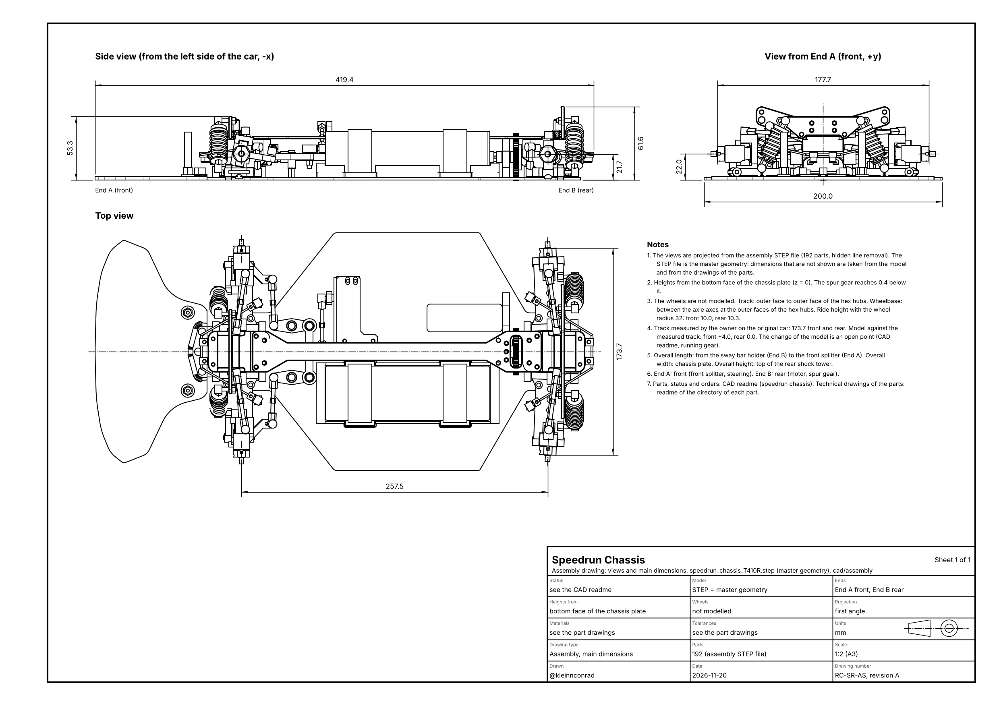

# Speedrun chassis: assembly drawing

## Table of contents
* [Overview](#overview)
* [Main dimensions](#main-dimensions)
* [Sheet](#sheet)
* [Files](#files)
* [Generating the drawing](#generating-the-drawing)

## Overview
* Assembly drawing of the speedrun chassis with the further own parts: views and main dimensions, one sheet A3, first angle projection, scale 1:2.
* The views are projected from the assembly STEP file (192 parts, hidden line removal). All dimensions are read from the model.
* Views: side view from the left side of the car (End A left), top view below it, view from End A (front) right of it.
* The wheels are not modelled. Heights are measured from the bottom face of the chassis plate (z = 0).
* Description of the assembly, parts and status: [CAD readme](../readme.md#speedrun-chassis).
* This page is generated by `scripts/cad/generate_assembly_drawing.py`.

## Main dimensions
| Dimension | Value (mm) | Reference |
|:---|:---|:---|
| Overall length | 419.4 | Sway bar holder (End B) to front splitter (End A) |
| Overall width | 200.0 | Chassis plate |
| Overall height | 61.6 | Bottom face of the chassis plate to the top of the rear shock tower |
| Wheelbase | 257.5 | Axle axes at the outer faces of the hex hubs |
| Track front (End A) | 177.7 | Outer face to outer face of the hex hubs |
| Track rear (End B) | 173.7 | Outer face to outer face of the hex hubs |
| Axle height front | 22.0 | From the bottom face of the chassis plate |
| Axle height rear | 21.7 | From the bottom face of the chassis plate |
| Height of the front shock tower | 53.3 | From the bottom face of the chassis plate |

Track measured by the owner on the original car: 173.7 mm front and rear (outer face to outer face of the hex hubs). The change of the model to this value is an open point.

## Sheet



## Files
| File | Content |
|:---|:---|
| `speedrun_chassis_T410R_technical_drawing.pdf` | Assembly drawing, 1 sheet A3 |
| `speedrun_chassis_T410R_technical_drawing_sheet_1.png` | The sheet as an image (150 dpi) |
| `speedrun_chassis_T410R.step` | Assembly (master geometry), generated by `scripts/cad/generate_speedrun_assembly.py` |

## Generating the drawing
The drawing is generated from the assembly STEP file (from the root directory of the repository; packages cadquery and matplotlib). After a change of the assembly, `generate_speedrun_assembly.py` runs first, then:

```bash
python scripts/cad/generate_assembly_drawing.py
```

The option `--date` sets the date in the title block.
