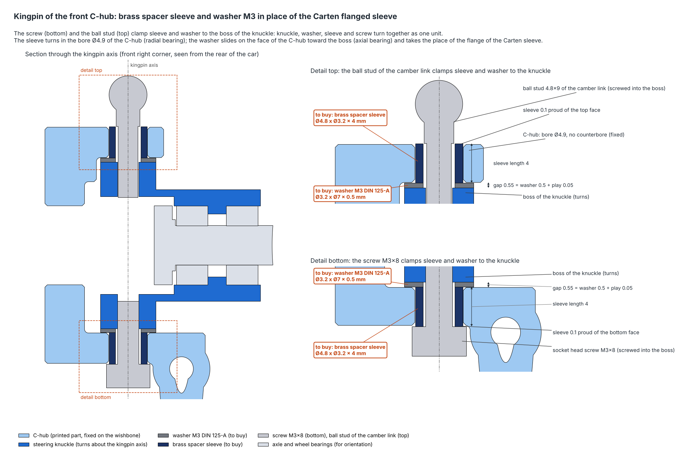
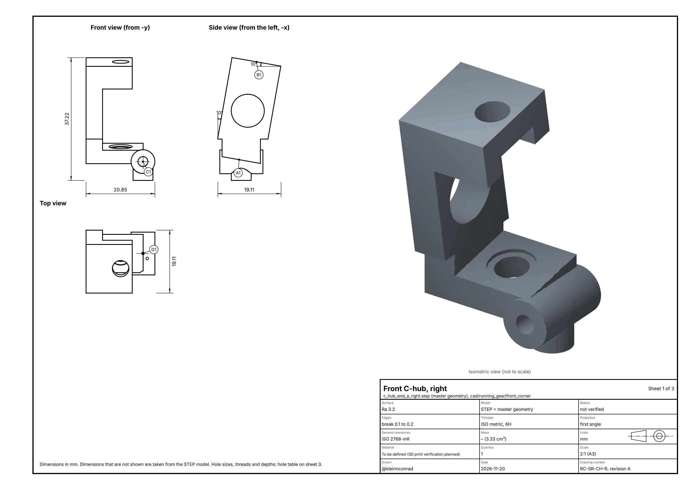
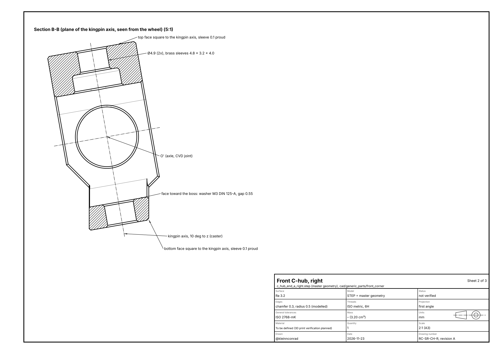
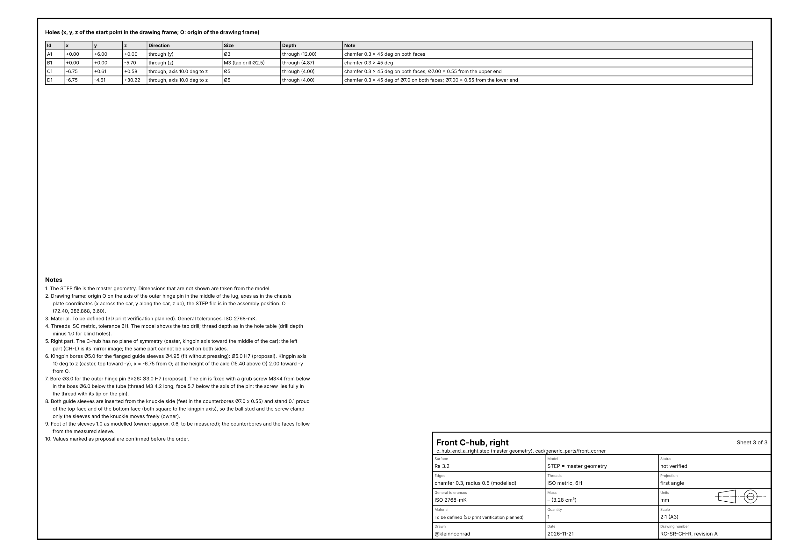
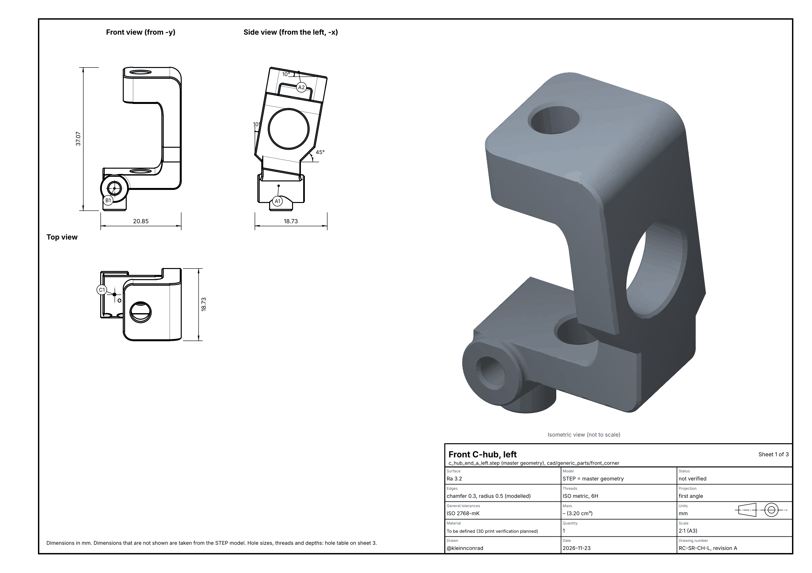
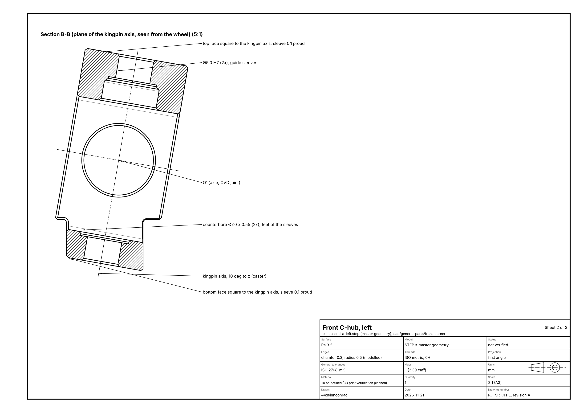
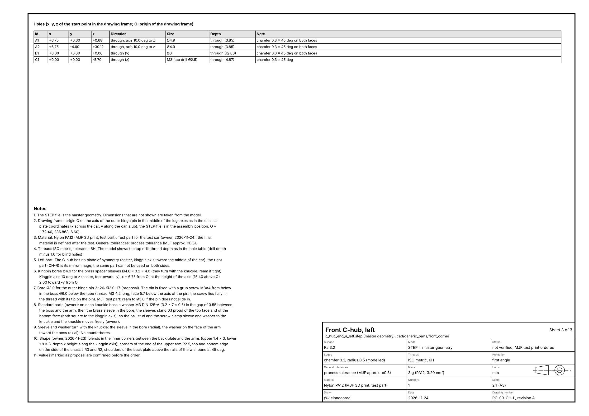
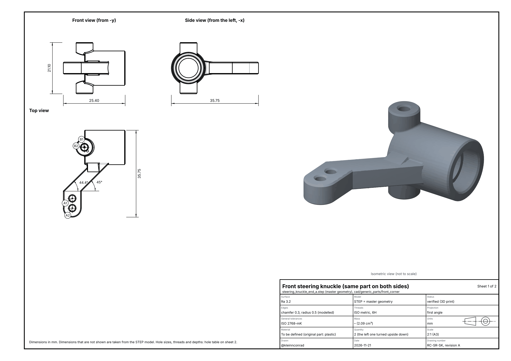
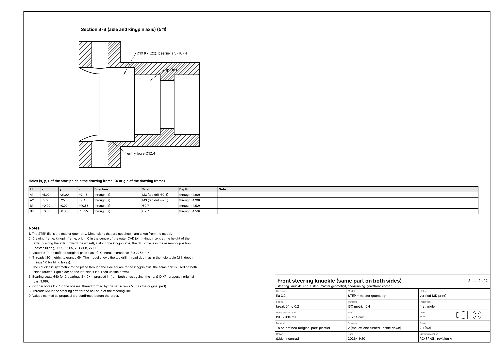

# Front corner: technical drawings of the C-hubs and the steering knuckle

## Table of contents
* [Kingpin of the C-hub: sleeves and washers to buy](#kingpin-of-the-c-hub-sleeves-and-washers-to-buy)
* [Overview](#overview)
* [Front C-hub, right](#front-c-hub-right)
* [Front C-hub, left](#front-c-hub-left)
* [Front steering knuckle (same part on both sides)](#front-steering-knuckle-same-part-on-both-sides)
* [Files](#files)
* [Generating the drawings](#generating-the-drawings)

## Kingpin of the C-hub: sleeves and washers to buy
Owner (2026-11-22): the knuckle mounts to the C-hub with standard parts instead of the Carten flanged sleeves. Per kingpin a plain brass spacer sleeve and a washer M3 take the place of the flanged sleeve.

**Parts to buy for the kingpins (per car: 2 C-hubs, 2 knuckles):**

| Quantity per car | Part | Size | Note |
|:---|:---|:---|:---|
| **4** | **Brass spacer sleeve without thread** (German: Distanzhülse or Distanzrolle, Messing, for M3) | **Ø4.8 mm outside, Ø3.2 mm inside, 4.0 mm long** | 2 per C-hub. Length 4.0 to 4.1 mm: the sleeve stands 0.1 mm proud of the C-hub; at 3.9 mm or less the screw head or the ball stud presses on the C-hub. A length of 4.0 mm was not found as a stock part in a web search (2026-11-22): RS PRO sells Ø4.8 x Ø3.2 mm in the lengths 6, 10, 20 and 25 mm (6 mm: RS 606-759); no listing was found for Conrad, Bauhaus or Hornbach (to be checked in the store). Shorten a 6 mm sleeve to 4.0 mm (see below). |
| **4** | **Washer M3 DIN 125-A (ISO 7089)** | **Ø3.2 mm inside, Ø7 mm outside, 0.5 mm thick** | 2 per C-hub. Steel or stainless steel; no plastic washers (other thickness). Standard part at DIY stores and Conrad. |
| 2 | Socket head screw M3x8 DIN 912 (ISO 4762) | M3 x 8 mm | Bottom kingpin, 1 per C-hub. Not M3x10: it reaches into the entry bore of the knuckle. |
| 2 | Ball stud 4.8x9 of the camber link | Ball Ø4.8 mm, thread M3 | Top kingpin, 1 per C-hub (as the original part). |

Shortening a 6 mm sleeve to 4.0 mm: file or grind one end face flat and square to the axis, deburr the bore and the outer edge, check the length with a caliper (4.0 to 4.1 mm).



How it works:
* The Carten sleeve has a shank and a flange in one piece: the shank turns in the bore of the C-hub, the flange runs on the arm of the C-hub.
* Here the washer takes the place of the flange: the washer lies on the boss of the knuckle, the sleeve lies on the washer and passes through the bore of the C-hub.
* The screw M3x8 (bottom) and the ball stud (top) are screwed into the bores 2.7 mm of the knuckle bosses (thread formed by the screw) and clamp sleeve and washer to the boss. Knuckle, washer, sleeve and screw turn together as one unit.
* Radial bearing: the sleeve Ø4.8 mm turns in the bore Ø4.9 mm of the C-hub. Axial bearing: the washer slides on the face of the C-hub arm toward the boss.
* Gap between the boss and the C-hub: 0.55 mm = washer 0.5 mm + play 0.05 mm. The C-hub has no counterbores.
* The sleeves stand 0.1 mm proud of the top face and of the bottom face of the C-hub: the screw head and the ball stud bear only on the sleeve, the knuckle moves freely.

Assembly:
1. Put a washer on each boss of the knuckle (a little grease holds it).
2. Slide the knuckle with the washers into the C-hub from the wheel side.
3. Insert the sleeves into the bores of the C-hub from above and from below, onto the washers.
4. Screw in the ball stud (top) and the screw M3x8 (bottom). The knuckle must turn freely; if it does not, check the length of the sleeves and ream the bore Ø4.9 mm.
5. Press in the bearings and insert the axle.

## Overview
* Technical drawings for manufacturing. The views and sections are projected from the STEP files (hidden line removal); the hole table is read from the STEP files.
* The STEP file is the master geometry. Dimensions that are not shown on the drawing are taken from the model.
* Format: A3 landscape, first angle projection, scale per part (title block). The PDF files are for printing and for the order, the PNG files show the sheets on this page.
* Description, sources and status of the parts: [CAD readme](../../readme.md#running-gear).
* Values marked as proposal on the drawings (fits, materials to be defined) are confirmed before the order.
* This page is generated by `scripts/cad/generate_technical_drawings.py`.

## Front C-hub, right
Material: To be defined (3D print verification planned). Quantity: 1. Status: not verified. Scale of the views: 2:1. 4 holes in the hole table.

**Sheet 1:** views, main dimensions, labels of the holes



**Sheet 2:** sections



**Sheet 3:** hole table and notes



## Front C-hub, left
Material: To be defined (3D print verification planned). Quantity: 1. Status: not verified. Scale of the views: 2:1. 4 holes in the hole table.

**Sheet 1:** views, main dimensions, labels of the holes



**Sheet 2:** sections



**Sheet 3:** hole table and notes



## Front steering knuckle (same part on both sides)
Material: To be defined (original part: plastic). Quantity: 2 (the left one turned upside down). Status: verified (3D print). Scale of the views: 2:1. 4 holes in the hole table.

**Sheet 1:** views, main dimensions, labels of the holes



**Sheet 2:** sections, hole table and notes



## Files
| File | Content |
|:---|:---|
| `c_hub_end_a_right_technical_drawing.pdf` | Front C-hub, right: technical drawing, 3 sheets A3 |
| `c_hub_end_a_right_technical_drawing_sheet_1.png`, `c_hub_end_a_right_technical_drawing_sheet_2.png`, `c_hub_end_a_right_technical_drawing_sheet_3.png` | The sheets as images (150 dpi) |
| `c_hub_end_a_right.step` | Master geometry of the part |
| `c_hub_end_a_left_technical_drawing.pdf` | Front C-hub, left: technical drawing, 3 sheets A3 |
| `c_hub_end_a_left_technical_drawing_sheet_1.png`, `c_hub_end_a_left_technical_drawing_sheet_2.png`, `c_hub_end_a_left_technical_drawing_sheet_3.png` | The sheets as images (150 dpi) |
| `c_hub_end_a_left.step` | Master geometry of the part |
| `steering_knuckle_end_a_technical_drawing.pdf` | Front steering knuckle (same part on both sides): technical drawing, 2 sheets A3 |
| `steering_knuckle_end_a_technical_drawing_sheet_1.png`, `steering_knuckle_end_a_technical_drawing_sheet_2.png` | The sheets as images (150 dpi) |
| `steering_knuckle_end_a.step` | Master geometry of the part |
| `kingpin_sleeves_and_washers.png` | Explanation picture of the kingpin: section through the kingpin axis with the sleeves and the washers to buy |

## Generating the drawings
The drawings are generated from the STEP files (from the root directory of the repository; packages cadquery and matplotlib). After a change of a part, its generator runs first, then:

```bash
python scripts/cad/generate_technical_drawings.py
```

The option `--part` generates the drawings of the given parts (keys separated by commas: `c_hub`, `c_hub_left`, `steering_knuckle`), the option `--date` sets the date in the title block.

The explanation picture of the kingpin is generated from the assembly STEP file (after `scripts/cad/generate_speedrun_assembly.py`):

```bash
python scripts/cad/generate_kingpin_stack_drawing.py
```
