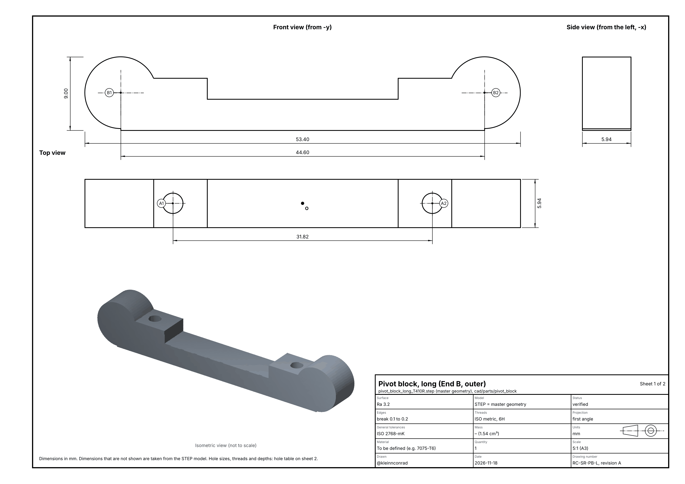
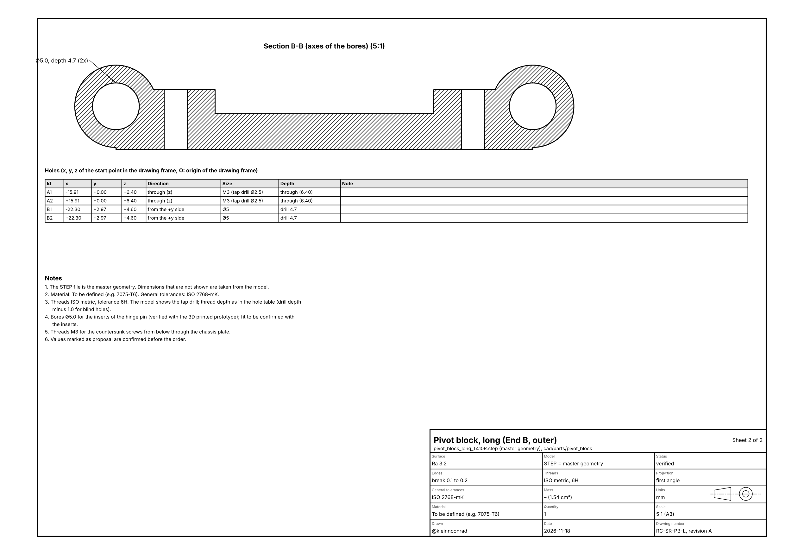
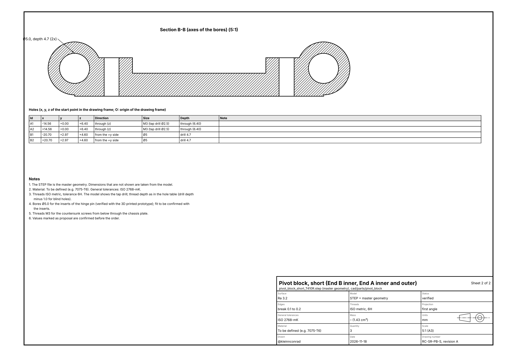

# Pivot blocks: technical drawings

## Table of contents
* [Overview](#overview)
* [Pivot block, long (End B, outer)](#pivot-block-long-end-b-outer)
* [Pivot block, short (End B inner, End A inner and outer)](#pivot-block-short-end-b-inner-end-a-inner-and-outer)
* [Files](#files)
* [Generating the drawings](#generating-the-drawings)

## Overview
* Technical drawings for manufacturing. The views and sections are projected from the STEP files (hidden line removal); the hole table is read from the STEP files.
* The STEP file is the master geometry. Dimensions that are not shown on the drawing are taken from the model.
* Format: A3 landscape, first angle projection, scale per part (title block). The PDF files are for printing and for the order, the PNG files show the sheets on this page.
* Description, sources and status of the parts: [CAD readme](../../readme.md#pivot-blocks).
* Values marked as proposal on the drawings (fits, materials to be defined) are confirmed before the order.
* This page is generated by `scripts/cad/generate_technical_drawings.py`.

## Pivot block, long (End B, outer)
Material: To be defined (e.g. 7075-T6). Quantity: 1. Status: verified. Scale of the views: 5:1. 4 holes in the hole table.

**Sheet 1:** views, main dimensions, labels of the holes



**Sheet 2:** sections, hole table and notes



## Pivot block, short (End B inner, End A inner and outer)
Material: To be defined (e.g. 7075-T6). Quantity: 3. Status: verified. Scale of the views: 5:1. 4 holes in the hole table.

**Sheet 1:** views, main dimensions, labels of the holes


**Sheet 2:** sections, hole table and notes



## Files
| File | Content |
|:---|:---|
| `pivot_block_long_T410R_technical_drawing.pdf` | Pivot block, long (End B, outer): technical drawing, 2 sheets A3 |
| `pivot_block_long_T410R_technical_drawing_sheet_1.png`, `pivot_block_long_T410R_technical_drawing_sheet_2.png` | The sheets as images (150 dpi) |
| `pivot_block_long_T410R.step` | Master geometry of the part |
| `pivot_block_short_T410R_technical_drawing.pdf` | Pivot block, short (End B inner, End A inner and outer): technical drawing, 2 sheets A3 |
| `pivot_block_short_T410R_technical_drawing_sheet_1.png`, `pivot_block_short_T410R_technical_drawing_sheet_2.png` | The sheets as images (150 dpi) |
| `pivot_block_short_T410R.step` | Master geometry of the part |

## Generating the drawings
The drawings are generated from the STEP files (from the root directory of the repository; packages cadquery and matplotlib). After a change of a part, its generator runs first, then:

```bash
python scripts/cad/generate_technical_drawings.py
```

The option `--part` generates the drawing of one part (keys: `pivot_block_long`, `pivot_block_short`), the option `--date` sets the date in the title block.
