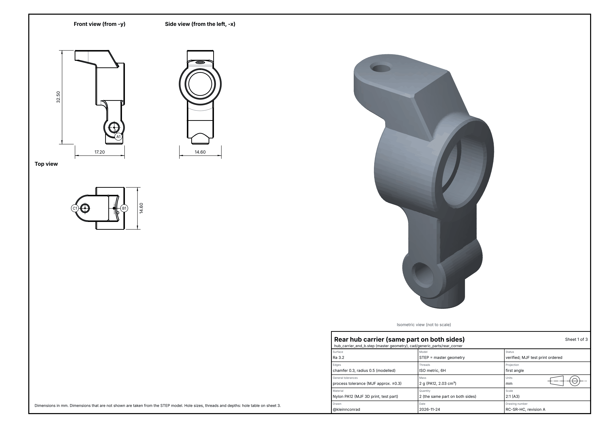
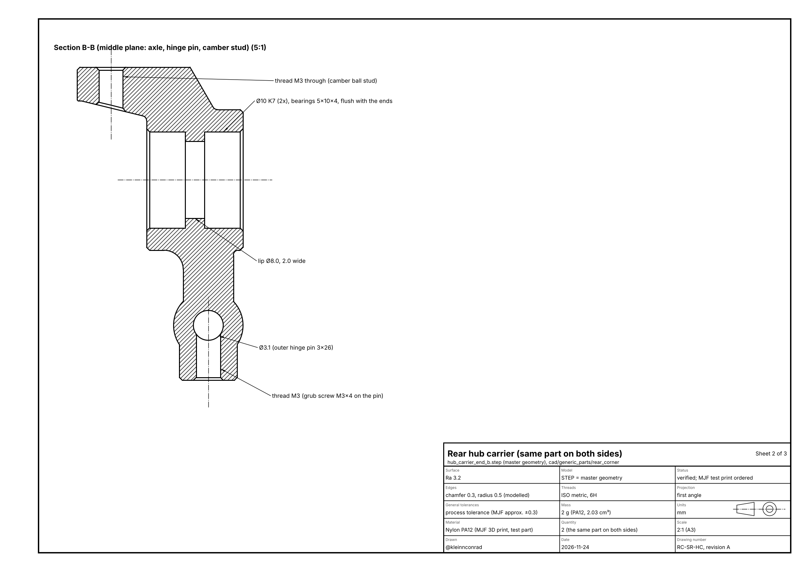
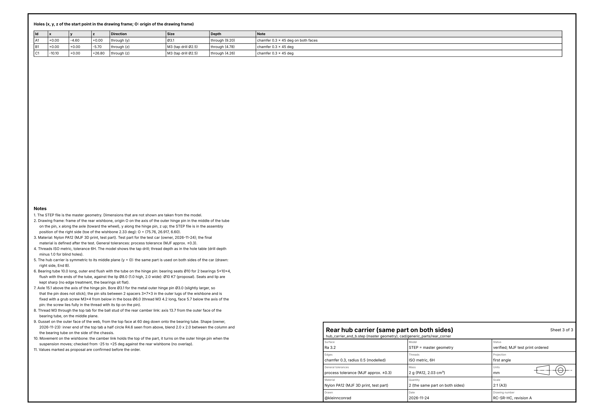

# Rear corner: technical drawing of the hub carrier

## Table of contents
* [Overview](#overview)
* [Rear hub carrier (same part on both sides)](#rear-hub-carrier-same-part-on-both-sides)
* [Files](#files)
* [Generating the drawings](#generating-the-drawings)

## Overview
* Technical drawings for manufacturing. The views and sections are projected from the STEP files (hidden line removal); the hole table is read from the STEP files.
* The STEP file is the master geometry. Dimensions that are not shown on the drawing are taken from the model.
* Format: A3 landscape, first angle projection, scale per part (title block). The PDF files are for printing and for the order, the PNG files show the sheets on this page.
* Description, sources and status of the parts: [CAD readme](../../readme.md#running-gear).
* Values marked as proposal on the drawings (fits, materials to be defined) are confirmed before the order.
* This page is generated by `scripts/cad/generate_technical_drawings.py`.

## Rear hub carrier (same part on both sides)
Material: Nylon PA12 (MJF 3D print, test part). Quantity: 2 (the same part on both sides). Status: verified; MJF test print ordered. Scale of the views: 2:1. 3 holes in the hole table.

**Sheet 1:** views, main dimensions, labels of the holes



**Sheet 2:** sections



**Sheet 3:** hole table and notes



## Files
| File | Content |
|:---|:---|
| `hub_carrier_end_b_technical_drawing.pdf` | Rear hub carrier (same part on both sides): technical drawing, 3 sheets A3 |
| `hub_carrier_end_b_technical_drawing_sheet_1.png`, `hub_carrier_end_b_technical_drawing_sheet_2.png`, `hub_carrier_end_b_technical_drawing_sheet_3.png` | The sheets as images (150 dpi) |
| `hub_carrier_end_b.step` | Master geometry of the part |

## Generating the drawings
The drawings are generated from the STEP files (from the root directory of the repository; packages cadquery and matplotlib). After a change of a part, its generator runs first, then:

```bash
python scripts/cad/generate_technical_drawings.py
```

The option `--part` generates the drawings of the given parts (keys separated by commas: `hub_carrier`), the option `--date` sets the date in the title block.
