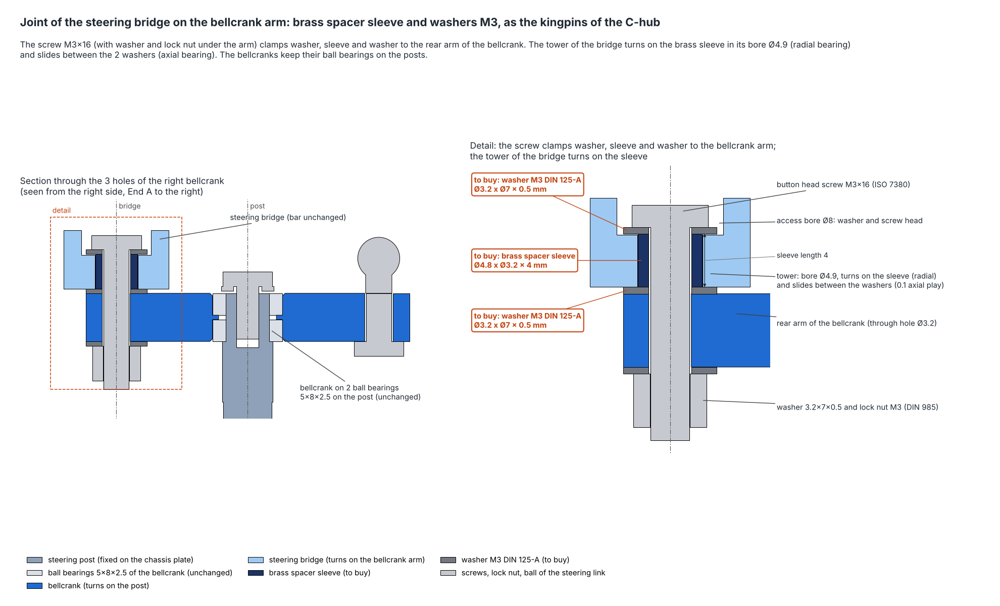
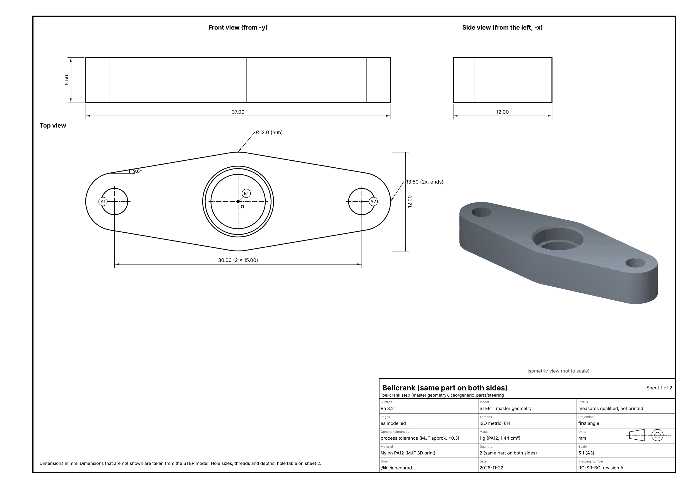
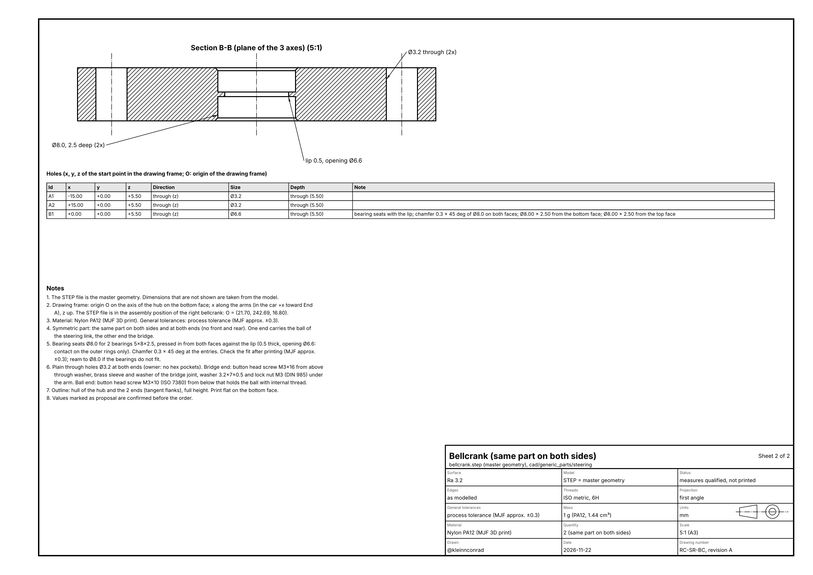
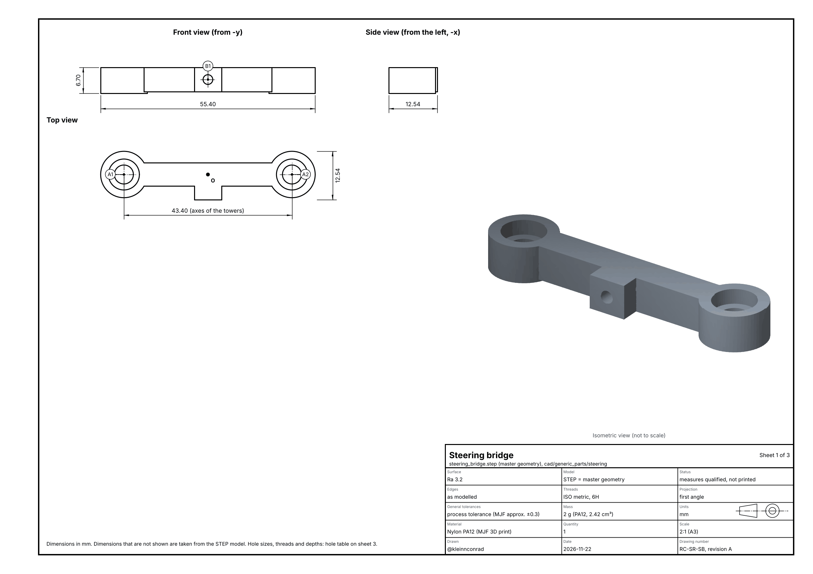
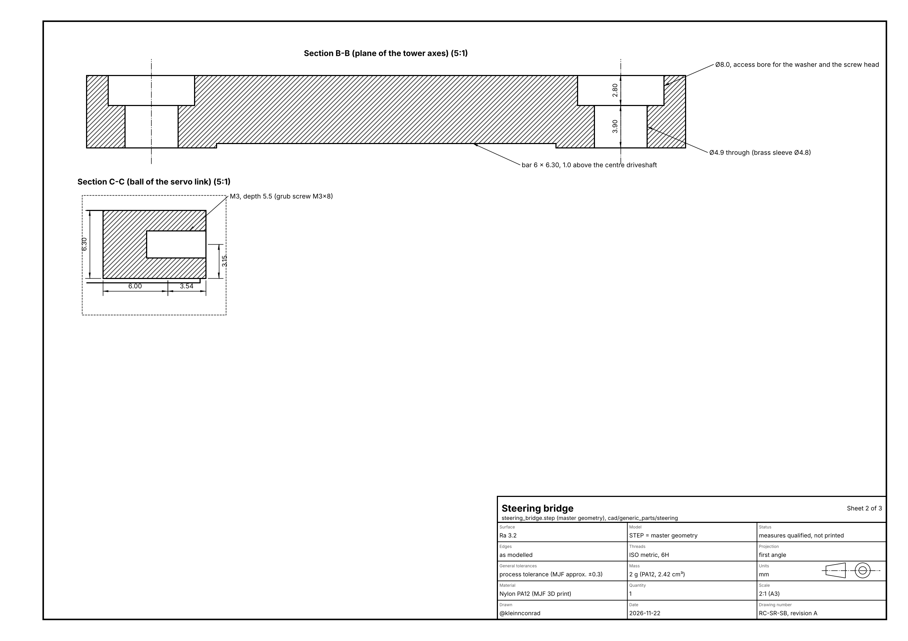
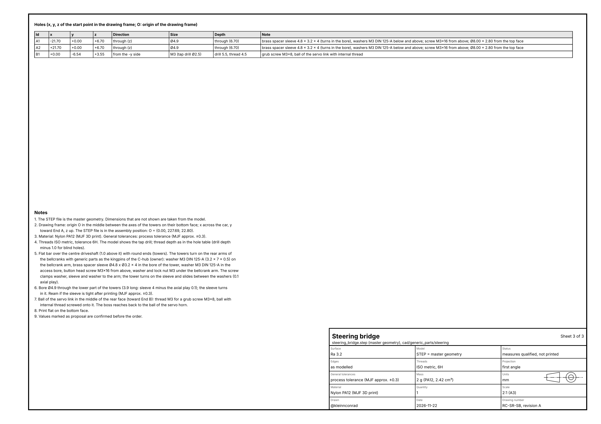
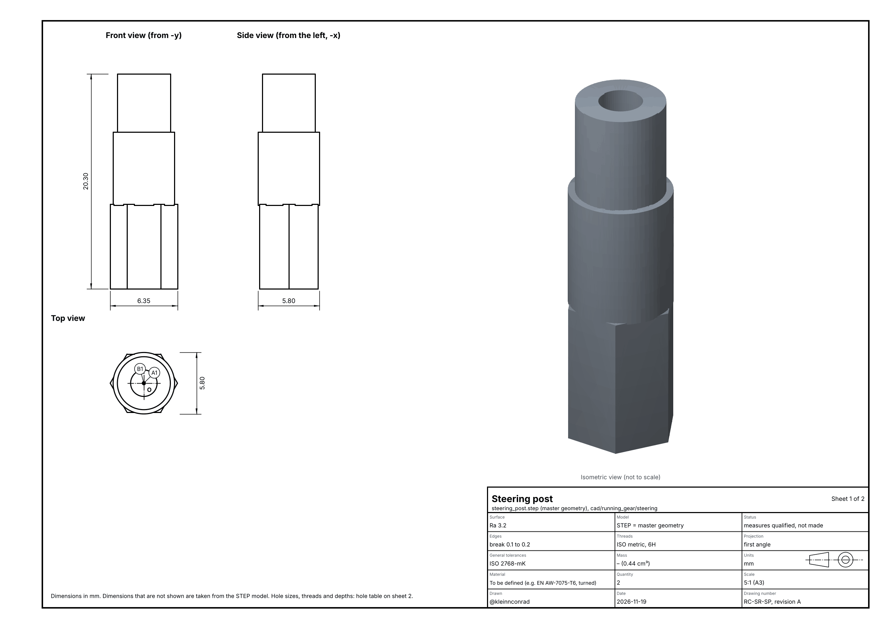
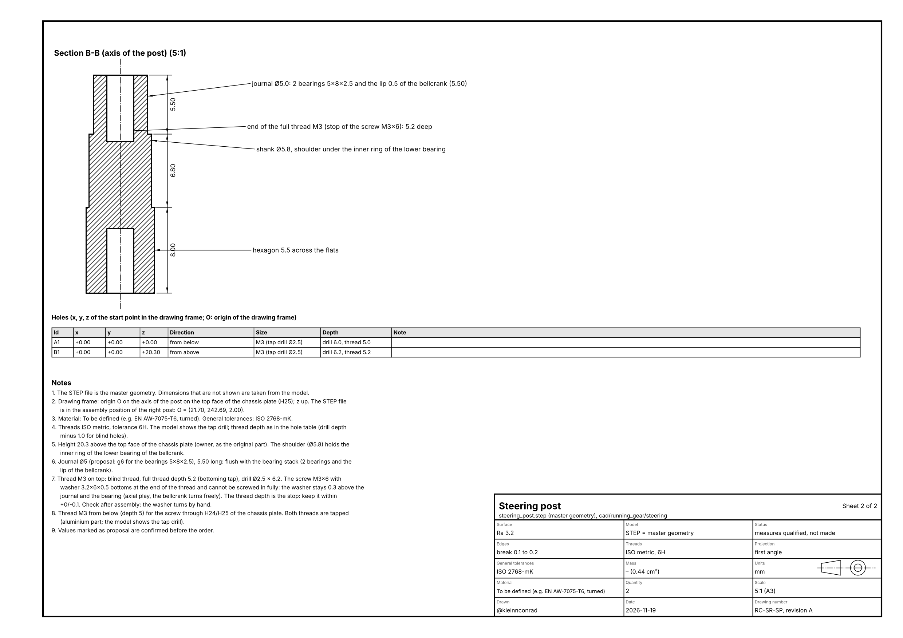

# Steering: technical drawings of the bellcrank, the steering bridge and the steering post

## Table of contents
* [Bridge joint: sleeves and washers to buy](#bridge-joint-sleeves-and-washers-to-buy)
* [Overview](#overview)
* [Bellcrank (same part on both sides)](#bellcrank-same-part-on-both-sides)
* [Steering bridge](#steering-bridge)
* [Steering post](#steering-post)
* [Files](#files)
* [Generating the drawings](#generating-the-drawings)

## Bridge joint: sleeves and washers to buy
Owner (2026-11-22): the steering bridge turns on the rear arms of the bellcranks with the same generic parts as the kingpins of the C-hub ([front corner](../front_corner/readme.md#kingpin-of-the-c-hub-sleeves-and-washers-to-buy)) instead of the flanged bearings MF63ZZ. The bellcranks keep their ball bearings 5x8x2.5 on the steering posts. The geometry of the steering is unchanged: only the towers of the bridge get a bore Ø4.9 instead of the bearing seats and reach 0.4 mm lower (onto the washer on the bellcrank arm).

**Parts to buy for the 2 bridge joints (per car):**

| Quantity per car | Part | Size | Note |
|:---|:---|:---|:---|
| **2** | **Brass spacer sleeve without thread** (German: Distanzhülse or Distanzrolle, Messing, for M3) | **Ø4.8 mm outside, Ø3.2 mm inside, 4.0 mm long** | 1 per joint; the same sleeve as at the C-hub. Length 4.0 to 4.1 mm: at 3.9 mm or less the upper washer presses on the tower. 4.0 mm is not a stock length (web search, 2026-11-22): shorten a 6 mm sleeve (RS PRO, RS 606-759) as described for the C-hub. |
| **6** | **Washer M3 DIN 125-A (ISO 7089)** | **Ø3.2 mm inside, Ø7 mm outside, 0.5 mm thick** | 3 per joint: on the bellcrank arm, in the access bore of the tower, under the bellcrank arm. Steel or stainless steel. |
| 2 | Button head screw M3x16 ISO 7380 | M3 x 16 mm | 1 per joint, from above (before: M3x18). |
| 2 | Lock nut M3 DIN 985 | M3 | 1 per joint, under the bellcrank arm (as before). |

No longer needed: 4 flanged bearings MF63ZZ, 4 shims 3x5x0.3, 2 screws M3x18.



How it works:
* The screw M3x16 from above, with a washer and the lock nut under the arm, clamps washer, sleeve and washer to the rear arm of the bellcrank.
* Radial bearing: the tower of the bridge turns on the sleeve Ø4.8 mm in its bore Ø4.9 mm. Axial bearing: the tower slides between the lower washer (on the bellcrank arm) and the upper washer (in the access bore Ø8 mm), with 0.1 mm axial play.
* The upper washer and the screw head lie in the access bore, below the top face of the bridge.

Assembly (per joint):
1. Put a washer on the rear arm of the bellcrank, over the hole.
2. Set the tower of the bridge on the washer.
3. Insert the sleeve into the bore of the tower from above, onto the washer.
4. Put a washer into the access bore onto the sleeve and insert the screw M3x16 from above through washer, sleeve, washer and the bellcrank arm.
5. Washer and lock nut under the arm, tighten. The bridge must turn freely on both bellcranks; if it does not, check the length of the sleeves and ream the bore Ø4.9 mm.

## Overview
* Technical drawings for manufacturing. The views and sections are projected from the STEP files (hidden line removal); the hole table is read from the STEP files.
* The STEP file is the master geometry. Dimensions that are not shown on the drawing are taken from the model.
* Format: A3 landscape, first angle projection, scale per part (title block). The PDF files are for printing and for the order, the PNG files show the sheets on this page.
* Description, sources and status of the parts: [CAD readme](../../readme.md#running-gear).
* Values marked as proposal on the drawings (fits, materials to be defined) are confirmed before the order.
* This page is generated by `scripts/cad/generate_technical_drawings.py`.

## Bellcrank (same part on both sides)
Material: Nylon PA12 (MJF 3D print). Quantity: 2 (same part on both sides). Status: measures qualified, not printed. Scale of the views: 5:1. 3 holes in the hole table.

**Sheet 1:** views, main dimensions, labels of the holes



**Sheet 2:** sections, hole table and notes



## Steering bridge
Material: Nylon PA12 (MJF 3D print). Quantity: 1. Status: measures qualified, not printed. Scale of the views: 2:1. 3 holes in the hole table.

**Sheet 1:** views, main dimensions, labels of the holes



**Sheet 2:** sections



**Sheet 3:** hole table and notes



## Steering post
Material: To be defined (e.g. EN AW-7075-T6, turned). Quantity: 2. Status: measures qualified, not made. Scale of the views: 5:1. 2 holes in the hole table.

**Sheet 1:** views, main dimensions, labels of the holes



**Sheet 2:** sections, hole table and notes



## Files
| File | Content |
|:---|:---|
| `bellcrank_technical_drawing.pdf` | Bellcrank (same part on both sides): technical drawing, 2 sheets A3 |
| `bellcrank_technical_drawing_sheet_1.png`, `bellcrank_technical_drawing_sheet_2.png` | The sheets as images (150 dpi) |
| `bellcrank.step` | Master geometry of the part |
| `steering_bridge_technical_drawing.pdf` | Steering bridge: technical drawing, 3 sheets A3 |
| `steering_bridge_technical_drawing_sheet_1.png`, `steering_bridge_technical_drawing_sheet_2.png`, `steering_bridge_technical_drawing_sheet_3.png` | The sheets as images (150 dpi) |
| `steering_bridge.step` | Master geometry of the part |
| `steering_post_technical_drawing.pdf` | Steering post: technical drawing, 2 sheets A3 |
| `steering_post_technical_drawing_sheet_1.png`, `steering_post_technical_drawing_sheet_2.png` | The sheets as images (150 dpi) |
| `steering_post.step` | Master geometry of the part |
| `bridge_joint_sleeves_and_washers.png` | Explanation picture of the bridge joint: section with the sleeve and the washers to buy |

## Generating the drawings
The drawings are generated from the STEP files (from the root directory of the repository; packages cadquery and matplotlib). After a change of a part, its generator runs first, then:

```bash
python scripts/cad/generate_technical_drawings.py
```

The option `--part` generates the drawings of the given parts (keys separated by commas: `bellcrank`, `steering_bridge`, `steering_post`), the option `--date` sets the date in the title block.

The explanation picture of the bridge joint is generated from the assembly STEP file (after `scripts/cad/generate_speedrun_assembly.py`):

```bash
python scripts/cad/generate_bridge_joint_drawing.py
```
