# CAD and 3D print files

## Table of contents
* [Overview](#overview)
* [Speedrun chassis](#speedrun-chassis)
  * [Parts of the speedrun chassis](#parts-of-the-speedrun-chassis)
  * [Assembly file](#assembly-file)
* [Speedrun chassis plate (wide) with longer motor window](#speedrun-chassis-plate-wide-with-longer-motor-window)
  * [Design of the speedrun chassis plate](#design-of-the-speedrun-chassis-plate)
  * [Longer motor window for a 3660 motor](#longer-motor-window-for-a-3660-motor)
  * [Measurement basis and test print](#measurement-basis-and-test-print)
  * [Print template](#print-template)
  * [Files and coordinate system of the speedrun chassis plate](#files-and-coordinate-system-of-the-speedrun-chassis-plate)
* [Speedrun top brace](#speedrun-top-brace)
  * [Design and fit of the speedrun top brace](#design-and-fit-of-the-speedrun-top-brace)
  * [Files and open points of the speedrun top brace](#files-and-open-points-of-the-speedrun-top-brace)
* [Lower bulkhead](#lower-bulkhead)
  * [Interfaces and files of the lower bulkhead](#interfaces-and-files-of-the-lower-bulkhead)
  * [Measurement basis and test print of the lower bulkhead](#measurement-basis-and-test-print-of-the-lower-bulkhead)
  * [Design of the lower bulkhead](#design-of-the-lower-bulkhead)
  * [Open points of the lower bulkhead](#open-points-of-the-lower-bulkhead)
* [Upper bulkhead (new design)](#upper-bulkhead-new-design)
  * [Interfaces and design of the upper bulkhead](#interfaces-and-design-of-the-upper-bulkhead)
  * [Files and measurement sheet of the upper bulkhead](#files-and-measurement-sheet-of-the-upper-bulkhead)
  * [Open points of the upper bulkhead](#open-points-of-the-upper-bulkhead)
* [Speedrun shock towers](#speedrun-shock-towers)
  * [Design and fit of the speedrun shock towers](#design-and-fit-of-the-speedrun-shock-towers)
  * [Files and open points of the speedrun shock towers](#files-and-open-points-of-the-speedrun-shock-towers)
* [Speedrun front splitter](#speedrun-front-splitter)
  * [Design of the speedrun front splitter](#design-of-the-speedrun-front-splitter)
  * [Files and open points of the speedrun front splitter](#files-and-open-points-of-the-speedrun-front-splitter)
* [Speedrun battery tray](#speedrun-battery-tray)
  * [Design of the speedrun battery tray](#design-of-the-speedrun-battery-tray)
  * [Files and open points of the speedrun battery tray](#files-and-open-points-of-the-speedrun-battery-tray)
* [Further own parts](#further-own-parts)
  * [Pivot blocks](#pivot-blocks)
  * [Centre driveshaft and drive line](#centre-driveshaft-and-drive-line)
  * [Differentials](#differentials)
  * [Wishbones](#wishbones)
  * [Running gear](#running-gear)
* [Scripts](#scripts)
  * [Regenerating the files](#regenerating-the-files)
  * [DXF generation](#dxf-generation)
* [3D printed parts](#3d-printed-parts)
* [Sources](#sources)

## Overview
This directory contains CAD data and 3D print files for the RC car **Carten T410R**:
* **`/speedrun_parts`**: Parts of the speedrun chassis, designed in this project (see [speedrun chassis](#speedrun-chassis)):
  * **`/chassis`**: CAD data of the speedrun chassis plate and the speedrun top brace:
    * **`/chassis_plate_speedrun_wide_motor10`**: Speedrun chassis plate (wide) with the longer motor window for a 3660 motor (STEP, STL, DXF, PDF template, geometry data, technical drawing)
    * **`/top_brace_speedrun`**: Speedrun top brace that matches the bulkheads of this project (STEP, STL, DXF, PDF templates, geometry data, hole table, test print STL files, technical drawing)
    * The other subdirectories contain source data of these two parts (see [scripts](#scripts)).
  * **`/bulkhead`**: CAD data of the bulkheads (gear boxes): lower bulkhead, upper bulkhead (new design) and the assembly of both parts (STEP, STL, test print STL, parameter files, measurement sheets, technical drawings; the drawings are shown in [`speedrun_parts/bulkhead/readme.md`](speedrun_parts/bulkhead/readme.md)).
  * **`/shock_tower`**: New design of the front and the rear shock tower that match the speedrun upper bulkhead (STEP, STL, DXF, PDF templates, geometry data, parameter file, hole table).
  * **`/front_splitter`**: Speedrun front splitter at End A, one part: the body post mount enlarged to the splitter (STEP, STL, test print STL, parameter file, measurement sheet).
  * **`/battery_tray`**: Speedrun battery tray for the 3S hardcase LiPo on the left side of the car (STEP, STL, parameter file, technical drawing).
* **`/generic_parts`**: Drive line, pivot blocks, wishbones and running gear: own design of the owner, partly based on the T410R (see [further own parts](#further-own-parts)). Camber links: purchased parts, simplified model for the assembly. The directory contains the parameter file of the running gear, the measurement sheet of the parts and one subdirectory per group (overview in [`generic_parts/readme.md`](generic_parts/readme.md)):
  * **`/pivot_block`**: Pivot blocks of the wishbones (STEP, STL, parameter file).
  * **`/driveshaft`**: Centre driveshaft with the fixed metal pins and the cup joints (STEP, STL, parameter file of all drive line parts).
  * **`/rear_drive`**: Rear pinion shaft with flange, pinion 17T, spur gear 72T, bearing 5x10x4 and retaining pin (STEP, STL).
  * **`/front_drive`**: Front pinion shaft (STEP, STL).
  * **`/motor_mount`**: Motor mount for 540 motors and its cap (STEP, STL).
  * **`/diff`**: Differential case, ring gear 42T and bearing (STEP, STL).
  * **`/diff_outdrive`**: Diff outdrive (STEP, STL).
  * **`/wishbone`**: Front and rear wishbones and the inner hinge pin (STEP, STL, parameter file).
  * **`/camber_link`**: Camber links (purchased parts), simplified model for the assembly: turnbuckle, rod end, ball stud, assembled front and rear link (STEP, STL, parameter file).
  * **`/front_corner`**: C-hubs with caster, steering knuckles, axles and hex hubs at End A (STEP, STL).
  * **`/rear_corner`**: Hub carriers, axles and hex hubs at End B (STEP, STL).
  * **`/cvd_drive_shafts`**: CVD drive shafts (STEP, STL).
  * **`/steering`**: Steering posts, bellcranks, steering bridge, spacers and servo horn (STEP, STL).
  * **`/servo_mount`**: Floating servo mount (STEP, STL).
  * **`/sway_bars`**: Sway bars with drop links (STEP, STL).
* **`/assembly`**: Assembly of the speedrun chassis: chassis plate, bulkheads, top brace and shock towers, completed with the further own parts (pivot blocks, drive line, wishbones and running gear) and the purchased camber links (STEP), and the assembly drawing with the views and the main dimensions (PDF, PNG, shown in [`assembly/readme.md`](assembly/readme.md)).
* **`/studies`**: Design studies that are not part of the build, one subdirectory per study with its own readme:
  * **`/dual_motor`**: Dual motor mount for 2 motors on the spur gear and a chassis plate with a second motor window on the left side (STEP, STL, geometry data, pictures, script).
  * **`/rear_fork_carrier`**: Rear hub carrier with a fork on a tongue of the rear wishbone (design concept E of the owner): grub screw from below in the middle of the tongue, shims set the wheelbase from 256.0 to 259.0 mm, the rear wishbone as a light A-frame with a right and a left part (5.1 g instead of 7.9 g in PA12) (STEP, STL, pictures, script).
* **`/3d_print_fdm`**: STL files of 3D printed parts (FDM) for the car and a maintenance stand (see [3D printed parts](#3d-printed-parts))
* **Technical drawings** (PDF, one PNG per sheet) of the verified parts, the wishbones and the C-hubs (right and left) are stored in the directory of each part. A readme in each directory shows the sheets: [bulkheads](speedrun_parts/bulkhead/readme.md), [speedrun chassis plate](speedrun_parts/chassis/chassis_plate_speedrun_wide_motor10/readme.md), [speedrun top brace](speedrun_parts/chassis/top_brace_speedrun/readme.md), [shock towers](speedrun_parts/shock_tower/readme.md), [pivot blocks](generic_parts/pivot_block/readme.md), [motor mount and cap](generic_parts/motor_mount/readme.md), [wishbones](generic_parts/wishbone/readme.md), [C-hub and steering knuckle](generic_parts/front_corner/readme.md), [front splitter](speedrun_parts/front_splitter/readme.md), [battery tray](speedrun_parts/battery_tray/readme.md), [steering](generic_parts/steering/readme.md), [servo mount](generic_parts/servo_mount/readme.md). The assembly drawing (views and main dimensions of the speedrun chassis) is shown in [`assembly/readme.md`](assembly/readme.md).
* **Colour scheme of the CAD pictures** (owner, 2026-11-20): blue and grey shades only, one colour per group of parts and the same in all pictures (assembly, running gear, drive line, bulkheads, shock towers, battery tray, front splitter, wishbones, studies), defined in `scripts/cad/palette.py`. Annotations (dimensions, labels, markers of new or closed holes) and the red and black battery wires (plus and minus) keep their own colours. The assembly picture has no legend.

Own files are not licensed for use by others, all rights are reserved (see the root readme). Third-party files are subject to the licenses of their authors (see [sources](#sources)). The preview images of all parts are stored in the `/photos` directory of the repository.

## Speedrun chassis
The speedrun chassis combines the parts that are designed in this project for speeds over 130 km/h; the assembly completes them with the further own parts (drive line, wishbones, running gear). The parts share their interfaces: the bulkheads are mounted on the hole patterns of the chassis plate, the top brace on the contact faces of both upper bulkheads, the shock towers on the shock tower walls of the upper bulkheads (front tower at End A, rear tower at End B), the front splitter on the holes H34 to H36 at the front end of the chassis plate (End A).

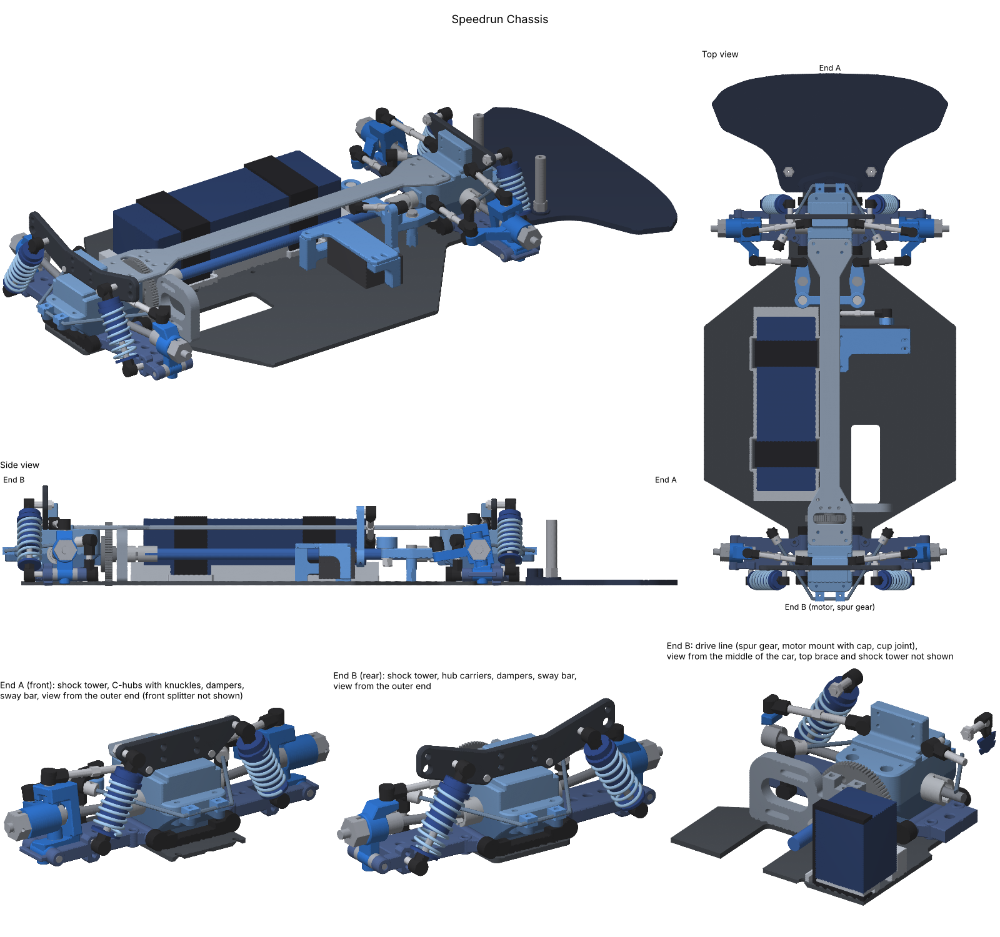

### Parts of the speedrun chassis
| Part | Quantity | Directory | Status | Order | Material | Mass |
|:---|---:|:---|:---|:---|:---|---:|
| [Speedrun chassis plate (wide) with longer motor window](#speedrun-chassis-plate-wide-with-longer-motor-window) | 1 | `/speedrun_parts/chassis/chassis_plate_speedrun_wide_motor10` | $\color{green}\checkmark$ Verified | CNC part (aluminium 6082) | Aluminium 6082 or carbon | 217 g (6082), 128 g (carbon) |
| [Lower bulkhead](#lower-bulkhead) | 2 | `/speedrun_parts/bulkhead` | $\color{green}\checkmark$ Verified | MJF 3D print (nylon PA12) | Nylon PA12 (MJF 3D print) | 2 x 12 g |
| [Upper bulkhead](#upper-bulkhead-new-design) | 2 | `/speedrun_parts/bulkhead` | $\color{green}\checkmark$ Verified | MJF 3D print (nylon PA12) | Nylon PA12 (MJF 3D print) | 2 x 19 g |
| [Speedrun top brace](#speedrun-top-brace) | 1 | `/speedrun_parts/chassis/top_brace_speedrun` | $\color{green}\checkmark$ Verified | Carbon plate (2D milling) | Carbon or 7075 | 14 g (carbon), 25 g (7075) |
| [Speedrun front shock tower](#speedrun-shock-towers) | 1 | `/speedrun_parts/shock_tower` | $\color{green}\checkmark$ Verified | Carbon plate (2D milling) | Carbon or 7075 | 4.4 g (carbon), 7.7 g (7075) |
| [Speedrun rear shock tower](#speedrun-shock-towers) | 1 | `/speedrun_parts/shock_tower` | $\color{green}\checkmark$ Verified | Carbon plate (2D milling) | Carbon or 7075 | 7.6 g (carbon), 13.4 g (7075) |
| [Speedrun front splitter (one part: body post mount enlarged to the splitter)](#speedrun-front-splitter) | 1 | `/speedrun_parts/front_splitter` | $\color{green}\checkmark$ Verified (3D print of the owner; bosses of the screws 3 mm higher after the print) | MJF 3D print (nylon PA12) | Nylon PA12 (MJF 3D print) | 38 g |
| [Speedrun battery tray (LiPo Absima GreenHorn 3S 5000 hardcase)](#speedrun-battery-tray) | 1 | `/speedrun_parts/battery_tray` | $\color{green}\checkmark$ Verified (owner) | – | Nylon PA12 (MJF 3D print) | 24 g |
| **Total** | | | | | Chassis plate 6082, bulkheads, front splitter and battery tray PA12, top brace and shock towers carbon | **368 g** |

Further own parts (own design of the owner, partly based on the T410R, not in the mass total):

| Part | Quantity | Directory | Status |
|:---|---:|:---|:---|
| [Pivot blocks of the wishbones](#pivot-blocks) (long and short block) | 4 | `/generic_parts/pivot_block` | $\color{green}\checkmark$ Verified |
| [Centre driveshaft with fixed metal pins](#centre-driveshaft-and-drive-line) | 1 | `/generic_parts/driveshaft` | $\color{gold}\blacktriangle$ Measures qualified, no 3D print verification |
| [Cup joints of the centre driveshaft](#centre-driveshaft-and-drive-line) | 2 | `/generic_parts/driveshaft` | $\color{red}\times$ Completely unqualified |
| [Rear pinion shaft with pinion 17T, spur gear 72T, bearings and retaining pin](#centre-driveshaft-and-drive-line) | 1 | `/generic_parts/rear_drive` | $\color{gold}\blacktriangle$ Measures qualified, no 3D print verification |
| [Front pinion shaft with pinion 17T, bearings and retaining pin](#centre-driveshaft-and-drive-line) | 1 | `/generic_parts/front_drive` | $\color{gold}\blacktriangle$ Measures qualified, no 3D print verification |
| [Motor mount with cap](#centre-driveshaft-and-drive-line) | 1 | `/generic_parts/motor_mount` | $\color{green}\checkmark$ Verified (test print; technically good; cosmetic changes after the print: smooth faces, round upper inner corner (R9)) |
| [Differential (End B) with ring gear 42T, inner gears and bearings](#differentials) | 1 | `/generic_parts/diff` | $\color{gold}\blacktriangle$ Measures qualified, no 3D print verification |
| [Spool (End A) with ring gear 42T and bearings](#differentials) | 1 | `/generic_parts/diff` | $\color{gold}\blacktriangle$ Measures qualified, no 3D print verification |
| [Diff outdrives](#centre-driveshaft-and-drive-line) | 4 | `/generic_parts/diff_outdrive` | $\color{red}\times$ Completely unqualified |
| [Front wishbones](#wishbones) | 2 | `/generic_parts/wishbone` | $\color{green}\checkmark$ Verified |
| [Rear wishbones](#wishbones) | 2 | `/generic_parts/wishbone` | $\color{green}\checkmark$ Verified |
| [Inner hinge pins of the wishbones (3x42)](#wishbones) | 4 | `/generic_parts/wishbone` | $\color{red}\times$ Completely unqualified |
| [Front C-hubs with 10 degrees caster (right and left part)](#running-gear) | 2 | `/generic_parts/front_corner` | $\color{red}\times$ Completely unqualified; kingpin bores 5 mm with guide sleeves (owner), 3D print verification planned |
| [Front steering knuckles](#running-gear) | 2 | `/generic_parts/front_corner` | $\color{green}\checkmark$ Verified (3D print of the owner) |
| [Rear hub carriers](#running-gear) | 2 | `/generic_parts/rear_corner` | $\color{gold}\blacktriangle$ Measures qualified, no 3D print verification |
| [Axles with joint cup, hex hubs 12 mm](#running-gear) | 4 + 4 | `/generic_parts/front_corner`, `/generic_parts/rear_corner` | $\color{red}\times$ Completely unqualified |
| [CVD drive shafts](#running-gear) | 4 | `/generic_parts/cvd_drive_shafts` | $\color{red}\times$ Completely unqualified |
| [Bellcranks (symmetric, the same part on both sides)](#running-gear) | 2 | `/generic_parts/steering` | $\color{gold}\blacktriangle$ Measures qualified, no 3D print verification; technical drawing |
| [Servo mount: top plate, fixed post, floating post; position of the servo and the horn](#running-gear) | 1 set | `/generic_parts/servo_mount` | $\color{green}\checkmark$ Verified (owner); the holes for the servo ears (positions assumed) are to be checked against the servo before printing; technical drawings |
| [Steering bridge (beam with 2 towers on flanged bearings MF63ZZ)](#running-gear) | 1 | `/generic_parts/steering` | $\color{gold}\blacktriangle$ Measures qualified, no 3D print verification; technical drawing |
| [Steering posts (height 20.3 mm, shoulder for the bellcrank bearings)](#running-gear) | 2 | `/generic_parts/steering` | $\color{gold}\blacktriangle$ Measures qualified, no 3D print verification; technical drawing |
| [Steering: steering links, servo link, servo horn](#running-gear) | 1 set | `/generic_parts/steering` | $\color{red}\times$ Completely unqualified |
| [Sway bars with holders, ball ends and drop links](#running-gear) | 2 | `/generic_parts/sway_bars` | $\color{red}\times$ Completely unqualified |
| [Dampers (standard 1:10 on-road, purchased)](#running-gear) | 4 | Assembly only | $\color{red}\times$ Completely unqualified |

Status: $\color{green}\checkmark$ verified (test print or on the car), $\color{gold}\blacktriangle$ measures qualified, no 3D print verification, $\color{red}\times$ completely unqualified. The parts marked red are first designs: they still need a lot of refinement (dimensions, strength, fit and function on the car) and are not ready for manufacturing.

* The masses are calculated from the volumes of the solid models (6082: 2.70 g/cm³, 7075: 2.81 g/cm³, carbon: 1.6 g/cm³, nylon PA12 (MJF): 1.01 g/cm³). Screws, bearings and the other parts of the car are not included.
* The bulkheads are the same parts at both ends. At End A, they are rotated by 180 degrees, so that both pinions point to the middle of the car.
* The end of the top brace with the obround is at End B (motor window, spur gear). End A is assumed to be the front (see [open points of the lower bulkhead](#open-points-of-the-lower-bulkhead)).

### Assembly file
* `assembly/speedrun_chassis_T410R.step`: assembly of the 10 parts of the speedrun chassis (with the front splitter and the battery tray), the battery with its 2 straps and 180 further parts (pivot blocks, wishbones with hinge pins, camber links, centre driveshaft with cup joints, front and rear drive line with pinions, bearings and retaining pins, spur gear, motor mount with cap, the differential with its inner parts and the spool, 4 diff outdrives, and the running gear: C-hubs, knuckles with guide sleeves and kingpin screws, hub carriers, axles, hex hubs, CVD drive shafts, steering, servo with the floating servo mount, dampers, sway bars with drop links; the 2 front body posts) in the coordinate system of the chassis plate (STEP AP214, one solid per part; the 3 shims behind each side gear are one solid).
* The further own parts are not in the mass total (see [further own parts](#further-own-parts)).
* The interference check of all pairs of parts gives 0 mm³, except 0.82 mm³ between the lower bulkhead at End B and the long pivot block (see [pivot blocks](#pivot-blocks)) and 4.47 mm³ between the lower bulkhead at End A and each front wishbone (the tube on the inner hinge pin reaches 0.14 mm into the side face, see [wishbones](#wishbones)).
* The assembly file and the image are generated with the script `generate_speedrun_assembly.py` (see [scripts](#scripts)) from the files of the parts.
* Assembly drawing `assembly/speedrun_chassis_T410R_technical_drawing.pdf` (one sheet A3, 1:2, first angle projection, shown in [`assembly/readme.md`](assembly/readme.md)): side view, top view and view from End A, projected from the assembly file, with the main dimensions read from the model: overall length 419.4 mm (overhang 123.0 mm front, 38.8 mm rear), width of the chassis plate 200.0 mm (overall width), height 61.6 mm (rear shock tower), wheelbase 257.5 mm, track 177.7 mm front and 173.7 mm rear, axle heights 22.0 mm front and 21.7 mm rear, ride height 10.0 mm front and 10.3 mm rear (tyres Ø64 mm as phantom lines, not modelled), front splitter 187.0 mm wide, front kingpin axes 131.3 mm apart, caster 10.0 degrees, rear toe-in 2.3 degrees on each side. Generated with the script `generate_assembly_drawing.py` after the assembly.
* The image shows an overall view, a side view, a top view and three close-ups:
  * both ends with the bulkheads, the shock tower, the corners of the running gear, the dampers and the sway bar, seen from the outer end;
  * the drive line at End B (spur gear, motor mount with cap, cup joint), seen from the middle of the car, without the top brace and the shock tower.

## Speedrun chassis plate (wide) with longer motor window
* **Author:** [@kleinnconrad](https://github.com/kleinnconrad)
* **Description:** Chassis plate of the speedrun chassis: wide middle section and a motor window for a 3660 motor. The hole pattern, the countersinks, the slot and both narrow ends are taken from the chassis plate of the T410R (see [measurement basis](#measurement-basis-and-test-print)).
* **Status:** $\color{green}\checkmark$ Verified. Order: CNC part (aluminium 6082). Technical drawing: [`speedrun_parts/chassis/chassis_plate_speedrun_wide_motor10/readme.md`](speedrun_parts/chassis/chassis_plate_speedrun_wide_motor10/readme.md).

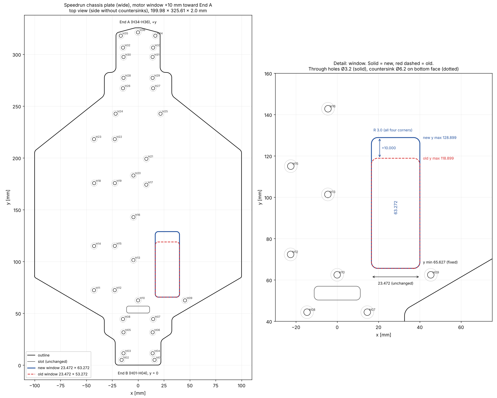

### Design of the speedrun chassis plate
| Property | Value |
|:---|:---|
| Size (width × length × thickness) | 199.98 × 325.6 × 2.0 mm |
| Holes | 36 through holes Ø3.2 mm (H01 to H36), countersunk Ø6.2 mm × 90° on the bottom face |
| Cutouts | Motor window 23.47 × 63.27 mm (corner radius 3.0 mm), slot approx. 22.3 × 6.7 mm |
| Volume | 80.2 cm³ |
| Mass | 217 g (aluminium 6082), 128 g (carbon) |

The outline (coordinate system see [files and coordinate system](#files-and-coordinate-system-of-the-speedrun-chassis-plate)):

| Section | Position (y) | Width |
|:---|:---|:---|
| End with the 2 × 2 hole pattern (H01 to H04, End B) | 0 to 55.3 mm | 99.98 mm (main section of the T410R plate) |
| Transition, 30.3° to the cross direction | 55.3 to 85.5 mm | Increases from 100 to 200 mm |
| Wide section | 85.5 to 205.0 mm | 199.98 mm |
| Transition, 38.4° to the cross direction | 205.0 to 246.5 mm | Decreases from 200 to 100 mm |
| End with the holes H34 to H36 (End A) | 246.5 to 325.6 mm | As the T410R plate |

* The wide section is 10 mm wider than the width over the tires (190 mm, `spec_cartent410r.yaml`) and the body width (190 mm, `spec_body.yaml`). It protrudes by 5 mm per side.
* The values are taken from the STL file.

### Longer motor window for a 3660 motor
* The motor of the car (Hobbywing 3660SL G2) has a diameter of 36 mm and a length of 60 mm (`specs/electronics/brushless_combo/spec_brushless_combo.yaml`). It is 10 mm longer than a 3650 motor. The motor window is therefore 10 mm longer than the window of the T410R plate (23.47 × 53.27 mm).

| Property | Value |
|:---|:---|
| Motor window (width × length) | 23.47 × 63.27 mm |
| Position of the window (x) | 16.59 to 40.06 mm |
| Position of the window (y) | 65.63 to 128.90 mm |
| Corner radius of the window | 3.0 mm |

* The window is extended only toward the end with the holes H34 to H36 (+y). The end edge at y = 65.63 mm is at the position of the T410R plate.
* Distance between the window and the countersink of hole H16 (Ø6.2 mm, bottom face): 23.3 mm. The countersinks of the holes H07, H09, H10 and H13 are closer to the window; their distances are the same as on the T410R plate.
* The preview image above shows the end of the shorter window as a red dashed line.

### Measurement basis and test print
* **Source:** the hole pattern, the countersinks, the slot and both narrow ends were taken from photos of the chassis plate of the T410R and scaled to caliper measurements: x by 1.00522 (width of the main section 99.98 mm), y by 1.00609 (distance between the holes H11 and H23 145.82 mm).
* **Holes:** through holes Ø3.2 mm, the clearance hole for M3 screws (measured on the original part: 3.18 mm). Two marks on the surface of the original part are not holes and are not modelled.
* **Test print:** a test print of the T410R plate (two halves with dovetails, home 3D printer) fitted the car: the holes at both ends align with the mounting points. This confirms the hole positions and the overall length of 325.6 mm (a ruler reading of 324 mm was too short). The wide section is not part of this test print.
* **Thickness:** the model has 2.0 mm. The chassis plate of the car measures 2.03 mm (the value of 2.25 mm in the chassis specification was wrong and is corrected in `specs/mechanics/carten_t410r/spec_cartent410r.yaml`). For manufacturing, the thickness is given by the sheet that is used.

### Print template
The 1:1 template `chassis_plate_T410R_speedrun_wide_motor10_1to1_A4x2_print97.pdf` (two A4 pages, landscape) is used to check the hole positions against the actual part.

* **Scale:** The drawing is pre-scaled to 103.09 % (100/97) for a PDF viewer that prints at 97 %. Printed at 97 %, the drawing is 1:1. Printed at 100 % ("actual size"), it is 3.1 % too large.
* **Scale check:** Each page has a 100 mm bar in x and a 100 mm bar in y. Both bars must measure 100 mm before the template is used. After joining the pages, the distance between the centres of the holes H11 and H23 is 145.82 mm.
* **Joining:** Page 2 is laid over page 1 so that the two blue dashed lines of the 20 mm overlap zone coincide. The holes H16 to H20 are shown on both pages.
* **Orientation:** The template shows the top view (side without countersinks). The part is placed with the countersinks facing down.
* **Content:** Outline, motor window and slot (black), through holes Ø3.2 mm with centre cross (red), countersinks Ø6.2 mm on the bottom face (dashed), the narrow outline of the T410R plate (grey, dashed) and the end of the shorter window (green, dashed).
* The positions were checked on raster images with 600 dpi: all 36 holes deviate by less than 0.06 mm from the geometry data, the window ends by less than 0.05 mm.
* The template is generated with `scripts/cad/generate_print_template.py --plate motor10`. For a PDF viewer with another print scale, the option `--print-scale` generates a matching template (see [scripts](#scripts)).

### Files and coordinate system of the speedrun chassis plate
All files are stored in the directory `/speedrun_parts/chassis/chassis_plate_speedrun_wide_motor10`. The STEP, STL and DXF files are generated from the geometry data (see [scripts](#scripts)).

| File | Format | Use |
|:---|:---|:---|
| `chassis_plate_T410R_speedrun_wide_motor10.step` | STEP (AP214) | Solid model for CAD programs (one solid) |
| `chassis_plate_T410R_speedrun_wide_motor10.stl` | STL (binary) | Complete part as triangle mesh |
| `chassis_plate_T410R_speedrun_wide_motor10.dxf` | DXF | 2D drawing for CNC manufacturing with the layers `OUTLINE`, `CUTOUT`, `HOLE_THROUGH` and `CSK_BOTTOM_INFO` (see [DXF generation](#dxf-generation)) |
| `chassis_plate_speedrun_wide_motor10_geometry.json` | JSON | Geometry data: outline, cutouts, holes, thickness and countersink parameters |
| `chassis_plate_T410R_speedrun_wide_motor10_1to1_A4x2_print97.pdf` | PDF (A4, 2 pages) | 1:1 template for a PDF viewer that prints at 97 % (see [print template](#print-template)) |
| `chassis_plate_T410R_speedrun_wide_motor10_technical_drawing.pdf` | PDF (A3, 2 sheets) | Technical drawing, shown with its PNG sheets in [`readme.md`](speedrun_parts/chassis/chassis_plate_speedrun_wide_motor10/readme.md) of the directory |

* Units are millimetres. All coordinates refer to the top view.
* x = 0 is the centre line of the part.
* y = 0 is the end edge with the 2 × 2 hole pattern (holes H01 to H04, End B).
* z = 0 is the bottom face. The countersinks are located on the bottom face.

## Speedrun top brace
* **Author:** [@kleinnconrad](https://github.com/kleinnconrad)
* **Description:** Top brace for the bulkheads of this project, in the same style as the bulkheads: straight lines and radii only.
* **Status:** $\color{green}\checkmark$ Verified. The holes are taken from the top brace of the T410R, whose hole positions and length (243.3 mm) are confirmed by a test print. The fit to the new bulkheads is also checked in the CAD model (see [fit to the bulkheads](#design-and-fit-of-the-speedrun-top-brace)). After the verification, the obsolete window at the end with B01 to B04 was closed. The holes, the outline and the fit to the bulkheads are not changed by this.

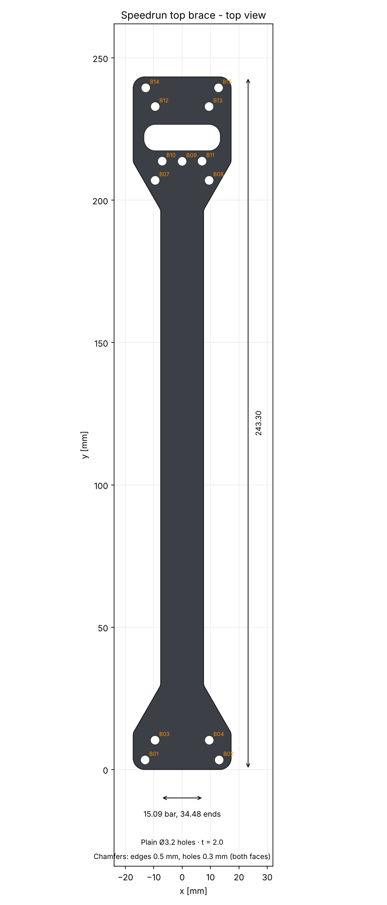

The assembly with the chassis plate and the bulkheads is shown in the section [speedrun chassis](#speedrun-chassis).

### Design and fit of the speedrun top brace
| Feature | Speedrun top brace |
|:---|:---|
| Holes | 13 holes Ø3.2 mm (B01 to B04, B07 to B15) at the positions of the T410R top brace |
| Ends | 34.48 mm wide (same as the bulkheads, flush with their sides), flat end edges, corner radius 4 mm |
| Middle part | Solid bar 15.09 mm wide |
| Transitions | 30 degrees on both ends, fillets 3 mm |
| Cutout at the end with B01 to B04 | None |
| Cutout at the end with B07 to B15 | Obround 27.0 x 9.3 mm (area of the spur gear) |
| Edges | Edge chamfers 0.5 mm on both faces (outline and obround), chamfers 0.3 mm on the holes, as the bulkheads and the shock towers |
| Size | 34.48 x 243.3 x 2.0 mm |
| Volume | 8.78 cm³ |
| Mass | 14.0 g in carbon (1.6 g/cm³), 24.7 g in 7075 (2.81 g/cm³) |

* The ends lie on the flat contact faces of the upper bulkheads of this project. The speedrun top brace fits only these bulkheads.
* Outside the contact faces of the bulkheads, the outline lies within the outline of the T410R top brace (0 mm² outside, checked by the script).
* The solid middle part without slots is stiff. The manual (step 25) shows a part with a screw M3x6 in the middle part of the top brace. It has no mounting hole on the speedrun top brace.

**Fit to the bulkheads**

The script `generate_top_brace_speedrun.py` places the top brace on the upper bulkheads at both ends of the chassis plate (centres of H03 to H06 and H28 to H31) and checks the fit:

| Check | Result |
|:---|:---|
| Top brace screws B01, B02, B14, B15 to the tapped holes of the upper bulkheads, along the car | 0.00 mm, after the correction of the upper bulkhead (see below) |
| Top brace screws across | B01/B02: +-0.25 mm, B14/B15: +-0.03 mm (see [open points](#files-and-open-points-of-the-speedrun-top-brace)) |
| Access holes B03/B04 and B12/B13 above the screws M3x10 of the bulkheads | Offset 0.5 mm or less, the hex key reaches the screws |
| Ends of the top brace on the contact faces of the upper bulkheads | 15.2 mm (end with B01 to B04) and 15.7 mm (end with B07 to B15) over the full width, 0.5 mm clearance to the step of the gear block |
| Interference with both upper bulkheads | 0 mm³ |

* Correction of the upper bulkhead: the distance of the top brace screws B01 and B14 (236.13 mm) and the distance of the bulkhead centres on the chassis plate (265.83 mm) require the top brace screws 14.85 mm from the bulkhead centre. The upper bulkhead had 14.36 mm (estimate from photos). The upper bulkhead now has 14.85 mm. Both the top brace and the chassis plate are confirmed by their test print.
* The end with B07 to B15 (obround) is placed at End B of the chassis plate (motor window, spur gear), the end with B01 to B04 at End A.

### Files and open points of the speedrun top brace
All files are stored in the directory `/speedrun_parts/chassis/top_brace_speedrun`. They are generated with the script `generate_top_brace_speedrun.py` (see [scripts](#scripts)).

| File | Format | Use |
|:---|:---|:---|
| `top_brace_T410R_speedrun.step` | STEP (AP214) | Solid model with the edge chamfers and the hole chamfers (one solid) |
| `top_brace_T410R_speedrun.stl` | STL (binary) | Triangle mesh of the solid model |
| `top_brace_T410R_speedrun.dxf` | DXF | 2D drawing for CNC manufacturing with the layers `OUTLINE`, `CUTOUT` and `HOLE_THROUGH` (without the chamfers; edge chamfers 0.5 mm and hole chamfers 0.3 mm on both faces are given in the order or taken from the STEP file) |
| `top_brace_T410R_speedrun_1to1_A4.pdf` | PDF (A4, 1 page) | 1:1 template, print at 100 % |
| `top_brace_T410R_speedrun_1to1_A4_print97.pdf` | PDF (A4, 1 page) | 1:1 template pre-scaled to 103.09 %, print at 97 % |
| `testprint_top_brace_speedrun_halfA.stl`, `testprint_top_brace_speedrun_halfB.stl` | STL (binary) | Test print in two halves (34.5 x 126.7 mm and 34.5 x 121.7 mm), split at y = 121.65 mm with one dovetail, 0.1 mm gap per side |
| `top_brace_speedrun_geometry.json` | JSON | Geometry data: outline, cutouts, holes, thickness |
| `top_brace_speedrun_hole_table.csv` | CSV | Hole coordinates (x, y) and diameter |

* Coordinate system: x = 0 centre line, y = 0 end edge with B01 to B04.
* The design values (bar width, corner radii, angle of the transitions, chamfers) are defined at the top of the script.

**Open points of the speedrun top brace**

* **Spacing B01 to B02:** 26.10 mm in the geometry data (taken from the T410R top brace), 25.65 mm between B14 and B15 and 25.6 mm between the top brace screws of the original upper bulkhead (U7). Both bulkheads are the same part, so both ends of the top brace should have the same spacing. With a hole of 3.2 mm, a screw M3 has approx. 0.1 mm radial clearance, so an offset of 0.25 mm per side can block the screws. The verification of the speedrun top brace shows that the screws fit. A measurement of the spacing B01 to B02 on the carbon top brace can still confirm the value of the geometry data.
* Function of the part with the screw M3x6 in the middle part of the top brace (manual step 25).

## Lower bulkhead
* **Author:** [@kleinnconrad](https://github.com/kleinnconrad)
* **Description:** CAD model of the lower half of the gear box (bulkhead) of the Carten T410R. The original part is the plastic part ("Gear box"), which is used at the front and at the rear. The model is designed for a CNC part made of 7075-T6. The ordered parts are MJF 3D prints from nylon PA12. The interfaces to the chassis plate, the bearings, the gears, the upper bulkhead and the sway bar follow the original part. The shape is designed to match the [upper bulkhead](#upper-bulkhead-new-design) (see [design of the lower bulkhead](#design-of-the-lower-bulkhead)).
* **Status:** $\color{green}\checkmark$ Verified (test prints: see [test print of the lower bulkhead](#measurement-basis-and-test-print-of-the-lower-bulkhead)). The interfaces are based on caliper measurements of the original part. Some positions are taken from photos (accuracy approx. +-0.5 mm) or derived from the caliper values (see [measurement basis of the lower bulkhead](#measurement-basis-and-test-print-of-the-lower-bulkhead)).

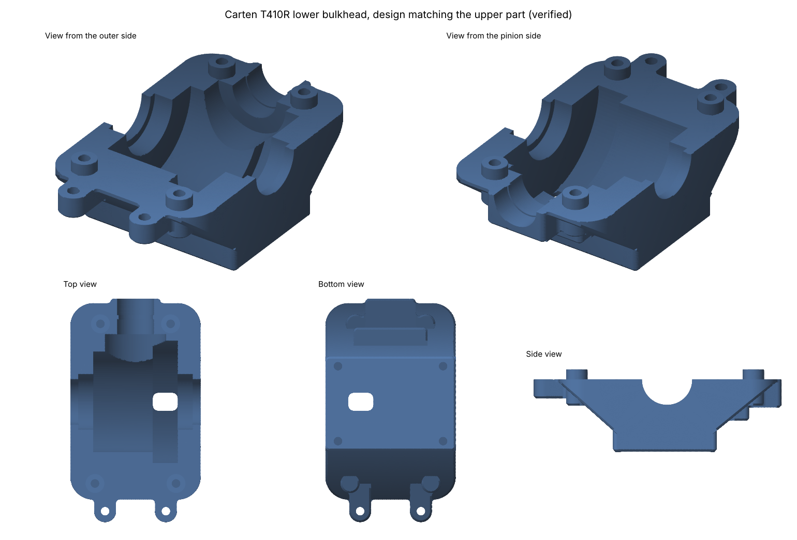

### Interfaces and files of the lower bulkhead
| Interface | Original parts | Model |
|:---|:---|:---|
| Chassis plate | 4 countersunk screws M3x8 from below through the 2 mm chassis plate | 4 M3 holes (tap drill 2.5 mm, 8 mm deep), spacing 28.0 x 20.0 mm |
| Upper bulkhead | 2 button head screws M3x10 on the pinion side, 2 button head screws M3x8 on the outer side | 4 bosses 4.86 mm, 2.42 mm above the parting face, M3 holes (tap drill 2.5 mm, 7 mm deep). Spacing across 18.7 mm (pinion side) and 21.6 mm (outer side), spacing along 42.6 mm |
| Diff | 2 bearings 10x15x4 | Per side: outer lip 1.89 mm thick (opening 12.28 mm) and seat 15 x 4 mm, open toward the gear cavity. Inner faces of the lips 30.7 mm apart |
| Pinion shaft | 2 bearings 5x10x4 | Seat 10 mm, 9.25 mm long: 2 seats of 4 mm (outer seat 4.35 mm) with a rib of 0.9 mm between the bearings, 0.3 mm high (opening 9.4 mm). The rib is the only axial stop: no shoulder at the inner end, open at the housing end face |
| Ring gear (42T, 31.93 mm) and diff case | Gear diff | Cavity with a radius of 13.5 mm for the diff case (test print), deepening with a radius of 16.4 mm for the ring gear on the ring gear side, with a through opening in the floor (test print) |
| Pinion gear (17T, 14.1 mm) | Pinion | Pocket with a radius of 8.25 mm (test print) in a rectangular block, wall 1.5 mm |
| Sway bar | 2 M3 screws | 2 tabs, 4.35 mm thick, with M3 holes (tap drill 2.5 mm), spacing 16.2 mm |

* The diff axis and the pinion axis lie in the parting face, 17.2 mm above the bottom face. The upper bulkhead holds the bearings from above.
* The ring gear and the pinion have a module of 0.75 (calculated from the outer diameters 31.93 mm and 14.1 mm). The pitch circle of the pinion is 15.75 mm from the diff axis.
* The chassis plate holes are H03 to H06 for the rear bulkhead (End B) and H28 to H31 for the front bulkhead (End A). The bulkhead is rotated by 180 degrees between the ends, so that the pinion points to the centre shaft at both ends.
* The source of the screw sizes is the manual (steps 9, 11 and 12) and the owner of the car. The source of the bearing sizes is the manual (steps 1 and 5).

**Files of the lower bulkhead**

All files are stored in the directory `/speedrun_parts/bulkhead`. The STEP and STL files and the measurement sheet are generated from the parameter file (see [scripts](#scripts)).

| File | Format | Use |
|:---|:---|:---|
| `bulkhead_lower_T410R.step` | STEP (AP214) | Solid model with nominal dimensions for CNC manufacturing (one solid) |
| `bulkhead_lower_T410R.stl` | STL (binary) | Triangle mesh of the solid model |
| `testprint_bulkhead_lower.stl` | STL (binary) | Test print variant (see [test print of the lower bulkhead](#measurement-basis-and-test-print-of-the-lower-bulkhead)) |
| `bulkhead_lower_parameters.json` | JSON | All dimensions of the model, each with its source and a note |
| `bulkhead_lower_measurement_sheet.pdf` | PDF (A4, 4 pages) | Caliper measurement sheet with the caliper values and the open values (see [caliper measurement sheet](#measurement-basis-and-test-print-of-the-lower-bulkhead)) |
| `bulkhead_lower_technical_drawing.pdf` | PDF (A3, 2 sheets), PNG per sheet | Technical drawing for the CNC order: views, sections, hole table, notes (see [`speedrun_parts/bulkhead/readme.md`](speedrun_parts/bulkhead/readme.md)) |

| Property | Value |
|:---|:---|
| Size (x by y by z) | 34.48 x 59.4 x 19.62 mm (with the sway bar tabs and the pinion housing) |
| Volume | 12.2 cm³ |
| Mass | 12 g in nylon PA12 (MJF, 1.01 g/cm³), 34 g in 7075 (2.81 g/cm³), 15 g in PLA (1.24 g/cm³) |

**Coordinate system of the lower bulkhead**

* Units are millimeters.
* The origin is the centre of the 4 bottom holes on the bottom face.
* x runs along the diff axis (across the car). y runs along the pinion axis, +y points to the pinion and the centre shaft. z = 0 is the bottom face, which sits on the chassis plate, +z points up.
* The diff axis is at y = 0.5 mm (photo).
* In the coordinate system of the chassis plate, the origin of the rear bulkhead is at x = 0, y = 21.53 mm (centre of H03 to H06) and the origin of the front bulkhead at x = 0, y = 287.36 mm (centre of H28 to H31).

### Measurement basis and test print of the lower bulkhead
Each parameter in `bulkhead_lower_parameters.json` has a source code:

| Source code | Meaning | Parameters |
|:---|:---|:---|
| `caliper` | Caliper measurement of the original part (number of the measurement sheet in the note) | Hole spacings, heights, widths, lips, seat lengths, boss and tab sizes |
| `derived` | Calculated from caliper values and part sizes | Positions along y, deepening, floor thickness, pocket radii |
| `manual` | T410R instruction manual (not stored in this repository, see [sources](#sources)) | Bearing sizes |
| `user` | Information from the owner of the car | Screw sizes, function of the sway bar holes, deepening for the ring gear, diff bearing seat limited only by the outer lip |
| `photo` | Estimate from photos with rulers at the height of the part | Position of the diff axis, length of the contact block, ring gear position and side |
| `design` | Free design choice | Tap drill diameters, hole depths, openings that were not measured |

* The caliper values 7, 8 and 9 (top boss holes) agree with the top view photo within 0.3 mm. The ratio of the bottom hole spacings (28.0 / 20.0) agrees with the bottom view photo within 0.3 %.
* The original part measures 15.6 mm (diff) and 10.5 mm (pinion) across the half bores at the parting face. The model uses the bearing diameters 15.0 mm and 10.0 mm for the bearing fit.
* The positions along y are calculated from the caliper values 16, 17 and 19 with the seat edge (15.6 mm) as the reference. With this reference, the inner pinion bearing is 18.15 mm from the diff axis. The photo with the diff installed shows approx. 18.3 mm.
* The photo with the diff installed shows the ring gear between 5.0 and 9.4 mm from the diff centre. The back face of the ring gear is approx. 1.9 mm from the inner face of the bearing.
* The lip thickness is 1.89 mm (no. 13, measured twice as no. 15). With the inner faces of the lips 30.7 mm apart (no. 14), the width over the outer faces is 34.48 mm. The caliper value no. 10 is 34.2 mm. The model keeps no. 13 and no. 14, because they set the position of the bearings.

**Caliper measurement sheet**

The measurement sheet `bulkhead_lower_measurement_sheet.pdf` documents the caliper values and lists the open dimensions:
* **Pages 1 to 3:** top view, bottom view, two sections, side view and end view with numbered dimensions.
* **Page 4:** table of 41 dimensions with the measuring method, the value of the model and the caliper value. Rows without a caliper value are open.
* **Priority A:** interfaces (holes, bearing seats, bosses, tabs, clearance for the gears). **Priority B:** shape.
* Hole spacings are measured with the inside jaws from far edge to far edge minus the hole diameter. Heights are measured with the depth rod with the part on a flat surface.
* The new values 38 to 41 cover the rib between the pinion bearings, the position of the diff axis relative to the bottom holes (39 and 40) and the height of the sway bar tabs.
* No. 15 now describes the length of the diff bearing seat (4.0 mm from the lip inward). The seat has no inner shoulder.

**Test print of the lower bulkhead**

* `testprint_bulkhead_lower.stl` differs from the solid model in two points: the bearing seats are 0.2 mm larger in diameter (15.2 mm and 10.2 mm), and all M3 holes have a diameter of 2.7 mm for self-tapping screws. The test print file contains the radii and edge chamfers of the solid model.
* Print orientation: bottom face on the print bed. The boss columns below the chamfers and the sway bar tabs need supports.
* The floor below the ring gear deepening has an opening of 6.85 x 5 mm. Around the opening, the floor is 0.8 mm thick and increases toward the ends of the deepening.
* Checks: the 4 bottom holes on the chassis plate, the diff and the pinion shaft with their bearings in the seats, the mesh of the gears, the fit of the original upper bulkhead and the clearance to the suspension arms and pivot blocks.

Result of the first test print (diff with ring gear and pinion shaft installed):

| Observation | Change |
|:---|:---|
| The diff case touches the wall of the cavity on the outer side (opposite the pinion). | Radius of the diff case cavity 12.5 mm -> 13.5 mm, in the lower and the upper part. |
| The ring gear does not rotate freely in its deepening. The original part has an extra deepening of approx. 5 mm length with approx. 0.7 mm more space below the ring gear. | Through opening in the floor below the deepening, 6.85 x 5 mm (x by y, centred below the diff axis), corner radius 1.5 mm. The chassis plate closes it. The lowest tooth of the ring gear is 1.23 mm above the chassis plate (before: 0.43 mm above the floor). The radius of the deepening (16.4 mm) is not increased: a larger radius would break through the side faces of the narrow lower section. |
| The pinion needs more space to rotate. | Radius of the pinion pocket 7.75 mm -> 8.25 mm (clearance to the 14.1 mm pinion 1.2 mm), in the lower and the upper part. Below the pocket of the lower part, the wall is 1.5 mm (before: 0.35 mm at the pinion seat). |

Result of the second test print:

| Observation | Change |
|:---|:---|
| The rib between the two pinion bearings is too high and too thick. The original part has a rib of only a fraction of a millimetre, just enough to keep the bearings apart. | Rib height 0.75 mm -> 0.3 mm (opening 8.5 mm -> 9.4 mm), rib width 1.25 mm -> 0.9 mm, in the lower and the upper part. The face toward the pinion is not moved, so the gear mesh does not change. |
| The part is functional. The shape is to match the upper part. | New shape of the lower part (see [design of the lower bulkhead](#design-of-the-lower-bulkhead)). The interfaces are not changed. |

### Design of the lower bulkhead
The lower part has the same design as the upper part: the footprint of the upper part (34.48 mm wide, corner radius 6 mm, outer end at y = -25.5 mm), with flat faces, radii and edge chamfers (see [edges of the outer shape](#design-of-the-lower-bulkhead)). The two parts end flush at the outer end and on the sides.

| Section | Shape | Function |
|:---|:---|:---|
| -12.4 to 12.4 mm (y) | Rectangular block, flat underside, vertical end faces 5.0 mm high | Contact face on the chassis plate with the 4 bottom holes |
| Outer side and pinion side | One straight chamfer per side, from the end faces of the block (5.0 mm) to 0.5 mm below the parting face at the ends | Space below the chamfers for the pivot blocks of the wishbones |
| Below the pinion pocket and the pinion seats | Stepped rectangular block: 19.5 mm wide below the pocket (to 1.5 mm beyond the end of the pocket), 13.2 mm wide below the seats and beyond the end of the footprint | Wall around the pinion pocket and the pinion seats |
| Below the screws to the upper part | 4 round bosses 4.86 mm, from 11.1 mm above the bottom face | Threads M3 for the screws M3x8 and M3x10 |
| Outer end | 2 tabs 4.35 mm thick with M3 holes, beyond the end of the footprint | Sway bar mounts |

* Space for the pivot blocks: the chamfers lie above the side profile of the previous shape (at the pivot block holes H07/H08, 13.6 mm instead of 11.2 mm above the bottom face). A comparison of the solids gives the material of the new shape outside the previous shape:
  * below the pinion: 82 mm³ in the corners beside the previous round shell (|x| up to 9.75 mm). The lowest point is unchanged at 7.45 mm above the bottom face.
  * corners of the footprint on the pinion side: 13 mm³ (corner radius 6 mm instead of 7 mm), more than 11 mm above the bottom face.
  * outer side: 2 mm³.
* The clearance to the pivot blocks is confirmed by the verification of the lower bulkhead.
* The interfaces (holes, bearing seats, cavities, floor opening, bosses, tabs) are not changed by the new shape.
* Correction after the first model of the new shape: the wide block below the pinion pocket ended at the end of the pocket. Below the pinion seat, the narrow block and the chamfer start only 10.15 mm above the bottom face, the pocket reaches down to 8.95 mm. The end face of the pocket therefore had a window of approx. 8.6 x 1.2 mm to the outside. The wide block now ends 1.5 mm behind the pocket.

**Design notes**

* The body is solid apart from the gear cavity. Pockets to reduce the mass are possible after the test print.
* Each diff bearing seat is limited only by the outer lip. The half bore of 15 mm runs 4.0 mm inward from the lip and then opens into the gear cavity. On the inner side, the diff holds the bearings. The diff with both bearings measures 30.0 mm, the lips are 30.7 mm apart: the diff has 0.7 mm axial play, as on the original part.
* The gear cavity has two depths. Between the bearing seats, a cylinder with a radius of 13.5 mm holds the diff case (floor 3.7 mm thick). The test print with a radius of 12.5 mm showed that the diff case touches the wall on the outer side. On the ring gear side, a deepening with a radius of 16.4 mm from x = 4.5 mm to the inner end of the bearing seat (x = 11.35 mm) holds the ring gear (radial clearance 0.43 mm). Below the ring gear, the floor has a through opening of 6.85 x 5 mm (extra deepening of the original part, approx. 5 mm long). The chassis plate closes the gear box from below. The wall between the deepening and the bottom holes is 1.4 mm thick.
* The ring gear is on the +x side. Seen from the pinion housing, the deepening is on the left. The bulkhead is the same part at the front and at the rear and is rotated by 180 degrees. Both pinions point to the centre shaft, so the ring gear is on the same side of the bulkhead at both ends.
* The STEP files contain no threads. All M3 threads are modelled as holes with the tap drill diameter of 2.5 mm (ISO metric thread M3 x 0.5). For CNC manufacturing, the threads are specified in the comment field of the order:

| Part | Holes | Thread | Drill depth | Thread depth | Screws |
|:---|:---|:---|---:|---:|:---|
| Lower bulkhead | 4 holes in the bottom face | M3 | 8.0 mm | 6.5 mm | M3x8 countersunk from below through the chassis plate |
| Lower bulkhead | 4 holes in the bosses below the upper part | M3 | 7.0 mm | 6.0 mm | M3x8 and M3x10 button head through the upper bulkhead |
| Lower bulkhead | 2 holes in the sway bar tabs | M3 | Through (4.35 mm) | Through | Sway bar holders |
| Upper bulkhead | 2 holes for the top brace | M3 | 7.0 mm | 6.0 mm | M3x8 through the top brace |
| Upper bulkhead | 4 holes in the shock tower wall | M3 | Through (6.0 mm) | Through | M3x8 button head through the shock tower |

* All other holes of the speedrun parts are clearance holes Ø3.2 mm without a thread: chassis plate (countersunk from below), top brace, shock towers, and the holes of the upper bulkhead for the screws into the lower bulkhead.
* Further own parts: the motor mount has M3 threads (tap drill 2.5 mm, 7.0 mm deep) for the screws from below through the holes H09 and H10 and for the 2 screws M3x18 of the cap; the flange of the rear pinion shaft has 4 M3 threads for the screws of the spur gear; the pivot blocks have M3 threads for the countersunk screws from below; the wishbones have M3 threads for the ball studs and M4 threads for the droop screws.

**Edges of the outer shape**

Both bulkheads are made for CNC milling from 7075 on a 3-axis machine. The inside of the parts is not changed (rule in `CLAUDE.md`): gear cavity, floor opening, bearing seats, lips, rib, pinion pocket, all holes, counterbores, the recesses and the bosses are the verified geometry of the test prints with the diff and the pinion. The parting faces are not changed either. Only the edges of the outer shape have radii and edge chamfers. The parameters are stored in `bulkhead_lower_parameters.json` (`inside_corner_r`, `outside_corner_r`, `edge_chamfer`, used for both parts) and `bulkhead_upper_parameters.json` (`wall_root_r`). The narrowed shock tower wall with the side steps of the upper part is also a change of the outer shape (see [design of the upper bulkhead](#interfaces-and-design-of-the-upper-bulkhead)).

| Edge treatment | Size | Where | Reason |
|:---|:---|:---|:---|
| Radius in the vertical inside corners | 1.0 mm | Lower part: sway bar bridges, block under the pinion, pinion bosses (10 corners). Upper part: block over the outer pinion bearing (2 corners), ends of the side steps behind the wall (2 corners) | An end mill cannot cut a sharp inside corner parallel to its axis and cannot enter a gap narrower than its diameter (end mill 2 mm) |
| Radius of the vertical outside edges | 1.0 mm | Corners of the levels and blocks seen from above | No extra machining time: the end mill follows the contour |
| Root radius of the shock tower wall | 2.0 mm | Upper part, both sides of the wall, around the corners of the wall | Strength of the wall at its root |
| Edge chamfer | 0.5 mm | The other hard outside edges (angle between the faces up to approx. 120 degrees) | Edge break with a lower cost than a radius |

**Radii in the inside corners:**
* At the pinion bosses of the lower part, the radius also closes the gap between the narrow block and the boss columns. This gap was 0.32 mm wide, so no end mill could enter it.
* The block over the outer pinion bearing projects 1.2 mm beyond the end of the footprint. This limits the radius. Between the radius and the end of the block, a flat of 0.2 mm remains.
* The script closes the horizontal section at the end of each inside edge with the radius (offset by +1.0 mm and back by -1.0 mm) and extends the added faces to the parting face. Above the inclined faces of the lower part, they lie inside the body. At the corners of the footprint, the lower end of the radius follows the inclined face.

**Edge chamfers:**
* Each edge chamfer is cut with a tool along the edge: a triangle with legs of 0.5 mm on both faces. The edges at the parting faces and the bosses are not changed.
* Edges that meet tangentially, for example a straight edge and the arc of a corner radius, are cut together. The edge chamfer runs through the junction without a step.
* Where a face beside the edge becomes narrower than 1.0 mm, the edge chamfer stops 0.1 mm before that point. This occurs where an edge runs into the recess of a vertical corner radius (deck, side steps and flange of the upper part at the corners of the gear blocks), into the corner radius of the shock tower wall (sides of the root radius) or into a narrowing face of the lower part (lower ends of the boss columns, inclined faces at the footprint corners). The end of such an edge chamfer is a small triangular face.
* Where an edge chamfer is not possible at all, the edge is left as it is: a face beside the middle of the edge is narrower than 1.0 mm (for example the end faces of 0.5 mm below the parting face of the lower part), or the cut leaves thin slivers.
* Upper part: 37 edges with full edge chamfers (269 mm), 12 edges with stopped edge chamfers (94 mm), 2 short arcs of 1.2 mm left as they are.
* Lower part: 18 edges with full edge chamfers (178 mm), 18 edges with stopped edge chamfers (154 mm), 12 short edges left as they are (25 mm: edges of the small inside radii and of the narrow block under the pinion).
* The generators list all edges that are left as they are.

**Shock tower wall:** the root radius changes the interface to the shock tower. In front of the contact face, the zone above 19.8 mm is kept free (block 17.8 mm plus the root radius). Beside the narrowed wall, the zones above the side steps are kept free for the camber link lobes of the towers and the rod ends of the camber links. The original shock tower plate reaches down to approx. 17.8 mm and does not fit. The [speedrun shock towers](#speedrun-shock-towers) are designed for the upper bulkhead.

**Unchanged inside:** the generators build the outer shape with the edge treatment first and then cut all functional voids: gear cavity, floor opening, bearing seats, lip openings, pinion pocket, rib, holes, counterbores, recesses and the keep-out zones of the upper part (top brace, shock tower, rod ends beside the wall). A comparison with the model without edge treatment, which has the verified inside, gives:

| Check | Lower part | Upper part |
|:---|:---|:---|
| Smallest distance of the changed material to the cavities, bearing seats, holes and recesses | 0.60 mm | 0.60 mm |
| Added material in the keep-out zones (top brace, shock tower, rod ends) | – | 0 mm³ |
| Removed material (edge chamfers, outside radii) | 43.3 mm³ | 61.9 mm³ |
| Added material (inside radii, root radius) | 8.3 mm³ in 10 pieces | 49.4 mm³ in 6 pieces |
| Thin slits and walls | None (narrow faces: 6 at the inside radii, 8 at the ends of stopped edge chamfers) | None (narrow faces: 16 at the ends of stopped edge chamfers, 4 at the ends of the root radius beside the narrowed wall) |

* Space for the pivot blocks: each radius lies between two existing faces and does not reach lower than the material beside it. Below the inclined faces on the outer side, the radii lie between the sway bar bridges and the outer bosses, from 12.85 mm above the bottom face (lower face of the bridges) and up to x = 11.6 mm (the bosses reach 13.2 mm). On the pinion side, they lie between the narrow block and the pinion bosses, from 10.6 mm above the bottom face (lower face of the narrow block) and up to x = 8.1 mm (the bosses reach 11.8 mm). The edge chamfers and the outside radii only remove material.
* The interference of the lower and the upper part, and of all parts of the speedrun chassis, is 0 mm³. The top brace fits the upper bulkheads unchanged.

### Open points of the lower bulkhead
* **Chassis plate:** the bottom holes of the original bulkhead are 28.0 x 20.0 mm apart. The speedrun chassis plate has 28.17 x 20.22 mm (H03 to H06) and 28.13 x 20.19 mm (H28 to H31), as the chassis plate of the T410R. Countersunk screws center themselves in the countersinks, so the difference of approx. 0.1 mm per hole is not compensated by clearance. The hole spacings of the carbon chassis plate are to be measured before the aluminium plate is ordered.
* Open caliper values of the measurement sheet (nos. 21, 26, 30 to 36, 38 to 41).
* The value 22 (5 mm) is interpreted as the height of the end faces of the contact block, and the value 25 (4.35 mm) as the thickness of the sway bar tabs with the top face in the parting face.
* Width over the outer faces of the diff bearing walls: 34.48 mm in the model, 34.2 mm measured (no. 10).
* The outer end face of the original part has small holes. Their function is unknown, so they are not modelled.
* Upper bulkhead: see [upper bulkhead (new design)](#upper-bulkhead-new-design).
* Front and rear: End A of the chassis plate is assumed to be the front (bumper holes H34 to H36), End B the rear (motor window).
* Pivot block at End B, outer: the model of the long pivot block overlaps the outer chamfer of the lower bulkhead by 0.38 mm (see [open points of the pivot blocks](#pivot-blocks)).

## Upper bulkhead (new design)
* **Author:** [@kleinnconrad](https://github.com/kleinnconrad)
* **Description:** CAD model of a new upper half of the gear box (bulkhead) of the Carten T410R for CNC manufacturing from 7075-T6. The shape is a new design. The interfaces follow the original part: the lower bulkhead, the diff and pinion bearings, the shock tower and the top brace.
* **Status:** $\color{green}\checkmark$ Verified with a test print. The interfaces to the lower part and the bearings are taken from the parameter file of the lower bulkhead. The shock tower hole pattern and its height, the spacing of the top brace screws and the height of the top brace face are caliper values (U1 to U4, U7, U9, U10). The position of the shock tower contact face is an estimate from photos (U5, U6), and the position of the top brace screws along y is derived from the top brace and the chassis plate (U8). The test print confirms the part (see [measurement sheet of the original upper bulkhead](#files-and-measurement-sheet-of-the-upper-bulkhead)). The root radius of the shock tower wall was added after the test print: the original shock tower plate does not fit, the [speedrun shock towers](#speedrun-shock-towers) are designed for the upper bulkhead. Also after the test print, the shock tower wall was narrowed to 28.0 mm with side steps beside it (request of the owner): the camber link holes of the towers are at the original position, and the rod ends of the camber links sit beside the wall. The inside of the part and the 4 tapped holes of the shock tower are not changed.

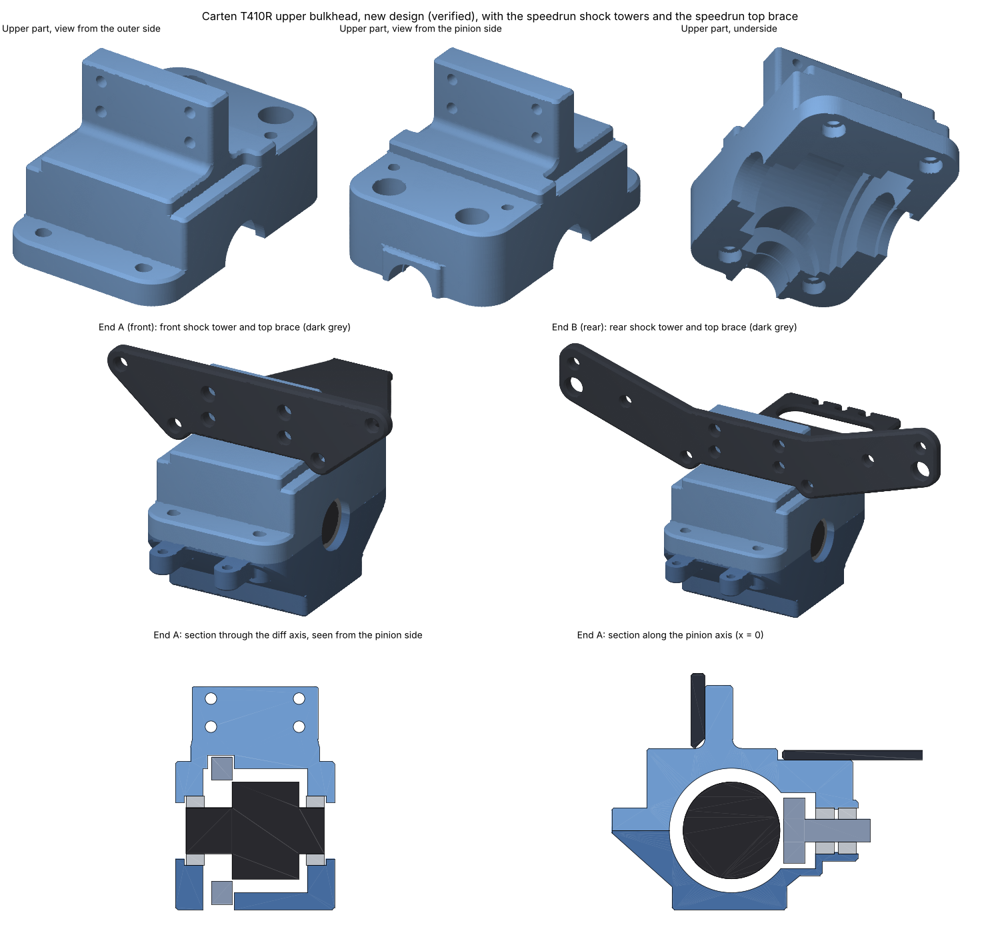

The preview shows the upper part, the assemblies at End A (front) and End B (rear) with the lower part, the [speedrun shock towers](#speedrun-shock-towers) and the end of the [speedrun top brace](#speedrun-top-brace) (dark grey), and two sections of the assembly at End A. The bearings (light grey), the gears (blue-grey) and the diff case (dark grey) are simplified bodies that show the positions only.

### Interfaces and design of the upper bulkhead
| Interface | Original parts | Model | Source |
|:---|:---|:---|:---|
| Lower bulkhead | Parting face, 4 bosses of the lower part (4.86 mm, 2.42 mm high) | Flat underside, 4 recesses 5.06 x 2.52 mm for the bosses (locating the two halves) | Lower part |
| Screws to the lower part | 2 button head screws M3x8 on the outer side, 2 button head screws M3x10 on the pinion side | Clearance holes 3.2 mm. Head seats 4.92 mm (outer side, on the flange) and 6.92 mm (pinion side, counterbore 6.5 mm) above the parting face: 5.5 mm thread engagement in the lower part | User, lower part |
| Diff bearings (10x15x4) | Clamped between the two halves | Upper half bores 15 x 4 mm, limited only by the outer lips (opening 12.28 mm, 1.89 mm thick) | Lower part |
| Pinion bearings (5x10x4) | Clamped between the two halves | Upper half bores 10 mm with the rib (0.9 mm wide, 0.3 mm high) between the bearings as the only axial stop, open toward the pinion pocket and at the housing end face | Lower part, user |
| Gears | Ring gear 42T (31.93 mm), pinion 17T (14.1 mm) | Same cavities as the lower part: diff case radius 13.5 mm, ring gear radius 16.4 mm on the ring gear side (from x = 4.5 mm to 10.4 mm, 1 mm beyond the back face of the ring gear), pinion pocket radius 8.25 mm | Lower part, photo |
| Shock tower | 3 mm carbon, 4 button head screws M3x8 (manual steps 19 and 20). Original holes 2.9 mm, through the 5.8 mm ears | Flat contact face facing the outer side at y = -5.3 mm, 4 tapped holes M3 (through the 6 mm wall) at x = +-9.55 mm and 22.5 / 28.6 mm above the parting face. Root radius 2.0 mm on both sides of the wall. In front of the face, no material above 19.8 mm: the original plate does not fit, the [speedrun shock towers](#speedrun-shock-towers) fit. Wall 28.0 mm wide (x = +-14.0 mm) with side steps 15.0 mm above the parting face beside it: space for the rod ends of the camber links (x = +-18.05 mm, 19.1 mm) | Caliper (holes), photo (contact face), owner (camber links) |
| Top brace | 2 button head screws M3x8 per bulkhead (manual step 25) into 2 raised bosses | Flat contact face 15.4 mm above the parting face, from y = 10.5 mm to the pinion end, 2 tapped holes M3 at x = +-12.8 mm, y = 14.85 mm | Caliper (height, spacing), top brace and chassis plate (y, see [fit to the bulkheads](#design-and-fit-of-the-speedrun-top-brace)) |
| Sway bar holders | M3x6 from above onto the tabs of the lower part (manual step 23) | The upper part ends at y = -25.5 mm, 3.2 mm before the sway bar holes | Photo |

* The pinion side screws (M3x10) sit below the top brace. The top brace has access holes above them (B03/B04 and B12/B13, spacing 19.1 mm, 6.94 mm and 6.58 mm from the top brace screws).
* The upper part is the same at the front and at the rear, like the lower part. The front and the rear shock tower use the same 4 holes.

**Design of the upper bulkhead**

The upper part is a prismatic block: the footprint of the lower part (34.48 mm wide, corner radius 6 mm) is extruded to 4 flat levels along y. The shock tower wall and the gear block are narrowed to 28.0 mm, with side steps beside them. All outer faces are flat. The edges have radii and edge chamfers, the root of the shock tower wall has a radius of 2.0 mm (see [edges of the outer shape](#design-of-the-lower-bulkhead)). The only other curved faces are the bores and the cavities, which follow the lower part.

| Section (y) | Level above the parting face | Function |
|:---|:---|:---|
| -25.5 to -17.9 mm | 4.92 mm | Flange: seat of the heads of the outer screws |
| -17.9 to -5.3 mm | 17.8 mm | Block over the diff and the ring gear (2 mm in front of the ring gear cavity), 28.0 mm wide |
| -5.3 to 0.7 mm | 31.5 mm | Shock tower wall, 28.0 mm wide (x = +-14.0 mm), 6 mm thick, flat contact face, root radius 2.0 mm on both sides |
| 0.7 to 10.5 mm | 17.8 mm | Block over the diff and the ring gear, 28.0 mm wide up to 5.0 mm |
| 10.5 to 26.7 mm | 15.4 mm | Flat contact face of the top brace over the pinion, counterbores of the pinion side screws |
| 26.7 to 27.9 mm | Rectangular block, 13.2 mm wide, 6.6 mm high | Cover of the outer pinion bearing beyond the footprint (same section as the lower part) |

* Side steps: beside the wall and the gear block (|x| > 14.0 mm), from the front face of the gear block to y = 5.0 mm, the part is 15.0 mm high. This gives space for the rod ends of the camber links behind the shock towers (zone with a radius of 4.0 mm around the ball stud at x = +-18.05 mm, 19.1 mm, 9 mm long; estimate) and for the camber link lobes of the towers (lowest point 15.6 mm). The removed material is 3.05 mm away from the cavities, seats and holes; above the diff bearing seats, 7.5 mm of material remain.
* The tapped holes of the shock tower (x = +-9.55 mm) are 4.45 mm from the side faces of the narrowed wall (centre to face).
* The interference check of the assembly of the lower and the upper part gives 0 mm³.
* The ring gear cavity of the upper part ends at x = 10.4 mm (lower part: 11.35 mm). Up to 11.35 mm, the wall to the tapped hole of the top brace screw was only 0.2 mm. It is now 1.15 mm.
* Size 34.48 x 53.4 x 31.5 mm, volume 18.8 cm³, mass 19 g in nylon PA12 (MJF, 1.01 g/cm³), 53 g in 7075 (2.81 g/cm³), 23 g in PLA.
* The wall is 6 mm thick: the screws M3x8 through the 3 mm shock tower have 5 mm thread engagement. The material above the thread of the upper holes is 1.4 mm (wall top at the height of the original ears, U10).
* The block over the ring gear is 17.8 mm high. In front of the wall, the zone above 19.8 mm (block plus root radius) is kept free for the shock tower. The cover over the ring gear cavity is 1.4 mm directly behind the wall and 2.5 mm at the contact face.
* The mass is higher than with shells that follow the gears. Straight pockets in the flat faces can reduce it, if required.
* Manufacturing: 3 setups on a 3-axis machine (underside with the bores and cavities, top with the levels and the vertical holes, outer side with the 4 shock tower holes). The STEP file contains no threads: the tapped holes are modelled with the tap drill diameter of 2.5 mm. Radii and edge chamfers: see [edges of the outer shape](#design-of-the-lower-bulkhead).

### Files and measurement sheet of the upper bulkhead
All files are stored in the directory `/speedrun_parts/bulkhead`. The files are generated from the parameter files of the upper and the lower part (see [scripts](#scripts)).

| File | Format | Use |
|:---|:---|:---|
| `bulkhead_upper_T410R.step` | STEP (AP214) | Solid model with nominal dimensions (one solid) |
| `bulkhead_upper_T410R.stl` | STL (binary) | Triangle mesh of the solid model |
| `testprint_bulkhead_upper.stl` | STL (binary) | Test print variant: bearing seats 0.2 mm larger, tapped holes 2.7 mm for self-tapping screws. Print with the parting face on the print bed. |
| `bulkhead_assembly_T410R.step` | STEP (AP214) | Assembly of the lower and the upper part |
| `bulkhead_upper_parameters.json` | JSON | Dimensions of the upper part, each with its source and a note. The shared dimensions are read from `bulkhead_lower_parameters.json`. |
| `bulkhead_upper_measurement_sheet.pdf` | PDF (A4, 2 pages) | Measurement sheet of the original upper part (see below) |
| `bulkhead_upper_technical_drawing.pdf` | PDF (A3, 2 sheets), PNG per sheet | Technical drawing for the CNC order: views, sections, hole table, notes (see [`speedrun_parts/bulkhead/readme.md`](speedrun_parts/bulkhead/readme.md)) |

**Measurement sheet of the original upper bulkhead**

The measurement sheet `bulkhead_upper_measurement_sheet.pdf` shows the interfaces of the original upper part on 3 photos (end view, side view, top view) with the numbers U1 to U14. Page 2 lists the values of the model and the caliper values (U1 to U4, U7, U9, U10 measured):
* **U1 to U6, U11, U13:** shock tower: hole pattern, height of the holes, position of the contact face, lowest edge of the shock tower plates.
* **U7 to U9:** top brace: hole spacing, position along y, height of the contact face.
* **U10, U12:** height of the ears, outer end of the original part.
* **U14:** use of the 2 screws M3x18 with the block at the rear end of the top brace (manual step 25).
* A scan of both shock towers on the flatbed scanner (U13) is the most accurate source for the hole pattern.
* The photos are stored as `photos/bulkhead_upper_stock_end_view.jpg`, `photos/bulkhead_upper_stock_side_view.jpg` and `photos/bulkhead_upper_stock_top_view.jpg`.

### Open points of the upper bulkhead
* Caliper values of the original upper part that are not measured: U5, U6 (position of the shock tower contact face), U8 (position of the top brace screws along y), U11 (lowest edge of the shock towers), U12 to U14. The test print confirms the part, so these values are not required for manufacturing.
* Shock tower: the original shock tower plate does not fit. The [speedrun shock towers](#speedrun-shock-towers) (front and rear) are designed for the upper bulkhead.
* Mass: 19 g in nylon PA12 (ordered part), 53 g in 7075. Straight pockets in the flat faces can reduce the mass.

## Speedrun shock towers
* **Author:** [@kleinnconrad](https://github.com/kleinnconrad)
* **Description:** New front and rear shock towers for the speedrun upper bulkhead. Flat carbon plates of 3 mm (as the original shock towers) on the contact face of the shock tower wall, each fixed with 4 button head screws M3x8 in the tapped holes of the wall. The dampers are mounted on the front face (outer end), the rod ends of the camber links on the back face (wall side), as on the car. The rear tower also carries the body post mounts.
* **Status:** $\color{green}\checkmark$ Verified by the owner (front and rear shock tower). The damper, camber link (wheel mount) and body post positions are based on measurements of the original shock towers by the owner. After the verification, the camber link holes were moved back to the original position (the owner found them about 3 mm too far outward), and the shock tower wall of the upper bulkhead was narrowed for the rod ends (see [design of the speedrun shock towers](#design-and-fit-of-the-speedrun-shock-towers)). The space for the rod ends is an estimate from photos.

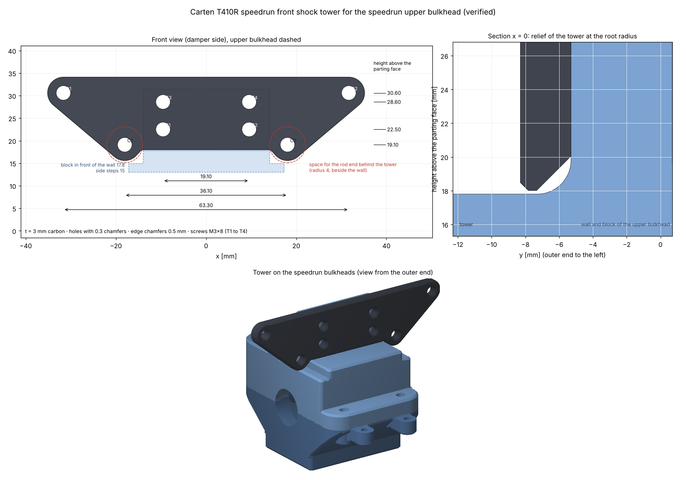

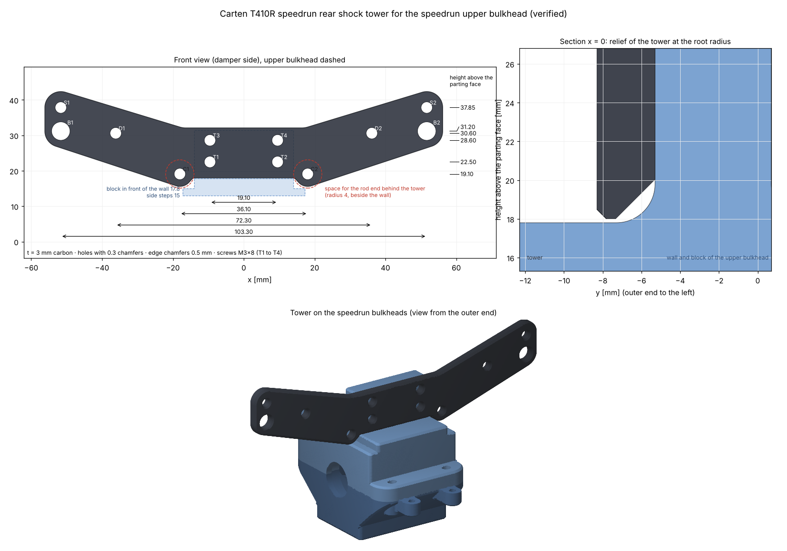

### Design and fit of the speedrun shock towers
Positions in the plane of the tower: x across the car, height above the parting face of the bulkheads. The measurements of the owner refer to the edges of the holes of the original towers; the model assumes holes of 3.2 mm in the original towers (parameter `stock_hole_d`).

| Element | Front shock tower | Rear shock tower | Basis |
|:---|:---|:---|:---|
| Mounting holes T1 to T4 | x = ±9.55 mm, 22.5 mm and 28.6 mm, Ø3.2 mm | Same | Tapped holes of the upper bulkhead (U1 to U3) |
| Camber link holes C1, C2 (wheel mounts) | x = ±18.05 mm, 19.1 mm, Ø3.2 mm | Same | Original towers: 8.5 mm outward and 5 mm down from the top of the lower mounting hole (owner) |
| Damper holes D1, D2 | x = ±31.65 mm, 30.6 mm, Ø3.2 mm | x = ±36.15 mm, 30.6 mm, Ø3.2 mm | Original towers, from the outer end of the upper mounting hole to the centre of the damper hole: front 20.5 mm outward and 2 mm up, rear 25 mm outward and 2 mm up (owner) |
| Body post bores B1, B2 | – | x = ±51.65 mm, 31.2 mm, Ø5.2 mm | Original rear tower: bottom of the bore 40.5 mm outward from the outer end of the upper mounting hole (owner) |
| Body post screw bores S1, S2 | – | x = ±51.65 mm, 37.85 mm, Ø3.2 mm | Original rear tower: bottom of the bore 2.45 mm above the top of the 5.2 mm bore (owner) |
| Thickness | 3.0 mm carbon | 3.0 mm carbon | Owner. The upper bulkhead is designed for it: screws M3x8, 5 mm thread engagement |
| Outline | Straight top edge 34.1 mm high, round ends R3.5 around the damper holes, straight edges down to the camber link lobes | Straight top edge 32.1 mm high over the width of the bulkhead, corners R6, rising straight edges to round ends R4.5 around the body post bores, straight edges down to the camber link lobes; the damper holes lie in the wings | Design |
| Common outline | Round lobes R3.5 around the camber link holes beside the narrowed block, straight bottom edge 0.2 mm above the block in front of the wall, inside corners R1 | Same | Design |
| Size, mass | 70.3 x 18.5 x 3 mm, 4.4 g (carbon), 7.7 g (7075) | 112.3 x 26.8 x 3 mm, 7.6 g (carbon), 13.4 g (7075) | |

* Edges of both towers: chamfer 0.5 mm on both faces (as the edge chamfers of the bulkheads), chamfers of 0.3 mm on the holes. No sharp corners: all outside corners are radii.
* Relief on the back face: along the bottom edge, the edge chamfer increases to 45 degrees with legs of 2.05 mm and runs out to the edge chamfer over 1.5 mm beside the wall. It clears the root radius of the wall (2.0 mm) by 0.18 mm.
* Camber link holes: at the original position (x = ±18.05 mm). The rod ends sit behind the tower beside the shock tower wall of the upper bulkhead. For this, the wall and the gear block of the upper bulkhead are narrowed to 28.0 mm (x = ±14.0 mm), with side steps 15.0 mm above the parting face beside them (see [design of the upper bulkhead](#interfaces-and-design-of-the-upper-bulkhead)). A zone with a radius of 4.0 mm around the ball stud (rod end with clearance, estimate) is 0.05 mm clear of the side faces of the wall: 18.05 - 4.0 - 0.05 = 14.0 mm.
* The bottom edge lies 0.2 mm above the block in front of the wall (17.8 mm). The camber link lobes reach down to 15.6 mm beside the narrowed block, 0.6 mm above the side steps. The edge distance below the lower mounting holes is 2.9 mm, around the other holes at least 1.9 mm.

**Fit to the upper bulkhead**

Results of the checks of `generate_shock_towers.py` (same for both towers):

| Check | Result |
|:---|:---|
| Mounting holes on the tapped holes of the upper bulkhead | Offset 0.00 mm |
| Interference with the upper and the lower bulkhead | 0 mm³ |
| Contact area on the wall | 247 mm² |
| Gap below the tower (block and root radius) | 0.20 mm |
| Zone of the rod ends behind the tower (radius 4.0 mm, 9 mm long) | Free, 0 mm³ overlap with the bulkheads |
| Edge distance of the holes | Mounting holes 2.9 mm, camber link holes 1.9 mm, damper holes 1.9 mm (front) and 5.3 mm (rear), body post bores 1.9 mm and 2.9 mm |
| Thin slits and walls | None |

* Both towers are part of the assembly of the speedrun chassis: the front tower at End A (assumed front), the rear tower at End B. The interference check gives 0 mm³ for both towers.

### Files and open points of the speedrun shock towers
All files are stored in the directory `/speedrun_parts/shock_tower`. They are generated with `generate_shock_towers.py` (see [scripts](#scripts)). The file names start with `shock_tower_front` or `shock_tower_rear`.

| File | Format | Use |
|:---|:---|:---|
| `shock_tower_front_T410R_speedrun.step`, `shock_tower_rear_T410R_speedrun.step` | STEP (AP214) | Solid models with the edge chamfers and the relief, for CNC manufacturing. Plate coordinates: x across the car, y height above the parting face, z = 0 back face |
| `shock_tower_front_T410R_speedrun.stl`, `shock_tower_rear_T410R_speedrun.stl` | STL (binary) | Triangle meshes, also for test prints |
| `shock_tower_front_T410R_speedrun.dxf`, `shock_tower_rear_T410R_speedrun.dxf` | DXF | 2D drawings with the layers `OUTLINE` and `HOLE_THROUGH` (outline without the chamfers) |
| `..._1to1_A4.pdf`, `..._1to1_A4_print97.pdf` | PDF (A4) | 1:1 templates of each tower (100 % and 97 %) to compare the holes with the original towers and the bulkhead |
| `shock_tower_front_geometry.json`, `shock_tower_rear_geometry.json` | JSON | Geometry data: outline and holes (holes with another diameter than 3.2 mm carry their own diameter) |
| `shock_tower_front_parameters.json`, `shock_tower_rear_parameters.json` | JSON | All dimensions, each with its source and a note |
| `shock_tower_front_hole_table.csv`, `shock_tower_rear_hole_table.csv` | CSV | Hole tables with diameter and use |

* CNC order of the carbon plates: outline and holes from the DXF files. The edge chamfers and the relief on the back face are in the STEP files (relief: 45 degrees, 2.05 mm, along the bottom edge on the back face).

**Open points of the speedrun shock towers**

Both shock towers are verified by the owner. The following points are not required for manufacturing. They are relevant for later changes of the design.
* Rod ends of the camber links: size and position behind the towers are not measured (the zone with a radius of 4.0 mm is an estimate). It sets the width of the shock tower wall of the upper bulkhead (parameters `rod_end_clearance_r` of the towers and `wall_half_width` of the upper bulkhead).
* Holes of the original towers: the conversion of the measurements assumes holes of 3.2 mm.

## Speedrun front splitter
* **Author:** [@kleinnconrad](https://github.com/kleinnconrad)
* **Description:** Speedrun front splitter at End A on the holes H34, H35 and H36 at the front end of the speedrun chassis plate. The car runs without the front foam bumper: the splitter takes its place, the body sits on it and it shows 15 to 20 mm ahead of the body (owner). One part (owner): the body post mount of the T410R enlarged to the outline of the splitter. The body post mount area follows the original mount (photos and measurements of the owner); the outer form of the splitter follows the lower front edge of the body (owner), as a broad plate after a reference picture of the owner, with concave rear edges (variant C of the design suggestions).
* **Status:** $\color{green}\checkmark$ Verified with a 3D print of the owner. The only change after the print: the bosses of the 3 screws are 3.0 mm higher (see [design](#design-of-the-speedrun-front-splitter)).

### Design of the speedrun front splitter
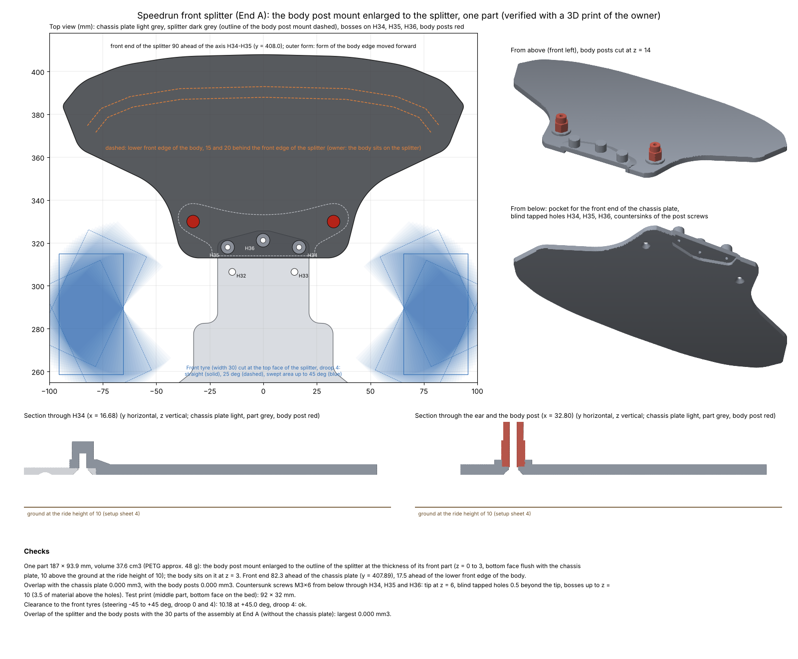

| Item | Model | Source |
|:---|:---|:---|
| Part | One part, 187 x 94 mm, 37.6 cm³, approx. 38 g in nylon PA12 (MJF 3D print), 48 g in PETG (3D print) | Owner (one part), design |
| Body post mount area | 79.5 mm wide over the ears, 47.7 mm over the side lips. Deck 2.5 mm thick on the top face of the chassis plate (4.5 mm total height at the rear edge), straight rear edge 4.0 mm behind H34/H35, 19.2 mm deep on the centre line. The bottom has a pocket in the form of the front end of the plate (2.0 mm deep, 0.2 mm clearance, side lips around the plate): the overhang holds the part against turning. In front of the plate the part is cranked down by the thickness of the plate (bottom face flush with the bottom face of the plate, 3.0 mm thick); a ramp 4 mm wide on the top face follows the front contour of the plate | Owner (M1 to M9), photo (form of the outline, ramp) |
| Splitter | The front part of the mount (3.0 mm, z = 0 to 3.0 mm, bottom face flush with the bottom face of the chassis plate; 10 mm above the ground at the ride height of 10 mm) is extended to the outline of the splitter. Front end 90 mm ahead of the axis through H34/H35 (82.3 mm ahead of the chassis plate). Outer form: the form of the lower front edge of the body, moved forward to this front end, from tip to tip. Full width only at the front, where the splitter closes the space between the chassis front and the body (variant C of the design suggestions): straight rear edge in the middle (y = 313 mm), concave rear edges, deeper beside the mount and narrower toward the tips. Behind the rear edge of the mount the splitter area only lies beside the chassis plate | Owner (front end, outer form, variant C), design |
| Fixing to the chassis plate | 3 countersunk screws M3x6 from below through the countersinks of H34, H35 and H36 into bosses 6.3 mm (as the collar of the original part) up to 10.0 mm above the bottom face of the chassis plate: blind tapped holes 0.5 mm beyond the tip of the screw, 3.5 mm of material above them; the screws are not visible from above. In the 3D print of the owner the bosses reached up to 7.0 mm (0.5 mm of material above the holes) and the tightened screws broke through their top; the bosses are therefore 3.0 mm higher | Owner (screws, M11, 3D print) |
| Ears | One on each side, holes 65.6 mm apart and 12.0 mm ahead of H34/H35; boss 11.2 mm up to 4.41 mm above the bottom face (as the original part); hexagon recess 7.06 mm across the flats from 2.31 mm above the bottom face up to the top: press fit of the body posts; hole 3.2 mm with a countersink on the bottom face | Owner (M2, M3, M13, M15, M16), photo (diameter of the boss) |
| Body posts | Stock parts (assembly only, not in the mass total): 5.92 mm, hexagon section 7.06 mm across the flats and 8 mm long from the bottom of the recess, each held by a countersunk screw M3x6 from below; round post 30 mm long above the hexagon section (B6 open) | Owner (M13), assumption (length) |
| Lower front edge of the body | The body sits on the splitter; its lower front edge lies 17.5 mm (owner: 15 to 20 mm) behind the front edge of the splitter: on the centre line 72.5 mm ahead of the axis through H34/H35 (64.9 mm ahead of the front end of the chassis plate) and 3.0 mm above the bottom face of the chassis plate (top face of the splitter, B4). The form of the edge (flat in the middle, receding toward the corners) is assumed | Owner, assumption (form; measurement sheet B1 to B5) |

* **Checks** of `generate_front_splitter.py`: no overlap with the chassis plate and with the body posts; clearance to the front tyres (cylinder 64 x 30 mm on the wheel centre plane, turned about the kingpin axis from -45 to +45 degrees, at the ride height and with 4 mm droop): 12.81 mm (required 3 mm); no overlap of the splitter and the body posts with the 30 parts of the assembly at End A (bulkheads, pivot block, wishbones, dampers, sway bar and its holders). The assembly contains this part.
* **Manufacturing:** 3D print with the bottom face on the print bed (the deck over the pocket is printed as a bridge or with support). The part does not fit on the print bed of the owner; the test print `front_splitter_one_piece_end_a_test_print.stl` (92 x 32 mm) is the middle part over the chassis plate and the ears with the pocket, the bosses and the hexagon recesses.
* **Parameters:** the outer form of the splitter follows the parameter `front_form` (offset `front_form_offset`), its front end is set by `splitter_front_distance`, the rear edge by `splitter_rear_outline`; the lower front edge of the body follows from `body_overhang`. With the measured form of the body (B1 to B3) the splitter follows the real body.

### Files and open points of the speedrun front splitter
All files are stored in the directory `/speedrun_parts/front_splitter` and are generated with `generate_front_splitter.py` from `front_splitter_parameters.json` (see [scripts](#scripts)), in the coordinates of the chassis plate.

| File | Content |
|:---|:---|
| `front_splitter_one_piece_end_a.step`, `.stl` | Front splitter (one part) in the position in the car |
| `front_splitter_one_piece_end_a_test_print.stl` | Test print for a home 3D printer: the middle part over the chassis plate and the ears, 92 x 32 mm, bottom face on the print bed. Print with 100 % infill; disable the XY hole compensation of the slicer, printed holes are usually undersized |
| `front_splitter_parameters.json` | All dimensions, each with its source and a note |
| `front_splitter_measurement_sheet.pdf` | Measurement sheet (A4, 4 pages): body post mount area, body and splitter with the letters M1 to M16, B1 to B6 and S1 to S3, table with the model values and the measured values of the owner; generated with `generate_front_splitter_measurement_sheet.py` |

Open points:
* Lower front edge of the body (B1 to B5) and the needed length of the body posts (B6).
* Ramp of the mount (M10) and droop of the front wheels (S3).
* As a 3D print (PETG or nylon PA12) the splitter (3.0 mm) is less stiff than a carbon plate.
* The car ran with the front foam bumper so far. ADR-009 (the foam bumper flush with the front apron of the body) and ADR-010 (GPS module on the front foam bumper) refer to it and are not changed yet.

## Speedrun battery tray
* **Author:** [@kleinnconrad](https://github.com/kleinnconrad)
* **Description:** Speedrun battery tray for the LiPo Absima GreenHorn V2 3S 5000 mAh 50C hardcase (`specs/electronics/battery/spec_battery.yaml`) on the left side of the car, fixed with 4 countersunk screws M3x6 from below through H11, H12, H22 and H23 of the speedrun chassis plate (owner). 2 velcro straps 20 mm (owner) hold the battery from left to right. MJF 3D print in nylon PA12 (owner).
* **Status:** $\color{green}\checkmark$ Verified by the owner (2026-11-20). The battery dimensions are taken from the manufacturer, the holes from the ordered chassis plate.

### Design of the speedrun battery tray
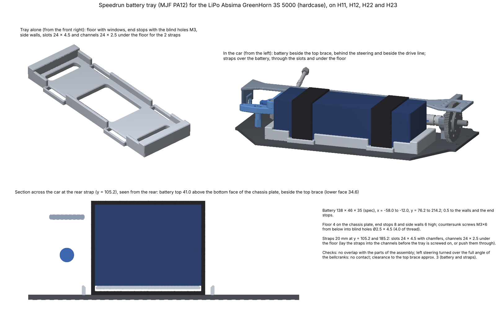

| Item | Model | Source |
|:---|:---|:---|
| Battery | 138 x 46 x 35 mm, 370 g; on the tray at x = -58.0 to -12.0 mm, y = 76.2 to 214.2 mm, z = 6.0 to 41.0 mm above the bottom face of the chassis plate | Spec (manufacturer) |
| Position across the car | The top brace (lower face 34.6 mm above the bottom face of the chassis plate) reaches to x = -7.5 mm and widens near the rear end of the battery; the battery stands beside it, 2.5 mm further out than centred on the holes: 3.1 mm clearance (straps 3.0 mm) | Check |
| Floor | 4.0 mm on the top face of the chassis plate, 153.8 x 57.0 mm (with the ears at the straps), windows for mass | Design |
| End stops and walls | End stops 8 mm high at both ends of the battery (they hold it along the car and contain the blind holes), side walls 6 mm high, interrupted at the straps; 0.5 mm clearance all around the battery. The leads at the end face of the battery stay free above the end stops | Design |
| Fixing | 4 countersunk screws M3x6 from below through the countersinks of H11, H12, H22 and H23 into blind holes Ø2.5 x 4.5 mm in the end stops (4.0 mm of thread, formed by the screws or tapped M3) | Owner |
| Straps | 2 velcro straps 20 mm, 80 mm apart (y = 105.2 and 185.2 mm): over the battery, down through a slot beside the battery on each side (24 x 4.5 mm, chamfer 0.8 mm at the top) and through a channel under the floor (24 x 2.5 mm), so each strap wraps battery and floor. Lay the straps into the channels before the tray is screwed on, or push them through | Owner (width, easy threading), design |
| Mass | 24.2 cm³, approx. 24 g in nylon PA12 | Model |

* **Checks** of `generate_battery_tray.py`: no overlap of the tray, the battery and the straps with the parts of the assembly; left steering (bellcrank with ball and screw, bridge with its bearings, shims, screws and lock nuts, rod end of the servo link) turned over the full angle of the bellcranks (±41.2 degrees): no contact, smallest distance 2.4 mm. Distances: top brace 3.1 mm (battery), 3.0 mm (straps); servo mount top plate 16 mm and more; centre driveshaft 7.5 mm; cup joint at End B 6.0 mm; motor mount 3.7 mm; lock nut under the left bellcrank 2.8 mm.
* **Manufacturing:** MJF 3D print, bottom face down. [Technical drawing](speedrun_parts/battery_tray/readme.md).

### Files and open points of the speedrun battery tray
All files are stored in the directory `/speedrun_parts/battery_tray` and are generated with `generate_battery_tray.py` from `battery_tray_parameters.json` (see [scripts](#scripts)), in the coordinates of the chassis plate (position in the car).

| File | Content |
|:---|:---|
| `battery_tray_speedrun.step`, `.stl` | Battery tray in the position in the car |
| `battery_tray_parameters.json` | All dimensions, each with its source and a note |
| `battery_tray_speedrun_technical_drawing.pdf` and the PNG files | Technical drawing (A3, 2 sheets) |

Open points:
* Height of the battery: its top lies 41.0 mm above the bottom face of the chassis plate (the floor adds 4.0 mm); the clearance to the body is not checked (body not modelled).
* Dimensions of the battery: from the manufacturer; the radius of the vertical edges and the position of the leads are assumed. A caliper value of the battery confirms the pocket (138 + 1.0 by 46 + 1.0 mm).
* The battery (370 g) is not in the mass total of the speedrun parts.

## Further own parts
The drive line, the pivot blocks, the wishbones and the running gear are the owner's own design. Some of them are based on parts of the Carten T410R (for example the interfaces: bearings, gears, screws), others deviate strongly from them (for example the C-hubs and the steering knuckles). The assembly of the speedrun chassis contains them, so that the space around the speedrun parts and the function of the build can be checked. The camber links are purchased parts; the assembly contains a simplified model of them (`/generic_parts/camber_link`, generated with `generate_camber_links.py`). Status: $\color{green}\checkmark$ verified (test print or on the car), $\color{gold}\blacktriangle$ measures qualified, no 3D print verification, $\color{red}\times$ completely unqualified.

### Pivot blocks
* **Author:** [@kleinnconrad](https://github.com/kleinnconrad)
* **Description:** Pivot blocks of the speedrun chassis (own design, partly based on the T410R). The pivot blocks hold the hinge pins of the wishbones and are screwed to the chassis plate from below (countersunk screws M3).
* **Status:** $\color{green}\checkmark$ Verified with a 3D printed prototype of the owner (bores 5.0 mm for the hinge pins, distances of the bores 44.6 and 41.4 mm confirmed). The dimensions are measurements of the owner, the distances of the mounting holes are taken from the hole pattern of the speedrun chassis plate, the lengths of the shoulders are estimates from photos.

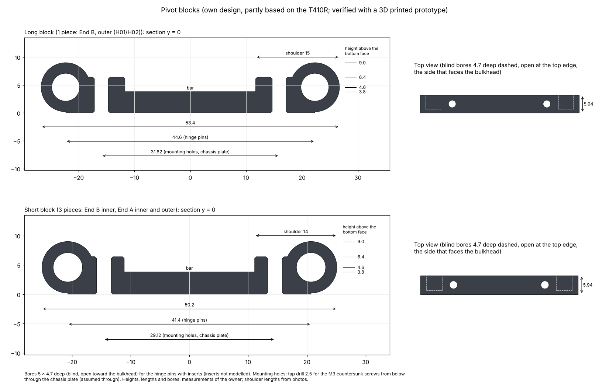

**Dimensions of the pivot blocks**

| Dimension | Long block | Short block | Source |
|:---|:---|:---|:---|
| Quantity and position | 1: End B, outer (H01/H02) | 3: End B, inner (H07/H08), End A, inner (H26/H27), End A, outer (H32/H33) | Owner, chassis plate |
| Total length | 53.4 mm | 50.2 mm | Owner (long block), derived (short block: 41.4 + 2 x 4.4) |
| Distance of the hinge pin bores | 44.6 mm | 41.4 mm | Owner, confirmed by the 3D printed prototype |
| Distance of the mounting holes | 31.82 mm | 29.12 mm | Chassis plate (short block: mean of 3 hole pairs; photo of the underside approx. 29.2 mm) |
| Width | 5.94 mm | 5.94 mm | Owner |
| Height at the lobes, at the shoulders, of the bar | 9.0 / 6.4 / 3.8 mm | Same | Owner |
| Length of the shoulders (from the end of the block) | 15.0 mm | 14.0 mm | Photo |
| Hinge pin bores | 5.0 mm, 4.7 mm deep (blind holes, wall of 1.24 mm at the bottom), open toward the bulkhead, axis 4.6 mm above the bottom face, lobes R4.4 | Same | Owner (diameter 5.0 mm after the 3D printed prototype, depth, side of the opening), derived from the measurements of the owner (axis, lobes) |
| Mounting holes | 2.5 mm (tap drill M3), through | Same | Assumption |

* The radius of the lobes follows from the long block: (53.4 - 44.6) / 2 = 4.4 mm. The axis of the bores lies at 9.0 - 4.4 = 4.6 mm above the bottom face.
* Not modelled: the inserts in the bores and the small tabs on top of the shoulders.

**Position and fit on the speedrun chassis**

Results of the checks of `generate_pivot_blocks.py`:

| Position | Block | Holes of the chassis plate | Offset of the mounting holes | Lower bulkhead | Upper bulkhead |
|:---|:---|:---|:---|:---|:---|
| End B, outer | Long | H01/H02 | 0.00 mm | Overlap 0.82 mm³ (0.38 mm deep) | 9.18 mm clearance |
| End B, inner | Short | H07/H08 | 0.03 mm | 2.13 mm clearance | 8.67 mm clearance |
| End A, inner | Short | H26/H27 | 0.01 mm | 1.22 mm clearance | 8.67 mm clearance |
| End A, outer | Short | H32/H33 | 0.02 mm | 0.90 mm clearance | 8.67 mm clearance |

* Orientation: the blind bores open toward the bulkhead. The blocks at End B, inner and End A, outer are turned by 180 degrees compared with the other two.
* The long block at End B lies closer to the bulkhead (16.5 mm from the centre of the bulkhead) than the short block at End A, outer (19.1 mm). Its shoulders (6.4 mm) reach 0.38 mm into the outer chamfer of the lower bulkhead, which starts at 6.0 mm above the chassis plate at the side of the block that faces the bulkhead (|x| from 11.7 to 17.0 mm).
* The test prints of the lower bulkhead were made with the previous shape. The outer chamfers came with the new shape after the second test print, so this point is not checked on the car.

**Files of the pivot blocks**

All files are stored in the directory `/generic_parts/pivot_block`. They are generated with `generate_pivot_blocks.py` (see [scripts](#scripts)).

| File | Format | Use |
|:---|:---|:---|
| `pivot_block_long_T410R.step`, `pivot_block_short_T410R.step` | STEP (AP214) | Solid models in block coordinates: x along the block, y along the hinge pins, z = 0 bottom face |
| `pivot_block_long_T410R.stl`, `pivot_block_short_T410R.stl` | STL (binary) | Triangle meshes |
| `pivot_block_parameters.json` | JSON | All dimensions, each with its source and a note |

**Open points of the pivot blocks**

* Overlap at End B, outer: check on the car whether the long pivot block touches the outer chamfer of the lower bulkhead, or measure the height of the shoulders at the side of the block that faces the bulkhead. If they touch, the outer chamfer of the lower bulkhead can be raised at this place (outer shape; the inside of the bulkhead is not changed).
* Mounting holes: depth (through or blind) not measured.

### Centre driveshaft and drive line
* **Author:** [@kleinnconrad](https://github.com/kleinnconrad)
* **Description:** Model of the centre driveshaft of the Carten T410R between the cup joints of the two pinion shafts. The shaft has a ball end at each end with a metal pin (2.0 x 7.6 mm), which is fixed on the shaft. The cup joints are pushed onto the pinion shafts and secured with a retaining pin 2.0 x 7.6 mm through a cross hole; an O-ring in a groove of the cup joint holds the pin. The pins run in the slots of the cup joints, so the shaft turns with the cup joints. In the centred position, each pin has 0.5 mm to the closed end of its slot, so the shaft can move a little back and forth. At End A, the cup joint sits on the front pinion shaft beside the bulkhead. At End B (motor), the rear pinion shaft runs from the pinion in the bulkhead through a flange with the spur gear and the bearing in the motor mount (manual steps 5, 10 and 12); the cup joint sits on its end beyond the motor mount. All these parts are modelled as CAD files (see [files](#centre-driveshaft-and-drive-line)).
* **Status:** $\color{green}\checkmark$ Verified: motor mount with cap (test print of the owner: technically good; cosmetic changes after the print: smooth faces without the grooves, round upper inner corner (R9)). $\color{gold}\blacktriangle$ Measures qualified, no 3D print verification: centre driveshaft, rear and front drive line (pinion shafts, pinions, spur gear, bearings, retaining pins; some dimensions from photos of the owner). $\color{red}\times$ Completely unqualified: cup joints and diff outdrives. The cup joints, the thickness of the motor mount and the spur gear (72T 48DP) are given by the owner, the positions of the motor mount and the spur gear are derived from the chassis plate, the outline of the motor mount and its cap follow the manual (steps 10 and 25). The thicknesses of the spur gear and the flange and the gaps are typical values (see [open points of the centre driveshaft](#centre-driveshaft-and-drive-line)).

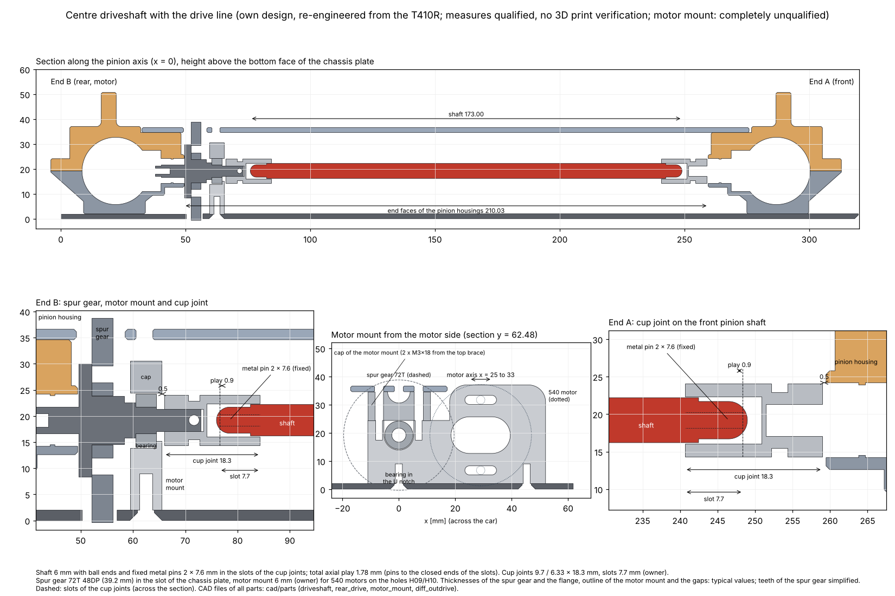

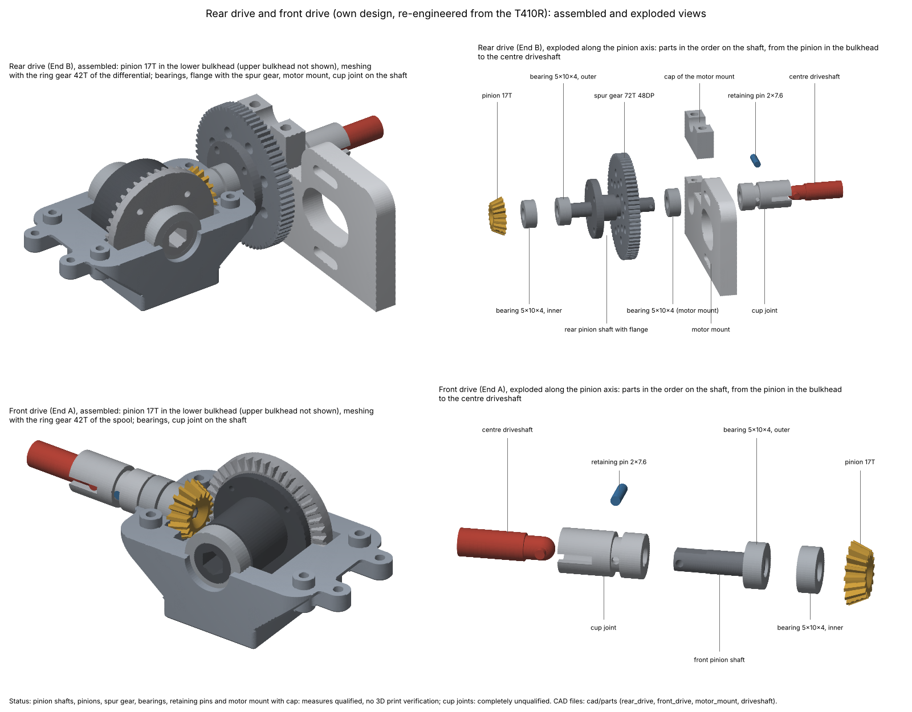

* Assembly pictures of the rear drive (End B) and the front drive (End A): left the assembled parts in the lower bulkhead (upper bulkhead not shown) with the differential or the spool, right the parts exploded along the pinion axis in their order on the shaft.

**Dimensions of the centre driveshaft**

Positions y along the car on the chassis plate (End B at y = 0).

| Dimension | Value | Source |
|:---|:---|:---|
| Pinion axis | x = 0, 19.2 mm above the bottom face of the chassis plate (2.0 + 17.2) | Lower bulkhead (`axis_z`), chassis plate |
| End faces of the pinion housings | y = 49.43 mm (End B) and 259.46 mm (End A) | Lower bulkhead (pinion seat 18.65 + 9.25 = 27.9 mm), positions of the bulkheads |
| Cup joints | 9.7 mm outer and 6.33 mm inner diameter, 18.3 mm long, 2 slots 7.7 mm long from the open end (2.1 mm wide); bore 10.2 mm deep. Back end: bore 5.0 mm for the pinion shaft (7.5 mm deep), groove 4.6 to 6.8 mm from the back face (7.4 mm diameter) for the O-ring 5.8 x 9.6 x 1.9 mm, cross hole 2.0 mm in the groove for the retaining pin | Owner (dimensions, mounting, photos with a ruler), manual step 5 (pin, O-ring), estimates (bore depths) |
| Cup joint End A | From y = 258.96 to 240.66 mm (0.5 mm from the end face of the pinion housing) | Typical value (gap) |
| Rear pinion shaft | Sections from the pinion: press fit shape for the pinion (5.0 mm with two flats, 4.2 mm across the flats) with an axial M3 thread (tap drill 2.5 mm, 6.0 mm deep) for the pinion screw M3x6; 5.0 mm for the 2 bearings of the bulkhead (y = 40.18 to 49.08 mm, rib 0.9 mm); flange 21.7 x 2.5 mm (mounting plate of the spur gear, y = 49.63 to 52.13 mm) with 4 M3 threads on a radius of 8.8 mm; spigot 9.3 mm through the spur gear, 2.2 mm beyond it; shoulder 6.7 mm against the inner ring of the bearing in the motor mount; 5.0 mm for this bearing; press fit shape for the cup joint with a cross hole 2.0 mm for the retaining pin 2.0 x 7.6 mm (separate part; end of the shaft at y = 72.98 mm, 7.0 mm in the cup joint) | Manual (step 5), owner (press fit shapes, screws, photos), bulkhead (seat), estimates (flats, lengths) |
| Spur gear | Standard 72T 48DP, 39.16 mm outer diameter, teeth with a simplified trapezoidal profile (not involute), 4.0 mm thick, y = 52.13 to 56.13 mm, in the slot of the chassis plate below the pinion axis (y = 50.28 to 56.97 mm); centre bore 9.4 mm on the spigot of the shaft; 4 holes 3.2 mm on a radius of 8.8 mm for the screws M3 into the flange; lightening holes 4 x 3.2 mm on a radius of 8.8 mm and 8 x 3.5 mm on a radius of 12.5 mm | Owner (72T 48DP, photos), chassis plate (position), typical value (thickness) |
| Motor mount for 540 motors | As the original part (photos of the owner of both faces with a ruler, scale 16.9 px/mm, accuracy approx. 0.3 to 0.5 mm): plate 6.0 mm thick, y = 59.48 to 65.48 mm, on the holes H09 and H10 (y = 62.48 mm); the motor window starts at y = 65.63 mm. Low part with the bearing seat (unchanged): U-shaped notch 10.6 mm wide, open to the top (24.4 mm), for the bearing 5 x 10 x 4 mm at the pinion axis, on the side toward End A a lip 1.0 mm wide (opening 8.0 mm) against which the bearing lies; beside the seat a hook at the outer end (x = -9.6 mm) with a curved underside down to the base (x = -2.7 mm). Tall part (x = 13.0 to 49.5 mm, 35.0 mm high, upper outer corner R10.4, upper inner corner R9.0, lower outer corner R3) with the long hole of the motor shaft (13 mm wide, at the height of the pinion axis, motor axis x = 23.8 to 37.05 mm as the original) and 2 diagonal long holes of the motor screws (3.2 mm wide, 11.2 mm above and below the motor axis, the screws 5.55 mm before and behind it). Deviation from the original part (owner): both long holes of the screws are extended as far as the part allows: the upper one from x = 19.05 to 31.5 mm (3.0 mm wall to the top, 2.1 mm to the round upper inner corner as the test print), the lower one from x = 29.35 to 39.4 mm (3.1 mm wall to the thread of H09). Usable range of the motor axis: x = 24.6 to 33.85 mm (original part: approx. 24.8 to 32.5 mm), centre distance to the pinion axis 24.6 to 33.85 mm (48DP: spur gear plus pinion 93 to 127 teeth). Smooth faces: the grooves of the original part (cooling ribs) are omitted (owner). Round upper inner corner R9.0, one continuous shoulder as the outer corner (owner): below the end of the top brace (x up to 17.24 mm at 34.6 mm) it stays 0.96 mm lower | Photos of the owner (outline, holes, cap), owner (thickness, notch, lip, measurement sheet), chassis plate (position), derived (height of the low part: top brace minus cap), manual step 10 (principle) |
| Cap of the motor mount (second part of the motor mount set) | As the original part (photos of the owner: side, end and top view): block 19.0 x 6.0 x 10.2 mm on the low part of the motor mount, from 24.4 mm up to the top brace (34.6 mm); rectangular notch 7.0 mm wide and 4.3 mm deep across its top face below the hole B09 of the top brace, with a thread M3 in its bottom for the set screw M3x3 (manual step 25) that presses on the outer ring of the bearing (0.2 mm below the cap); 2 through holes 3.2 mm below the holes B10 and B11 of the top brace (x = +-7.02 mm, y = 62.15 mm; photo: approx. +-6.7 mm). 2 screws M3x18 from the top brace through the cap into the motor mount fix the motor mount to the top brace | Photos of the owner (length, notch, holes), owner (height), manual (steps 25, parts list), top brace (holes) |
| Pinion | 17 teeth, 14.1 mm outer diameter at the large end, 4.1 mm long, large end against the inner bearing of the bulkhead (y = 36.08 to 40.18 mm, in the pinion pocket of the bulkhead); simplified straight bevel gear: the teeth converge to the apex of the pitch cone (pitch cone angle 22 degrees); bore with the press fit shape of the shaft, countersink for the screw M3x6 | Owner (teeth, side photo with the bearing as scale: length, large end at the bearing), bulkhead (no. 29: outer diameter), gear ratio 42/17 (cone angle), estimate (tooth profile) |
| Front pinion shaft (End A) | Same sections as the rear pinion shaft without flange, spur gear and motor mount: press fit shape for the pinion with the axial M3 thread, 5.0 mm through the 2 bearings of the bulkhead (y = 268.71 to 259.81 mm), press fit shape for the cup joint with the cross hole of the retaining pin; 19.15 mm long, end 7.0 mm in the cup joint (y = 251.96 mm). Pinion, bearings and retaining pin as at End B, turned by 180 degrees with the bulkhead | Manual (step 5), owner (photos), bulkhead (seat) |
| Differentials | See [differentials](#differentials) | |
| Bearings in the bulkhead | 2 x 5 x 10 x 4 mm in the pinion seat, y = 40.18 to 44.18 mm and 45.08 to 49.08 mm (rib 0.9 mm between them) | Manual (step 5), bulkhead (seat) |
| Cup joint End B | From y = 65.98 to 84.28 mm (0.5 mm beyond the motor mount, on the end of the rear pinion shaft) | Typical value (gap) |
| Shaft | Rod 6.0 mm, ball ends 5.0 mm (radial clearance 0.665 mm in the cup joints), neck of 5.0 mm up to 4.0 mm from the centres of the balls | Owner (rod), ruler photo (ball ends) |
| Metal pins | 2.0 x 7.6 mm, fixed on the shaft at the centres of the ball ends, part of the model of the shaft | Owner (fixed pins), size as the retaining pin of the cup joints |
| Pins in the centred position | y = 78.47 mm and 246.47 mm, 168.00 mm apart (ruler: 167.9 mm); 0.89 mm to the closed ends of the slots (y = 76.58 and 248.36 mm) | Derived |
| Length of the shaft | 173.00 mm over the ball ends | Owner (ruler) |
| Axial play | 1.78 mm in total, 0.89 mm at each pin to the closed end of its slot: follows from the measured length of the shaft and the positions of the cup joints | Derived |
| Diff outdrives | Hexagon shaft 5.6 mm across the flats (press fit of the side gear, through the hexagon bore of the ring gear or of the case hub and the lip opening of the bulkhead, 12.28 mm), cup 12.0 mm outer diameter, 10.0 mm long, 0.3 mm beyond the side faces of the bulkheads on the diff axes, bore 9.6 x 8.0 mm (wall 1.2 mm), 2 slots 2.1 x 7.0 mm for the holding pin of the dogbones | Owner (hexagon press fit), typical values (cup) |

**Checks of the centre driveshaft**

Results of `generate_driveshaft.py`:

| Check | Result |
|:---|:---|
| Shaft in the cup joints | 0 mm³ overlap; pins 0.05 mm per side in the slots, pin ends 1.05 mm inside the cup joints |
| Ends of the shaft | 1.89 mm to the bottoms of the bores |
| Shaft, cup joints, rear drive line, motor mount and diff outdrives with the bulkheads, the chassis plate and the top brace | 0 mm³ overlap; the spur gear runs through the slot of the chassis plate and below the obround of the top brace, the tall part of the motor mount lies 0.76 mm beside the end of the top brace, the cap of the motor mount touches the top brace |

* Not modelled: the motor, the screws of the pinions, the shims between the bearings, the O-rings 5.8 x 9.6 x 1.9 mm in the grooves of the cup joints (see `specs/mechanics/carten_t410r/drivetrain/spec_driveshaft_and_joints.yaml`).

**Open points of the centre driveshaft**

* Not measured: thickness of the spur gear (4.0 mm), dimensions of the rear pinion shaft from the photos (flange 21.7 x 2.5 mm, spigot 9.3 mm, shoulder 6.7 mm, flats 4.2 mm across) and of the pinion (length 4.1 mm from the side photo), the gaps between the motor mount or the pinion housing and the cup joints (0.5 mm), depths of the bores of the cup joints, opening of the lip of the bearing seat (8.0 mm), outline of the tall part of the motor mount (height, long holes) and of the cap (width, notch).
* Motor mount: verified with a test print (owner); technically good. Cosmetic changes after the print (owner): smooth faces without the grooves, round upper inner corner (R9) instead of the step. The measured height of the low part (MM3: 23.2 mm, photo of the owner: 23.25 mm) does not fit the stack: with the cap (10.2 mm) below the top brace (34.6 mm above the bottom face of the chassis plate), the low part is 22.4 mm high in the model; the bearing seat is kept as it is (owner). The depth of the U notch (MM2: 10.3 mm) fits within 0.2 mm. Open: MM5 (does the set screw of the cap touch the bearing).
* Length of the shaft: checked with a ruler (173.0 mm over the ball ends); the model uses this length.
* Spur gear: the specifications (`spec_spur_gear.yaml`, `spec_gearing.yaml`) and the setup sheet list a 68T spur gear; the model uses the standard 72T 48DP spur gear of the owner.

**Files of the centre driveshaft and the drive line**

All files are stored in the directory `/generic_parts` and are generated with `generate_driveshaft.py` from `driveshaft/driveshaft_parameters.json` (see [scripts](#scripts)). Each file has STEP (AP214) and STL (binary) format and its own part coordinates.

| File | Part coordinates and use |
|:---|:---|
| `driveshaft/driveshaft_T410R` | Centre driveshaft with the fixed metal pins, along y from 0 to 173.00 mm, axis at x = 0, z = 0, pins along x |
| `driveshaft/cup_joint_T410R` | Cup joint (2 pieces): along y, back face at y = 0, open end at y = 18.3 mm, slots and cross hole of the retaining pin along x |
| `rear_drive/rear_pinion_shaft_T410R` | Rear pinion shaft with flange: along y, y = 0 end face of the pinion housing of the bulkhead, from y = -11.65 mm (inside the bulkhead) to 23.55 mm, with the cross hole of the retaining pin |
| `front_drive/front_pinion_shaft_T410R` | Front pinion shaft (End A), in the same coordinates as the rear pinion shaft: y = 0 end face of the pinion housing, y > 0 toward the cup joint; pinion, bearings and retaining pin as the files in `rear_drive` |
| `rear_drive/retaining_pin_2x7.6` | Retaining pin of the cup joint (2.0 x 7.6 mm), in the coordinates of the rear pinion shaft |
| `rear_drive/pinion_17T` | Pinion 17T, in the coordinates of the rear pinion shaft |
| `rear_drive/spur_gear_72T_T410R` | Spur gear 72T 48DP: along y from y = 0 (face on the flange) to 4.0 mm, axis at x = 0, z = 0 |
| `rear_drive/bearing_5x10x4` | Bearing in the motor mount: along y from y = 0 to 4.0 mm |
| `motor_mount/motor_mount_T410R` | Motor mount: x = 0 pinion axis, y = 0 middle of the plate, z = 0 bottom face (on the chassis plate) |
| `motor_mount/motor_mount_cap_T410R` | Cap of the motor mount, in the coordinates of the motor mount |
| `diff_outdrive/diff_outdrive_T410R` | Diff outdrive (4 pieces): along +x, back face at x = 0, open end at x = 10.0 mm, slots along z |
| `driveshaft/driveshaft_parameters.json` | All dimensions of these parts, each with its source and a note (JSON) |

### Differentials
* **Description:** Models of the differential at End B (rear) with the ring gear 42T, the inner gears, the shims, the bearings and the outdrives, and of the spool at End A (front, owner: a spool is installed) with the same ring gear, bearings and outdrives. Own design, partly based on the T410R.
* **Status:** $\color{gold}\blacktriangle$ Measures qualified, no 3D print verification. Main dimensions and the design of the inner parts from the owner (measurements, photos, description), the position from the verified bulkhead.

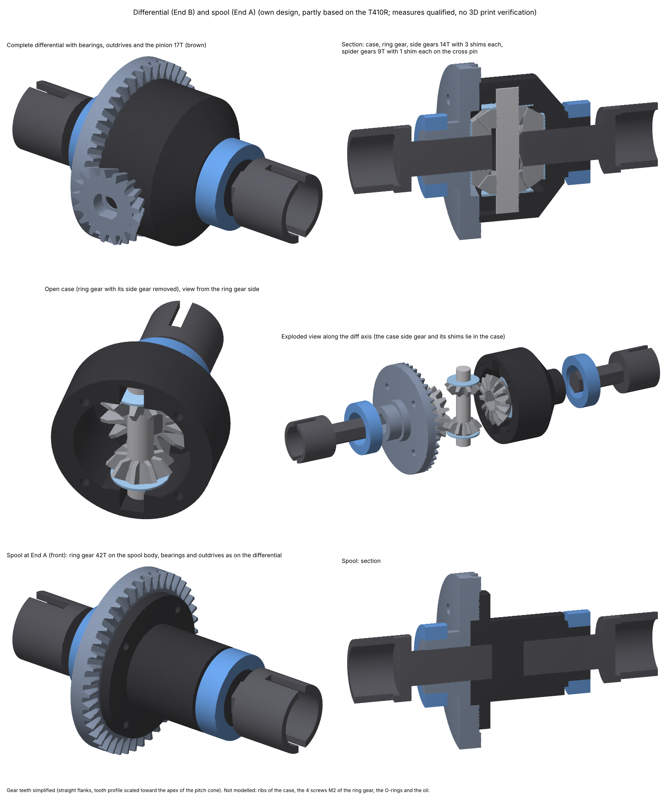

| Part | Model | Source |
|:---|:---|:---|
| Position | Diff axis 0.5 mm from the bulkhead centre toward the pinion, 17.2 mm above the bottom face of the bulkhead; ring gear on the +x side of the bulkhead; centre of the inner gears in the plane of the pinion axis (x = 0) | Bulkhead |
| Case (plastic) | 26.0 mm diameter over 10.5 mm from the teeth of the ring gear, then a taper to 14.0 mm at x = -10.3 mm, hub 12.0 mm and journal 10.0 mm for the bearing; inner space 19.0 mm diameter with flat walls at the spider gears (16.4 mm apart), bores and mounting slots for the cross pin, 4 tap holes M2 (1.6 mm, 5.0 mm deep) on a radius of 10.7 mm; hexagon bore 5.6 mm through the hub; 0.5 mm in the case cavity of the bulkhead (radius 13.5 mm), 1.05 mm below the pinion | Owner (26.0 x 10.5 mm, photos), bulkhead, estimates (taper, wall) |
| Ring gear 42T | 31.8 mm, 3.8 mm from the back face (plate side) to the tips of the teeth: teeth toward the case and the pinion (tips at x = 4.9 mm, toothed band from radius 13.2 to 15.9 mm), back face at x = 8.7 mm; central opening 15.9 mm for the side gear with the shoulder for its shims at x = 6.8 mm; hub 12.0 mm and journal 10.0 mm for the bearing; hexagon bore 5.6 mm through the hub for the shaft of the outdrive; 4 clearance holes 2.2 mm for the screws M2 into the case. Mesh with the pinion 17T: tooth gap of the ring gear at the pinion, no overlap (smallest clearance 0.02 mm) | Owner (42T, 31.8 mm, 3.8 mm, photos, hexagon bore, screws), bulkhead (recess, no. 27) |
| Side gears 14T (2 pieces) | Module 1.0, pitch cone angle 57.3 degrees, 15.1 mm outer diameter, back face 6.5 mm from the centre; hexagon bore 5.6 mm on the press fit of the outdrive; 3 shims 0.1 x 6.6 x 12.0 mm behind each side gear | Owner (14T, press fit, 3 shims), photo (diameter), estimates (shim sizes) |
| Spider gears 9T (2 pieces) | Module 1.0, pitch cone angle 32.7 degrees, 10.6 mm outer diameter, on the cross pin, back face 7.9 mm from the centre; 1 shim 0.3 x 4.1 x 9.2 mm behind each spider gear against the flat wall of the case | Owner (2 spider gears, 9T, 1 shim each, photos) |
| Cross pin | 4.0 x 23.3 mm, through the spider gears and the case wall | Photo of the owner |
| Bearings | 10 x 15 x 4 mm on the journals of the ring gear and the case hub, x = +-11.0 to +-15.0 mm (30.0 mm over both bearings, 0.35 mm to each lip of the bulkhead) | Manual, bulkhead (no. 28) |
| Spool (End A) | Instead of the case and the inner gears: solid body 15.0 mm, flange 25.0 x 2.0 mm with 4 tap holes M2 for the ring gear, spigot 15.8 mm in the opening of the ring gear, hub 12.0 mm and journal 10.0 mm for the bearing, hexagon bores 5.6 mm for the shafts of both outdrives (up to x = +-2.85 mm). Same ring gear, bearings and outdrives as the differential; shape of the body assumed (inside the envelope of the differential) | Owner (spool), assumption (body) |
| Outdrives | Hexagon shaft 5.6 mm from the front face of the side gear (x = 2.9 mm) through the hub to the cup (see [centre driveshaft and drive line](#centre-driveshaft-and-drive-line)) | Owner (press fit) |

* Checks of `generate_driveshaft.py`: all parts of the differential and the outdrives are valid solids without overlap with each other (19 parts per differential), with the bulkheads, the chassis plate and the top brace. The gear teeth are simplified (straight flanks, tooth profile scaled toward the apex of the pitch cone); the inner gears are turned so that their teeth lie in the tooth gaps.
* Not modelled: ribs of the case, the 4 screws M2, the O-rings and the oil.
* Not measured: module of the inner gears (from the photo), shim thicknesses, wall thickness and inner space of the case, taper of the case.

**Files of the differentials**

All files are stored in the directory `/generic_parts/diff` and are generated with `generate_driveshaft.py` (see [scripts](#scripts)). Diff coordinates: x along the diff axis, x = 0 centre of the inner gears (plane of the pinion axis), ring gear side toward +x; each file has STEP (AP214) and STL (binary) format.

| File | Part coordinates and use |
|:---|:---|
| `diff_case_T410R` | Diff case, cross pin along z |
| `ring_gear_42T_T410R` | Ring gear 42T with hub, in the coordinates of the diff case |
| `side_gear_14T_T410R` | Side gear 14T: along z, apex of the pitch cone at z = 0, back face at z = 6.5 mm |
| `spider_gear_9T_T410R` | Spider gear 9T: along z, apex of the pitch cone at z = 0, back face at z = 7.9 mm |
| `cross_pin_T410R` | Cross pin, along z, centred at the origin |
| `shim_side_gear`, `shim_spider_gear` | Shims (side gear: along x from x = 0; spider gear: along z from z = 7.9 mm) |
| `spool_T410R` | Spool (End A), in the coordinates of the diff case |
| `bearing_10x15x4` | Bearing of the differential: along x from x = 0 to 4.0 mm |

### Wishbones
* **Description:** Lower wishbones (suspension arms) of the speedrun chassis (own design, partly based on the T410R) with the inner hinge pins 3 x 42 mm. The manual (step 7 and parts list "Arms (F/R)") and the photos of the owner show two different arms: 2 front arms and 2 rear arms. There is no left or right arm (owner): each arm is used on both sides of its axle, flipped so that the shock plate on rail A faces the outer end of the car.
* **Status:** $\color{green}\checkmark$ Verified (front and rear wishbone, owner, after the change of the pin bores to Ø3.1 mm for the metal pins Ø3.0 mm; widened to Ø3.2 mm on 2026-11-20, see below). Optical design of the window changed on 2026-11-20 (web with 3 lightening holes instead of the X ribs, interfaces unchanged): a test print of the new shape is open; inner hinge pins: $\color{red}\times$ Completely unqualified. The front wishbone is 6.44 mm longer than measured (51.7 mm axis to axis): 4.44 mm for equal track front and rear with the kingpin of the C-hub 6.75 mm inside the outer hinge pin, then 2.0 mm more so that the front CVD drive shafts of the T410R fit (owner). The main dimensions are caliper measurements of the owner (measurement sheet). The positions of the shock plate and of the holes of the ball studs are estimates from the photos (see the measurement table below).

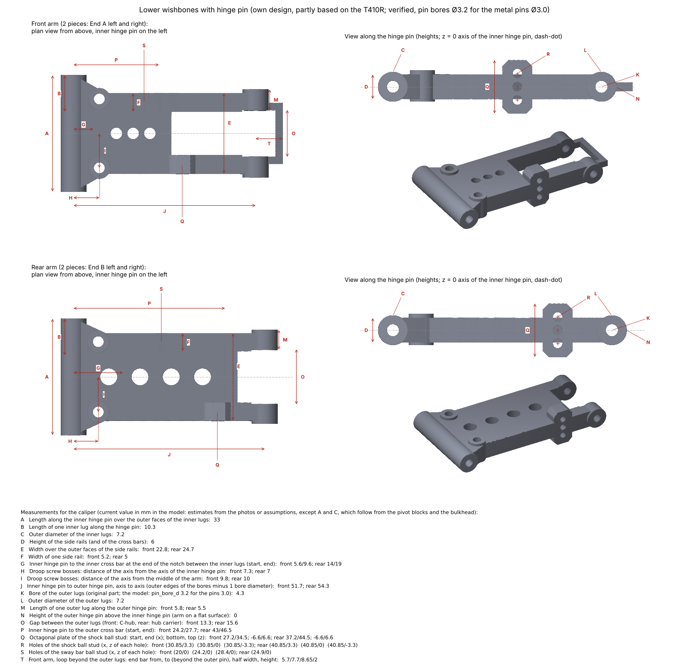

**Design of the wishbones**

* Two inner lugs on the inner hinge pin between the pivot blocks, joined to one tube Ø7.2 mm of constant diameter over the whole length of 33.0 mm (owner, 2026-11-20; the original part has an open notch between the lugs up to the inner cross bar); a shoulder from each end of the tube to its side rail; two parallel side rails; a closed plate as high as the rails from the tube to the outer cross bar; two outer lugs at the ends of the side rails for the outer hinge pin.
* Optical design (owner, 2026-11-20, concept E of 5 concepts; the original part has X-shaped ribs in an open window): the plate from the tube to the outer cross bar is closed and as high as the rails (no step, the same look on both sides of the car: one arm per axle is mounted upside down), with lightening holes of the same size: front 3 holes Ø3.5 mm (pitch 4.75 mm, x = 12.15 to 21.65 mm), rear 4 holes Ø5.0 mm spread evenly between the tube and the outer cross bar (pitch 8.88 mm, x = 9.98 to 36.62 mm). No engraving. The lugs, bores, bosses, plates and the holes for the ball studs are unchanged; no ball stud reaches into the plate. Mass in PA12: front 6.3 g, rear 8.0 g (before 5.2 g and 5.5 g).
* Front arm: side rails 22.8 mm wide over the outer faces, open loop between the outer cross bar and the outer lugs (C-hub), a thin closed loop beyond the outer lugs.
* Rear arm: side rails 24.7 mm wide over the outer faces, 2 mm longer than the front arm, open U between the outer cross bar and the outer lugs (hub carrier).
* Above each shoulder a boss with a thread M4 for the droop screw M4 x 10 mm (one of the two is used, depending on the side of the car).
* On side rail A an octagonal plate that reaches above and below the rail, with holes M3 for the ball stud of the shock (set screw M3 x 8 mm with ball): front 3 holes (the middle hole added on 2026-11-20, owner), rear 3 holes; the damper uses the upper hole at the front and the middle hole at the rear (`damper_hole_z` of the running gear). On side rail B holes M3 for the ball stud of the sway bar drop link: front 3 holes, rear 1 hole. The holes go through, so that the ball stud can be set from the side that faces the shock tower.
* Bores of the inner lugs (inner hinge pin 3x42) and of the outer lugs (outer hinge pin 3x26): Ø3.2 mm. The metal pins are exactly Ø3.0 mm (owner); the bores are 0.2 mm wider, so the pins slide in without force and the arms turn freely (original part: outer lugs Ø4.3 mm, caliper value K). Owner (2026-11-20): with Ø3.1 mm the pins had to be pressed into an FDM print (small bores print undersize). The wishbones are made as MJF 3D prints (nylon PA12, technical drawings); if a bore is tight, it is reamed with a drill Ø3.1 to Ø3.2 mm instead of pressing the pin in.
* Between the outer lugs, the side rails end 0.3 mm before the lug of the C-hub (front) or of the hub carrier (rear), which sits on the outer hinge pin between the outer lugs (see [running gear](#running-gear)).
* Not modelled: radii, draft angles, the pivot balls at the ends of the hinge pins, the ball studs and the droop screws. The outer hinge pins are part of the running gear.

**Position and checks of the wishbones**

* The inner hinge pins run through the axes of the bores of the pivot blocks, 4.6 mm above the top face of the chassis plate (6.6 mm above its bottom face). Each arm is centred between the faces of its two pivot blocks.
* End A (front arms): both pivot blocks are short blocks; the hinge pins are parallel to the axis of the car at x = ±20.7 mm.
* End B (rear arms): the outer pivot block is the long block (bores at x = ±22.3 mm), the inner block is a short block (±20.7 mm). The hinge pins are turned by 2.33 degrees to the axis of the car; the outer ends of the arms point toward the middle of the car (toe-in of the rear wheels, `spec_cartent410r.yaml`: 2.5 degrees with the rear toe blocks).
* The model is horizontal: inner and outer hinge pin at the same height. The ride height and the travel of the suspension are not modelled.

Results of `generate_wishbones.py`:

| Check | Result |
|:---|:---|
| Solids | Front arm 60.0 x 33.0 x 13.2 mm, rear arm 57.9 x 33.0 x 13.2 mm: one valid solid each |
| Arms and lower bulkhead | End A: 4.47 mm³ overlap per arm (2.16 mm³ before the notch between the inner lugs was closed): the tube on the inner hinge pin (7.2 mm) reaches 0.14 mm into the side face of the lower bulkhead (x = 17.24 mm, hinge pin at x = 20.7 mm); see open point below. End B: 0 mm³, 0.30 mm clearance |
| Inner lugs and pivot blocks | 0 mm³ overlap; 0.14 mm on each side at End A, 0.10 mm at End B (the arm is turned by 2.33 degrees to the faces of the blocks) |
| Arms and chassis plate | 0 mm³ overlap; the octagonal plates reach below the top face of the chassis plate, but lie beside its outline |
| Hinge pins in the bores of the pivot blocks | Play of the ends to the bottoms of the bores: 0.34 mm at End A, 0.45 mm at End B (pin 42 mm) |
| Assembly | See [assembly file](#assembly-file) |

**Measurements for the wishbones**

The letters are shown in the drawing and in the measurement sheet `parts/parts_measurement_sheet.pdf` (A4, 4 pages: drawings of both arms with dimension lines, a table with empty fields for the measured values, and the bearing seat of the motor mount). x: distance from the axis of the inner hinge pin toward the wheel; y: distance from the middle of the arm; z: height above the axis of the inner hinge pin. Current values in the model:

| Letter | Measurement | Front arm | Rear arm | Source |
|:---|:---|---:|---:|:---|
| A | Length along the inner hinge pin over the outer faces of the inner lugs | 33.0 | 33.0 | Caliper |
| B | Length of one inner lug along the hinge pin | 10.3 | 10.3 | Caliper |
| C | Outer diameter of the inner lugs | 7.2 | 7.2 | Caliper |
| D | Height of the side rails and of the cross bars | 6.0 | 6.0 | Caliper |
| E | Width over the outer faces of the side rails | 22.8 | 24.7 | Caliper |
| F | Width of one side rail | 5.2 | 5.0 | Caliper |
| G | Inner hinge pin to the inner cross bar at the end of the notch (start) | 5.6 | 14.0 | Caliper |
| H | Droop screw bosses: distance of the axis from the axis of the inner hinge pin | 7.3 | 7.0 | Caliper |
| I | Droop screw bosses: distance of the axis from the middle of the arm | 9.8 | 10.0 | Caliper |
| J | Inner hinge pin to outer hinge pin, axis to axis: end to end over the lugs (second measurement of the owner: front 52.46 mm without the loop, rear 61.5 mm) minus 2 x 3.6 mm = 45.26 and 54.3 mm. The front arm is prolonged by 4.44 mm (owner: equal track with the kingpin 6.75 mm inside the outer hinge pin) and by 2.0 mm more (owner: front CVD drive shafts of the T410R). First measurement (outer edges of the bores minus 4.3 mm: 48.7 and 50.7 mm) was wrong | 51.7 | 54.3 | Caliper, owner |
| K | Bore of the outer lugs of the original part (the model: Ø3.2 for the pins Ø3.0, owner) | 4.3 | 4.3 | Caliper |
| L | Outer diameter of the outer lugs | 7.2 | 7.2 | Caliper |
| M | Length of one outer lug along the outer hinge pin | 5.8 | 5.5 | Caliper |
| N | Height of the outer hinge pin above the inner hinge pin | 0 | 0 | Assumption |
| O | Gap between the outer lugs | 13.3 | 15.6 | Caliper |
| P | Inner hinge pin to the outer cross bar (start) | 24.2 | 43.0 | Caliper |
| Q | Octagonal plate of the shock ball stud: height, width (position from the photos) | 13.2, 7.3 | 13.2, 7.3 | Caliper, photo |
| R | Holes of the shock ball stud (x, z) | (30.85, 3.3), (30.85, -3.3) | (40.85, 3.3), (40.85, 0), (40.85, -3.3) | Photo |
| S | Holes of the sway bar ball stud (x, z) | (20.0, 0), (24.2, 0), (28.4, 0) | (24.9, 0) | Photo |
| T | Outer pin axis to the outer edge of the loop beyond the outer lugs | 7.7 | - | Caliper |

* J: the caliper value over the outer edges of the two bores minus 4.3 mm (both bores taken as 4.3 mm). If the bore of the inner lugs is 3.0 mm (hinge pin 3 x 42 mm), J is 0.65 mm longer.
* Open point: with the measured inner lugs (7.2 mm), the front arms reach 0.14 mm into the side faces of the lower bulkhead at End A; since the notch between the lugs is closed (tube of constant diameter, owner), over the whole length of the tube. To be checked on the car. If they touch, the side faces of the lower bulkhead can be narrowed at the inner lugs (outer shape; the inside of the bulkhead is not changed).
* The shock plate is assumed symmetric to the axis of the inner hinge pin (13.2 mm high).

**Files of the wishbones**

All files are stored in the directory `/generic_parts/wishbone`. They are generated with `generate_wishbones.py` from `wishbone_parameters.json` (see [scripts](#scripts)). Part coordinates: x from the axis of the inner hinge pin toward the wheel, y along the hinge pin (y = 0 middle of the arm), z = 0 axis of the inner hinge pin.

| File | Format | Content |
|:---|:---|:---|
| `wishbone_front_T410R.step`, `wishbone_rear_T410R.step` | STEP (AP214) | Solid models of the front arm and the rear arm |
| `wishbone_front_T410R.stl`, `wishbone_rear_T410R.stl` | STL (binary) | Triangle meshes |
| `hinge_pin_3x42.step`, `hinge_pin_3x42.stl` | STEP, STL | Inner hinge pin, along y, centred at y = 0 |
| `wishbone_parameters.json` | JSON | All dimensions, each with its source, the letter of the measurement and a note |

### Running gear
* **Author:** [@kleinnconrad](https://github.com/kleinnconrad)
* **Description:** Wheel suspension (front C-hubs with steering knuckles, rear hub carriers), axles with hex hubs, CVD drive shafts, steering with the servo mount, dampers and sway bars of the speedrun chassis. Own design of the owner, partly based on the T410R: the steering, the floating servo mount and the sway bars follow the T410R (manual steps 10, 13, 14, 21, 22 and 23, photos of the owner), the other parts are designed for their function and deviate from the original parts. The dampers are standard 1:10 on-road dampers (purchased, simplified model).
* **Status:** $\color{green}\checkmark$ Verified: steering knuckles (3D print of the owner; dimensions measured on the original part, still open on the measurement sheet: K11, K14, K16 and K19) and the servo mount (top plate, fixed post, floating post; owner, 2026-11-20; the holes for the servo ears are to be checked against the servo before printing). $\color{gold}\blacktriangle$ Measures qualified, no 3D print verification: steering posts (height of the owner), bellcranks (symmetric design of the owner), the steering bridge (refined design of the owner) and the rear hub carriers (caliper values of the owner, 2026-11-20). All other parts: $\color{red}\times$ Completely unqualified: first design, not checked by the owner, no 3D print verification. The parts are designed from the measured parts (chassis plate, bulkheads, shock towers, wishbones, pivot blocks) and the setup sheet. They still need a lot of refinement (dimensions, strength, fit and function on the car) before manufacturing. Two values can be confirmed on the car (servo height, length of the drop links, see open points).

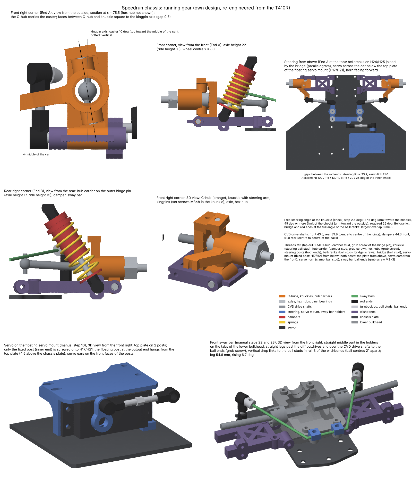

**Layout**

| Item | Model | Source |
|:---|:---|:---|
| Ride height | Front 10 mm: axle 22.0 mm above the bottom face of the chassis plate, wishbones horizontal. Rear: axle 21.7 mm from the hub carrier with the wishbones horizontal (owner), ride height 10.3 mm in the model; setup sheet 4: 15 mm (on the car the rear wishbones then point down toward the wheel by approx. 5 degrees) | Setup sheet 4, owner |
| Wheel centres | Original car: x = ±80.5 mm (overall width 187 mm over tyres of 26 mm, measured by the owner; 191 mm with tyres of 30 mm), wheel radius 32 mm; wheels not modelled. Model: outer faces of the hex hubs at x = ±86.85 mm at the rear (as the original car) and at x = ±88.85 mm at the front: the front wishbone is prolonged by 4.44 mm (equal track, kingpin 6.75 mm inside the outer hinge pin) and by 2.0 mm more for the front CVD drive shafts of the T410R (owner), so the front track is 4.0 mm wider than the rear track (overall width 191 mm front and 187 mm rear over tyres of 26 mm); the rear hex hubs are 1 mm wider (7 mm instead of 6 mm) | Owner, `spec_tires.yaml` |
| Wishbones | Horizontal at this ride height: inner and outer hinge pins 6.6 mm above the bottom face of the chassis plate; each arm is used on both sides (flipped, the shock plate on rail A faces the outer end of the car) | Owner, wishbones |
| Caster | 10 degrees at the front, in the C-hub (between the bore of the outer hinge pin and the kingpin bores) | Setup sheet 4 |
| Front kingpin axis | x = 65.65 mm (6.75 mm inside the outer hinge pin); at the height of the axle 2.0 mm toward the middle of the car from the middle of the front wishbone (y = 284.87 mm) | Owner |
| Wheelbase | Approx. 257.8 mm between the wheel centres (T410R: 258 mm) | Model, `spec_cartent410r.yaml` |
| Rear toe | 2.33 degrees toe-in from the pivot blocks | Pivot blocks |

**Front corner: C-hub with caster and steering knuckle**

* The caster of 10 degrees is in the C-hub, between the bore of the outer hinge pin and the kingpin bores (owner): the kingpin axis is tilted by 10 degrees (top toward the middle of the car) and passes through the centre of the outer CVD joint at the height of the axle (x = 65.65 mm: 2.0 mm outside the track of the measured rear, front wishbone 51.7 mm for the front CVD drive shafts; 6.75 mm inside the outer hinge pin, so the lower bore of the C-hub stays outside the tube on the hinge pin).
* At the height of the axle the kingpin axis lies 2.0 mm toward the middle of the car from the middle of the front wishbone (owner). With the caster the axis lies 2.0 to 2.7 mm further toward the front end of the car in the lower arm of the C-hub, which lies between the rails of the wishbone. With the offset the axis lies in the middle between the rails at this height: the lower bore 5 mm and the counterbore of the lower flange keep walls of 2.27 mm or more to both faces of the lower arm (without the offset: 0.19 mm from the former pocket of the screw head to the front face). The knuckle, the axle and the wheel move with the axis: wheelbase approx. 257.8 mm (T410R: 258 mm); the front CVD drive shafts run at 2.8 degrees to the axis of the diff in the top view.
* The kingpin bores and the faces of the C-hub toward the knuckle are square to this axis, so the knuckle turns with a constant gap of 0.5 mm at the top and at the bottom. The arms of the wishbones stay horizontal; the pivot blocks need no shims for the caster.
* C-hub in 2 frames: the lug on the outer hinge pin 3x26 (3 mm, owner) between the outer lugs of the wishbone (grub screw M3x4 on the groove of the pin, from below in a boss Ø6.0 mm below the tube: thread 4.2 mm, the screw lies fully in it, owner), the lower arm and the back plate up to z = 13.5 mm lie between the rails of the wishbone and are centred on the middle of the wishbone (11.6 mm wide). Their bottom face is square to the kingpin axis (caster angle), 0.1 mm above the lower end of the lower guide sleeve: the sleeve stands 0.1 mm proud, so the head of the screw bears only on the sleeve (owner); the tube on the outer hinge pin stays complete. The back plate above z = 13.5 mm (horizontal bottom face, 0.3 mm above the shock plate of the wishbone) and the upper arm are parallel to the kingpin axis and centred on it (15 mm wide). Passage 10 mm in the back plate (owner: the bone of the CVD drive shaft with its cross pin passes through; 2.5 mm of wall remain beside the passage), closed back plate (no slot, no pocket: the steering arm of the knuckle lies at the height of the axle and does not reach the back plate), top face of the upper arm square to the kingpin axis (15.05 mm from the axle along the axis; z = 35.5 to 38.1 mm; the top guide sleeve stands 0.1 mm proud of it). The outer ball of the camber link sits on the top kingpin (see kingpins), so the C-hub has no separate seat for it. The upper arm is solid from the back plate to the kingpin and from its top down to 1.0 mm above the ring of the knuckle (approx. 7.5 mm high); a U-slot around the upper boss of the knuckle (0.5 mm clearance, open toward the wheel, so the knuckle slides in) leaves room for the boss. The faces toward the boss ends of the knuckle are square to the kingpin axis. Only the boss turns in this space, so the steering angle is unchanged. The rod end of the camber link on the top kingpin lies 0.38 mm above the top face of the upper arm (static position; 1.28 mm before the top face was raised by 0.9 mm for the top guide sleeve inserted from below). The C-hub has no plane of symmetry: the right and the left C-hub are mirror images (owner: the same part cannot be used on both sides because of the caster), files `c_hub_end_a_right` and `c_hub_end_a_left`.
* Knuckle as the T410R knuckle, with the dimensions measured by the owner on the original part (measurement sheet `running_gear/front_corner/steering_knuckle_measurement_sheet.pdf`, K1 to K21), built in the frame of the kingpin axis: a ring (outer diameter 14.1 mm, 16.7 mm long) starts at the kingpin axis (K10 = 0) and holds 2 bearings 5x10x4 (manual), pressed in from both ends against a lip. Both seats are 4.29 mm long, so the outer bearing lies 0.29 mm below the end face. From the inner end face a wider entry bore (12.4 mm) surrounds the joint cup of the axle; it narrows exactly where the inner bearing sits, the step holds the end of the CVD drive shaft (owner). The entry bore (section of the joint cup) is 5.79 mm long; the joint cup of the axle reaches up to 0.2 mm before the step, a shoulder (6.5 mm) rests on the inner race of the inner bearing. The lip cannot be measured; its thickness is the rest of the ring (calculated by the owner): 16.7 - 5.79 (entry bore) - 2 x 4.29 (bearing seats) = 2.33 mm, inner diameter 8.0 mm (lip approx. 1 mm high). Bearing seats: 9.98 mm measured (press fit), modelled with the nominal 10.0 mm as the bearing seats of the bulkheads. Two kingpin bosses (diameter 7.0 mm, 21.1 mm between the end faces, symmetric to the axle) sit on the kingpin axis above and below the inner end of the ring; their bores (2.7 mm, 4.5 mm deep) end at the entry bore. The flat steering arm (4.9 mm thick) lies in the middle plane of the axle: wide root along the ring, diagonal inboard to the end tab (7.4 mm wide) with 2 threads M3. The ball stud sits on top of the arm in the outer hole: from the kingpin axis 5.0 mm toward the chassis and 25.0 mm toward the middle of the car (original position, owner), a second hole 4.0 mm closer to the ring. Gussets between the arm and the ring at the bosses (7.5 mm high, not measured). The inner edge of the arm runs straight back up to 8.5 mm behind the kingpin axis and then diagonally to the tab, so the arm stays clear of the back plate of the C-hub when steering.
* Kingpins and guide sleeves as the original (manual step 15; owner: bores 5 mm in the C-hub with guide sleeves just under 5 mm, so that they fit without pressing and the knuckle moves freely). The knuckle has the bores 2.7 mm of the original part (thread formed by the screw). 2 identical flanged guide sleeves per knuckle (4.95 mm outside, 3.1 mm inside, flange 6.4 x 1.0 mm, sizes from the manual drawing scaled to the outer diameter; shank 3.6 mm, total length 4.6 mm; foot 1.0 mm as modelled, owner: approx. 0.6 mm, to be measured) in bores 5 mm through both arms of the C-hub. Both sleeves are inserted from the knuckle side (owner), their feet lie in counterbores 7.0 x 0.55 mm of the arms toward the bosses of the knuckle (thrust faces), and both stand 0.1 mm proud of the C-hub, so the knuckle moves freely (owner). Top: inserted from below, the upper end 0.1 mm above the top face of the upper arm; the ball stud 4.8x9 of the camber link clamps the sleeve to the knuckle, the ball sits on the kingpin axis. Bottom: inserted from above, foot in the counterbore of the lower arm (thrust face toward the lower boss); a socket head screw M3x8 from below clamps the sleeve to the knuckle (the original M3x10 would reach into the entry bore of the knuckle); the bottom face of the C-hub is square to the kingpin axis (caster angle) and the lower end of the sleeve stands 0.1 mm proud of it, so the head of the screw bears only on the sleeve (owner). Knuckle, sleeves and screws turn together in the bores of the C-hub. The outer hinge pin lies 6.75 mm beside the kingpin axis (front wishbone prolonged, owner): the bore 5 mm and the head of the screw stay outside the tube on the hinge pin (0.65 mm and 0.4 mm to its outer surface); the tube is complete, only the thread of the grub screw reaches the pin. Order: knuckle into the C-hub from the wheel side, the sleeves from above and from below, ball stud and screw, then bearings and axle. The guide sleeves are purchased parts (no files).
* Axle: a shoulder (6.5 mm) between the joint cup and the inner race of the inner bearing (0.1 mm gap) locates the axle; the hex hub sits 0.5 mm outside the end face of the ring.
* Free steering angle (check of the generator: knuckle, axle, hex hub, steering ball stud and the rod end of the steering link turned about the kingpin axis against the C-hub, the kingpins, the hinge pin, the CVD drive shaft and the wishbone): 35 degrees with the steering arm toward the middle of the car (inner wheel; limited by the steering arm at the edge of the back plate), 45 degrees or more toward the outside (limit of the check); required 25 degrees.

**Rear corner**

* Hub carrier (values of the owner, 2026-11-20), on the outer hinge pin 3x26 between 2 spacers 3x7x3 (manual step 18), built in the frame of the rear wishbone (toe from the pivot blocks):
  * Tube on the hinge pin: bore Ø3.1 mm for the metal hinge pin Ø3.0 mm (slightly larger, so that the pin does not stick), radius 3.6 mm (assumption); the pin is secured from below with a grub screw M3x4 (owner) in a boss Ø6.0 mm below the tube: its face lies 5.7 mm below the axis of the pin, the thread M3 is 4.2 mm long, so the screw lies fully in it with its tip on the pin (without the boss, the screw would stand approx. 2 mm out).
  * Bearing tube: 10 mm long, approx. 14.6 mm in diameter (photo), its outer end flush with the tube on the hinge pin (outer end of the part). The 2 bearings 5x10x4 sit in the ends of the tube (flush with the ends) and are separated by a lip 1.0 mm high (bore Ø8.0 mm, 2.0 mm wide).
  * Height: 30.4 mm from the outer lower end of the tube on the hinge pin to the upper end of the part (top face at z = 33.4 mm).
  * Lower end of the bearing tube 11.4 mm above the outer lower end of the tube on the hinge pin (owner): with the tube diameter of 14.6 mm the axle lies 15.1 mm above the axis of the hinge pin. A web joins the bearing tube and the tube on the hinge pin.
  * Camber stud bore (thread M3 on top for the outer ball stud of the camber link): axis 13.7 mm from the outer face of the bearing tube (10.1 mm inside the outer hinge pin), centred on the vertical middle plane of the part (owner). The original part has 2 holes in the top tab; the model has the one given by the owner.
  * A web on the inner end of the bearing tube and a sloped arm carry the top tab.

**Axles, hex hubs and CVD drive shafts**

| Item | Model | Source |
|:---|:---|:---|
| Axles | 5 mm in the bearings 5x10x4, joint cup 10 mm (owner) with 2 slots 2.1 mm for the cross pin of the CVD drive shaft, thread M4 for the wheel nut | Manual (bearings, M4), design |
| Hex hubs | 12 mm across the flats, 6 mm (front) and 7 mm (rear) wide, pin 2x10 through the axle in a slot of the hub, grub screw M3 | `spec_tires.yaml`, manual |
| CVD drive shafts | Bone 4 mm with balls 6 mm, cross pins 2x11 in the slots of the diff outdrives and 2x8 in the joint cups of the axles; centre to centre of the joints: front 42.3 mm (2.7 degrees to the axis of the diff in the top view, kingpin axis 2.0 mm toward the middle of the car), rear 41.1 mm | Design |

**Steering and servo mounting (as the T410R)**

The steering follows the T410R (manual steps 10, 13, 14 and 21, photos of the owner). The bellcranks and the servo mount are refined with the owner (photos of the original bellcrank, caliper values of the servo position and the mount):

* Steering posts on H24/H25, 20.3 mm high above the chassis plate (owner, as the original part): hexagon 5.5 mm (8 mm high), shank Ø5.8 mm up to the shoulder (collar) that holds the inner ring of the lower bearing of the bellcrank, journal Ø5 mm, threads M3 at both ends (screw from below through the chassis plate, screw M3x6 on top). The posts can be made from aluminium (threads tapped). [Technical drawing](generic_parts/steering/readme.md).
* Two symmetric bellcranks on the posts. The bellcrank has no front and rear (owner: the same part on both sides and at both ends): a straight lever with 2 arms of 15 mm, the 3 holes in line (ball at x = ±21.7 mm), the outline is the hull of the hub (Ø12 mm) and the 2 ends (Ø7 mm), full height 5.5 mm. MJF 3D print in nylon PA12, approx. 1.7 g. [Technical drawing](generic_parts/steering/readme.md).
* Hub: 2 bearings 5x8x2.5, pressed in from both faces against a lip of 0.5 mm (owner; opening Ø6.6 mm, contact on the outer rings only). The lower bearing sits on the shoulder of the post (bellcrank 16.8 to 22.3 mm above the bottom face of the chassis plate); the journal ends flush with the bearing stack. The thread M3 on top is a blind thread with a full thread depth of 5.2 mm: the screw M3x6 with washer 3.2x6x0.5 bottoms at the end of the thread and cannot be screwed in fully, so the washer stays 0.3 mm above the journal and the bearing (axial play, the bellcrank turns freely; owner: on the original post the screw is left a bit proud).
* Ends: plain through holes Ø3.2 mm (owner: no hex pockets). Front arm: ball of the steering link with internal thread on a button head screw M3x10 from below. Rear arm: the bridge turns on 2 flanged bearings; screw M3x18 from above, washer 3.2x7x0.5 and lock nut M3 under the arm (a screw from below with the nut on top would touch the top brace).
* Changes from the original part (photos and manual): arms of approx. 17 mm at different heights (front arm raised), hub approx. 7 mm, windows in the arms, holes for self-tapping screws. The full height of the arms makes the torsion stiffness of the arm 3 to 4 times higher (important in PA12, the ball sits 4 mm above the arm).
* The rear arms are joined by the steering bridge: parallelogram, both bellcranks turn by the same angle, the bridge moves across the car (up to ±9.9 mm). Refined with the owner (photos of the original part: an arch whose ends sit on the bellcrank arms; MJF 3D print in nylon PA12, approx. 2.3 g): a flat bar 6 x 6.3 mm across the car with round ends (towers Ø12 mm) on the bellcrank arms, 1.0 mm above the centre driveshaft (the posts of 20.3 mm lift the bellcranks above the driveshaft, so the bridge needs no arch). Each tower turns on 2 flanged bearings MF63ZZ (3x6x2.5, pressed in from both faces, flanges outside); the inner rings are clamped on the bellcrank arm between 2 shims 3x5x0.3 by the screw M3x18 from above (access bore Ø8 mm in the tower), washer and lock nut M3 under the bellcrank arm. Ball of the servo link in the middle of the rear face on a grub screw M3x8 in a thread M3 (owner); its boss reaches back 3.5 mm to the y of the horn ball. [Technical drawing](generic_parts/steering/readme.md).
* The steering links run from the balls of the bellcranks to the steering arms of the knuckles (ball on top of the arm, 5.0 mm inward of the kingpin and 25.0 mm behind the axle as the original part; the link runs 2.3 mm down from the bellcrank ball, 26.3 mm above the bottom face of the chassis plate, to the knuckle ball, 24.0 mm).
* Servo (Savox SC-1252MG+, low profile) across the car in the floating servo mount, output shaft and horn facing forward (End A), aluminium clamp horn pointing up in the centre position (manual step 10). Position from the caliper values of the owner (measurement sketch S1 to S9): front face of the case 8.0 mm ahead of H21, output shaft 37.0 mm from H21 across the car and 15.0 mm above the chassis plate, case 2.0 mm above the chassis plate; horn 4.3 mm thick, its front face 6.0 mm ahead of the case, ball 28.4 mm from the output shaft and 4.0 mm ahead of the horn.
* The servo link runs across the car from the horn ball (45.4 mm above the bottom face of the chassis plate) to the ball in the middle of the bridge (26.35 mm) and is inclined by 22.9 degrees; gap between the rod ends 30.9 mm (manual: 21 mm with the original servo saver and bridge). The rod ends sit on balls along the car, so the inclination does not limit the movement.
* Floating servo mount as the T410R (manual step 10; caliper values M1 to M5 of the owner, drawing of the parts in the manual): top plate 2.3 mm, its top face 23.4 mm above the chassis plate; front edge straight (flush with the front faces of the posts), 19.6 mm deep over the servo and the floating post, at the fixed post the plate reaches back to the rear face of the post. Fixed post (7 mm wide, 34 mm long; measured part 32 mm, lengthened to the rear so that the thread of H17 has 2.25 mm of material behind it) at the inner end of the servo, screwed onto the chassis plate (H17 and H21, threads M3 from below); its front face lies 5.5 mm ahead of H21 and carries the servo ear. Seen from the side the post is an H: front and rear pillar with a web, U-notch from the top, arch from below. Floating post: L bracket at the output end, flange 19.1 mm long under the top plate (slots for other servo lengths), leg down to 2.0 mm above the chassis plate. Servo ears with M3x6 and washers from the front, top plate with M3x6 from above. [Technical drawings](generic_parts/servo_mount/readme.md).

| Value | Model | Note |
|:---|:---|:---|
| Steering link to the knuckle arm and to the bellcrank arm | 13.2 and 2.2 degrees from the perpendicular | Straight ahead |
| Ackermann | 85, 99 and 116 % at 15, 20 and 25 degrees of the inner wheel (outer wheel 13.5, 17.1 and 20.0 degrees) | Plan view; 100 % = ideal Ackermann for the wheelbase of 258 mm and the kingpin distance of 131.3 mm. Arms of 17 mm (original part): 55, 69 and 85 % |
| Ratio | Inner wheel 25 degrees at 38.5 degrees of the bellcranks: bridge 9.3 mm across the car, servo approx. 19 degrees (horn ball 28.4 mm from the output shaft) | The end points are set in the transmitter |
| Gaps between the rod ends | Steering links 21.0 mm, servo link 30.9 mm | Manual: 15.4 mm (A) and 21 mm (B); the steering posts on H24/H25 lie 44 mm behind the front axle |
| Free movement | Bellcranks with balls and screws, bridge with bearings, shims, screws and lock nuts, and the rod ends of the steering links turned by ±41.5 degrees (25 degrees of the inner wheel plus 3): no contact with the bulkheads, the front cup joint, the centre driveshaft, the front pinion shaft, the top brace, the posts, the servo and its mount | Check of the generator |

**Dampers and sway bars**

* Dampers: standard 1:10 on-road dampers (body 12 mm, 23 mm long, cap 13 mm, spring 15 mm), centre to centre of the balls front 44.6 mm, rear 51.0 mm. Upper ball stud through the damper hole of the shock tower with a nut M3 on the back face, lower ball stud in the hole of the shock plate of the wishbone given by `damper_hole_z`: front the upper hole (9.9 mm above the bottom face of the chassis plate), rear the middle hole (6.6 mm).
* Sway bars 1.4 mm as the T410R (manual steps 22 and 23, photos of the owner): the bar is a plain trapezoid. The straight middle part (±14 mm) lies in the holders on the tabs of the lower bulkheads (screws M3x6 into the threads of the tabs). From there a straight leg runs on each side beside the bulkhead, over the CVD drive shaft, to the ball end above the ball stud of the wishbone (front leg 54.6 mm, rising by 6.7 degrees; rear leg 61.1 mm, rising by 6.0 degrees).
* Ball ends (aluminium): ball 4.8 mm, neck and collar on the axis of the leg, bore for the bar up to the ball centre, grub screw M3x3 from the top into the collar (manual step 23).
* Drop links (manual step 22): 2 rod ends on a set screw M3x12 with a gap of 3 mm, vertical from the ball end down to the ball stud in the inner hole of rail B of the wishbone (front 20.0 mm, rear 24.9 mm from the inner hinge pin). With the rod ends of the camber links the ball centres are 21 mm apart; the ball ends lie 27.6 mm above the bottom face of the chassis plate.

**Threads and screws**

| Part | Threads M3 (tap drill 2.5 mm) |
|:---|:---|
| C-hub | Camber ball stud (top), grub screw on the outer hinge pin |
| Steering knuckle | Ball stud of the steering arm |
| Hub carrier | Camber ball stud (top), grub screw on the outer hinge pin |
| Hex hubs | Grub screw on the axle pin |
| Steering posts | Both ends: screw from below through the chassis plate, screw M3x6 with washer 3.2x6x0.5 on top (blind thread, full thread depth 5.2 mm: the screw bottoms with the washer 0.3 mm above the journal) |
| Bellcranks | No threads: plain through holes Ø3.2 (bridge screw M3x18 with washer and lock nut M3 under the arm, ball screw M3x10 from below) |
| Bridge | Grub screw M3x8 for the ball of the servo link (middle of the rear face, toward End B) |
| Servo mount | Fixed post: H17 and H21 from below; both posts: 2 screws of the top plate (from above) and 2 screws of the servo ear (from the front) |
| Servo horn | Clamp screw, ball stud |
| Sway bar ball ends | Grub screw M3x3 on the sway bar |

**Checks**

* Results of `generate_running_gear.py`: all solids valid; overlap of all parts of the running gear with each other and with all parts of the assembly: 0 mm³.

**Files of the running gear**

All files are stored in the directory `/generic_parts` and are generated with `generate_running_gear.py` from `running_gear_parameters.json` (see [scripts](#scripts)). One STEP and one STL file per own part of the right side in the assembly position (chassis plate coordinates), one folder per group. The parts of the left side are mirror images of the right ones. Most parts are the same on both sides (symmetric; the steering knuckle is turned upside down on the left side). The C-hub has no plane of symmetry (caster, kingpin axis toward the middle of the car): it has a right and a left part (mirror images, own files).

| Folder | Files | Content |
|:---|:---|:---|
| `/front_corner` | `c_hub_end_a_right`, `c_hub_end_a_left`, `steering_knuckle_end_a`, `axle_with_joint_cup_end_a`, `hex_hub_12_end_a`, technical drawings of the C-hubs (right and left) and the steering knuckle (PDF, PNG, readme), `steering_knuckle_measurement_sheet.pdf` | Front C-hubs with caster (right and left part), steering knuckle (same part on both sides), axle and hex hub (End A); measurement sheet of the original knuckle (A4, 2 pages: views with the letters K1 to K21, table with the model values and the values measured by the owner) |
| `/rear_corner` | `hub_carrier_end_b`, `axle_with_joint_cup_end_b`, `hex_hub_12_end_b` | Rear hub carrier, axle and hex hub (End B) |
| `/cvd_drive_shafts` | `cvd_drive_shaft_end_a`, `cvd_drive_shaft_end_b` | CVD drive shafts |
| `/steering` | `steering_post`, `bellcrank`, `steering_bridge`, `servo_horn_aluminium_clamp`, technical drawings of the steering post, the bellcrank and the steering bridge (PDF, PNG, readme) | Steering and servo horn; the bellcrank is the same part on both sides |
| `/servo_mount` | `servo_mount_top_plate`, `servo_mount_fixed_post`, `servo_mount_floating_post`, technical drawings (PDF, PNG, readme) | Floating servo mount (top plate and 2 posts) |
| `/sway_bars` | `sway_bar_end_a`, `sway_bar_end_b`, `sway_bar_holder_end_a`, `sway_bar_holder_end_b`, `sway_bar_ball_end_end_a`, `sway_bar_ball_end_end_b` | Sway bars, holders and ball ends |
| `/generic_parts` | `running_gear_parameters.json` | All dimensions, each with its source and a note |

* Purchased parts (bearings, flanged bearings MF63ZZ of the bridge, shims, pins, screws, lock nuts, rod ends, turnbuckles, set screws of the drop links, ball studs, dampers, servo) are in the assembly only.
* Technical drawings of the steering post, the bellcrank, the steering bridge and the 3 parts of the servo mount: `scripts/cad/generate_technical_drawings.py --part steering_post,bellcrank,steering_bridge,servo_mount_top_plate,servo_mount_fixed_post,servo_mount_floating_post` (frames: axis of the post on the chassis plate; hub axis of the bellcrank; middle between the towers of the bridge; hole H21 of the chassis plate for the servo mount).

**Open points of the running gear**

* 3D print verification of the C-hub, the hub carrier, the steering and the servo mount.
* C-hub: 3D print verification with the guide sleeves. The lower guide sleeve deviates from the original part (see kingpins). Owner: both guide sleeves are inserted from the knuckle side and stand 0.1 mm proud of the C-hub (implemented). The thickness of the foot (model 1.0 mm, owner: approx. 0.6 mm) and the total length of the sleeve (model 4.6 mm) are still to be measured; with the measured values the counterbores and the faces of the C-hub follow from the parameters.
* Steering knuckle: open dimensions of the original part K11, K14, K16 and K19 (measurement sheet `running_gear/front_corner/steering_knuckle_measurement_sheet.pdf`).
* Track: measured by the owner on the original car: 173.7 mm from the outer face to the outer face of the hex hubs, front and rear (2026-11-20). The model has 173.7 mm at the rear (x = ±86.85 mm) and 177.7 mm at the front (x = ±88.85 mm): the front is 2.0 mm per side too wide. The owner compared the C-hub, the steering knuckle and the front wishbone (51.7 mm) with the original parts. Not measured in the front chain: the width of the front hex hub (6.0 mm from the manual) and the gap of 0.5 mm between the knuckle ring and the hex hub; a front hex hub of approx. 4 mm explains the difference (open: caliper value of the owner).
* Height of the rear hub carrier: the axle lies 15.1 mm above the hinge pin (owner: lower end of the bearing tube 11.4 mm above the outer lower end of the tube on the hinge pin; photo: approx. 17 mm). Not measured: the outer diameter of the bearing tube (14.6 mm from the photo) and the radius of the tube on the hinge pin (3.6 mm); both change the axle height. The rear wishbones are horizontal in the model, so the rear ride height is 10.3 mm instead of 15 mm (setup sheet 4).
* Servo travel: with the horn ball 28.4 mm from the output shaft the servo turns only approx. 19 degrees for 25 degrees of the inner wheel; the steering reacts to small servo movements. A hole closer to the output shaft increases the servo angle (14 mm: approx. 41 degrees) and needs the ball of the bridge at the new height.
* Ackermann: with the kingpin distance of 131.3 mm, the kingpin axis 2.0 mm toward the middle of the car and the symmetric bellcranks (arms 15 mm) the model has 85 / 99 / 116 % at 15 / 20 / 25 degrees of the inner wheel.
* Servo: the caliper values give 19.0 mm between the lower face of the case and the top plate (spec 20.2 mm) and the output shaft 13.0 mm above the lower face of the case (owner: caliper values before the spec). Not measured (assumed): position of the ear holes (spacing 49.5 mm, 10 mm between the holes of an ear; to be checked against the servo before printing, owner), the floating post (7.7 mm wide, leg 6.0 mm, flange 5.0 mm), the heights of the U-notch and the arch of the fixed post.
* Servo link and horn: the horn ball lies 43.4 mm above the top face of the chassis plate; the clearance to the body is not checked.
* Bellcrank and steering bridge (MJF PA12): check the fit of the bearings in the seats Ø8.0 (bellcrank) and Ø6.0 (bridge) after printing (MJF approx. ±0.3 mm).
* Servo link: gap between the rod ends 30.9 mm (longer turnbuckle than the manual link B with 21 mm).
* Drop links of the sway bars: the length is assumed with the rod ends of the camber links (21 mm between the ball centres); a measurement on the car confirms the height of the ball ends.
* Wheels are not modelled.

## Scripts
The directory `scripts/cad` contains the Python scripts that generate the CAD files. The scripts are run from the root directory of the repository. Without arguments, the scripts of the chassis plate read and write the files of the speedrun chassis plate, and the scripts of the bulkhead read and write the files of the lower bulkhead and the upper bulkhead. The option `--help` lists the arguments of each script. The required packages are installed with `pip install cadquery ezdxf matplotlib reportlab`.

| Script | Input | Output | Package |
|:---|:---|:---|:---|
| `geometry_from_step.py` | Source data: STEP file of the first wide plate without the longer window (`/speedrun_parts/chassis/chassis_plate_speedrun_wide`), geometry data of the T410R plate (`/speedrun_parts/chassis/chassis_plate`) | Geometry data of the first wide plate: its outline with the holes, cutouts and countersinks of the T410R plate. The option `--check` compares the rebuilt solid with the STEP file. | cadquery |
| `lengthen_motor_window.py` | Geometry data of the first wide plate | Geometry data of the speedrun chassis plate: motor window 10 mm longer toward End A (option `--length`) | None |
| `generate_solid.py` | Geometry data | STEP and STL file. Helper module: plates with edge chamfers and hole chamfers (speedrun top brace, speedrun shock towers) | cadquery |
| `generate_dxf.py` | Geometry data | DXF file (see [DXF generation](#dxf-generation)) | ezdxf |
| `check_motor_window.py` | STEP files and geometry data of the speedrun chassis plate and of the first wide plate | Check results: solid, volume, section through the window, holes, distances to the countersinks | cadquery |
| `generate_window_preview.py` | Geometry data of the speedrun chassis plate and of the first wide plate | Preview image `photos/cad_chassis_speedrun_wide_motor10_preview.png` | matplotlib |
| `generate_print_template.py` | Geometry data of the speedrun chassis plate, of the first wide plate and of the T410R plate | Print template of the speedrun chassis plate (option `--plate motor10`). The option `--print-scale` sets the scale of the PDF viewer. | reportlab |
| `generate_top_brace_speedrun.py` | Geometry data of the T410R top brace (holes), parameter files of the bulkheads | All files of the speedrun top brace, drawing `photos/cad_top_brace_speedrun_drawing.png`, checks of the outline and of the fit to the bulkheads | cadquery, ezdxf, matplotlib, reportlab |
| `generate_shock_towers.py` | Parameter files of the bulkheads and of the shock towers (option `--tower front`, `rear` or `all`) | All files of the speedrun front and rear shock tower, drawings `photos/cad_shock_tower_front_drawing.png` and `photos/cad_shock_tower_rear_drawing.png`, checks of the fit to the bulkheads | cadquery, ezdxf, matplotlib, reportlab |
| `generate_pivot_blocks.py` | Parameter file of the pivot blocks, geometry data of the speedrun chassis plate, parameter files of the bulkheads | STEP and STL files of the pivot blocks, drawing `photos/cad_pivot_blocks_drawing.png`, checks of the mounting holes and of the clearance to the bulkheads | cadquery, matplotlib |
| `generate_driveshaft.py` | Parameter file of the driveshaft, parameter files of the bulkheads, STEP file of the speedrun chassis plate | STEP and STL files of the centre driveshaft, cup joint, rear pinion shaft, spur gear, bearing, motor mount with cap and diff outdrive, drawings `photos/cad_driveshaft_drawing.png`, `photos/cad_differential_drawing.png` and the assembly pictures of the rear and the front drive `photos/cad_drive_line_assembly.png`, checks of the play and of the fit | cadquery, matplotlib |
| `generate_wishbones.py` | Parameter file of the wishbones, parameter files of the pivot blocks and the bulkheads, geometry data and STEP file of the speedrun chassis plate | STEP and STL files of the front and rear wishbones and of the inner hinge pin, drawing `photos/cad_wishbones_drawing.png` with the letters of the measurements, checks of the clearance to the pivot blocks, the bulkheads and the chassis plate and of the play of the hinge pins | cadquery, matplotlib |
| `generate_measurement_sheets.py` | Parameter files of the wishbones and of the driveshaft | Measurement sheet `parts/parts_measurement_sheet.pdf` of the further own parts that are not measured yet (wishbones, bearing seat of the motor mount) | cadquery, matplotlib |
| `generate_camber_links.py` | Parameter file of the camber links, parameter files of the shock towers and the bulkheads, wishbones | STEP and STL files of the camber links (turnbuckle, rod end, ball stud, assembled links), drawing `photos/cad_camber_links_drawing.png`, checks of the clearance to the shock towers, the bulkheads and the wishbones | cadquery, matplotlib |
| `generate_running_gear.py` | Parameter file of the running gear, parameter files of the driveshaft, the bulkheads, the shock towers and the camber links, wishbones | STEP and STL files of the own parts of the running gear, drawing `photos/cad_running_gear_drawing.png`, free steering angle, Ackermann, overlap check of all parts against each other and against the assembly (option `--no-check`) | cadquery, matplotlib |
| `generate_knuckle_measurement_sheet.py` | Parameter file of the running gear (knuckle of the front corner) | Measurement sheet `running_gear/front_corner/steering_knuckle_measurement_sheet.pdf` of the original steering knuckle (views of the model with the letters K1 to K21, table with the model values and the measured values) | cadquery, matplotlib |
| `generate_front_splitter.py` | Parameter file of the front splitter, geometry data and STEP file of the speedrun chassis plate, parameter file of the running gear (kingpin, wheels), assembly STEP file (check) | STEP and STL files of the front splitter (one part), test print STL, drawing `photos/cad_front_splitter_one_piece_drawing.png`, checks of the overlap with the chassis plate and the body posts, of the clearance to the front tyres over the steering angle and of the overlap with the parts of the assembly at End A (option `--no-check`) | cadquery, matplotlib |
| `generate_battery_tray.py` | Parameter file of the battery tray, geometry data of the speedrun chassis plate, parameter file of the running gear (steering), assembly STEP file (check, picture) | STEP and STL files of the battery tray, drawing `photos/cad_battery_tray_drawing.png`, checks of the overlap with the parts of the assembly and of the left steering over the full angle of the bellcranks, distances to the top brace, the servo mount, the steering and the drive line (option `--no-check`) | cadquery, matplotlib |
| `generate_front_splitter_measurement_sheet.py` | Parameter file of the front splitter | Measurement sheet `front_splitter/front_splitter_measurement_sheet.pdf` of the front splitter, the body posts and the body (letters M1 to M16, B1 to B6, S1 to S3, table with the model values and the measured values of the owner) | cadquery, matplotlib |
| `generate_speedrun_assembly.py` | STEP file of the speedrun chassis plate with the longer motor window, parameter files of the bulkheads, of the shock towers, of the pivot blocks, of the driveshaft, of the wishbones, of the camber links, of the running gear and of the front splitter, geometry data of the speedrun top brace | Assembly `assembly/speedrun_chassis_T410R.step`, image `photos/cad_speedrun_chassis_assembly.png`, volumes and masses, interference check of all parts | cadquery, matplotlib |
| `generate_assembly_drawing.py` | Assembly STEP file, parameter file of the running gear (wheel radius) | Assembly drawing `assembly/speedrun_chassis_T410R_technical_drawing.pdf` (one sheet A3, views and main dimensions read from the model), PNG of the sheet and `assembly/readme.md` (option `--date`) | cadquery, matplotlib |
| `generate_bulkhead_lower.py` | Parameter file of the lower bulkhead | STEP and STL file, test print STL file, geometry checks | cadquery |
| `generate_bulkhead_drawings.py` | STEP, STL and parameter file of the lower bulkhead | Preview image `photos/cad_bulkhead_lower_preview.png` and measurement sheet (PDF) | cadquery, matplotlib |
| `generate_bulkhead_upper.py` | Parameter files of the upper and the lower bulkhead | STEP and STL file of the upper part, test print STL file, assembly STEP file, interference check, geometry checks | cadquery |
| `generate_bulkhead_upper_drawings.py` | Parameter files, photos of the original upper part | Preview image `photos/cad_bulkhead_upper_preview.png` and measurement sheet of the original upper part (PDF) | cadquery, matplotlib |
| `generate_bulkhead_technical_drawings.py` | STEP, STL and parameter files of the lower and the upper bulkhead | Technical drawings of both parts (PDF, A3, 2 sheets each, and one PNG per sheet) in `/speedrun_parts/bulkhead` | cadquery, matplotlib |
| `generate_technical_drawings.py` | STEP files of the speedrun chassis plate, top brace, shock towers, pivot blocks, motor mount and cap, C-hubs (right and left), steering knuckle, front splitter and wishbones; hole tables of the plates; parameter file of the running gear (frames of the C-hub and the knuckle) | Technical drawings (PDF, A3, 2 or 3 sheets, one PNG per sheet) and a readme with the sheets in the directory of each part. Scale and layout follow from the size of the part; the holes are read from the STEP files | cadquery, matplotlib |
| `technical_drawing.py` | – (module) | Helpers of the technical drawings: projection with hidden line removal, sections, dimensions, hole finder (cylinders and countersinks along any axis), hole table, title block | cadquery, matplotlib |
| `mesh_views.py` | None | Helper module: shaded views of STL files and assemblies, used by the drawing scripts of the bulkheads | matplotlib |
| `palette.py` | None | Helper module: colour scheme of the CAD pictures (blue and grey shades, one colour per group of parts), used by the picture scripts | – |

### Regenerating the files
The following commands regenerate the files of the speedrun chassis plate in this order:

```bash
python scripts/cad/geometry_from_step.py --check
python scripts/cad/lengthen_motor_window.py
python scripts/cad/generate_solid.py cad/speedrun_parts/chassis/chassis_plate_speedrun_wide_motor10/chassis_plate_speedrun_wide_motor10_geometry.json cad/speedrun_parts/chassis/chassis_plate_speedrun_wide_motor10/chassis_plate_T410R_speedrun_wide_motor10
python scripts/cad/generate_dxf.py cad/speedrun_parts/chassis/chassis_plate_speedrun_wide_motor10/chassis_plate_speedrun_wide_motor10_geometry.json cad/speedrun_parts/chassis/chassis_plate_speedrun_wide_motor10/chassis_plate_T410R_speedrun_wide_motor10.dxf
python scripts/cad/check_motor_window.py
python scripts/cad/generate_window_preview.py
python scripts/cad/generate_print_template.py --plate motor10
```

* The regenerated geometry data, STL files and images are identical to the files in the repository. The STEP, DXF and PDF files differ only in header data such as the creation date and internal IDs.
* The STEP and STL files of the first wide plate (`/speedrun_parts/chassis/chassis_plate_speedrun_wide`) are source data and are not regenerated.

Both generators of the bulkheads check the solid after each run:
* **Enclosure check:** the intended openings (parting face, lip openings, end of the pinion seat, floor opening below the ring gear) are closed with plugs. The gear cavity must then be a closed void. If it is not, the part has an unwanted opening to the outside.
* **Thin slits and walls:** faces without a common edge that are closer than 0.25 mm (exact distance between the faces). Each pair is reported as a slit (void between the faces), a wall (material between the faces) or a narrow face (the faces are separated by other faces, not by a gap, for example the flat of 0.2 mm between a radius and the end of a block). In a slit or a wall, the point between the two faces is about half the distance away from the surface. Current result: lower part 14 narrow faces (6 at the inside radii, 8 at the ends of stopped edge chamfers), upper part 20 narrow faces (16 at the ends of stopped edge chamfers, 4 at the ends of the root radius beside the narrowed wall); no slits and no walls.
* **Inside corners:** number of vertical inside corners without a radius that are longer than 1 mm (shorter ones occur at the ends of stopped edge chamfers). Current result: 0 in both parts.
* **Edge chamfers:** number and length of the edges with edge chamfers, with stopped edge chamfers and of the edges left as they are, with a list of the edges left as they are.
* **Functional check:** comparison with the model without edge treatment, which has the verified inside of the part (see [edges of the outer shape](#design-of-the-lower-bulkhead)). No added or removed material may touch the cavities, bearing seats, holes or recesses, no material may be added in the keep-out zones, and no radius may reach lower or higher than the material beside it.
* **Interference** of the lower and the upper part (upper generator).

The following commands regenerate the files of the bulkheads from the parameter files (lower part first) and the files of the speedrun top brace and the assembly of the speedrun chassis:

```bash
python scripts/cad/generate_bulkhead_lower.py
python scripts/cad/generate_bulkhead_drawings.py
python scripts/cad/generate_bulkhead_upper.py
python scripts/cad/generate_bulkhead_upper_drawings.py
python scripts/cad/generate_bulkhead_technical_drawings.py
python scripts/cad/generate_top_brace_speedrun.py
python scripts/cad/generate_shock_towers.py
python scripts/cad/generate_pivot_blocks.py
python scripts/cad/generate_driveshaft.py
python scripts/cad/generate_wishbones.py
python scripts/cad/generate_camber_links.py
python scripts/cad/generate_measurement_sheets.py
python scripts/cad/generate_running_gear.py
python scripts/cad/generate_front_splitter.py
python scripts/cad/generate_front_splitter_measurement_sheet.py
python scripts/cad/generate_speedrun_assembly.py
python scripts/cad/generate_assembly_drawing.py
python scripts/cad/generate_technical_drawings.py
```

### DXF generation
The script `scripts/cad/generate_dxf.py` generates the DXF file of the speedrun chassis plate for CNC manufacturing from its geometry data (`*_geometry.json`, same directory):

```bash
python scripts/cad/generate_dxf.py cad/speedrun_parts/chassis/chassis_plate_speedrun_wide_motor10/chassis_plate_speedrun_wide_motor10_geometry.json cad/speedrun_parts/chassis/chassis_plate_speedrun_wide_motor10/chassis_plate_T410R_speedrun_wide_motor10.dxf
```

* The DXF file contains the layers `OUTLINE` (outer contour), `CUTOUT` (motor window and slot), `HOLE_THROUGH` (through holes Ø3.2 mm), `CSK_BOTTOM_INFO` (countersink diameter Ø6.2 mm on the bottom face, for information only) and `NOTES` (empty).
* The generated geometry is identical to the existing DXF file. Only the creation date and internal IDs of the file differ.
* The DXF files of the speedrun top brace and the speedrun shock towers are written by their own generators.

## 3D printed parts
All files are stored in the directory `/3d_print_fdm`.

| File | Part | Author | Status |
|:---|:---|:---|:---|
| `fan_mount.stl` | Mount for the 40 mm motor fan from Hobbywing (60 x 50 x 18 mm, 40 mm air opening) | [@kleinnconrad](https://github.com/kleinnconrad) (own design) | Not in use: the motor cooling was removed, since the motor does not heat up significantly during speedruns (ADR-007) |
| `lipo_mock.stl` | Placeholder in the size of a 3S hardcase LiPo battery, for planning installations, electronics and cable management | [@kleinnconrad](https://github.com/kleinnconrad) (own design) | Planning aid |
| `stojan_3dprint_25.stl` | Maintenance stand for RC cars (scale 1:10) for repairs and setup work | [@Upgrade25](https://www.printables.com/@Upgrade25) | In use |
| `T410R_DIFFUSOR_V2_2.stl` | Rear diffuser for the Carten T410R (120 x 70 x 18 mm) | [3DMaxi](https://cults3d.com/en/users/3DMaxi/3d-models) | Printed and mounted on the car; private use only (see [sources](#sources)) |

---

## Sources

The instruction manual of the Carten T410R is not stored in this repository (copyright of the manufacturer). It is available from the manufacturer and from distributors:

* **Manufacturer:** [Carten](https://www.carten-rc.com)
* **Download page of a distributor:** [Blaze-RC downloads](http://blazerc.com/download) ("CARTEN T410 Instruction Manual-FINAL", also covers the T410R)

The RC maintenance stand (`stojan_3dprint_25.stl`) is not mine. The original files and all credits go to the original designer on printables:

* **Original model:** [RC car maintenance stand 1:10 on printables](https://www.printables.com/model/1200600-rc-car-maintenance-stand-110/files)
* **Designer profile:** [Upgrade25](https://www.printables.com/@Upgrade25)

The rear diffuser (`T410R_DIFFUSOR_V2_2.stl`) is not mine. The original file and all credits go to the original designer on Cults3D:

* **Designer profile:** [3DMaxi on Cults3D](https://cults3d.com/en/users/3DMaxi/3d-models)
* **License:** The license of the author covers private use only. The copyright notice of this repository does not apply to this file.
