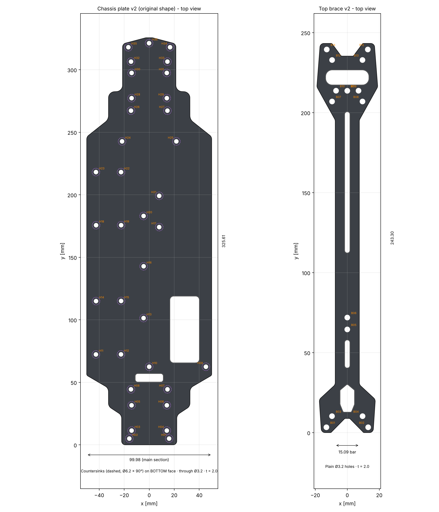
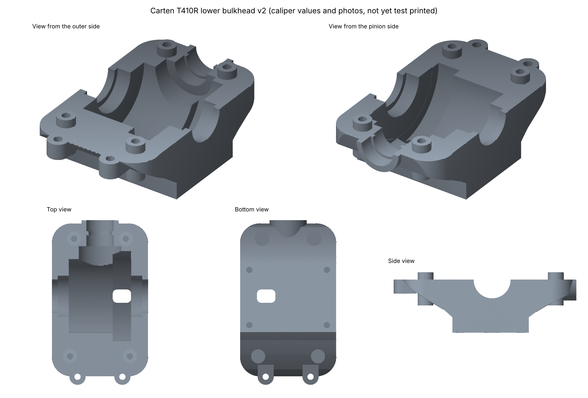
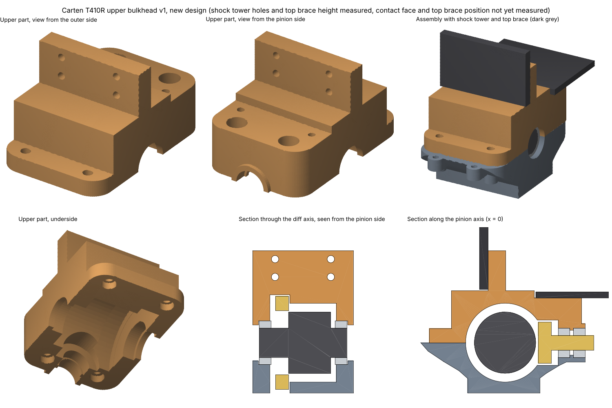

# CAD and 3D print files

## Table of contents
* [Overview](#overview)
* [Chassis plate and top brace v2](#chassis-plate-and-top-brace-v2)
  * [Parts](#parts)
  * [Files](#files)
  * [Coordinate system](#coordinate-system)
  * [Measurement basis](#measurement-basis)
  * [Test print](#test-print)
  * [Open points](#open-points)
* [Speedrun chassis plate (wide)](#speedrun-chassis-plate-wide)
  * [Print template](#print-template)
  * [Longer motor window for a 3660 motor](#longer-motor-window-for-a-3660-motor)
* [Lower bulkhead v2](#lower-bulkhead-v2)
  * [Interfaces](#interfaces)
  * [Files of the lower bulkhead](#files-of-the-lower-bulkhead)
  * [Coordinate system of the lower bulkhead](#coordinate-system-of-the-lower-bulkhead)
  * [Measurement basis of the lower bulkhead](#measurement-basis-of-the-lower-bulkhead)
  * [Caliper measurement sheet](#caliper-measurement-sheet)
  * [Test print of the lower bulkhead](#test-print-of-the-lower-bulkhead)
  * [Design notes](#design-notes)
  * [Open points of the lower bulkhead](#open-points-of-the-lower-bulkhead)
* [Upper bulkhead v1 (new design)](#upper-bulkhead-v1-new-design)
  * [Interfaces of the upper bulkhead](#interfaces-of-the-upper-bulkhead)
  * [Design of the upper bulkhead](#design-of-the-upper-bulkhead)
  * [Files of the upper bulkhead](#files-of-the-upper-bulkhead)
  * [Measurement sheet of the stock upper bulkhead](#measurement-sheet-of-the-stock-upper-bulkhead)
  * [Open points of the upper bulkhead](#open-points-of-the-upper-bulkhead)
* [Scripts](#scripts)
  * [Regenerating the files](#regenerating-the-files)
  * [DXF generation](#dxf-generation)
* [3D printed parts](#3d-printed-parts)
  * [1. Motor fan mount (`fan_mount.stl`)](#1-motor-fan-mount-fan_mountstl)
  * [2. LiPo battery dummy (`lipo_mock.stl`)](#2-lipo-battery-dummy-lipo_mockstl)
  * [3. RC car maintenance stand (`stojan_3dprint_25.stl`)](#3-rc-car-maintenance-stand-stojan_3dprint_25stl)
  * [4. Rear diffuser (`T410R_DIFFUSOR_V2_2.stl`)](#4-rear-diffuser-t410r_diffusor_v2_2stl)
* [Sources](#sources)

## Overview
This directory contains CAD data and 3D print files for the RC car **Carten T410R**:
* **`/chassis_v2`**: CAD data of the chassis plate and the top brace, version 2, with one subdirectory per part:
  * **`/chassis_plate`**: Chassis plate v2 (STEP, STL, DXF, OpenSCAD, PDF templates, geometry data, hole table)
  * **`/top_brace`**: Top brace v2 (STEP, STL, DXF, OpenSCAD, PDF template, geometry data, hole table)
  * **`/test_print`**: STL files of the chassis plate and the top brace for a test print on a home 3D printer
  * **`/chassis_plate_speedrun_wide`**: Wide variant of the chassis plate for speedruns (STEP, STL, PDF template, geometry data)
  * **`/chassis_plate_speedrun_wide_motor10`**: Wide variant with a longer motor window for a 3660 motor (STEP, STL, DXF, PDF template, geometry data)
* **`/bulkhead`**: CAD data of the bulkheads (gear boxes): version 2 of the lower bulkhead, version 1 of the upper bulkhead (new design) and the assembly of both parts (STEP, STL, test print STL, parameter files, measurement sheets).
* **STL files in this directory**: 3D printed parts for the car and a maintenance stand

Own files are released under the licenses of this repository (see the root readme). Third-party files are subject to the licenses of their authors (see [sources](#sources)). The preview images of all parts are stored in the `/photos` directory of the repository.

## Chassis plate and top brace v2
* **Author:** [@kleinnconrad](https://github.com/kleinnconrad)
* **Description:** CAD models of the chassis plate and the top brace of the Carten T410R. The geometry is derived from photos of the original parts and scaled to caliper measurements (see [measurement basis](#measurement-basis)). Version 2 replaces version 1, which is not part of this repository.
* **Status:** Verified with a test print. The printed chassis plate and top brace fit the car, the hole positions and the overall lengths are correct (see [test print](#test-print)).



### Parts
| Part | Size (width × length × thickness) | Holes | Cutouts | Volume |
|:---|:---|:---|:---|---:|
| Chassis plate | 100.0 × 325.6 × 2.0 mm | 36 through holes Ø3.2 mm (H01 to H36), countersunk Ø6.2 mm × 90° on the bottom face | Window approx. 23.5 × 53.3 mm, slot approx. 22.3 × 6.7 mm | 49.4 cm³ |
| Top brace | 38.0 × 243.3 × 2.0 mm | 15 through holes Ø3.2 mm (B01 to B15), not countersunk | Hexagon, short slot approx. 3.2 × 17.5 mm, long slot approx. 3.2 × 88.2 mm, obround approx. 27.0 × 9.3 mm | 7.8 cm³ |

* The width of the main section of the chassis plate is 99.98 mm. The bar of the top brace is 15.09 mm wide.
* The hole diameter of 3.2 mm is the clearance hole for M3 screws.
* Sizes and volumes are taken from the STL files. The cutout sizes are approximate values from the geometry data.

### Files
The files of the chassis plate are stored in the directory `/chassis_v2/chassis_plate`, the files of the top brace in `/chassis_v2/top_brace` and the test print files in `/chassis_v2/test_print`. The STEP, STL, DXF, OpenSCAD and PDF files and the hole tables are generated from the geometry data (`*_geometry.json`). The DXF files can be regenerated with a script (see [DXF generation](#dxf-generation)).

| File | Format | Use |
|:---|:---|:---|
| `chassis_plate_T410R_v2.step`, `top_brace_T410R_v2.step` | STEP (AP214) | Solid models for CAD programs |
| `chassis_plate_T410R_v2.stl`, `top_brace_T410R_v2.stl` | STL (binary) | Complete parts as triangle meshes |
| `testprint_chassis_plate_v2_halfA.stl`, `testprint_chassis_plate_v2_halfB.stl` | STL (binary) | Chassis plate in two halves for the test print |
| `testprint_top_brace_v2_halfA.stl`, `testprint_top_brace_v2_halfB.stl` | STL (binary) | Top brace in two halves for the test print |
| `chassis_plate_T410R_v2.dxf`, `top_brace_T410R_v2.dxf` | DXF | 2D drawings for CNC manufacturing with the layers `OUTLINE`, `CUTOUT`, `HOLE_THROUGH` and `CSK_BOTTOM_INFO` (countersinks, chassis plate only) |
| `chassis_plate_T410R_v2.scad`, `top_brace_T410R_v2.scad` | OpenSCAD | Parametric models. The parameters `thickness`, `hole_d`, `csk_d` and `csk_angle` are defined at the top of the file. |
| `chassis_plate_T410R_v2_1to1_A3.pdf` | PDF (A3, 1 page) | 1:1 template of the chassis plate |
| `chassis_plate_T410R_v2_1to1_A4x2.pdf` | PDF (A4, 2 pages) | 1:1 template of the chassis plate on two A4 sheets |
| `top_brace_T410R_v2_1to1_A4.pdf` | PDF (A4, 1 page) | 1:1 template of the top brace |
| `chassis_plate_v2_hole_table.csv`, `top_brace_v2_hole_table.csv` | CSV | Hole coordinates (x, y), through hole diameter and countersink diameter |
| `chassis_plate_v2_geometry.json`, `top_brace_v2_geometry.json` | JSON | Geometry data: outline, cutouts, holes, thickness and countersink parameters |

The PDF templates must be printed at 100 % scale. The 100 mm bar on the template is used to check the scale.

### Coordinate system
* Units are millimeters. All coordinates refer to the top view.
* x = 0 is the center line of the part.
* y = 0 is the end edge: on the chassis plate the end with the 2 × 2 hole pattern (holes H01 to H04), on the top brace the end with the hexagon cutout. The OpenSCAD files refer to this edge as the rear end edge.
* z = 0 is the bottom face. The countersinks of the chassis plate are located on the bottom face.

### Measurement basis
The outlines were taken from photos of the original parts and scaled to caliper measurements:
* **Chassis plate:** x scaled by 1.00522 (width of the main section 99.98 mm), y scaled by 1.00609 (distance between the holes H11 and H23 145.82 mm)
* **Top brace:** uniformly scaled by 1.006 (bar width 15.09 mm)
* **Holes:** through holes Ø3.2 mm (measured on the original part: 3.18 mm)
* **Shape:** The window and the slot of the chassis plate are part of the model. Two marks on the surface of the original parts are not holes and are therefore not modelled.

### Test print
The test print checks the hole positions and the overall length with a home 3D printer before the parts are manufactured. Both parts are split into two halves that are connected with dovetails. The files are stored in the directory `/chassis_v2/test_print`.

**Result:** The test print of the chassis plate and the top brace fits the car. The holes at both ends of both parts align with the mounting points. This confirms the hole positions and the overall lengths of 325.6 mm (chassis plate) and 243.3 mm (top brace).


| File | Size (width × length × thickness) | Split |
|:---|:---|:---|
| `testprint_chassis_plate_v2_halfA.stl` | 100.0 × 168.7 × 2.0 mm | Split at half length (y = 162.8 mm), three dovetails, 0.2 mm joint gap |
| `testprint_chassis_plate_v2_halfB.stl` | 100.0 × 162.7 × 2.0 mm | See half A |
| `testprint_top_brace_v2_halfA.stl` | 34.9 × 97.4 × 2.0 mm | Split at y = 92.5 mm between the short and the long slot, so that the long slot is not cut. One dovetail, 0.2 mm joint gap. |
| `testprint_top_brace_v2_halfB.stl` | 38.0 × 150.7 × 2.0 mm | See half A |

* The halves of the chassis plate are oriented with the top side on the print bed, so that the countersinks face upwards.
* The largest half requires a print area of 100.0 × 168.7 mm.

Recommended procedure:
* Print with 100 % infill.
* Disable the XY hole compensation of the slicer for a true check of the hole positions.
* Printed holes with Ø3.2 mm are usually undersized. Ream them with a 3.2 mm drill before screws are inserted.
* Glue the halves together on a flat surface, preferably on the 1:1 template.
* Check the fit on the car: if the holes at both ends of the parts align with the mounting points, the overall length is correct.

### Open points
There are no open points for the chassis plate and the top brace v2. The following points were clarified:
* **Overall length:** With the caliper scaling, the chassis plate is 325.6 mm and the top brace 243.3 mm long, while measurements with a ruler resulted in 324 mm and 242 mm. The test print confirms the lengths from the caliper scaling, so the ruler readings were too short.
* **Thickness of the chassis plate:** The chassis specification listed 2.25 mm for the bottom plate. A measurement of the chassis plate of the car with a precise caliper resulted in 2.03 mm, so the value of the specification was wrong. It is corrected in `specs/mechanics/carten_t410r/spec_cartent410r.yaml`. The model uses 2.0 mm. For manufacturing, the thickness is determined by the carbon sheet that is used. The thickness of the model can be changed with the parameter `thickness` in the OpenSCAD file.

## Speedrun chassis plate (wide)
* **Author:** [@kleinnconrad](https://github.com/kleinnconrad)
* **Description:** Variant of the chassis plate v2 for speedruns with a widened middle section. The hole pattern, the countersinks, the window, the slot and both narrow ends are identical to the chassis plate v2.
* **Files:** `chassis_plate_T410R_speedrun_wide.step` (STEP AP214, one solid), `chassis_plate_T410R_speedrun_wide.stl` (binary STL), `chassis_plate_T410R_speedrun_wide_1to1_A4x2_print97.pdf` (1:1 template, see [print template](#print-template)) and `chassis_plate_speedrun_wide_geometry.json` (geometry data) in the directory `/chassis_v2/chassis_plate_speedrun_wide`. This variant has no DXF, OpenSCAD or test print files. The STEP and STL files are the source data of this variant. The geometry data is derived from the STEP file (see [scripts](#scripts)).


| Property | Chassis plate v2 | Speedrun chassis plate (wide) |
|:---|:---|:---|
| Size (width × length × thickness) | 99.98 × 325.6 × 2.0 mm | 199.98 × 325.6 × 2.0 mm |
| Holes | 36 through holes Ø3.2 mm, countersunk Ø6.2 mm × 90° on the bottom face | Identical |
| Cutouts | Window and slot | Identical |
| Volume | 49.4 cm³ | 80.7 cm³ |

The outline differs from the chassis plate v2 only between y = 55.3 mm and y = 246.5 mm (coordinate system as for the chassis plate v2, see [coordinate system](#coordinate-system)):

| Section | Position (y) | Width |
|:---|:---|:---|
| End with the 2 × 2 hole pattern | 0 to 55.3 mm | Identical to the chassis plate v2 |
| Transition, 30.3° to the cross direction | 55.3 to 85.5 mm | Increases from 100 to 200 mm |
| Wide section | 85.5 to 205.0 mm | 199.98 mm |
| Transition, 38.4° to the cross direction | 205.0 to 246.5 mm | Decreases from 200 to 100 mm |
| Opposite end | 246.5 to 325.6 mm | Identical to the chassis plate v2 |

* The values are taken from the STL file.
* The wide section is 10 mm wider than the width over the tires (190 mm, `spec_cartent410r.yaml`) and the body width (190 mm, `spec_body.yaml`). It protrudes by 5 mm per side. The clearance to the wheels and to the body has to be checked before manufacturing.
* The thickness of 2.0 mm is the same as for the chassis plate v2. The chassis plate of the car measures 2.03 mm (see [open points](#open-points)).
* The hole pattern and both narrow ends are identical to the chassis plate v2 and are therefore confirmed by its [test print](#test-print). The widened section is not part of the test print.

### Print template
Both speedrun chassis plates have a 1:1 template on two A4 pages in landscape format. The templates are used to check the hole positions against the actual part.

| File | Directory | Window (solid line) | Green dashed line |
|:---|:---|:---|:---|
| `chassis_plate_T410R_speedrun_wide_1to1_A4x2_print97.pdf` | `/chassis_v2/chassis_plate_speedrun_wide` | Window 23.47 × 53.27 mm | Longer motor window (see [longer motor window for a 3660 motor](#longer-motor-window-for-a-3660-motor)) |
| `chassis_plate_T410R_speedrun_wide_motor10_1to1_A4x2_print97.pdf` | `/chassis_v2/chassis_plate_speedrun_wide_motor10` | Longer motor window 23.47 × 63.27 mm | End of the previous window |

* **Scale:** The drawing is pre-scaled to 103.09 % (100/97) for a PDF viewer that prints at 97 %. Printed at 97 %, the drawing is 1:1. Printed at 100 % ("actual size"), it is 3.1 % too large. This differs from the templates of the chassis plate v2, which are printed at 100 %.
* **Scale check:** Each page has a 100 mm bar in x and a 100 mm bar in y. Both bars must measure 100 mm before the template is used. After joining the pages, the distance between the centres of the holes H11 and H23 is 145.82 mm.
* **Joining:** Page 2 is laid over page 1 so that the two blue dashed lines of the 20 mm overlap zone coincide. The holes H16 to H20 are shown on both pages.
* **Orientation:** The template shows the top view (side without countersinks). The part is placed with the countersinks facing down.
* **Content:** Outline, window and slot (black), through holes Ø3.2 mm with centre cross (red), countersinks Ø6.2 mm on the bottom face (dashed), outline of the chassis plate v2 (grey, dashed) and the other motor window (green, dashed, see table).
* The positions on both PDF files were checked on raster images with 600 dpi. All 36 holes deviate by less than 0.06 mm from the geometry data. The window ends of the template with the longer motor window deviate by less than 0.05 mm.
* The templates are generated with `scripts/cad/generate_print_template.py` (option `--plate wide` or `--plate motor10`). For a PDF viewer with another print scale, the option `--print-scale` generates a matching template (see [scripts](#scripts)).

### Longer motor window for a 3660 motor
* **Author:** [@kleinnconrad](https://github.com/kleinnconrad)
* **Description:** Version of the speedrun chassis plate (wide) with a motor window that is 10 mm longer. The window is lengthened to fit a 3660 motor. The motor of the car (Hobbywing 3660SL G2) has a diameter of 36 mm and a length of 60 mm (`specs/electronics/brushless_combo/spec_brushless_combo.yaml`) and is 10 mm longer than a 3650 motor.
* **Status:** Not yet verified. The fit of the motor has to be checked before manufacturing. The [test print](#test-print) of the chassis plate v2 confirms the hole pattern, but does not include the longer motor window.


| Property | Speedrun chassis plate (wide) | Longer motor window |
|:---|:---|:---|
| Motor window (width × length) | 23.47 × 53.27 mm | 23.47 × 63.27 mm |
| Position of the window (x) | 16.59 to 40.06 mm | Identical |
| Position of the window (y) | 65.63 to 118.90 mm | 65.63 to 128.90 mm |
| Corner radius of the window | 3.0 mm | Identical |
| Volume | 80.7 cm³ | 80.2 cm³ |

* The window is extended only toward the end with the holes H34 to H36 (+y). The end edge at y = 65.63 mm is not moved.
* The outline, the slot, the 36 holes with the countersinks and the thickness are identical to the speedrun chassis plate (wide).
* The extension reduces the distance between the window and the countersink of hole H16 (Ø6.2 mm, bottom face) from 30.0 mm to 23.3 mm. The distances to the countersinks of the holes H07, H09, H10 and H13, which are closer to the window than H16, do not change.
* The [print template](#print-template) of the speedrun chassis plate (wide) shows the longer window as a green dashed line. The print template of this variant shows the longer window as a solid line and the end of the previous window as a green dashed line.

| File | Format | Use |
|:---|:---|:---|
| `chassis_plate_T410R_speedrun_wide_motor10.step` | STEP (AP214) | Solid model for CAD programs (one solid) |
| `chassis_plate_T410R_speedrun_wide_motor10.stl` | STL (binary) | Complete part as triangle mesh |
| `chassis_plate_T410R_speedrun_wide_motor10.dxf` | DXF | 2D drawing for CNC manufacturing with the same layers as `chassis_plate_T410R_v2.dxf` |
| `chassis_plate_speedrun_wide_motor10_geometry.json` | JSON | Geometry data: outline, cutouts, holes, thickness and countersink parameters |
| `chassis_plate_T410R_speedrun_wide_motor10_1to1_A4x2_print97.pdf` | PDF (A4, 2 pages) | 1:1 template for a PDF viewer that prints at 97 % (see [print template](#print-template)) |

* All files are stored in the directory `/chassis_v2/chassis_plate_speedrun_wide_motor10`. The preview image above (`photos/cad_chassis_speedrun_wide_motor10_preview.png`) shows the previous window as a red dashed line. The STEP, STL and DXF files are generated from the geometry data. All files and the preview image can be regenerated with scripts (see [scripts](#scripts)).
* The geometry data is the geometry data of the speedrun chassis plate (wide) (`chassis_plate_speedrun_wide_geometry.json`) with the longer window. That file combines the outline of `chassis_plate_T410R_speedrun_wide.step` with the holes, cutouts and countersink parameters of `chassis_plate_v2_geometry.json` and reproduces `chassis_plate_T410R_speedrun_wide.step` exactly.

## Lower bulkhead v2
* **Author:** [@kleinnconrad](https://github.com/kleinnconrad)
* **Description:** CAD model of the lower half of the gear box (bulkhead) of the Carten T410R. The stock part is the plastic part NBA249 ("Gear box"), which is used at the front and at the rear. The model is the basis for a CNC part made of 7075-T6. The interfaces to the chassis plate, the bearings, the gears, the upper bulkhead and the sway bar are modelled. The remaining shape is simplified and can be changed.
* **Status:** Version 2, first test print done (see [test print of the lower bulkhead](#test-print-of-the-lower-bulkhead)). The interfaces are based on caliper measurements of the stock part. Some positions are taken from photos (accuracy approx. +-0.5 mm) or derived from the caliper values (see [measurement basis of the lower bulkhead](#measurement-basis-of-the-lower-bulkhead)).
* **History:** Version 1 was a model from photos with estimated dimensions. Version 2 uses 27 caliper values (measurement sheet v1) and a second set of photos with rulers at the height of the part.



### Interfaces
| Interface | Stock parts | Model v2 |
|:---|:---|:---|
| Chassis plate | 4 countersunk screws M3x8 from below through the 2 mm chassis plate | 4 M3 holes (tap drill 2.5 mm, 8 mm deep), spacing 28.0 x 20.0 mm |
| Upper bulkhead | 2 button head screws M3x10 on the pinion side, 2 button head screws M3x8 on the outer side | 4 bosses 4.86 mm, 2.42 mm above the parting face, M3 holes (tap drill 2.5 mm, 7 mm deep). Spacing across 18.7 mm (pinion side) and 21.6 mm (outer side), spacing along 42.6 mm |
| Diff | 2 bearings 10x15x4 (NBA299) | Per side: outer lip 1.89 mm thick (opening 12.28 mm) and seat 15 x 4 mm, open toward the gear cavity. Inner faces of the lips 30.7 mm apart |
| Pinion shaft | 2 bearings 5x10x4 (NBA298) | Seat 10 mm, 9.25 mm long: 2 seats of 4 mm with a rib of 1.25 mm between the bearings. The rib is the only axial stop: no shoulder at the inner end, open at the housing end face |
| Ring gear (42T, 31.93 mm) and diff case | Gear diff NBA230 | Cavity with a radius of 13.5 mm for the diff case (test print), deepening with a radius of 16.4 mm for the ring gear on the ring gear side, with a through opening in the floor (test print) |
| Pinion gear (17T, 14.1 mm) | Pinion NBA207 | Pocket with a radius of 7.75 mm |
| Sway bar | 2 M3 screws | 2 tabs, 4.35 mm thick, with M3 holes (tap drill 2.5 mm), spacing 16.2 mm |

* The diff axis and the pinion axis lie in the parting face, 17.2 mm above the bottom face. The upper bulkhead holds the bearings from above.
* The ring gear and the pinion have a module of 0.75 (calculated from the outer diameters 31.93 mm and 14.1 mm). The pitch circle of the pinion is 15.75 mm from the diff axis.
* The chassis plate holes are H03 to H06 for the rear bulkhead (End B) and H28 to H31 for the front bulkhead (End A). The bulkhead is rotated by 180 degrees between the ends, so that the pinion points to the centre shaft at both ends.
* The source of the screw sizes is the manual (steps 9, 11 and 12) and the owner of the car. The source of the bearing sizes is the manual (steps 1 and 5).

### Files of the lower bulkhead
All files are stored in the directory `/bulkhead`. The STEP and STL files and the measurement sheet are generated from the parameter file (see [scripts](#scripts)).

| File | Format | Use |
|:---|:---|:---|
| `bulkhead_lower_T410R_v2.step` | STEP (AP214) | Solid model with nominal dimensions for CNC manufacturing (one solid) |
| `bulkhead_lower_T410R_v2.stl` | STL (binary) | Triangle mesh of the solid model |
| `testprint_bulkhead_lower_v2.stl` | STL (binary) | Test print variant (see [test print of the lower bulkhead](#test-print-of-the-lower-bulkhead)) |
| `bulkhead_lower_v2_parameters.json` | JSON | All dimensions of the model, each with its source and a note |
| `bulkhead_lower_v2_measurement_sheet.pdf` | PDF (A4, 4 pages) | Caliper measurement sheet with the caliper values of version 1 and the open values (see [caliper measurement sheet](#caliper-measurement-sheet)) |

| Property | Value |
|:---|:---|
| Size (x by y by z) | 34.48 x 59.4 x 19.62 mm (with the sway bar tabs and the pinion housing) |
| Volume | 13.0 cm³ |
| Mass | 37 g in 7075 (2.81 g/cm³), 16 g in PLA (1.24 g/cm³) |

### Coordinate system of the lower bulkhead
* Units are millimeters.
* The origin is the centre of the 4 bottom holes on the bottom face.
* x runs along the diff axis (across the car). y runs along the pinion axis, +y points to the pinion and the centre shaft. z = 0 is the bottom face, which sits on the chassis plate, +z points up.
* The diff axis is at y = 0.5 mm (photo).
* In the coordinate system of the chassis plate, the origin of the rear bulkhead is at x = 0, y = 21.53 mm (centre of H03 to H06) and the origin of the front bulkhead at x = 0, y = 287.36 mm (centre of H28 to H31).

### Measurement basis of the lower bulkhead
Each parameter in `bulkhead_lower_v2_parameters.json` has a source code:

| Source code | Meaning | Parameters |
|:---|:---|:---|
| `caliper` | Caliper measurement of the stock part (number of the measurement sheet in the note) | Hole spacings, heights, widths, lips, seat lengths, boss and tab sizes |
| `derived` | Calculated from caliper values and part sizes | Positions along y, deepening, floor thickness, pocket radii |
| `manual` | T410R instruction manual | Bearing sizes |
| `user` | Information from the owner of the car | Screw sizes, function of the sway bar holes, deepening for the ring gear, diff bearing seat limited only by the outer lip |
| `photo` | Estimate from photos with rulers at the height of the part | Position of the diff axis, outline, side profile, ring gear position and side |
| `design` | Free design choice | Tap drill diameters, hole depths, openings that were not measured |

* The caliper values 7, 8 and 9 (top boss holes) agree with the top view photo within 0.3 mm. The ratio of the bottom hole spacings (28.0 / 20.0) agrees with the bottom view photo within 0.3 %.
* The stock part measures 15.6 mm (diff) and 10.5 mm (pinion) across the half bores at the parting face. The model uses the bearing diameters 15.0 mm and 10.0 mm for the bearing fit.
* The positions along y are calculated from the caliper values 16, 17 and 19 with the seat edge (15.6 mm) as the reference. With this reference, the inner pinion bearing is 18.15 mm from the diff axis. The photo with the diff installed shows approx. 18.3 mm.
* The photo with the diff installed shows the ring gear between 5.0 and 9.4 mm from the diff centre. The back face of the ring gear is approx. 1.9 mm from the inner face of the bearing.
* The lip thickness is 1.89 mm (no. 13, measured twice as no. 15). With the inner faces of the lips 30.7 mm apart (no. 14), the width over the outer faces is 34.48 mm. The caliper value no. 10 is 34.2 mm. The model keeps no. 13 and no. 14, because they set the position of the bearings.

### Caliper measurement sheet
The measurement sheet `bulkhead_lower_v2_measurement_sheet.pdf` documents the caliper values and lists the open dimensions:
* **Pages 1 to 3:** top view, bottom view, two sections, side view and end view with numbered dimensions.
* **Page 4:** table of 41 dimensions with the measuring method, the value of the model v2 and the caliper value. Rows without a caliper value are open.
* **Priority A:** interfaces (holes, bearing seats, bosses, tabs, clearance for the gears). **Priority B:** shape.
* Hole spacings are measured with the inside jaws from far edge to far edge minus the hole diameter. Heights are measured with the depth rod with the part on a flat surface.
* The new values 38 to 41 cover the rib between the pinion bearings, the position of the diff axis relative to the bottom holes (39 and 40) and the height of the sway bar tabs.
* No. 15 now describes the length of the diff bearing seat (4.0 mm from the lip inward). The seat has no inner shoulder.

### Test print of the lower bulkhead
* `testprint_bulkhead_lower_v2.stl` differs from the solid model in two points: the bearing seats are 0.2 mm larger in diameter (15.2 mm and 10.2 mm), and all M3 holes have a diameter of 2.7 mm for self-tapping screws.
* Print orientation: bottom face on the print bed. The boss columns below the wings and the sway bar tabs need supports.
* The floor below the ring gear deepening has an opening of 6.85 x 5 mm. Around the opening, the floor is 0.8 mm thick and increases toward the ends of the deepening.
* Checks: the 4 bottom holes on the chassis plate, the diff and the pinion shaft with their bearings in the seats, the mesh of the gears, the fit of the stock upper bulkhead and the clearance to the suspension arms and pivot blocks.

Result of the first test print (diff with ring gear and pinion shaft installed):

| Observation | Change |
|:---|:---|
| The diff case touches the wall of the cavity on the outer side (opposite the pinion). | Radius of the diff case cavity 12.5 mm -> 13.5 mm, in the lower and the upper part. |
| The ring gear does not rotate freely in its deepening. The stock part has an extra deepening of approx. 5 mm length with approx. 0.7 mm more space below the ring gear. | Through opening in the floor below the deepening, 6.85 x 5 mm (x by y, centred below the diff axis), corner radius 1.5 mm. The chassis plate closes it. The lowest tooth of the ring gear is 1.23 mm above the chassis plate (before: 0.43 mm above the floor). The radius of the deepening (16.4 mm) is not increased: a larger radius would break through the side faces of the narrow lower section. |

### Design notes
* The body is solid apart from the gear cavity. Pockets to reduce the mass are planned after the test print.
* Each diff bearing seat is limited only by the outer lip. The half bore of 15 mm runs 4.0 mm inward from the lip and then opens into the gear cavity. On the inner side, the diff holds the bearings. The diff with both bearings measures 30.0 mm, the lips are 30.7 mm apart: the diff has 0.7 mm axial play, as on the stock part.
* The gear cavity has two depths. Between the bearing seats, a cylinder with a radius of 13.5 mm holds the diff case (floor 3.7 mm thick). The test print with a radius of 12.5 mm showed that the diff case touches the wall on the outer side. On the ring gear side, a deepening with a radius of 16.4 mm from x = 4.5 mm to the inner end of the bearing seat (x = 11.35 mm) holds the ring gear (radial clearance 0.43 mm). Below the ring gear, the floor has a through opening of 6.85 x 5 mm (extra deepening of the stock part, approx. 5 mm long). The chassis plate closes the gear box from below. The wall between the deepening and the bottom holes is 1.4 mm thick.
* The ring gear is on the +x side. Seen from the pinion housing, the deepening is on the left. The bulkhead is the same part at the front and at the rear and is rotated by 180 degrees. Both pinions point to the centre shaft, so the ring gear is on the same side of the bulkhead at both ends.
* The STEP file contains no threads. The M3 holes are modelled with the tap drill diameter of 2.5 mm. For CNC manufacturing, the threads are specified in the comment field of the order (M3, thread depth 6.5 mm for the bottom holes).

### Open points of the lower bulkhead
* **Chassis plate:** the bottom holes of the stock bulkhead are 28.0 x 20.0 mm apart. The chassis plate v2 and the speedrun chassis plates have 28.17 x 20.22 mm (H03 to H06) and 28.13 x 20.19 mm (H28 to H31). Countersunk screws center themselves in the countersinks, so the difference of approx. 0.1 mm per hole is not compensated by clearance. The hole spacings of the carbon chassis plate are to be measured before the aluminium plate is ordered.
* Open caliper values of the measurement sheet (nos. 21, 26, 30 to 36, 38 to 41).
* The value 22 (5 mm) is interpreted as the height of the narrow lower section, and the value 25 (4.35 mm) as the thickness of the sway bar tabs with the top face in the parting face.
* Width over the outer faces of the diff bearing walls: 34.48 mm in the model, 34.2 mm measured (no. 10).
* The outer end face of the stock part has small holes. Their function is unknown, so they are not modelled.
* Upper bulkhead: see [upper bulkhead v1 (new design)](#upper-bulkhead-v1-new-design).
* Front and rear: End A of the chassis plate is assumed to be the front (bumper holes H34 to H36), End B the rear (motor window).

## Upper bulkhead v1 (new design)
* **Author:** [@kleinnconrad](https://github.com/kleinnconrad)
* **Description:** CAD model of a new upper half of the gear box (bulkhead) of the Carten T410R for CNC manufacturing from 7075-T6. The shape is a new design. The interfaces follow the stock part: the lower bulkhead v2, the diff and pinion bearings, the shock tower and the top brace.
* **Status:** Version 1, not verified. The interfaces to the lower part and the bearings are taken from the parameter file of the lower bulkhead v2. The shock tower hole pattern and its height, the spacing of the top brace screws and the height of the top brace face are caliper values (U1 to U4, U7, U9, U10). The position of the shock tower contact face and of the top brace screws along y are estimates from photos (accuracy approx. +-1.5 mm, U5, U6, U8 open). The test print is useful only after these values are known (see [measurement sheet of the stock upper bulkhead](#measurement-sheet-of-the-stock-upper-bulkhead)).



The preview shows the upper part, the assembly with the lower part v2 and two sections of the assembly. The bearings (light grey), the gears (yellow), the diff case, the shock tower plate and the end of the top brace (dark grey) are simplified bodies that show the positions only.

### Interfaces of the upper bulkhead
| Interface | Stock parts | Model v1 | Source |
|:---|:---|:---|:---|
| Lower bulkhead | Parting face, 4 bosses of the lower part (4.86 mm, 2.42 mm high) | Flat underside, 4 recesses 5.06 x 2.52 mm for the bosses (locating the two halves) | Lower part v2 |
| Screws to the lower part | 2 button head screws M3x8 on the outer side, 2 button head screws M3x10 on the pinion side | Clearance holes 3.2 mm. Head seats 4.92 mm (outer side, on the flange) and 6.92 mm (pinion side, counterbore 6.5 mm) above the parting face: 5.5 mm thread engagement in the lower part | User, lower part v2 |
| Diff bearings (10x15x4) | Clamped between the two halves | Upper half bores 15 x 4 mm, limited only by the outer lips (opening 12.28 mm, 1.89 mm thick) | Lower part v2 |
| Pinion bearings (5x10x4) | Clamped between the two halves | Upper half bores 10 mm with the rib of 1.25 mm between the bearings as the only axial stop, open toward the pinion pocket and at the housing end face | Lower part v2, user |
| Gears | Ring gear 42T (31.93 mm), pinion 17T (14.1 mm) | Same cavities as the lower part: diff case radius 13.5 mm, ring gear radius 16.4 mm on the ring gear side, pinion pocket radius 7.75 mm | Lower part v2 |
| Shock tower | 3 mm carbon, 4 button head screws M3x8 (manual steps 19 and 20). Stock holes 2.9 mm, through the 5.8 mm ears | Flat contact face facing the outer side at y = -5.3 mm, 4 tapped holes M3 (through the 6 mm wall) at x = +-9.55 mm and 22.5 / 28.6 mm above the parting face. In front of the face, no material above 17.8 mm | Caliper (holes), photo (contact face) |
| Top brace (NHA432) | 2 button head screws M3x8 per bulkhead (manual step 25) into 2 raised bosses | Flat contact face 15.4 mm above the parting face, from y = 10.5 mm to the pinion end, 2 tapped holes M3 at x = +-12.8 mm, y = 14.36 mm | Caliper (height, spacing), photo and top brace v2 (y) |
| Sway bar holders | M3x6 from above onto the tabs of the lower part (manual step 23) | The upper part ends at y = -25.5 mm, 3.2 mm before the sway bar holes | Photo |

* The pinion side screws (M3x10) sit below the top brace. The top brace has access holes above them (B03/B04 and B12/B13, spacing 19.1 mm, 6.94 mm from the top brace screws).
* The upper part is the same at the front and at the rear, like the lower part. The front and the rear shock tower use the same 4 holes.

### Design of the upper bulkhead
The upper part is a prismatic block: the footprint of the lower part (34.48 mm wide, corner radius 6 mm) is extruded to 4 flat levels along y. All outer faces are flat. The only curved faces are the bores and the cavities, which follow the lower part.

| Section (y) | Level above the parting face | Function |
|:---|:---|:---|
| -25.5 to -17.9 mm | 4.92 mm | Flange: seat of the heads of the outer screws |
| -17.9 to -5.3 mm | 17.8 mm | Block over the diff and the ring gear (2 mm in front of the ring gear cavity) |
| -5.3 to 0.7 mm | 31.5 mm | Shock tower wall over the full width, 6 mm thick, flat contact face |
| 0.7 to 10.5 mm | 17.8 mm | Block over the diff and the ring gear |
| 10.5 to 26.7 mm | 15.4 mm | Flat contact face of the top brace over the pinion, counterbores of the pinion side screws |
| 26.7 to 27.9 mm | Half cylinder, radius 6.6 mm | Cover of the outer pinion bearing beyond the footprint (as on the lower part) |

* The interference check of the assembly (lower part v2 and upper part v1) gives 0 mm³.
* Size 34.48 x 53.4 x 31.5 mm, volume 19.7 cm³, mass 55 g in 7075 (2.81 g/cm³), 24 g in PLA.
* The wall is 6 mm thick: the screws M3x8 through the 3 mm shock tower have 5 mm thread engagement. The material above the thread of the upper holes is 1.4 mm (wall top at the height of the stock ears, U10).
* The block over the ring gear is 17.8 mm high, equal to the zone kept free for the shock tower plate in front of the wall. The cover over the ring gear cavity is 1.4 mm directly behind the wall and 2.5 mm at the contact face.
* The mass is higher than with shells that follow the gears. Straight pockets in the flat faces can reduce it, if required.
* Manufacturing: 3 setups on a 3-axis machine (underside with the bores and cavities, top with the levels and the vertical holes, outer side with the 4 shock tower holes). The STEP file contains no threads: the tapped holes are modelled with the tap drill diameter of 2.5 mm.

### Files of the upper bulkhead
All files are stored in the directory `/bulkhead`. The files are generated from the parameter files of the upper and the lower part (see [scripts](#scripts)).

| File | Format | Use |
|:---|:---|:---|
| `bulkhead_upper_T410R_v1.step` | STEP (AP214) | Solid model with nominal dimensions (one solid) |
| `bulkhead_upper_T410R_v1.stl` | STL (binary) | Triangle mesh of the solid model |
| `testprint_bulkhead_upper_v1.stl` | STL (binary) | Test print variant: bearing seats 0.2 mm larger, tapped holes 2.7 mm for self-tapping screws. Print with the parting face on the print bed. |
| `bulkhead_assembly_T410R_v1.step` | STEP (AP214) | Assembly of the lower part v2 and the upper part v1 |
| `bulkhead_upper_v1_parameters.json` | JSON | Dimensions of the upper part, each with its source and a note. The shared dimensions are read from `bulkhead_lower_v2_parameters.json`. |
| `bulkhead_upper_v1_measurement_sheet.pdf` | PDF (A4, 2 pages) | Measurement sheet of the stock upper part (see below) |

### Measurement sheet of the stock upper bulkhead
The measurement sheet `bulkhead_upper_v1_measurement_sheet.pdf` shows the interfaces of the stock upper part on 3 photos (end view, side view, top view) with the numbers U1 to U14. Page 2 lists the values of the model and the caliper values (U1 to U4, U7, U9, U10 measured):
* **U1 to U6, U11, U13:** shock tower: hole pattern, height of the holes, position of the contact face, lowest edge of the shock tower plates.
* **U7 to U9:** top brace: hole spacing, position along y, height of the contact face.
* **U10, U12:** height of the ears, outer end of the stock part.
* **U14:** use of the 2 screws M3x18 with the block NBA201 at the rear end of the top brace (manual step 25).
* A scan of both shock towers on the flatbed scanner (U13) is the most accurate source for the hole pattern.
* The photos are stored as `photos/bulkhead_upper_stock_end_view.jpg`, `photos/bulkhead_upper_stock_side_view.jpg` and `photos/bulkhead_upper_stock_top_view.jpg`.

### Open points of the upper bulkhead
* Open caliper values of the stock upper part: U5, U6 (position of the shock tower contact face), U8 (position of the top brace screws along y), U11 (lowest edge of the shock towers), U12 to U14.
* Lowest edge of the shock tower plates: the block in front of the wall is 17.8 mm high. If a shock tower plate reaches lower, the block in front of the wall is to be lowered (the ring gear cavity requires at least 15.3 mm plus the wall at the contact face).
* Top brace: the end of the top brace is assumed at y = 11.0 mm. The shape of its end (hexagon and slot) is not checked against the block.
* Mass: 55 g in 7075. Straight pockets are possible after the interfaces are confirmed.

## Scripts
The directory `scripts/cad` contains the Python scripts that generate the files of the chassis plates and the bulkheads. The scripts are run from the root directory of the repository. Without arguments, the scripts of the chassis plates read and write the files of the speedrun chassis plates, and the scripts of the bulkhead read and write the files of the lower bulkhead v2 and the upper bulkhead v1. The option `--help` lists the arguments of each script. The required packages are installed with `pip install cadquery ezdxf matplotlib reportlab`.

| Script | Input | Output | Package |
|:---|:---|:---|:---|
| `geometry_from_step.py` | STEP file of the speedrun chassis plate (wide), geometry data of the chassis plate v2 | Geometry data of the speedrun chassis plate (wide). The option `--check` compares the rebuilt solid with the STEP file. | cadquery |
| `lengthen_motor_window.py` | Geometry data of the speedrun chassis plate (wide) | Geometry data with the motor window 10 mm longer toward End A (option `--length`) | None |
| `generate_solid.py` | Geometry data | STEP and STL file | cadquery |
| `generate_dxf.py` | Geometry data | DXF file (see [DXF generation](#dxf-generation)) | ezdxf |
| `check_motor_window.py` | STEP files and geometry data of both speedrun chassis plates | Check results: solid, volume, section through the window, holes, distances to the countersinks | cadquery |
| `generate_drawing.py` | Geometry data of the speedrun chassis plate (wide) and the chassis plate v2 | Drawing `photos/cad_chassis_speedrun_wide_drawing.png` | matplotlib |
| `generate_window_preview.py` | Geometry data of both speedrun chassis plates | Preview image `photos/cad_chassis_speedrun_wide_motor10_preview.png` | matplotlib |
| `generate_print_template.py` | Geometry data of both speedrun chassis plates and the chassis plate v2 | Print templates of both speedrun chassis plates (option `--plate wide` or `--plate motor10`). The option `--print-scale` sets the scale of the PDF viewer. | reportlab |
| `generate_bulkhead_lower.py` | Parameter file of the lower bulkhead | STEP and STL file, test print STL file | cadquery |
| `generate_bulkhead_drawings.py` | STEP, STL and parameter file of the lower bulkhead | Preview image `photos/cad_bulkhead_lower_v2_preview.png` and measurement sheet (PDF) | cadquery, matplotlib |
| `generate_bulkhead_upper.py` | Parameter files of the upper and the lower bulkhead | STEP and STL file of the upper part, test print STL file, assembly STEP file, interference check | cadquery |
| `generate_bulkhead_upper_drawings.py` | Parameter files, photos of the stock upper part | Preview image `photos/cad_bulkhead_upper_v1_preview.png` and measurement sheet of the stock upper part (PDF) | cadquery, matplotlib |
| `mesh_views.py` | None | Helper module: shaded views of STL files and assemblies, used by the drawing scripts of the bulkheads | matplotlib |

### Regenerating the files
The following commands regenerate the files of the speedrun chassis plates in this order:

```bash
python scripts/cad/geometry_from_step.py --check
python scripts/cad/lengthen_motor_window.py
python scripts/cad/generate_solid.py cad/chassis_v2/chassis_plate_speedrun_wide_motor10/chassis_plate_speedrun_wide_motor10_geometry.json cad/chassis_v2/chassis_plate_speedrun_wide_motor10/chassis_plate_T410R_speedrun_wide_motor10
python scripts/cad/generate_dxf.py cad/chassis_v2/chassis_plate_speedrun_wide_motor10/chassis_plate_speedrun_wide_motor10_geometry.json cad/chassis_v2/chassis_plate_speedrun_wide_motor10/chassis_plate_T410R_speedrun_wide_motor10.dxf
python scripts/cad/check_motor_window.py
python scripts/cad/generate_drawing.py
python scripts/cad/generate_window_preview.py
python scripts/cad/generate_print_template.py --plate wide
python scripts/cad/generate_print_template.py --plate motor10
```

* The regenerated geometry data, STL files and images are identical to the files in the repository. The STEP, DXF and PDF files differ only in header data such as the creation date and internal IDs.
* The STEP and STL files of the speedrun chassis plate (wide) are the source data and are not regenerated.

The following commands regenerate the files of the bulkheads from the parameter files (lower part first):

```bash
python scripts/cad/generate_bulkhead_lower.py
python scripts/cad/generate_bulkhead_drawings.py
python scripts/cad/generate_bulkhead_upper.py
python scripts/cad/generate_bulkhead_upper_drawings.py
```

### DXF generation
The script `scripts/cad/generate_dxf.py` generates a DXF file for CNC manufacturing from the geometry data (`*_geometry.json`). The geometry data and the DXF file of each part are stored in the same directory:

```bash
python scripts/cad/generate_dxf.py cad/chassis_v2/chassis_plate/chassis_plate_v2_geometry.json cad/chassis_v2/chassis_plate/chassis_plate_T410R_v2.dxf
python scripts/cad/generate_dxf.py cad/chassis_v2/top_brace/top_brace_v2_geometry.json cad/chassis_v2/top_brace/top_brace_T410R_v2.dxf
python scripts/cad/generate_dxf.py cad/chassis_v2/chassis_plate_speedrun_wide_motor10/chassis_plate_speedrun_wide_motor10_geometry.json cad/chassis_v2/chassis_plate_speedrun_wide_motor10/chassis_plate_T410R_speedrun_wide_motor10.dxf
```

* The DXF file contains the layers `OUTLINE` (outer contour), `CUTOUT` (window and slots), `HOLE_THROUGH` (through holes Ø3.2 mm), `CSK_BOTTOM_INFO` (countersink diameter Ø6.2 mm on the bottom face, for information only) and `NOTES` (empty). The top brace has no countersinks, so its layer `CSK_BOTTOM_INFO` is empty.
* For the three parts, the generated geometry is identical to the existing DXF files. Only the creation date and internal IDs of the files differ.
* The speedrun chassis plate (wide) without the longer motor window has no DXF file. It can be generated from `chassis_plate_speedrun_wide_geometry.json` with the same script.

## 3D printed parts

### 1. Motor fan mount (`fan_mount.stl`)
* **Author:** [@kleinnconrad](https://github.com/kleinnconrad) (own design)
* **Description:** A 50 mm fan mount (60 x 50 x 18 mm, 40 mm air opening) for the **40 mm motor fan from hobbywing**. Designed for mounting in the Carten T410R for installation and cooling of the motor.
* **Status:** Not in use. The motor cooling was removed, since the motor does not heat up significantly during speedruns (ADR-007).

### 2. LiPo battery dummy (`lipo_mock.stl`)
* **Author:** [@kleinnconrad](https://github.com/kleinnconrad) (own design)
* **Description:** A placeholder object in the size of a **3S hardcase LiPo battery**. This model is used for planning installations, electronics and cable management in the Carten T410R. It replaces the physical battery during the design phase.

### 3. RC car maintenance stand (`stojan_3dprint_25.stl`)
* **Author:** [@Upgrade25](https://www.printables.com/@Upgrade25)
* **Description:** A maintenance stand for RC cars (scale 1:10). Intended for repairs, setup work or as a rest.

### 4. Rear diffuser (`T410R_DIFFUSOR_V2_2.stl`)
* **Author:** [3DMaxi](https://cults3d.com/en/users/3DMaxi/3d-models)
* **Description:** A rear diffuser for the Carten T410R (120 x 70 x 18 mm).
* **Status:** Printed and mounted on the car.
* **License:** Private use only (see [sources](#sources)).

---

## Sources

The RC maintenance stand (`stojan_3dprint_25.stl`) is not mine. The original files and all credits go to the original designer on printables:

* **Original model:** [RC car maintenance stand 1:10 on printables](https://www.printables.com/model/1200600-rc-car-maintenance-stand-110/files)
* **Designer profile:** [Upgrade25](https://www.printables.com/@Upgrade25)

The rear diffuser (`T410R_DIFFUSOR_V2_2.stl`) is not mine. The original file and all credits go to the original designer on Cults3D:

* **Designer profile:** [3DMaxi on Cults3D](https://cults3d.com/en/users/3DMaxi/3d-models)
* **License:** The license of the author covers private use only. The licenses of this repository (MIT, CC BY 4.0) do not apply to this file.
