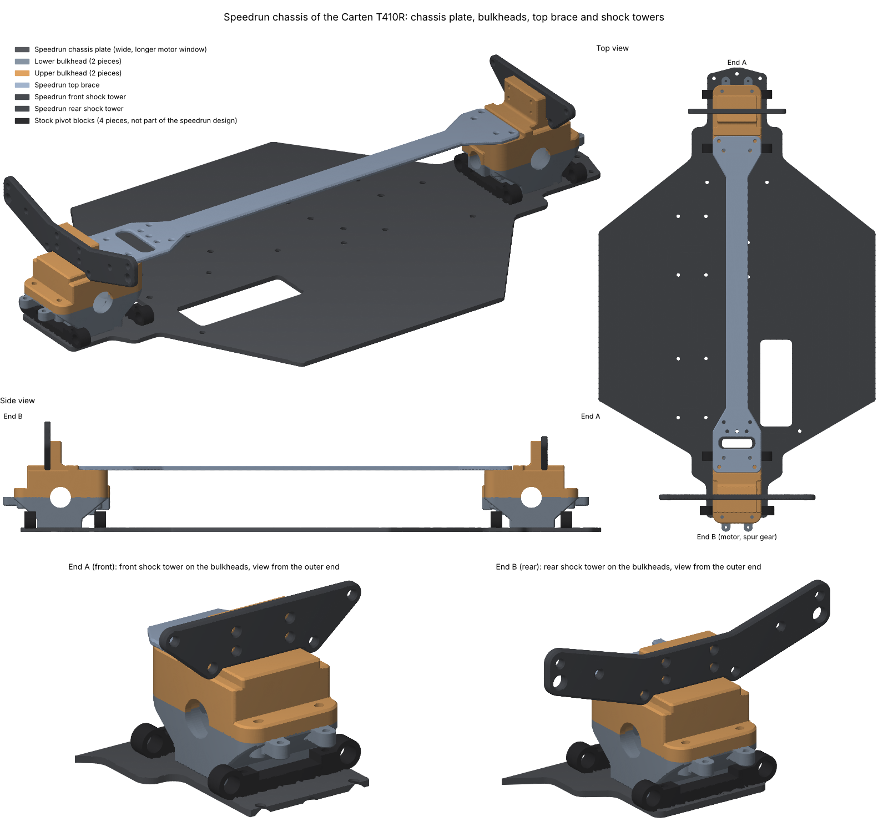
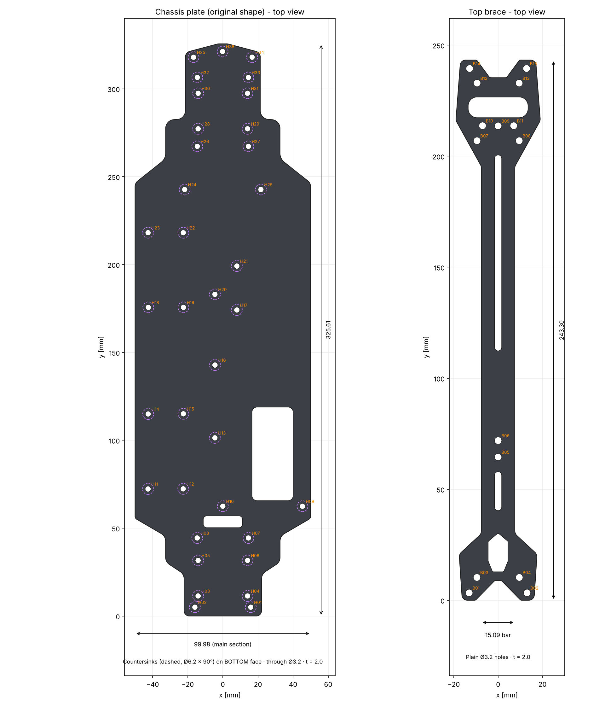
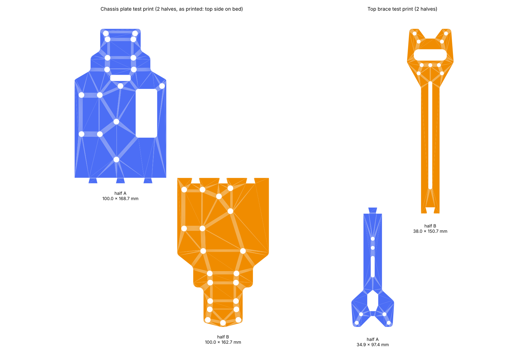
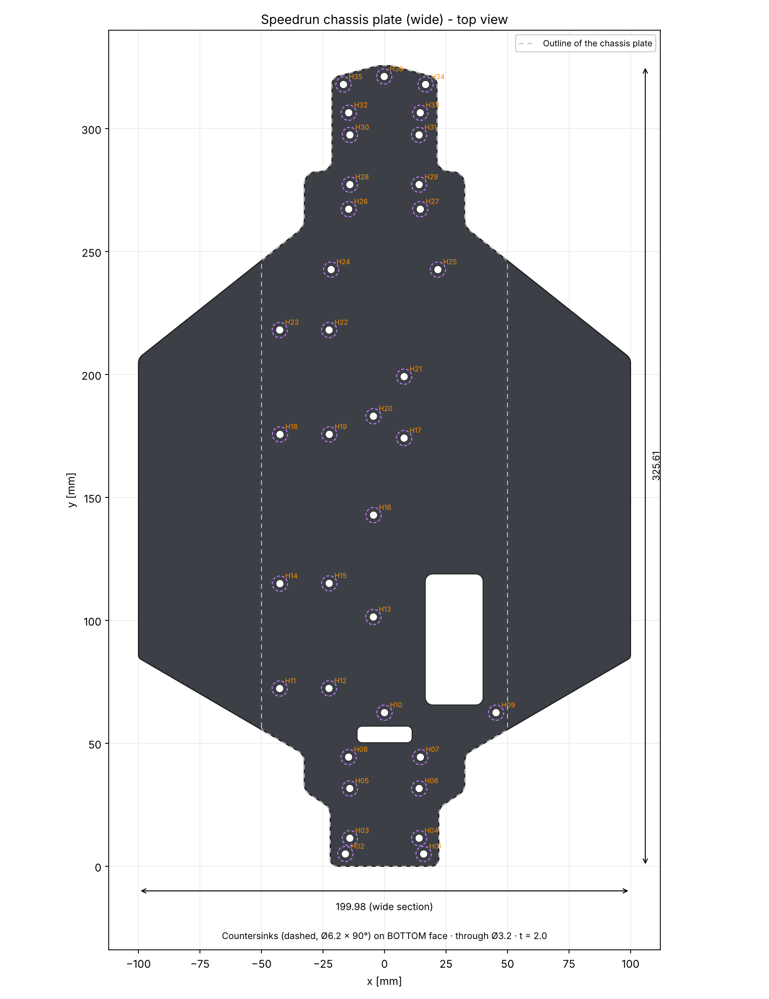
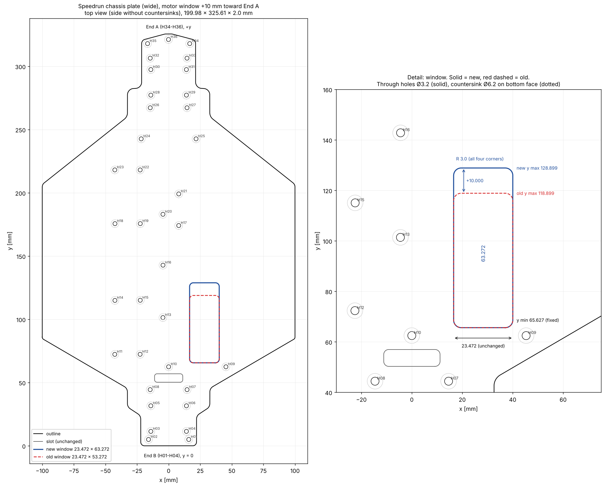
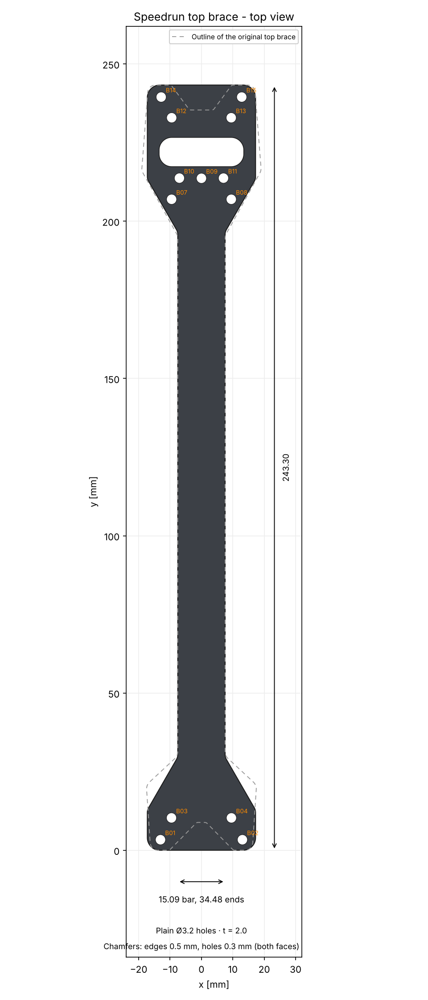
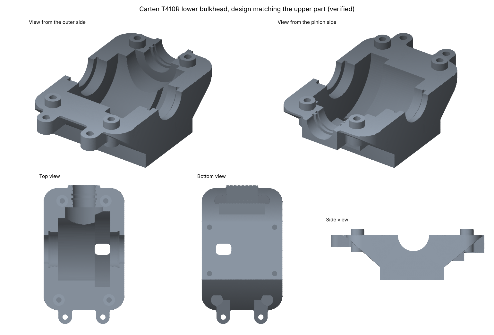
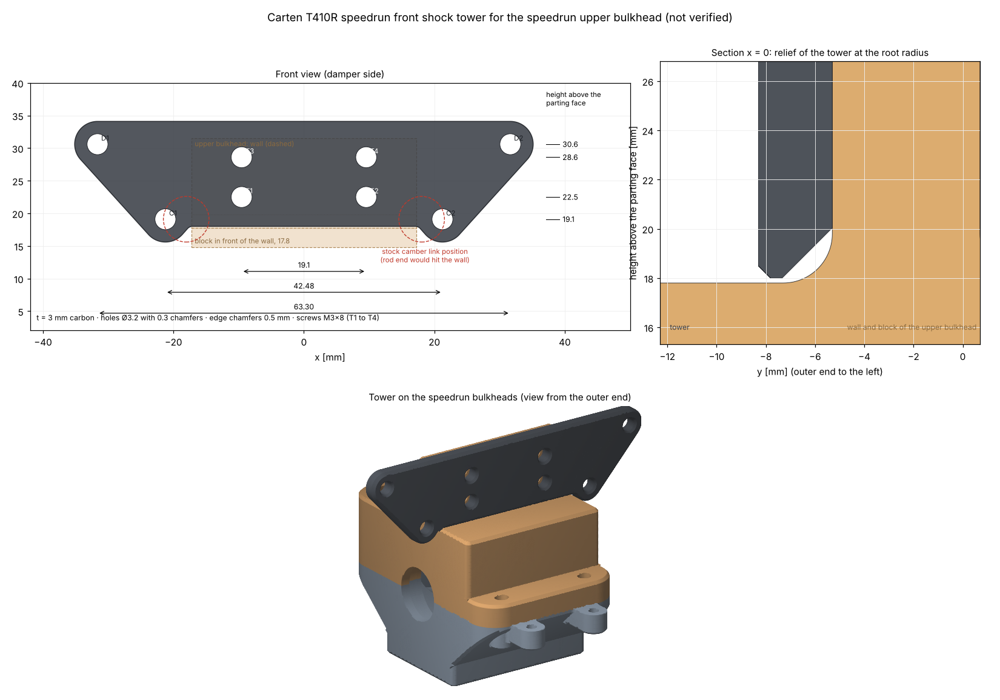
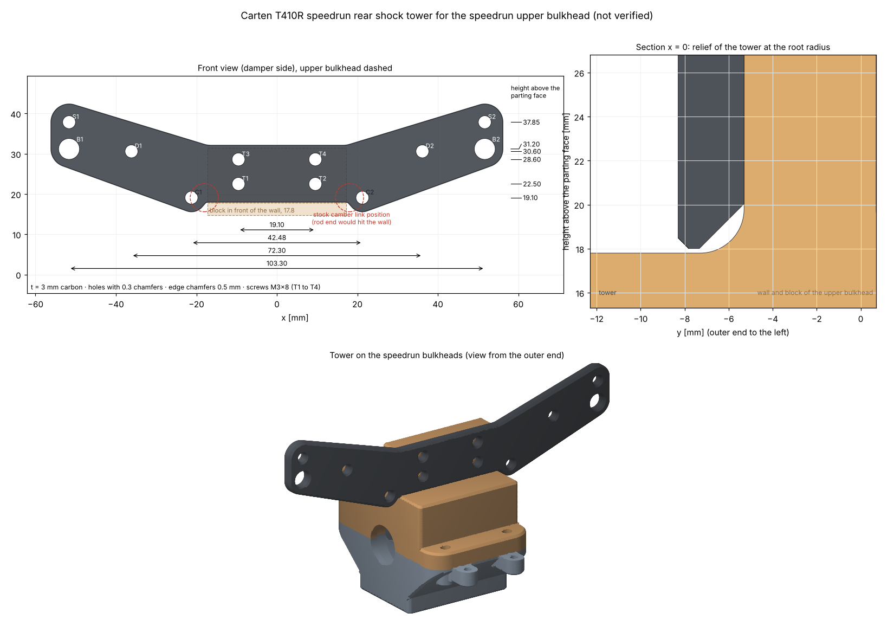
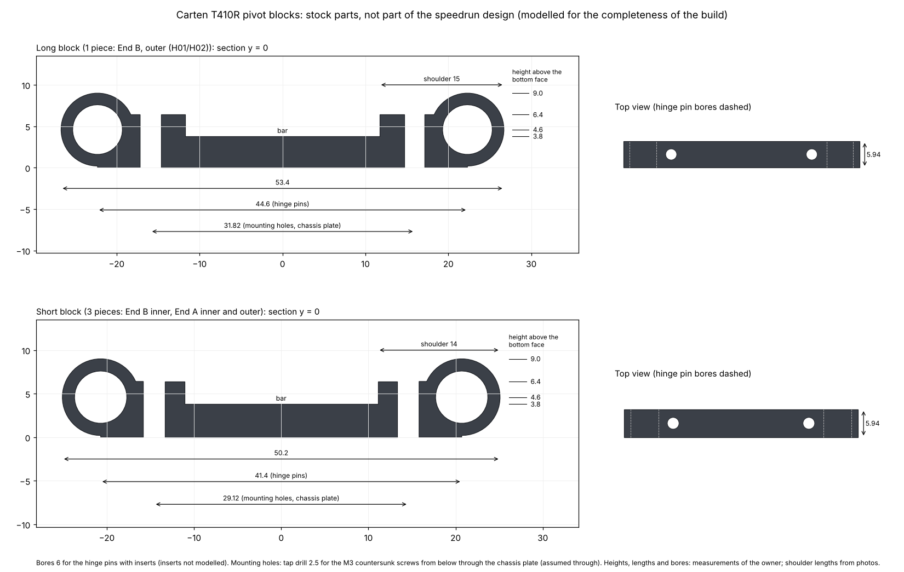

# CAD and 3D print files

## Table of contents
* [Overview](#overview)
* [Speedrun chassis](#speedrun-chassis)
  * [Parts of the speedrun chassis](#parts-of-the-speedrun-chassis)
  * [Assembly file](#assembly-file)
* [Chassis plate and top brace](#chassis-plate-and-top-brace)
  * [Parts](#parts)
  * [Files](#files)
  * [Coordinate system](#coordinate-system)
  * [Measurement basis](#measurement-basis)
  * [Test print](#test-print)
  * [Open points](#open-points)
* [Speedrun chassis plate (wide)](#speedrun-chassis-plate-wide)
  * [Print template](#print-template)
  * [Longer motor window for a 3660 motor](#longer-motor-window-for-a-3660-motor)
* [Speedrun top brace](#speedrun-top-brace)
  * [Design of the speedrun top brace](#design-of-the-speedrun-top-brace)
  * [Fit to the bulkheads](#fit-to-the-bulkheads)
  * [Files of the speedrun top brace](#files-of-the-speedrun-top-brace)
  * [Open points of the speedrun top brace](#open-points-of-the-speedrun-top-brace)
* [Lower bulkhead](#lower-bulkhead)
  * [Interfaces](#interfaces)
  * [Files of the lower bulkhead](#files-of-the-lower-bulkhead)
  * [Coordinate system of the lower bulkhead](#coordinate-system-of-the-lower-bulkhead)
  * [Measurement basis of the lower bulkhead](#measurement-basis-of-the-lower-bulkhead)
  * [Caliper measurement sheet](#caliper-measurement-sheet)
  * [Test print of the lower bulkhead](#test-print-of-the-lower-bulkhead)
  * [Design of the lower bulkhead](#design-of-the-lower-bulkhead)
  * [Design notes](#design-notes)
  * [Edges of the outer shape](#edges-of-the-outer-shape)
  * [Open points of the lower bulkhead](#open-points-of-the-lower-bulkhead)
* [Upper bulkhead (new design)](#upper-bulkhead-new-design)
  * [Interfaces of the upper bulkhead](#interfaces-of-the-upper-bulkhead)
  * [Design of the upper bulkhead](#design-of-the-upper-bulkhead)
  * [Files of the upper bulkhead](#files-of-the-upper-bulkhead)
  * [Measurement sheet of the stock upper bulkhead](#measurement-sheet-of-the-stock-upper-bulkhead)
  * [Open points of the upper bulkhead](#open-points-of-the-upper-bulkhead)
* [Speedrun shock towers](#speedrun-shock-towers)
  * [Design of the speedrun shock towers](#design-of-the-speedrun-shock-towers)
  * [Fit to the upper bulkhead](#fit-to-the-upper-bulkhead)
  * [Files of the speedrun shock towers](#files-of-the-speedrun-shock-towers)
  * [Open points of the speedrun shock towers](#open-points-of-the-speedrun-shock-towers)
* [Pivot blocks (stock parts, not part of the speedrun design)](#pivot-blocks-stock-parts-not-part-of-the-speedrun-design)
  * [Dimensions of the pivot blocks](#dimensions-of-the-pivot-blocks)
  * [Position and fit on the speedrun chassis](#position-and-fit-on-the-speedrun-chassis)
  * [Files of the pivot blocks](#files-of-the-pivot-blocks)
  * [Open points of the pivot blocks](#open-points-of-the-pivot-blocks)
* [Scripts](#scripts)
  * [Regenerating the files](#regenerating-the-files)
  * [DXF generation](#dxf-generation)
* [3D printed parts](#3d-printed-parts)
  * [1. Motor fan mount (`fan_mount.stl`)](#1-motor-fan-mount-fan_mountstl)
  * [2. LiPo battery dummy (`lipo_mock.stl`)](#2-lipo-battery-dummy-lipo_mockstl)
  * [3. RC car maintenance stand (`stojan_3dprint_25.stl`)](#3-rc-car-maintenance-stand-stojan_3dprint_25stl)
  * [4. Rear diffuser (`T410R_DIFFUSOR_V2_2.stl`)](#4-rear-diffuser-t410r_diffusor_v2_2stl)
* [Sources](#sources)

## Overview
This directory contains CAD data and 3D print files for the RC car **Carten T410R**:
* **`/chassis`**: CAD data of the chassis plate and the top brace, with one subdirectory per part:
  * **`/chassis_plate`**: Chassis plate (STEP, STL, DXF, OpenSCAD, PDF templates, geometry data, hole table)
  * **`/top_brace`**: Top brace (STEP, STL, DXF, OpenSCAD, PDF template, geometry data, hole table)
  * **`/test_print`**: STL files of the chassis plate and the top brace for a test print on a home 3D printer
  * **`/chassis_plate_speedrun_wide`**: Wide variant of the chassis plate for speedruns (STEP, STL, PDF template, geometry data)
  * **`/chassis_plate_speedrun_wide_motor10`**: Wide variant with a longer motor window for a 3660 motor (STEP, STL, DXF, PDF template, geometry data)
  * **`/top_brace_speedrun`**: New design of the top brace that matches the bulkheads of this project (STEP, STL, DXF, PDF templates, geometry data, hole table, test print STL files)
* **`/bulkhead`**: CAD data of the bulkheads (gear boxes): lower bulkhead, upper bulkhead (new design) and the assembly of both parts (STEP, STL, test print STL, parameter files, measurement sheets).
* **`/shock_tower`**: New design of the front and the rear shock tower that match the speedrun upper bulkhead (STEP, STL, DXF, PDF templates, geometry data, parameter file, hole table).
* **`/stock_parts`**: Models of stock parts of the Carten T410R. They are not part of the speedrun design and are modelled for the completeness of the build.
  * **`/pivot_block`**: Pivot blocks of the wishbones (STEP, STL, parameter file).
* **`/assembly`**: Assembly of the speedrun chassis: chassis plate, bulkheads, top brace and shock towers, completed with the stock pivot blocks (STEP).
* **STL files in this directory**: 3D printed parts for the car and a maintenance stand

Own files are not licensed for use by others, all rights are reserved (see the root readme). Third-party files are subject to the licenses of their authors (see [sources](#sources)). The preview images of all parts are stored in the `/photos` directory of the repository.

## Speedrun chassis
The speedrun chassis combines the parts that are designed in this project for speeds over 100 km/h. The parts share their interfaces: the bulkheads are mounted on the hole patterns of the chassis plate, the top brace on the contact faces of both upper bulkheads, the shock towers on the shock tower walls of the upper bulkheads (front tower at End A, rear tower at End B).



### Parts of the speedrun chassis
| Part | Quantity | Directory | Status | Material | Mass |
|:---|---:|:---|:---|:---|---:|
| [Speedrun chassis plate (wide) with longer motor window](#longer-motor-window-for-a-3660-motor) | 1 | `/chassis/chassis_plate_speedrun_wide_motor10` | Verified | Aluminium 6082 or carbon | 217 g (6082), 128 g (carbon) |
| [Lower bulkhead](#lower-bulkhead) | 2 | `/bulkhead` | Verified | 7075 | 2 x 34 g |
| [Upper bulkhead](#upper-bulkhead-new-design) | 2 | `/bulkhead` | Verified | 7075 | 2 x 53 g |
| [Speedrun top brace](#speedrun-top-brace) | 1 | `/chassis/top_brace_speedrun` | Verified | Carbon or 7075 | 14 g (carbon), 25 g (7075) |
| [Speedrun front shock tower](#speedrun-shock-towers) | 1 | `/shock_tower` | Verified | Carbon or 7075 | 4.4 g (carbon), 7.7 g (7075) |
| [Speedrun rear shock tower](#speedrun-shock-towers) | 1 | `/shock_tower` | Verified | Carbon or 7075 | 7.6 g (carbon), 13.4 g (7075) |
| **Total** | | | | Chassis plate 6082, bulkheads 7075, top brace and shock towers carbon | **417 g** |

* The masses are calculated from the volumes of the solid models (6082: 2.70 g/cm³, 7075: 2.81 g/cm³, carbon: 1.6 g/cm³). Screws, bearings and the other parts of the car are not included.
* The bulkheads are the same parts at both ends. At End A, they are rotated by 180 degrees, so that both pinions point to the middle of the car.
* The end of the top brace with the obround is at End B (motor window, spur gear). End A is assumed to be the front (see [open points of the lower bulkhead](#open-points-of-the-lower-bulkhead)).

### Assembly file
* `assembly/speedrun_chassis_T410R.step`: assembly of all 8 parts in the coordinate system of the chassis plate (STEP AP214, one solid per part).
* The assembly also contains the 4 stock pivot blocks of the wishbones (see [pivot blocks](#pivot-blocks-stock-parts-not-part-of-the-speedrun-design)). They are not part of the speedrun design, are modelled for the completeness of the build and are not in the mass total.
* The interference check of all pairs of parts gives 0 mm³, except 0.82 mm³ between the lower bulkhead at End B and the long pivot block (see [position and fit on the speedrun chassis](#position-and-fit-on-the-speedrun-chassis)).
* The assembly file and the image are generated with the script `generate_speedrun_assembly.py` (see [scripts](#scripts)) from the files of the parts.
* The image shows an overall view, a side view, a top view and close-ups of both ends: bulkheads, shock tower and end of the top brace, seen from the outer end.

## Chassis plate and top brace
* **Author:** [@kleinnconrad](https://github.com/kleinnconrad)
* **Description:** CAD models of the chassis plate and the top brace of the Carten T410R. The geometry is derived from photos of the original parts and scaled to caliper measurements (see [measurement basis](#measurement-basis)).
* **Status:** Verified with a test print. The printed chassis plate and top brace fit the car, the hole positions and the overall lengths are correct (see [test print](#test-print)).



### Parts
| Part | Size (width × length × thickness) | Holes | Cutouts | Volume |
|:---|:---|:---|:---|---:|
| Chassis plate | 100.0 × 325.6 × 2.0 mm | 36 through holes Ø3.2 mm (H01 to H36), countersunk Ø6.2 mm × 90° on the bottom face | Window approx. 23.5 × 53.3 mm, slot approx. 22.3 × 6.7 mm | 49.4 cm³ |
| Top brace | 38.0 × 243.3 × 2.0 mm | 15 through holes Ø3.2 mm (B01 to B15), not countersunk | Hexagon, short slot approx. 3.2 × 17.5 mm, long slot approx. 3.2 × 88.2 mm, obround approx. 27.0 × 9.3 mm | 7.8 cm³ |

* The width of the main section of the chassis plate is 99.98 mm. The bar of the top brace is 15.09 mm wide.
* The hole diameter of 3.2 mm is the clearance hole for M3 screws.
* Sizes and volumes are taken from the STL files. The cutout sizes are approximate values from the geometry data.

### Files
The files of the chassis plate are stored in the directory `/chassis/chassis_plate`, the files of the top brace in `/chassis/top_brace` and the test print files in `/chassis/test_print`. The STEP, STL, DXF, OpenSCAD and PDF files and the hole tables are generated from the geometry data (`*_geometry.json`). The DXF files can be regenerated with a script (see [DXF generation](#dxf-generation)). The PDF templates and the drawing `photos/cad_chassis_drawing.png` are generated with the script `generate_chassis_templates.py` (see [scripts](#scripts)).

| File | Format | Use |
|:---|:---|:---|
| `chassis_plate_T410R.step`, `top_brace_T410R.step` | STEP (AP214) | Solid models for CAD programs |
| `chassis_plate_T410R.stl`, `top_brace_T410R.stl` | STL (binary) | Complete parts as triangle meshes |
| `testprint_chassis_plate_halfA.stl`, `testprint_chassis_plate_halfB.stl` | STL (binary) | Chassis plate in two halves for the test print |
| `testprint_top_brace_halfA.stl`, `testprint_top_brace_halfB.stl` | STL (binary) | Top brace in two halves for the test print |
| `chassis_plate_T410R.dxf`, `top_brace_T410R.dxf` | DXF | 2D drawings for CNC manufacturing with the layers `OUTLINE`, `CUTOUT`, `HOLE_THROUGH` and `CSK_BOTTOM_INFO` (countersinks, chassis plate only) |
| `chassis_plate_T410R.scad`, `top_brace_T410R.scad` | OpenSCAD | Parametric models. The parameters `thickness`, `hole_d`, `csk_d` and `csk_angle` are defined at the top of the file. |
| `chassis_plate_T410R_1to1_A3.pdf` | PDF (A3, 1 page) | 1:1 template of the chassis plate |
| `chassis_plate_T410R_1to1_A4x2.pdf` | PDF (A4, 2 pages) | 1:1 template of the chassis plate on two A4 sheets (portrait) with a 20 mm overlap zone |
| `top_brace_T410R_1to1_A4.pdf` | PDF (A4, 1 page) | 1:1 template of the top brace |
| `chassis_plate_T410R_1to1_A3_print97.pdf`, `chassis_plate_T410R_1to1_A4x2_print97.pdf`, `top_brace_T410R_1to1_A4_print97.pdf` | PDF | The same templates pre-scaled to 103.09 % for a PDF viewer that prints at 97 % |
| `chassis_plate_hole_table.csv`, `top_brace_hole_table.csv` | CSV | Hole coordinates (x, y), through hole diameter and countersink diameter |
| `chassis_plate_geometry.json`, `top_brace_geometry.json` | JSON | Geometry data: outline, cutouts, holes, thickness and countersink parameters |

The PDF templates without suffix must be printed at 100 % scale. The templates with the suffix `_print97` are pre-scaled to 103.09 % (100/97) and must be printed at 97 %: printed at 97 %, the drawing is 1:1. The 100 mm bars on each page are used to check the scale. For a PDF viewer with another fixed print scale, the script `generate_chassis_templates.py` generates matching templates (options `--print-scale` and `--suffix`).

### Coordinate system
* Units are millimeters. All coordinates refer to the top view.
* x = 0 is the center line of the part.
* y = 0 is the end edge: on the chassis plate the end with the 2 × 2 hole pattern (holes H01 to H04), on the top brace the end with the hexagon cutout. The OpenSCAD files refer to this edge as the rear end edge.
* z = 0 is the bottom face. The countersinks of the chassis plate are located on the bottom face.

### Measurement basis
The outlines were taken from photos of the original parts and scaled to caliper measurements:
* **Chassis plate:** x scaled by 1.00522 (width of the main section 99.98 mm), y scaled by 1.00609 (distance between the holes H11 and H23 145.82 mm)
* **Top brace:** uniformly scaled by 1.006 (bar width 15.09 mm)
* **Holes:** through holes Ø3.2 mm (measured on the original part: 3.18 mm)
* **Shape:** The window and the slot of the chassis plate are part of the model. Two marks on the surface of the original parts are not holes and are therefore not modelled.

### Test print
The test print checks the hole positions and the overall length with a home 3D printer before the parts are manufactured. Both parts are split into two halves that are connected with dovetails. The files are stored in the directory `/chassis/test_print`.

**Result:** The test print of the chassis plate and the top brace fits the car. The holes at both ends of both parts align with the mounting points. This confirms the hole positions and the overall lengths of 325.6 mm (chassis plate) and 243.3 mm (top brace).



| File | Size (width × length × thickness) | Split |
|:---|:---|:---|
| `testprint_chassis_plate_halfA.stl` | 100.0 × 168.7 × 2.0 mm | Split at half length (y = 162.8 mm), three dovetails, 0.2 mm joint gap |
| `testprint_chassis_plate_halfB.stl` | 100.0 × 162.7 × 2.0 mm | See half A |
| `testprint_top_brace_halfA.stl` | 34.9 × 97.4 × 2.0 mm | Split at y = 92.5 mm between the short and the long slot, so that the long slot is not cut. One dovetail, 0.2 mm joint gap. |
| `testprint_top_brace_halfB.stl` | 38.0 × 150.7 × 2.0 mm | See half A |

* The halves of the chassis plate are oriented with the top side on the print bed, so that the countersinks face upwards.
* The largest half requires a print area of 100.0 × 168.7 mm.

Recommended procedure:
* Print with 100 % infill.
* Disable the XY hole compensation of the slicer for a true check of the hole positions.
* Printed holes with Ø3.2 mm are usually undersized. Ream them with a 3.2 mm drill before screws are inserted.
* Glue the halves together on a flat surface, preferably on the 1:1 template.
* Check the fit on the car: if the holes at both ends of the parts align with the mounting points, the overall length is correct.

### Open points
There are no open points for the chassis plate and the top brace. The following points were clarified:
* **Overall length:** With the caliper scaling, the chassis plate is 325.6 mm and the top brace 243.3 mm long, while measurements with a ruler resulted in 324 mm and 242 mm. The test print confirms the lengths from the caliper scaling, so the ruler readings were too short.
* **Thickness of the chassis plate:** The chassis specification listed 2.25 mm for the bottom plate. A measurement of the chassis plate of the car with a precise caliper resulted in 2.03 mm, so the value of the specification was wrong. It is corrected in `specs/mechanics/carten_t410r/spec_cartent410r.yaml`. The model uses 2.0 mm. For manufacturing, the thickness is determined by the carbon sheet that is used. The thickness of the model can be changed with the parameter `thickness` in the OpenSCAD file.

## Speedrun chassis plate (wide)
* **Author:** [@kleinnconrad](https://github.com/kleinnconrad)
* **Description:** Variant of the chassis plate for speedruns with a widened middle section. The hole pattern, the countersinks, the window, the slot and both narrow ends are identical to the chassis plate.
* **Files:** `chassis_plate_T410R_speedrun_wide.step` (STEP AP214, one solid), `chassis_plate_T410R_speedrun_wide.stl` (binary STL), `chassis_plate_T410R_speedrun_wide_1to1_A4x2_print97.pdf` (1:1 template, see [print template](#print-template)) and `chassis_plate_speedrun_wide_geometry.json` (geometry data) in the directory `/chassis/chassis_plate_speedrun_wide`. This variant has no DXF, OpenSCAD or test print files. The STEP and STL files are the source data of this variant. The geometry data is derived from the STEP file (see [scripts](#scripts)).



| Property | Chassis plate | Speedrun chassis plate (wide) |
|:---|:---|:---|
| Size (width × length × thickness) | 99.98 × 325.6 × 2.0 mm | 199.98 × 325.6 × 2.0 mm |
| Holes | 36 through holes Ø3.2 mm, countersunk Ø6.2 mm × 90° on the bottom face | Identical |
| Cutouts | Window and slot | Identical |
| Volume | 49.4 cm³ | 80.7 cm³ |

The outline differs from the chassis plate only between y = 55.3 mm and y = 246.5 mm (coordinate system as for the chassis plate, see [coordinate system](#coordinate-system)):

| Section | Position (y) | Width |
|:---|:---|:---|
| End with the 2 × 2 hole pattern | 0 to 55.3 mm | Identical to the chassis plate |
| Transition, 30.3° to the cross direction | 55.3 to 85.5 mm | Increases from 100 to 200 mm |
| Wide section | 85.5 to 205.0 mm | 199.98 mm |
| Transition, 38.4° to the cross direction | 205.0 to 246.5 mm | Decreases from 200 to 100 mm |
| Opposite end | 246.5 to 325.6 mm | Identical to the chassis plate |

* The values are taken from the STL file.
* The wide section is 10 mm wider than the width over the tires (190 mm, `spec_cartent410r.yaml`) and the body width (190 mm, `spec_body.yaml`). It protrudes by 5 mm per side. The speedrun chassis plate with the longer motor window is verified (see [longer motor window for a 3660 motor](#longer-motor-window-for-a-3660-motor)).
* The thickness of 2.0 mm is the same as for the chassis plate. The chassis plate of the car measures 2.03 mm (see [open points](#open-points)).
* The hole pattern and both narrow ends are identical to the chassis plate and are therefore confirmed by its [test print](#test-print). The widened section is not part of the test print.

### Print template
Both speedrun chassis plates have a 1:1 template on two A4 pages in landscape format. The templates are used to check the hole positions against the actual part.

| File | Directory | Window (solid line) | Green dashed line |
|:---|:---|:---|:---|
| `chassis_plate_T410R_speedrun_wide_1to1_A4x2_print97.pdf` | `/chassis/chassis_plate_speedrun_wide` | Window 23.47 × 53.27 mm | Longer motor window (see [longer motor window for a 3660 motor](#longer-motor-window-for-a-3660-motor)) |
| `chassis_plate_T410R_speedrun_wide_motor10_1to1_A4x2_print97.pdf` | `/chassis/chassis_plate_speedrun_wide_motor10` | Longer motor window 23.47 × 63.27 mm | End of the previous window |

* **Scale:** The drawing is pre-scaled to 103.09 % (100/97) for a PDF viewer that prints at 97 %. Printed at 97 %, the drawing is 1:1. Printed at 100 % ("actual size"), it is 3.1 % too large. This differs from the templates of the chassis plate, which are printed at 100 %.
* **Scale check:** Each page has a 100 mm bar in x and a 100 mm bar in y. Both bars must measure 100 mm before the template is used. After joining the pages, the distance between the centres of the holes H11 and H23 is 145.82 mm.
* **Joining:** Page 2 is laid over page 1 so that the two blue dashed lines of the 20 mm overlap zone coincide. The holes H16 to H20 are shown on both pages.
* **Orientation:** The template shows the top view (side without countersinks). The part is placed with the countersinks facing down.
* **Content:** Outline, window and slot (black), through holes Ø3.2 mm with centre cross (red), countersinks Ø6.2 mm on the bottom face (dashed), outline of the chassis plate (grey, dashed) and the other motor window (green, dashed, see table).
* The positions on both PDF files were checked on raster images with 600 dpi. All 36 holes deviate by less than 0.06 mm from the geometry data. The window ends of the template with the longer motor window deviate by less than 0.05 mm.
* The templates are generated with `scripts/cad/generate_print_template.py` (option `--plate wide` or `--plate motor10`). For a PDF viewer with another print scale, the option `--print-scale` generates a matching template (see [scripts](#scripts)).

### Longer motor window for a 3660 motor
* **Author:** [@kleinnconrad](https://github.com/kleinnconrad)
* **Description:** Variant of the speedrun chassis plate (wide) with a motor window that is 10 mm longer. The window is lengthened to fit a 3660 motor. The motor of the car (Hobbywing 3660SL G2) has a diameter of 36 mm and a length of 60 mm (`specs/electronics/brushless_combo/spec_brushless_combo.yaml`) and is 10 mm longer than a 3650 motor.
* **Status:** Verified. The hole pattern is also confirmed by the [test print](#test-print) of the chassis plate.



| Property | Speedrun chassis plate (wide) | Longer motor window |
|:---|:---|:---|
| Motor window (width × length) | 23.47 × 53.27 mm | 23.47 × 63.27 mm |
| Position of the window (x) | 16.59 to 40.06 mm | Identical |
| Position of the window (y) | 65.63 to 118.90 mm | 65.63 to 128.90 mm |
| Corner radius of the window | 3.0 mm | Identical |
| Volume | 80.7 cm³ | 80.2 cm³ |

* The window is extended only toward the end with the holes H34 to H36 (+y). The end edge at y = 65.63 mm is not moved.
* The outline, the slot, the 36 holes with the countersinks and the thickness are identical to the speedrun chassis plate (wide).
* The extension reduces the distance between the window and the countersink of hole H16 (Ø6.2 mm, bottom face) from 30.0 mm to 23.3 mm. The distances to the countersinks of the holes H07, H09, H10 and H13, which are closer to the window than H16, do not change.
* The [print template](#print-template) of the speedrun chassis plate (wide) shows the longer window as a green dashed line. The print template of this variant shows the longer window as a solid line and the end of the previous window as a green dashed line.

| File | Format | Use |
|:---|:---|:---|
| `chassis_plate_T410R_speedrun_wide_motor10.step` | STEP (AP214) | Solid model for CAD programs (one solid) |
| `chassis_plate_T410R_speedrun_wide_motor10.stl` | STL (binary) | Complete part as triangle mesh |
| `chassis_plate_T410R_speedrun_wide_motor10.dxf` | DXF | 2D drawing for CNC manufacturing with the same layers as `chassis_plate_T410R.dxf` |
| `chassis_plate_speedrun_wide_motor10_geometry.json` | JSON | Geometry data: outline, cutouts, holes, thickness and countersink parameters |
| `chassis_plate_T410R_speedrun_wide_motor10_1to1_A4x2_print97.pdf` | PDF (A4, 2 pages) | 1:1 template for a PDF viewer that prints at 97 % (see [print template](#print-template)) |

* All files are stored in the directory `/chassis/chassis_plate_speedrun_wide_motor10`. The preview image above (`photos/cad_chassis_speedrun_wide_motor10_preview.png`) shows the previous window as a red dashed line. The STEP, STL and DXF files are generated from the geometry data. All files and the preview image can be regenerated with scripts (see [scripts](#scripts)).
* The geometry data is the geometry data of the speedrun chassis plate (wide) (`chassis_plate_speedrun_wide_geometry.json`) with the longer window. That file combines the outline of `chassis_plate_T410R_speedrun_wide.step` with the holes, cutouts and countersink parameters of `chassis_plate_geometry.json` and reproduces `chassis_plate_T410R_speedrun_wide.step` exactly.

## Speedrun top brace
* **Author:** [@kleinnconrad](https://github.com/kleinnconrad)
* **Description:** New design of the top brace for the bulkheads of this project, in the same style as the bulkheads: straight lines and radii only. The original top brace (see [chassis plate and top brace](#chassis-plate-and-top-brace)) is kept unchanged.
* **Status:** Verified. The holes are taken from the original top brace, which is confirmed by its test print. The fit to the new bulkheads is also checked in the CAD model (see [fit to the bulkheads](#fit-to-the-bulkheads)). After the verification, the obsolete window at the end with B01 to B04 was closed. The holes, the outline and the fit to the bulkheads are not changed by this.



The assembly with the chassis plate and the bulkheads is shown in the section [speedrun chassis](#speedrun-chassis).

### Design of the speedrun top brace
| Feature | Original top brace | Speedrun top brace |
|:---|:---|:---|
| Holes | 15 holes Ø3.2 mm (B01 to B15) | 13 holes, positions unchanged. B05 and B06 in the middle part are closed. |
| Ends | 32.7 to 38.0 mm wide, with a notch in the middle of each end | 34.48 mm wide (same as the bulkheads, flush with their sides), flat end edges, corner radius 4 mm |
| Middle part | Bar 15.09 mm wide with a short slot (3.2 x 17.5 mm) and a long slot (3.2 x 88.2 mm) | Solid bar 15.09 mm wide |
| Transitions | Approx. 42 degrees (end with B01 to B04) and 29 degrees (end with B07 to B15) to the y axis | 30 degrees on both ends, fillets 3 mm |
| Cutout at the end with B01 to B04 | Hexagon | None: the cutout is obsolete and closed |
| Cutout at the end with B07 to B15 | Obround 27.0 x 9.3 mm | Unchanged |
| Edges | Sharp edges | Edge chamfers 0.5 mm on both faces (outline and obround), chamfers 0.3 mm on the holes, as the bulkheads and the shock towers |
| Size | 38.0 x 243.3 x 2.0 mm | 34.48 x 243.3 x 2.0 mm |
| Volume | 7.84 cm³ | 8.78 cm³ |
| Mass | 12.5 g in carbon (1.6 g/cm³) | 14.0 g in carbon, 24.7 g in 7075 (2.81 g/cm³) |

* The notches at the ends of the original top brace most likely clear the raised rib on top of the stock upper bulkhead. The upper bulkhead of this project has a flat contact face there. The speedrun top brace therefore fits only the bulkheads of this project. With the stock bulkheads, the original top brace is used.
* The new outline lies within the outline of the original top brace, except at the ends: the closed notches and the wider ends (222 mm² in total) lie on the contact faces of the bulkheads. Outside the contact faces, the new outline does not exceed the original outline (0 mm², checked by the script).
* The obround is kept unchanged, because it lies in the area of the spur gear.
* The closed holes and slots make the middle part stiffer. The manual (step 25) shows a part NHA410 with a screw M3x6 in the middle part of the top brace. It has no mounting hole on the speedrun top brace.

### Fit to the bulkheads
The script `generate_top_brace_speedrun.py` places the top brace on the upper bulkheads at both ends of the chassis plate (centres of H03 to H06 and H28 to H31) and checks the fit:

| Check | Result |
|:---|:---|
| Top brace screws B01, B02, B14, B15 to the tapped holes of the upper bulkheads, along the car | 0.00 mm, after the correction of the upper bulkhead (see below) |
| Top brace screws across | B01/B02: +-0.25 mm, B14/B15: +-0.03 mm (see [open points](#open-points-of-the-speedrun-top-brace)) |
| Access holes B03/B04 and B12/B13 above the screws M3x10 of the bulkheads | Offset 0.5 mm or less, the hex key reaches the screws |
| Ends of the top brace on the contact faces of the upper bulkheads | 15.2 mm (end with B01 to B04) and 15.7 mm (end with B07 to B15) over the full width, 0.5 mm clearance to the step of the gear block |
| Interference with both upper bulkheads | 0 mm³ |

* Correction of the upper bulkhead: the distance of the top brace screws B01 and B14 (236.13 mm) and the distance of the bulkhead centres on the chassis plate (265.83 mm) require the top brace screws 14.85 mm from the bulkhead centre. The upper bulkhead had 14.36 mm (estimate from photos). The upper bulkhead now has 14.85 mm. Both the top brace and the chassis plate are confirmed by their test print.
* The end with B07 to B15 (obround) is placed at End B of the chassis plate (motor window, spur gear), the end with B01 to B04 at End A.

### Files of the speedrun top brace
All files are stored in the directory `/chassis/top_brace_speedrun`. They are generated with the script `generate_top_brace_speedrun.py` (see [scripts](#scripts)).

| File | Format | Use |
|:---|:---|:---|
| `top_brace_T410R_speedrun.step` | STEP (AP214) | Solid model with the edge chamfers and the hole chamfers (one solid) |
| `top_brace_T410R_speedrun.stl` | STL (binary) | Triangle mesh of the solid model |
| `top_brace_T410R_speedrun.dxf` | DXF | 2D drawing for CNC manufacturing with the layers `OUTLINE`, `CUTOUT` and `HOLE_THROUGH` (without the chamfers; edge chamfers 0.5 mm and hole chamfers 0.3 mm on both faces are given in the order or taken from the STEP file) |
| `top_brace_T410R_speedrun_1to1_A4.pdf` | PDF (A4, 1 page) | 1:1 template, print at 100 % |
| `top_brace_T410R_speedrun_1to1_A4_print97.pdf` | PDF (A4, 1 page) | 1:1 template pre-scaled to 103.09 %, print at 97 % |
| `testprint_top_brace_speedrun_halfA.stl`, `testprint_top_brace_speedrun_halfB.stl` | STL (binary) | Test print in two halves (34.5 x 126.7 mm and 34.5 x 121.7 mm), split at y = 121.65 mm with one dovetail, 0.1 mm gap per side |
| `top_brace_speedrun_geometry.json` | JSON | Geometry data: outline, cutouts, holes, thickness |
| `top_brace_speedrun_hole_table.csv` | CSV | Hole coordinates (x, y) and diameter |

* The coordinate system is the same as for the original top brace: x = 0 centre line, y = 0 end edge with B01 to B04.
* The design values (bar width, corner radii, angle of the transitions, chamfers) are defined at the top of the script.

### Open points of the speedrun top brace
* **Spacing B01 to B02:** 26.10 mm in the geometry data of the original top brace, 25.65 mm between B14 and B15 and 25.6 mm between the top brace screws of the stock upper bulkhead (U7). Both bulkheads are the same part, so both ends of the top brace should have the same spacing. With a hole of 3.2 mm, a screw M3 has approx. 0.1 mm radial clearance, so an offset of 0.25 mm per side can block the screws. The verification of the speedrun top brace shows that the screws fit. A measurement of the spacing B01 to B02 on the carbon top brace can still confirm the value of the geometry data.
* Function of the part NHA410 (manual step 25) in the middle part of the original top brace.

## Lower bulkhead
* **Author:** [@kleinnconrad](https://github.com/kleinnconrad)
* **Description:** CAD model of the lower half of the gear box (bulkhead) of the Carten T410R. The stock part is the plastic part NBA249 ("Gear box"), which is used at the front and at the rear. The model is the basis for a CNC part made of 7075-T6. The interfaces to the chassis plate, the bearings, the gears, the upper bulkhead and the sway bar follow the stock part. The shape is designed to match the [upper bulkhead](#upper-bulkhead-new-design) (see [design of the lower bulkhead](#design-of-the-lower-bulkhead)).
* **Status:** Verified (test prints: see [test print of the lower bulkhead](#test-print-of-the-lower-bulkhead)). The interfaces are based on caliper measurements of the stock part. Some positions are taken from photos (accuracy approx. +-0.5 mm) or derived from the caliper values (see [measurement basis of the lower bulkhead](#measurement-basis-of-the-lower-bulkhead)).



### Interfaces
| Interface | Stock parts | Model |
|:---|:---|:---|
| Chassis plate | 4 countersunk screws M3x8 from below through the 2 mm chassis plate | 4 M3 holes (tap drill 2.5 mm, 8 mm deep), spacing 28.0 x 20.0 mm |
| Upper bulkhead | 2 button head screws M3x10 on the pinion side, 2 button head screws M3x8 on the outer side | 4 bosses 4.86 mm, 2.42 mm above the parting face, M3 holes (tap drill 2.5 mm, 7 mm deep). Spacing across 18.7 mm (pinion side) and 21.6 mm (outer side), spacing along 42.6 mm |
| Diff | 2 bearings 10x15x4 (NBA299) | Per side: outer lip 1.89 mm thick (opening 12.28 mm) and seat 15 x 4 mm, open toward the gear cavity. Inner faces of the lips 30.7 mm apart |
| Pinion shaft | 2 bearings 5x10x4 (NBA298) | Seat 10 mm, 9.25 mm long: 2 seats of 4 mm (outer seat 4.35 mm) with a rib of 0.9 mm between the bearings, 0.3 mm high (opening 9.4 mm). The rib is the only axial stop: no shoulder at the inner end, open at the housing end face |
| Ring gear (42T, 31.93 mm) and diff case | Gear diff NBA230 | Cavity with a radius of 13.5 mm for the diff case (test print), deepening with a radius of 16.4 mm for the ring gear on the ring gear side, with a through opening in the floor (test print) |
| Pinion gear (17T, 14.1 mm) | Pinion NBA207 | Pocket with a radius of 8.25 mm (test print) in a rectangular block, wall 1.5 mm |
| Sway bar | 2 M3 screws | 2 tabs, 4.35 mm thick, with M3 holes (tap drill 2.5 mm), spacing 16.2 mm |

* The diff axis and the pinion axis lie in the parting face, 17.2 mm above the bottom face. The upper bulkhead holds the bearings from above.
* The ring gear and the pinion have a module of 0.75 (calculated from the outer diameters 31.93 mm and 14.1 mm). The pitch circle of the pinion is 15.75 mm from the diff axis.
* The chassis plate holes are H03 to H06 for the rear bulkhead (End B) and H28 to H31 for the front bulkhead (End A). The bulkhead is rotated by 180 degrees between the ends, so that the pinion points to the centre shaft at both ends.
* The source of the screw sizes is the manual (steps 9, 11 and 12) and the owner of the car. The source of the bearing sizes is the manual (steps 1 and 5).

### Files of the lower bulkhead
All files are stored in the directory `/bulkhead`. The STEP and STL files and the measurement sheet are generated from the parameter file (see [scripts](#scripts)).

| File | Format | Use |
|:---|:---|:---|
| `bulkhead_lower_T410R.step` | STEP (AP214) | Solid model with nominal dimensions for CNC manufacturing (one solid) |
| `bulkhead_lower_T410R.stl` | STL (binary) | Triangle mesh of the solid model |
| `testprint_bulkhead_lower.stl` | STL (binary) | Test print variant (see [test print of the lower bulkhead](#test-print-of-the-lower-bulkhead)) |
| `bulkhead_lower_parameters.json` | JSON | All dimensions of the model, each with its source and a note |
| `bulkhead_lower_measurement_sheet.pdf` | PDF (A4, 4 pages) | Caliper measurement sheet with the caliper values and the open values (see [caliper measurement sheet](#caliper-measurement-sheet)) |

| Property | Value |
|:---|:---|
| Size (x by y by z) | 34.48 x 59.4 x 19.62 mm (with the sway bar tabs and the pinion housing) |
| Volume | 12.2 cm³ |
| Mass | 34 g in 7075 (2.81 g/cm³), 15 g in PLA (1.24 g/cm³) |

### Coordinate system of the lower bulkhead
* Units are millimeters.
* The origin is the centre of the 4 bottom holes on the bottom face.
* x runs along the diff axis (across the car). y runs along the pinion axis, +y points to the pinion and the centre shaft. z = 0 is the bottom face, which sits on the chassis plate, +z points up.
* The diff axis is at y = 0.5 mm (photo).
* In the coordinate system of the chassis plate, the origin of the rear bulkhead is at x = 0, y = 21.53 mm (centre of H03 to H06) and the origin of the front bulkhead at x = 0, y = 287.36 mm (centre of H28 to H31).

### Measurement basis of the lower bulkhead
Each parameter in `bulkhead_lower_parameters.json` has a source code:

| Source code | Meaning | Parameters |
|:---|:---|:---|
| `caliper` | Caliper measurement of the stock part (number of the measurement sheet in the note) | Hole spacings, heights, widths, lips, seat lengths, boss and tab sizes |
| `derived` | Calculated from caliper values and part sizes | Positions along y, deepening, floor thickness, pocket radii |
| `manual` | T410R instruction manual (not stored in this repository, see [sources](#sources)) | Bearing sizes |
| `user` | Information from the owner of the car | Screw sizes, function of the sway bar holes, deepening for the ring gear, diff bearing seat limited only by the outer lip |
| `photo` | Estimate from photos with rulers at the height of the part | Position of the diff axis, length of the contact block, ring gear position and side |
| `design` | Free design choice | Tap drill diameters, hole depths, openings that were not measured |

* The caliper values 7, 8 and 9 (top boss holes) agree with the top view photo within 0.3 mm. The ratio of the bottom hole spacings (28.0 / 20.0) agrees with the bottom view photo within 0.3 %.
* The stock part measures 15.6 mm (diff) and 10.5 mm (pinion) across the half bores at the parting face. The model uses the bearing diameters 15.0 mm and 10.0 mm for the bearing fit.
* The positions along y are calculated from the caliper values 16, 17 and 19 with the seat edge (15.6 mm) as the reference. With this reference, the inner pinion bearing is 18.15 mm from the diff axis. The photo with the diff installed shows approx. 18.3 mm.
* The photo with the diff installed shows the ring gear between 5.0 and 9.4 mm from the diff centre. The back face of the ring gear is approx. 1.9 mm from the inner face of the bearing.
* The lip thickness is 1.89 mm (no. 13, measured twice as no. 15). With the inner faces of the lips 30.7 mm apart (no. 14), the width over the outer faces is 34.48 mm. The caliper value no. 10 is 34.2 mm. The model keeps no. 13 and no. 14, because they set the position of the bearings.

### Caliper measurement sheet
The measurement sheet `bulkhead_lower_measurement_sheet.pdf` documents the caliper values and lists the open dimensions:
* **Pages 1 to 3:** top view, bottom view, two sections, side view and end view with numbered dimensions.
* **Page 4:** table of 41 dimensions with the measuring method, the value of the model and the caliper value. Rows without a caliper value are open.
* **Priority A:** interfaces (holes, bearing seats, bosses, tabs, clearance for the gears). **Priority B:** shape.
* Hole spacings are measured with the inside jaws from far edge to far edge minus the hole diameter. Heights are measured with the depth rod with the part on a flat surface.
* The new values 38 to 41 cover the rib between the pinion bearings, the position of the diff axis relative to the bottom holes (39 and 40) and the height of the sway bar tabs.
* No. 15 now describes the length of the diff bearing seat (4.0 mm from the lip inward). The seat has no inner shoulder.

### Test print of the lower bulkhead
* `testprint_bulkhead_lower.stl` differs from the solid model in two points: the bearing seats are 0.2 mm larger in diameter (15.2 mm and 10.2 mm), and all M3 holes have a diameter of 2.7 mm for self-tapping screws. The test print file contains the radii and edge chamfers of the solid model.
* Print orientation: bottom face on the print bed. The boss columns below the chamfers and the sway bar tabs need supports.
* The floor below the ring gear deepening has an opening of 6.85 x 5 mm. Around the opening, the floor is 0.8 mm thick and increases toward the ends of the deepening.
* Checks: the 4 bottom holes on the chassis plate, the diff and the pinion shaft with their bearings in the seats, the mesh of the gears, the fit of the stock upper bulkhead and the clearance to the suspension arms and pivot blocks.

Result of the first test print (diff with ring gear and pinion shaft installed):

| Observation | Change |
|:---|:---|
| The diff case touches the wall of the cavity on the outer side (opposite the pinion). | Radius of the diff case cavity 12.5 mm -> 13.5 mm, in the lower and the upper part. |
| The ring gear does not rotate freely in its deepening. The stock part has an extra deepening of approx. 5 mm length with approx. 0.7 mm more space below the ring gear. | Through opening in the floor below the deepening, 6.85 x 5 mm (x by y, centred below the diff axis), corner radius 1.5 mm. The chassis plate closes it. The lowest tooth of the ring gear is 1.23 mm above the chassis plate (before: 0.43 mm above the floor). The radius of the deepening (16.4 mm) is not increased: a larger radius would break through the side faces of the narrow lower section. |
| The pinion needs more space to rotate. | Radius of the pinion pocket 7.75 mm -> 8.25 mm (clearance to the 14.1 mm pinion 1.2 mm), in the lower and the upper part. Below the pocket of the lower part, the wall is 1.5 mm (before: 0.35 mm at the pinion seat). |

Result of the second test print:

| Observation | Change |
|:---|:---|
| The rib between the two pinion bearings is too high and too thick. The stock part has a rib of only a fraction of a millimetre, just enough to keep the bearings apart. | Rib height 0.75 mm -> 0.3 mm (opening 8.5 mm -> 9.4 mm), rib width 1.25 mm -> 0.9 mm, in the lower and the upper part. The face toward the pinion is not moved, so the gear mesh does not change. |
| The part is functional. The shape is to match the upper part. | New shape of the lower part (see [design of the lower bulkhead](#design-of-the-lower-bulkhead)). The interfaces are not changed. |

### Design of the lower bulkhead
The lower part has the same design as the upper part: the footprint of the upper part (34.48 mm wide, corner radius 6 mm, outer end at y = -25.5 mm), with flat faces, radii and edge chamfers (see [edges of the outer shape](#edges-of-the-outer-shape)). The two parts end flush at the outer end and on the sides.

| Section | Shape | Function |
|:---|:---|:---|
| -12.4 to 12.4 mm (y) | Rectangular block, flat underside, vertical end faces 5.0 mm high | Contact face on the chassis plate with the 4 bottom holes |
| Outer side and pinion side | One straight chamfer per side, from the end faces of the block (5.0 mm) to 0.5 mm below the parting face at the ends | Space below the chamfers for the pivot blocks of the wishbones |
| Below the pinion pocket and the pinion seats | Stepped rectangular block: 19.5 mm wide below the pocket (to 1.5 mm beyond the end of the pocket), 13.2 mm wide below the seats and beyond the end of the footprint | Wall around the pinion pocket and the pinion seats |
| Below the screws to the upper part | 4 round bosses 4.86 mm, from 11.1 mm above the bottom face | Threads M3 for the screws M3x8 and M3x10 |
| Outer end | 2 tabs 4.35 mm thick with M3 holes, beyond the end of the footprint | Sway bar mounts |

* Space for the pivot blocks: the chamfers lie above the side profile of the previous shape (at the pivot block holes H07/H08, 13.6 mm instead of 11.2 mm above the bottom face). A comparison of the solids gives the material of the new shape outside the previous shape:
  * below the pinion: 82 mm³ in the corners beside the previous round shell (|x| up to 9.75 mm). The lowest point is unchanged at 7.45 mm above the bottom face.
  * corners of the footprint on the pinion side: 13 mm³ (corner radius 6 mm instead of 7 mm), more than 11 mm above the bottom face.
  * outer side: 2 mm³.
* The clearance to the pivot blocks is confirmed by the verification of the lower bulkhead.
* The interfaces (holes, bearing seats, cavities, floor opening, bosses, tabs) are not changed by the new shape.
* Correction after the first model of the new shape: the wide block below the pinion pocket ended at the end of the pocket. Below the pinion seat, the narrow block and the chamfer start only 10.15 mm above the bottom face, the pocket reaches down to 8.95 mm. The end face of the pocket therefore had a window of approx. 8.6 x 1.2 mm to the outside. The wide block now ends 1.5 mm behind the pocket.

### Design notes
* The body is solid apart from the gear cavity. Pockets to reduce the mass are possible after the test print.
* Each diff bearing seat is limited only by the outer lip. The half bore of 15 mm runs 4.0 mm inward from the lip and then opens into the gear cavity. On the inner side, the diff holds the bearings. The diff with both bearings measures 30.0 mm, the lips are 30.7 mm apart: the diff has 0.7 mm axial play, as on the stock part.
* The gear cavity has two depths. Between the bearing seats, a cylinder with a radius of 13.5 mm holds the diff case (floor 3.7 mm thick). The test print with a radius of 12.5 mm showed that the diff case touches the wall on the outer side. On the ring gear side, a deepening with a radius of 16.4 mm from x = 4.5 mm to the inner end of the bearing seat (x = 11.35 mm) holds the ring gear (radial clearance 0.43 mm). Below the ring gear, the floor has a through opening of 6.85 x 5 mm (extra deepening of the stock part, approx. 5 mm long). The chassis plate closes the gear box from below. The wall between the deepening and the bottom holes is 1.4 mm thick.
* The ring gear is on the +x side. Seen from the pinion housing, the deepening is on the left. The bulkhead is the same part at the front and at the rear and is rotated by 180 degrees. Both pinions point to the centre shaft, so the ring gear is on the same side of the bulkhead at both ends.
* The STEP file contains no threads. The M3 holes are modelled with the tap drill diameter of 2.5 mm. For CNC manufacturing, the threads are specified in the comment field of the order (M3, thread depth 6.5 mm for the bottom holes).

### Edges of the outer shape
Both bulkheads are made for CNC milling from 7075 on a 3-axis machine. The inside of the parts is not changed (rule in `CLAUDE.md`): gear cavity, floor opening, bearing seats, lips, rib, pinion pocket, all holes, counterbores, the recesses and the bosses are the verified geometry of the test prints with the diff and the pinion. The parting faces are not changed either. Only the edges of the outer shape have radii and edge chamfers. The parameters are stored in `bulkhead_lower_parameters.json` (`inside_corner_r`, `outside_corner_r`, `edge_chamfer`, used for both parts) and `bulkhead_upper_parameters.json` (`wall_root_r`). The narrowed shock tower wall with the side steps of the upper part is also a change of the outer shape (see [design of the upper bulkhead](#design-of-the-upper-bulkhead)).

| Edge treatment | Size | Where | Reason |
|:---|:---|:---|:---|
| Radius in the vertical inside corners | 1.0 mm | Lower part: sway bar bridges, block under the pinion, pinion bosses (10 corners). Upper part: block over the outer pinion bearing (2 corners), ends of the side steps behind the wall (2 corners) | An end mill cannot cut a sharp inside corner parallel to its axis and cannot enter a gap narrower than its diameter (end mill 2 mm) |
| Radius of the vertical outside edges | 1.0 mm | Corners of the levels and blocks seen from above | No extra machining time: the end mill follows the contour |
| Root radius of the shock tower wall | 2.0 mm | Upper part, both sides of the wall, around the corners of the wall | Strength of the wall at its root |
| Edge chamfer | 0.5 mm | The other hard outside edges (angle between the faces up to approx. 120 degrees) | Edge break with a lower cost than a radius |

**Radii in the inside corners:**
* At the pinion bosses of the lower part, the radius also closes the gap between the narrow block and the boss columns. This gap was 0.32 mm wide, so no end mill could enter it.
* The block over the outer pinion bearing projects 1.2 mm beyond the end of the footprint. This limits the radius. Between the radius and the end of the block, a flat of 0.2 mm remains.
* The script closes the horizontal section at the end of each inside edge with the radius (offset by +1.0 mm and back by -1.0 mm) and extends the added faces to the parting face. Above the inclined faces of the lower part, they lie inside the body. At the corners of the footprint, the lower end of the radius follows the inclined face.

**Edge chamfers:**
* Each edge chamfer is cut with a tool along the edge: a triangle with legs of 0.5 mm on both faces. The edges at the parting faces and the bosses are not changed.
* Edges that meet tangentially, for example a straight edge and the arc of a corner radius, are cut together. The edge chamfer runs through the junction without a step.
* Where a face beside the edge becomes narrower than 1.0 mm, the edge chamfer stops 0.1 mm before that point. This occurs where an edge runs into the recess of a vertical corner radius (deck, side steps and flange of the upper part at the corners of the gear blocks), into the corner radius of the shock tower wall (sides of the root radius) or into a narrowing face of the lower part (lower ends of the boss columns, inclined faces at the footprint corners). The end of such an edge chamfer is a small triangular face.
* Where an edge chamfer is not possible at all, the edge is left as it is: a face beside the middle of the edge is narrower than 1.0 mm (for example the end faces of 0.5 mm below the parting face of the lower part), or the cut leaves thin slivers.
* Upper part: 37 edges with full edge chamfers (269 mm), 12 edges with stopped edge chamfers (94 mm), 2 short arcs of 1.2 mm left as they are.
* Lower part: 18 edges with full edge chamfers (178 mm), 18 edges with stopped edge chamfers (154 mm), 12 short edges left as they are (25 mm: edges of the small inside radii and of the narrow block under the pinion).
* The generators list all edges that are left as they are.

**Shock tower wall:** the root radius changes the interface to the shock tower. In front of the contact face, the zone above 19.8 mm is kept free (block 17.8 mm plus the root radius). Beside the narrowed wall, the zones above the side steps are kept free for the camber link lobes of the towers and the rod ends of the camber links. The stock shock tower plate reaches down to approx. 17.8 mm and does not fit. The [speedrun shock towers](#speedrun-shock-towers) are designed for the upper bulkhead.

**Unchanged inside:** the generators build the outer shape with the edge treatment first and then cut all functional voids: gear cavity, floor opening, bearing seats, lip openings, pinion pocket, rib, holes, counterbores, recesses and the keep-out zones of the upper part (top brace, shock tower, rod ends beside the wall). A comparison with the model without edge treatment, which has the verified inside, gives:

| Check | Lower part | Upper part |
|:---|:---|:---|
| Smallest distance of the changed material to the cavities, bearing seats, holes and recesses | 0.60 mm | 0.60 mm |
| Added material in the keep-out zones (top brace, shock tower, rod ends) | – | 0 mm³ |
| Removed material (edge chamfers, outside radii) | 43.3 mm³ | 61.9 mm³ |
| Added material (inside radii, root radius) | 8.3 mm³ in 10 pieces | 49.4 mm³ in 6 pieces |
| Thin slits and walls | None (narrow faces: 6 at the inside radii, 8 at the ends of stopped edge chamfers) | None (narrow faces: 16 at the ends of stopped edge chamfers, 4 at the ends of the root radius beside the narrowed wall) |

* Space for the pivot blocks: each radius lies between two existing faces and does not reach lower than the material beside it. Below the inclined faces on the outer side, the radii lie between the sway bar bridges and the outer bosses, from 12.85 mm above the bottom face (lower face of the bridges) and up to x = 11.6 mm (the bosses reach 13.2 mm). On the pinion side, they lie between the narrow block and the pinion bosses, from 10.6 mm above the bottom face (lower face of the narrow block) and up to x = 8.1 mm (the bosses reach 11.8 mm). The edge chamfers and the outside radii only remove material.
* The interference of the lower and the upper part, and of all parts of the speedrun chassis, is 0 mm³. The top brace fits the upper bulkheads unchanged.

### Open points of the lower bulkhead
* **Chassis plate:** the bottom holes of the stock bulkhead are 28.0 x 20.0 mm apart. The chassis plate and the speedrun chassis plates have 28.17 x 20.22 mm (H03 to H06) and 28.13 x 20.19 mm (H28 to H31). Countersunk screws center themselves in the countersinks, so the difference of approx. 0.1 mm per hole is not compensated by clearance. The hole spacings of the carbon chassis plate are to be measured before the aluminium plate is ordered.
* Open caliper values of the measurement sheet (nos. 21, 26, 30 to 36, 38 to 41).
* The value 22 (5 mm) is interpreted as the height of the end faces of the contact block, and the value 25 (4.35 mm) as the thickness of the sway bar tabs with the top face in the parting face.
* Width over the outer faces of the diff bearing walls: 34.48 mm in the model, 34.2 mm measured (no. 10).
* The outer end face of the stock part has small holes. Their function is unknown, so they are not modelled.
* Upper bulkhead: see [upper bulkhead (new design)](#upper-bulkhead-new-design).
* Front and rear: End A of the chassis plate is assumed to be the front (bumper holes H34 to H36), End B the rear (motor window).
* Pivot block at End B, outer: the model of the long stock pivot block overlaps the outer chamfer of the lower bulkhead by 0.38 mm (see [open points of the pivot blocks](#open-points-of-the-pivot-blocks)).

## Upper bulkhead (new design)
* **Author:** [@kleinnconrad](https://github.com/kleinnconrad)
* **Description:** CAD model of a new upper half of the gear box (bulkhead) of the Carten T410R for CNC manufacturing from 7075-T6. The shape is a new design. The interfaces follow the stock part: the lower bulkhead, the diff and pinion bearings, the shock tower and the top brace.
* **Status:** Verified with a test print. The interfaces to the lower part and the bearings are taken from the parameter file of the lower bulkhead. The shock tower hole pattern and its height, the spacing of the top brace screws and the height of the top brace face are caliper values (U1 to U4, U7, U9, U10). The position of the shock tower contact face is an estimate from photos (U5, U6), and the position of the top brace screws along y is derived from the top brace and the chassis plate (U8). The test print confirms the part (see [measurement sheet of the stock upper bulkhead](#measurement-sheet-of-the-stock-upper-bulkhead)). The root radius of the shock tower wall was added after the test print: the stock shock tower plate does not fit, the [speedrun shock towers](#speedrun-shock-towers) are designed for the upper bulkhead. Also after the test print, the shock tower wall was narrowed to 28.0 mm with side steps beside it (request of the owner): the camber link holes of the towers are at the stock position, and the rod ends of the camber links sit beside the wall. The inside of the part and the 4 tapped holes of the shock tower are not changed.


The preview shows the upper part, the assemblies at End A (front) and End B (rear) with the lower part, the [speedrun shock towers](#speedrun-shock-towers) and the end of the [speedrun top brace](#speedrun-top-brace) (dark grey), and two sections of the assembly at End A. The bearings (light grey), the gears (yellow) and the diff case (dark grey) are simplified bodies that show the positions only.

### Interfaces of the upper bulkhead
| Interface | Stock parts | Model | Source |
|:---|:---|:---|:---|
| Lower bulkhead | Parting face, 4 bosses of the lower part (4.86 mm, 2.42 mm high) | Flat underside, 4 recesses 5.06 x 2.52 mm for the bosses (locating the two halves) | Lower part |
| Screws to the lower part | 2 button head screws M3x8 on the outer side, 2 button head screws M3x10 on the pinion side | Clearance holes 3.2 mm. Head seats 4.92 mm (outer side, on the flange) and 6.92 mm (pinion side, counterbore 6.5 mm) above the parting face: 5.5 mm thread engagement in the lower part | User, lower part |
| Diff bearings (10x15x4) | Clamped between the two halves | Upper half bores 15 x 4 mm, limited only by the outer lips (opening 12.28 mm, 1.89 mm thick) | Lower part |
| Pinion bearings (5x10x4) | Clamped between the two halves | Upper half bores 10 mm with the rib (0.9 mm wide, 0.3 mm high) between the bearings as the only axial stop, open toward the pinion pocket and at the housing end face | Lower part, user |
| Gears | Ring gear 42T (31.93 mm), pinion 17T (14.1 mm) | Same cavities as the lower part: diff case radius 13.5 mm, ring gear radius 16.4 mm on the ring gear side (from x = 4.5 mm to 10.4 mm, 1 mm beyond the back face of the ring gear), pinion pocket radius 8.25 mm | Lower part, photo |
| Shock tower | 3 mm carbon, 4 button head screws M3x8 (manual steps 19 and 20). Stock holes 2.9 mm, through the 5.8 mm ears | Flat contact face facing the outer side at y = -5.3 mm, 4 tapped holes M3 (through the 6 mm wall) at x = +-9.55 mm and 22.5 / 28.6 mm above the parting face. Root radius 2.0 mm on both sides of the wall. In front of the face, no material above 19.8 mm: the stock plate does not fit, the [speedrun shock towers](#speedrun-shock-towers) fit. Wall 28.0 mm wide (x = +-14.0 mm) with side steps 15.0 mm above the parting face beside it: space for the rod ends of the camber links (x = +-18.05 mm, 19.1 mm) | Caliper (holes), photo (contact face), owner (camber links) |
| Top brace (NHA432) | 2 button head screws M3x8 per bulkhead (manual step 25) into 2 raised bosses | Flat contact face 15.4 mm above the parting face, from y = 10.5 mm to the pinion end, 2 tapped holes M3 at x = +-12.8 mm, y = 14.85 mm | Caliper (height, spacing), top brace and chassis plate (y, see [fit to the bulkheads](#fit-to-the-bulkheads)) |
| Sway bar holders | M3x6 from above onto the tabs of the lower part (manual step 23) | The upper part ends at y = -25.5 mm, 3.2 mm before the sway bar holes | Photo |

* The pinion side screws (M3x10) sit below the top brace. The top brace has access holes above them (B03/B04 and B12/B13, spacing 19.1 mm, 6.94 mm and 6.58 mm from the top brace screws).
* The upper part is the same at the front and at the rear, like the lower part. The front and the rear shock tower use the same 4 holes.

### Design of the upper bulkhead
The upper part is a prismatic block: the footprint of the lower part (34.48 mm wide, corner radius 6 mm) is extruded to 4 flat levels along y. The shock tower wall and the gear block are narrowed to 28.0 mm, with side steps beside them. All outer faces are flat. The edges have radii and edge chamfers, the root of the shock tower wall has a radius of 2.0 mm (see [edges of the outer shape](#edges-of-the-outer-shape)). The only other curved faces are the bores and the cavities, which follow the lower part.

| Section (y) | Level above the parting face | Function |
|:---|:---|:---|
| -25.5 to -17.9 mm | 4.92 mm | Flange: seat of the heads of the outer screws |
| -17.9 to -5.3 mm | 17.8 mm | Block over the diff and the ring gear (2 mm in front of the ring gear cavity), 28.0 mm wide |
| -5.3 to 0.7 mm | 31.5 mm | Shock tower wall, 28.0 mm wide (x = +-14.0 mm), 6 mm thick, flat contact face, root radius 2.0 mm on both sides |
| 0.7 to 10.5 mm | 17.8 mm | Block over the diff and the ring gear, 28.0 mm wide up to 5.0 mm |
| 10.5 to 26.7 mm | 15.4 mm | Flat contact face of the top brace over the pinion, counterbores of the pinion side screws |
| 26.7 to 27.9 mm | Rectangular block, 13.2 mm wide, 6.6 mm high | Cover of the outer pinion bearing beyond the footprint (same section as the lower part) |

* Side steps: beside the wall and the gear block (|x| > 14.0 mm), from the front face of the gear block to y = 5.0 mm, the part is 15.0 mm high. This gives space for the rod ends of the camber links behind the shock towers (zone with a radius of 4.0 mm around the ball stud at x = +-18.05 mm, 19.1 mm, 9 mm long; estimate) and for the camber link lobes of the towers (lowest point 15.6 mm). The removed material is 3.05 mm away from the cavities, seats and holes; above the diff bearing seats, 7.5 mm of material remain.
* The tapped holes of the shock tower (x = +-9.55 mm) are 4.45 mm from the side faces of the narrowed wall (centre to face).
* The interference check of the assembly of the lower and the upper part gives 0 mm³.
* The ring gear cavity of the upper part ends at x = 10.4 mm (lower part: 11.35 mm). Up to 11.35 mm, the wall to the tapped hole of the top brace screw was only 0.2 mm. It is now 1.15 mm.
* Size 34.48 x 53.4 x 31.5 mm, volume 18.8 cm³, mass 53 g in 7075 (2.81 g/cm³), 23 g in PLA.
* The wall is 6 mm thick: the screws M3x8 through the 3 mm shock tower have 5 mm thread engagement. The material above the thread of the upper holes is 1.4 mm (wall top at the height of the stock ears, U10).
* The block over the ring gear is 17.8 mm high. In front of the wall, the zone above 19.8 mm (block plus root radius) is kept free for the shock tower. The cover over the ring gear cavity is 1.4 mm directly behind the wall and 2.5 mm at the contact face.
* The mass is higher than with shells that follow the gears. Straight pockets in the flat faces can reduce it, if required.
* Manufacturing: 3 setups on a 3-axis machine (underside with the bores and cavities, top with the levels and the vertical holes, outer side with the 4 shock tower holes). The STEP file contains no threads: the tapped holes are modelled with the tap drill diameter of 2.5 mm. Radii and edge chamfers: see [edges of the outer shape](#edges-of-the-outer-shape).

### Files of the upper bulkhead
All files are stored in the directory `/bulkhead`. The files are generated from the parameter files of the upper and the lower part (see [scripts](#scripts)).

| File | Format | Use |
|:---|:---|:---|
| `bulkhead_upper_T410R.step` | STEP (AP214) | Solid model with nominal dimensions (one solid) |
| `bulkhead_upper_T410R.stl` | STL (binary) | Triangle mesh of the solid model |
| `testprint_bulkhead_upper.stl` | STL (binary) | Test print variant: bearing seats 0.2 mm larger, tapped holes 2.7 mm for self-tapping screws. Print with the parting face on the print bed. |
| `bulkhead_assembly_T410R.step` | STEP (AP214) | Assembly of the lower and the upper part |
| `bulkhead_upper_parameters.json` | JSON | Dimensions of the upper part, each with its source and a note. The shared dimensions are read from `bulkhead_lower_parameters.json`. |
| `bulkhead_upper_measurement_sheet.pdf` | PDF (A4, 2 pages) | Measurement sheet of the stock upper part (see below) |

### Measurement sheet of the stock upper bulkhead
The measurement sheet `bulkhead_upper_measurement_sheet.pdf` shows the interfaces of the stock upper part on 3 photos (end view, side view, top view) with the numbers U1 to U14. Page 2 lists the values of the model and the caliper values (U1 to U4, U7, U9, U10 measured):
* **U1 to U6, U11, U13:** shock tower: hole pattern, height of the holes, position of the contact face, lowest edge of the shock tower plates.
* **U7 to U9:** top brace: hole spacing, position along y, height of the contact face.
* **U10, U12:** height of the ears, outer end of the stock part.
* **U14:** use of the 2 screws M3x18 with the block NBA201 at the rear end of the top brace (manual step 25).
* A scan of both shock towers on the flatbed scanner (U13) is the most accurate source for the hole pattern.
* The photos are stored as `photos/bulkhead_upper_stock_end_view.jpg`, `photos/bulkhead_upper_stock_side_view.jpg` and `photos/bulkhead_upper_stock_top_view.jpg`.

### Open points of the upper bulkhead
* Caliper values of the stock upper part that are not measured: U5, U6 (position of the shock tower contact face), U8 (position of the top brace screws along y), U11 (lowest edge of the shock towers), U12 to U14. The test print confirms the part, so these values are not required for manufacturing.
* Shock tower: the stock shock tower plate does not fit. The [speedrun shock towers](#speedrun-shock-towers) (front and rear) are designed for the upper bulkhead.
* Mass: 53 g in 7075. Straight pockets in the flat faces can reduce the mass.

## Speedrun shock towers
* **Author:** [@kleinnconrad](https://github.com/kleinnconrad)
* **Description:** New front and rear shock towers for the speedrun upper bulkhead. Flat carbon plates of 3 mm (as the stock shock towers) on the contact face of the shock tower wall, each fixed with 4 button head screws M3x8 in the tapped holes of the wall. The dampers are mounted on the front face (outer end), the rod ends of the camber links on the back face (wall side), as on the car. The rear tower also carries the body post mounts.
* **Status:** Verified by the owner (front and rear shock tower). The damper, camber link (wheel mount) and body post positions are based on measurements of the stock shock towers by the owner. After the verification, the camber link holes were moved back to the stock position (the owner found them about 3 mm too far outward), and the shock tower wall of the upper bulkhead was narrowed for the rod ends (see [design of the speedrun shock towers](#design-of-the-speedrun-shock-towers)). The space for the rod ends is an estimate from photos.





### Design of the speedrun shock towers
Positions in the plane of the tower: x across the car, height above the parting face of the bulkheads. The measurements of the owner refer to the edges of the holes of the stock towers; the model assumes holes of 3.2 mm in the stock towers (parameter `stock_hole_d`).

| Element | Front shock tower | Rear shock tower | Basis |
|:---|:---|:---|:---|
| Mounting holes T1 to T4 | x = ±9.55 mm, 22.5 mm and 28.6 mm, Ø3.2 mm | Same | Tapped holes of the upper bulkhead (U1 to U3) |
| Camber link holes C1, C2 (wheel mounts) | x = ±18.05 mm, 19.1 mm, Ø3.2 mm | Same | Stock towers: 8.5 mm outward and 5 mm down from the top of the lower mounting hole (owner) |
| Damper holes D1, D2 | x = ±31.65 mm, 30.6 mm, Ø3.2 mm | x = ±36.15 mm, 30.6 mm, Ø3.2 mm | Stock towers, from the outer end of the upper mounting hole to the centre of the damper hole: front 20.5 mm outward and 2 mm up, rear 25 mm outward and 2 mm up (owner) |
| Body post bores B1, B2 | – | x = ±51.65 mm, 31.2 mm, Ø5.2 mm | Stock rear tower: bottom of the bore 40.5 mm outward from the outer end of the upper mounting hole (owner) |
| Body post screw bores S1, S2 | – | x = ±51.65 mm, 37.85 mm, Ø3.2 mm | Stock rear tower: bottom of the bore 2.45 mm above the top of the 5.2 mm bore (owner) |
| Thickness | 3.0 mm carbon | 3.0 mm carbon | Owner. The upper bulkhead is designed for it: screws M3x8, 5 mm thread engagement |
| Outline | Straight top edge 34.1 mm high, round ends R3.5 around the damper holes, straight edges down to the camber link lobes | Straight top edge 32.1 mm high over the width of the bulkhead, corners R6, rising straight edges to round ends R4.5 around the body post bores, straight edges down to the camber link lobes; the damper holes lie in the wings | Design |
| Common outline | Round lobes R3.5 around the camber link holes beside the narrowed block, straight bottom edge 0.2 mm above the block in front of the wall, inside corners R1 | Same | Design |
| Size, mass | 70.3 x 18.5 x 3 mm, 4.4 g (carbon), 7.7 g (7075) | 112.3 x 26.8 x 3 mm, 7.6 g (carbon), 13.4 g (7075) | |

* Edges of both towers: chamfer 0.5 mm on both faces (as the edge chamfers of the bulkheads), chamfers of 0.3 mm on the holes. No sharp corners: all outside corners are radii.
* Relief on the back face: along the bottom edge, the edge chamfer increases to 45 degrees with legs of 2.05 mm and runs out to the edge chamfer over 1.5 mm beside the wall. It clears the root radius of the wall (2.0 mm) by 0.18 mm.
* Camber link holes: at the stock position (x = ±18.05 mm). The rod ends sit behind the tower beside the shock tower wall of the upper bulkhead. For this, the wall and the gear block of the upper bulkhead are narrowed to 28.0 mm (x = ±14.0 mm), with side steps 15.0 mm above the parting face beside them (see [design of the upper bulkhead](#design-of-the-upper-bulkhead)). A zone with a radius of 4.0 mm around the ball stud (rod end with clearance, estimate) is 0.05 mm clear of the side faces of the wall: 18.05 - 4.0 - 0.05 = 14.0 mm.
* The bottom edge lies 0.2 mm above the block in front of the wall (17.8 mm). The camber link lobes reach down to 15.6 mm beside the narrowed block, 0.6 mm above the side steps. The edge distance below the lower mounting holes is 2.9 mm, around the other holes at least 1.9 mm.

### Fit to the upper bulkhead
Results of the checks of `generate_shock_towers.py` (same for both towers):

| Check | Result |
|:---|:---|
| Mounting holes on the tapped holes of the upper bulkhead | Offset 0.00 mm |
| Interference with the upper and the lower bulkhead | 0 mm³ |
| Contact area on the wall | 247 mm² |
| Gap below the tower (block and root radius) | 0.20 mm |
| Zone of the rod ends behind the tower (radius 4.0 mm, 9 mm long) | Free, 0 mm³ overlap with the bulkheads |
| Edge distance of the holes | Mounting holes 2.9 mm, camber link holes 1.9 mm, damper holes 1.9 mm (front) and 5.3 mm (rear), body post bores 1.9 mm and 2.9 mm |
| Thin slits and walls | None |

* Both towers are part of the assembly of the speedrun chassis: the front tower at End A (assumed front), the rear tower at End B. The interference check gives 0 mm³ for both towers.

### Files of the speedrun shock towers
All files are stored in the directory `/shock_tower`. They are generated with `generate_shock_towers.py` (see [scripts](#scripts)). The file names start with `shock_tower_front` or `shock_tower_rear`.

| File | Format | Use |
|:---|:---|:---|
| `shock_tower_front_T410R_speedrun.step`, `shock_tower_rear_T410R_speedrun.step` | STEP (AP214) | Solid models with the edge chamfers and the relief, for CNC manufacturing. Plate coordinates: x across the car, y height above the parting face, z = 0 back face |
| `shock_tower_front_T410R_speedrun.stl`, `shock_tower_rear_T410R_speedrun.stl` | STL (binary) | Triangle meshes, also for test prints |
| `shock_tower_front_T410R_speedrun.dxf`, `shock_tower_rear_T410R_speedrun.dxf` | DXF | 2D drawings with the layers `OUTLINE` and `HOLE_THROUGH` (outline without the chamfers) |
| `..._1to1_A4.pdf`, `..._1to1_A4_print97.pdf` | PDF (A4) | 1:1 templates of each tower (100 % and 97 %) to compare the holes with the stock towers and the bulkhead |
| `shock_tower_front_geometry.json`, `shock_tower_rear_geometry.json` | JSON | Geometry data: outline and holes (holes with another diameter than 3.2 mm carry their own diameter) |
| `shock_tower_front_parameters.json`, `shock_tower_rear_parameters.json` | JSON | All dimensions, each with its source and a note |
| `shock_tower_front_hole_table.csv`, `shock_tower_rear_hole_table.csv` | CSV | Hole tables with diameter and use |

* CNC order of the carbon plates: outline and holes from the DXF files. The edge chamfers and the relief on the back face are in the STEP files (relief: 45 degrees, 2.05 mm, along the bottom edge on the back face).

### Open points of the speedrun shock towers
Both shock towers are verified by the owner. The following points are not required for manufacturing. They are relevant for later changes of the design.
* Rod ends of the camber links: size and position behind the towers are not measured (the zone with a radius of 4.0 mm is an estimate). It sets the width of the shock tower wall of the upper bulkhead (parameters `rod_end_clearance_r` of the towers and `wall_half_width` of the upper bulkhead).
* Holes of the stock towers: the conversion of the measurements assumes holes of 3.2 mm.

## Pivot blocks (stock parts, not part of the speedrun design)
* **Author:** [@kleinnconrad](https://github.com/kleinnconrad)
* **Description:** Models of the stock pivot blocks of the Carten T410R. The pivot blocks hold the hinge pins of the wishbones and are screwed to the chassis plate from below (countersunk screws M3). They are stock parts: they are not part of the speedrun design and are not manufactured in this project. They are modelled for the completeness of the build: the assembly of the speedrun chassis contains them, so that the space below the bulkheads can be checked.
* **Status:** Not part of the speedrun design (stock part). The dimensions are measurements of the owner, the distances of the mounting holes are taken from the hole pattern of the speedrun chassis plate, the lengths of the shoulders are estimates from photos.



### Dimensions of the pivot blocks
| Dimension | Long block | Short block | Source |
|:---|:---|:---|:---|
| Quantity and position | 1: End B, outer (H01/H02) | 3: End B, inner (H07/H08), End A, inner (H26/H27), End A, outer (H32/H33) | Owner, chassis plate |
| Total length | 53.4 mm | 50.2 mm | Owner (long block), derived (short block: 41.4 + 2 x 4.4) |
| Distance of the hinge pin bores | 44.6 mm | 41.4 mm | Owner |
| Distance of the mounting holes | 31.82 mm | 29.12 mm | Chassis plate (short block: mean of 3 hole pairs; photo of the underside approx. 29.2 mm) |
| Width | 5.94 mm | 5.94 mm | Owner |
| Height at the lobes, at the shoulders, of the bar | 9.0 / 6.4 / 3.8 mm | Same | Owner |
| Length of the shoulders (from the end of the block) | 15.0 mm | 14.0 mm | Photo |
| Hinge pin bores | 6.0 mm, axis 4.6 mm above the bottom face, lobes R4.4 | Same | Derived from the measurements of the owner |
| Mounting holes | 2.5 mm (tap drill M3), through | Same | Assumption |

* The radius of the lobes follows from the long block: (53.4 - 44.6) / 2 = 4.4 mm. The axis of the bores lies at 9.0 - 4.4 = 4.6 mm above the bottom face.
* Not modelled: the inserts in the bores and the small tabs on top of the shoulders.

### Position and fit on the speedrun chassis
Results of the checks of `generate_pivot_blocks.py`:

| Position | Block | Holes of the chassis plate | Offset of the mounting holes | Lower bulkhead | Upper bulkhead |
|:---|:---|:---|:---|:---|:---|
| End B, outer | Long | H01/H02 | 0.00 mm | Overlap 0.82 mm³ (0.38 mm deep) | 9.18 mm clearance |
| End B, inner | Short | H07/H08 | 0.03 mm | 2.13 mm clearance | 8.67 mm clearance |
| End A, inner | Short | H26/H27 | 0.01 mm | 1.22 mm clearance | 8.67 mm clearance |
| End A, outer | Short | H32/H33 | 0.02 mm | 0.90 mm clearance | 8.67 mm clearance |

* The long block at End B lies closer to the bulkhead (16.5 mm from the centre of the bulkhead) than the short block at End A, outer (19.1 mm). Its shoulders (6.4 mm) reach 0.38 mm into the outer chamfer of the lower bulkhead, which starts at 6.0 mm above the chassis plate at the side of the block that faces the bulkhead (|x| from 11.7 to 17.0 mm).
* The test prints of the lower bulkhead were made with the previous shape. The outer chamfers came with the new shape after the second test print, so this point is not checked on the car.

### Files of the pivot blocks
All files are stored in the directory `/stock_parts/pivot_block`. They are generated with `generate_pivot_blocks.py` (see [scripts](#scripts)).

| File | Format | Use |
|:---|:---|:---|
| `pivot_block_long_T410R.step`, `pivot_block_short_T410R.step` | STEP (AP214) | Solid models in block coordinates: x along the block, y along the hinge pins, z = 0 bottom face |
| `pivot_block_long_T410R.stl`, `pivot_block_short_T410R.stl` | STL (binary) | Triangle meshes |
| `pivot_block_parameters.json` | JSON | All dimensions, each with its source and a note |

### Open points of the pivot blocks
* Overlap at End B, outer: check on the car whether the long pivot block touches the outer chamfer of the lower bulkhead, or measure the height of the shoulders at the side of the block that faces the bulkhead. If they touch, the outer chamfer of the lower bulkhead can be raised at this place (outer shape; the inside of the bulkhead is not changed).
* Mounting holes: depth (through or blind) not measured.

## Scripts
The directory `scripts/cad` contains the Python scripts that generate the files of the chassis plates and the bulkheads. The scripts are run from the root directory of the repository. Without arguments, the scripts of the chassis plates read and write the files of the speedrun chassis plates (except `generate_chassis_templates.py`, which writes the templates of the chassis plate and the top brace), and the scripts of the bulkhead read and write the files of the lower bulkhead and the upper bulkhead. The option `--help` lists the arguments of each script. The required packages are installed with `pip install cadquery ezdxf matplotlib reportlab`.

| Script | Input | Output | Package |
|:---|:---|:---|:---|
| `geometry_from_step.py` | STEP file of the speedrun chassis plate (wide), geometry data of the chassis plate | Geometry data of the speedrun chassis plate (wide). The option `--check` compares the rebuilt solid with the STEP file. | cadquery |
| `lengthen_motor_window.py` | Geometry data of the speedrun chassis plate (wide) | Geometry data with the motor window 10 mm longer toward End A (option `--length`) | None |
| `generate_solid.py` | Geometry data | STEP and STL file. Helper module: plates with edge chamfers and hole chamfers (speedrun top brace, speedrun shock towers) | cadquery |
| `generate_dxf.py` | Geometry data | DXF file (see [DXF generation](#dxf-generation)) | ezdxf |
| `check_motor_window.py` | STEP files and geometry data of both speedrun chassis plates | Check results: solid, volume, section through the window, holes, distances to the countersinks | cadquery |
| `generate_drawing.py` | Geometry data of the speedrun chassis plate (wide) and the chassis plate | Drawing `photos/cad_chassis_speedrun_wide_drawing.png` | matplotlib |
| `generate_window_preview.py` | Geometry data of both speedrun chassis plates | Preview image `photos/cad_chassis_speedrun_wide_motor10_preview.png` | matplotlib |
| `generate_print_template.py` | Geometry data of both speedrun chassis plates and the chassis plate | Print templates of both speedrun chassis plates (option `--plate wide` or `--plate motor10`). The option `--print-scale` sets the scale of the PDF viewer. | reportlab |
| `generate_chassis_templates.py` | Geometry data of the chassis plate and the top brace | Print templates `chassis_plate_T410R_1to1_A3.pdf`, `chassis_plate_T410R_1to1_A4x2.pdf`, `top_brace_T410R_1to1_A4.pdf` and the drawing `photos/cad_chassis_drawing.png`. The options `--print-scale` and `--suffix` generate pre-scaled templates (for example `_print97`). | matplotlib, reportlab |
| `generate_top_brace_speedrun.py` | Geometry data of the original top brace, parameter files of the bulkheads | All files of the speedrun top brace, drawing `photos/cad_top_brace_speedrun_drawing.png`, checks of the outline and of the fit to the bulkheads | cadquery, ezdxf, matplotlib, reportlab |
| `generate_shock_towers.py` | Parameter files of the bulkheads and of the shock towers (option `--tower front`, `rear` or `all`) | All files of the speedrun front and rear shock tower, drawings `photos/cad_shock_tower_front_drawing.png` and `photos/cad_shock_tower_rear_drawing.png`, checks of the fit to the bulkheads | cadquery, ezdxf, matplotlib, reportlab |
| `generate_pivot_blocks.py` | Parameter file of the pivot blocks, geometry data of the speedrun chassis plate, parameter files of the bulkheads | STEP and STL files of the stock pivot blocks (reference), drawing `photos/cad_pivot_blocks_drawing.png`, checks of the mounting holes and of the clearance to the bulkheads | cadquery, matplotlib |
| `generate_speedrun_assembly.py` | STEP file of the speedrun chassis plate with the longer motor window, parameter files of the bulkheads, of the shock towers and of the pivot blocks, geometry data of the speedrun top brace | Assembly `assembly/speedrun_chassis_T410R.step`, image `photos/cad_speedrun_chassis_assembly.png`, volumes and masses, interference check of all parts | cadquery, matplotlib |
| `generate_bulkhead_lower.py` | Parameter file of the lower bulkhead | STEP and STL file, test print STL file, geometry checks | cadquery |
| `generate_bulkhead_drawings.py` | STEP, STL and parameter file of the lower bulkhead | Preview image `photos/cad_bulkhead_lower_preview.png` and measurement sheet (PDF) | cadquery, matplotlib |
| `generate_bulkhead_upper.py` | Parameter files of the upper and the lower bulkhead | STEP and STL file of the upper part, test print STL file, assembly STEP file, interference check, geometry checks | cadquery |
| `generate_bulkhead_upper_drawings.py` | Parameter files, photos of the stock upper part | Preview image `photos/cad_bulkhead_upper_preview.png` and measurement sheet of the stock upper part (PDF) | cadquery, matplotlib |
| `mesh_views.py` | None | Helper module: shaded views of STL files and assemblies, used by the drawing scripts of the bulkheads | matplotlib |

### Regenerating the files
The following commands regenerate the files of the speedrun chassis plates in this order:

```bash
python scripts/cad/geometry_from_step.py --check
python scripts/cad/lengthen_motor_window.py
python scripts/cad/generate_solid.py cad/chassis/chassis_plate_speedrun_wide_motor10/chassis_plate_speedrun_wide_motor10_geometry.json cad/chassis/chassis_plate_speedrun_wide_motor10/chassis_plate_T410R_speedrun_wide_motor10
python scripts/cad/generate_dxf.py cad/chassis/chassis_plate_speedrun_wide_motor10/chassis_plate_speedrun_wide_motor10_geometry.json cad/chassis/chassis_plate_speedrun_wide_motor10/chassis_plate_T410R_speedrun_wide_motor10.dxf
python scripts/cad/check_motor_window.py
python scripts/cad/generate_drawing.py
python scripts/cad/generate_window_preview.py
python scripts/cad/generate_print_template.py --plate wide
python scripts/cad/generate_print_template.py --plate motor10
```

The following command regenerates the print templates of the chassis plate and the top brace and the drawing `photos/cad_chassis_drawing.png` from their geometry data:

```bash
python scripts/cad/generate_chassis_templates.py
python scripts/cad/generate_chassis_templates.py --print-scale 0.97 --suffix _print97
```

* The regenerated geometry data, STL files and images are identical to the files in the repository. The STEP, DXF and PDF files differ only in header data such as the creation date and internal IDs.
* The STEP and STL files of the speedrun chassis plate (wide) are the source data and are not regenerated.

Both generators of the bulkheads check the solid after each run:
* **Enclosure check:** the intended openings (parting face, lip openings, end of the pinion seat, floor opening below the ring gear) are closed with plugs. The gear cavity must then be a closed void. If it is not, the part has an unwanted opening to the outside.
* **Thin slits and walls:** faces without a common edge that are closer than 0.25 mm (exact distance between the faces). Each pair is reported as a slit (void between the faces), a wall (material between the faces) or a narrow face (the faces are separated by other faces, not by a gap, for example the flat of 0.2 mm between a radius and the end of a block). In a slit or a wall, the point between the two faces is about half the distance away from the surface. Current result: lower part 14 narrow faces (6 at the inside radii, 8 at the ends of stopped edge chamfers), upper part 20 narrow faces (16 at the ends of stopped edge chamfers, 4 at the ends of the root radius beside the narrowed wall); no slits and no walls.
* **Inside corners:** number of vertical inside corners without a radius that are longer than 1 mm (shorter ones occur at the ends of stopped edge chamfers). Current result: 0 in both parts.
* **Edge chamfers:** number and length of the edges with edge chamfers, with stopped edge chamfers and of the edges left as they are, with a list of the edges left as they are.
* **Functional check:** comparison with the model without edge treatment, which has the verified inside of the part (see [edges of the outer shape](#edges-of-the-outer-shape)). No added or removed material may touch the cavities, bearing seats, holes or recesses, no material may be added in the keep-out zones, and no radius may reach lower or higher than the material beside it.
* **Interference** of the lower and the upper part (upper generator).

The following commands regenerate the files of the bulkheads from the parameter files (lower part first) and the files of the speedrun top brace and the assembly of the speedrun chassis:

```bash
python scripts/cad/generate_bulkhead_lower.py
python scripts/cad/generate_bulkhead_drawings.py
python scripts/cad/generate_bulkhead_upper.py
python scripts/cad/generate_bulkhead_upper_drawings.py
python scripts/cad/generate_top_brace_speedrun.py
python scripts/cad/generate_shock_towers.py
python scripts/cad/generate_pivot_blocks.py
python scripts/cad/generate_speedrun_assembly.py
```

### DXF generation
The script `scripts/cad/generate_dxf.py` generates a DXF file for CNC manufacturing from the geometry data (`*_geometry.json`). The geometry data and the DXF file of each part are stored in the same directory:

```bash
python scripts/cad/generate_dxf.py cad/chassis/chassis_plate/chassis_plate_geometry.json cad/chassis/chassis_plate/chassis_plate_T410R.dxf
python scripts/cad/generate_dxf.py cad/chassis/top_brace/top_brace_geometry.json cad/chassis/top_brace/top_brace_T410R.dxf
python scripts/cad/generate_dxf.py cad/chassis/chassis_plate_speedrun_wide_motor10/chassis_plate_speedrun_wide_motor10_geometry.json cad/chassis/chassis_plate_speedrun_wide_motor10/chassis_plate_T410R_speedrun_wide_motor10.dxf
```

* The DXF file contains the layers `OUTLINE` (outer contour), `CUTOUT` (window and slots), `HOLE_THROUGH` (through holes Ø3.2 mm), `CSK_BOTTOM_INFO` (countersink diameter Ø6.2 mm on the bottom face, for information only) and `NOTES` (empty). The top brace has no countersinks, so its layer `CSK_BOTTOM_INFO` is empty.
* For the three parts, the generated geometry is identical to the existing DXF files. Only the creation date and internal IDs of the files differ.
* The speedrun chassis plate (wide) without the longer motor window has no DXF file. It can be generated from `chassis_plate_speedrun_wide_geometry.json` with the same script.

## 3D printed parts

### 1. Motor fan mount (`fan_mount.stl`)
* **Author:** [@kleinnconrad](https://github.com/kleinnconrad) (own design)
* **Description:** A 50 mm fan mount (60 x 50 x 18 mm, 40 mm air opening) for the **40 mm motor fan from hobbywing**. Designed for mounting in the Carten T410R for installation and cooling of the motor.
* **Status:** Not in use. The motor cooling was removed, since the motor does not heat up significantly during speedruns (ADR-007).

### 2. LiPo battery dummy (`lipo_mock.stl`)
* **Author:** [@kleinnconrad](https://github.com/kleinnconrad) (own design)
* **Description:** A placeholder object in the size of a **3S hardcase LiPo battery**. This model is used for planning installations, electronics and cable management in the Carten T410R. It replaces the physical battery during the design phase.

### 3. RC car maintenance stand (`stojan_3dprint_25.stl`)
* **Author:** [@Upgrade25](https://www.printables.com/@Upgrade25)
* **Description:** A maintenance stand for RC cars (scale 1:10). Intended for repairs, setup work or as a rest.

### 4. Rear diffuser (`T410R_DIFFUSOR_V2_2.stl`)
* **Author:** [3DMaxi](https://cults3d.com/en/users/3DMaxi/3d-models)
* **Description:** A rear diffuser for the Carten T410R (120 x 70 x 18 mm).
* **Status:** Printed and mounted on the car.
* **License:** Private use only (see [sources](#sources)).

---

## Sources

The instruction manual of the Carten T410R is not stored in this repository (copyright of the manufacturer). It is available from the manufacturer and from distributors:

* **Manufacturer:** [Carten](https://www.carten-rc.com)
* **Download page of a distributor:** [Blaze-RC downloads](http://blazerc.com/download) ("CARTEN T410 Instruction Manual-FINAL", also covers the T410R)

The RC maintenance stand (`stojan_3dprint_25.stl`) is not mine. The original files and all credits go to the original designer on printables:

* **Original model:** [RC car maintenance stand 1:10 on printables](https://www.printables.com/model/1200600-rc-car-maintenance-stand-110/files)
* **Designer profile:** [Upgrade25](https://www.printables.com/@Upgrade25)

The rear diffuser (`T410R_DIFFUSOR_V2_2.stl`) is not mine. The original file and all credits go to the original designer on Cults3D:

* **Designer profile:** [3DMaxi on Cults3D](https://cults3d.com/en/users/3DMaxi/3d-models)
* **License:** The license of the author covers private use only. The copyright notice of this repository does not apply to this file.
