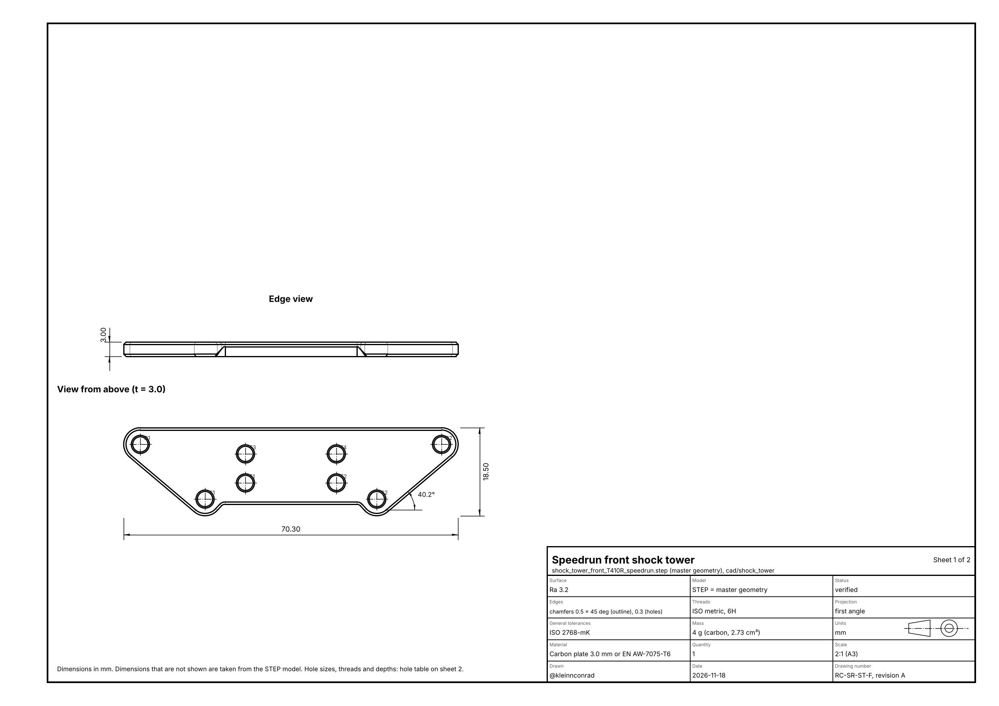
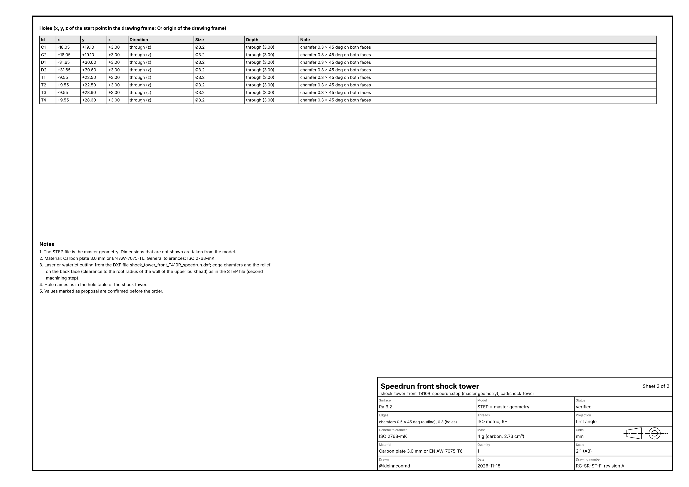
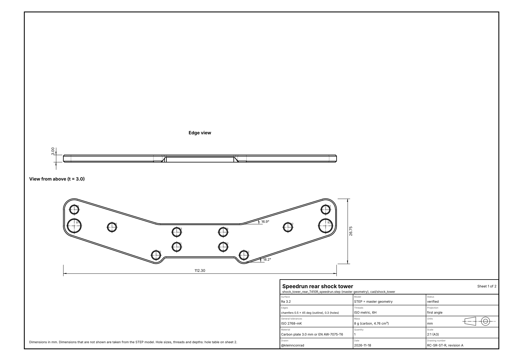
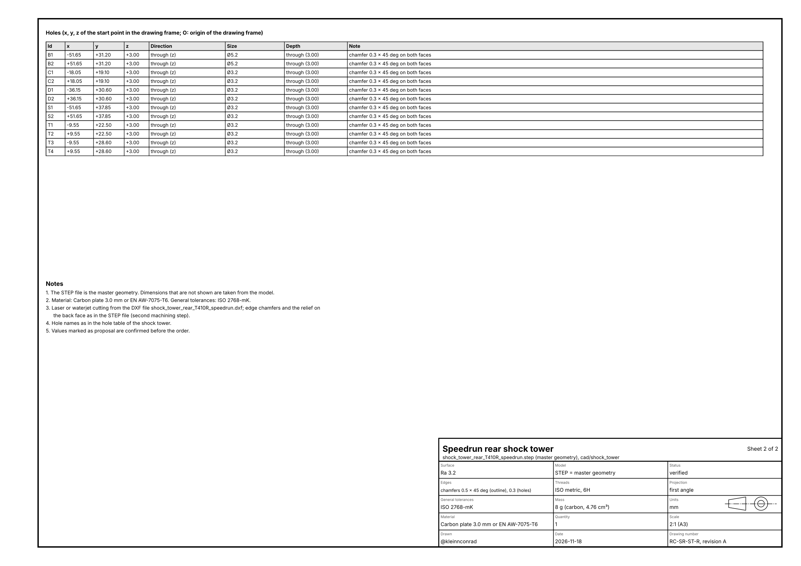

# Speedrun shock towers: technical drawings

## Table of contents
* [Overview](#overview)
* [Speedrun front shock tower](#speedrun-front-shock-tower)
* [Speedrun rear shock tower](#speedrun-rear-shock-tower)
* [Files](#files)
* [Generating the drawings](#generating-the-drawings)

## Overview
* Technical drawings for manufacturing. The views and sections are projected from the STEP files (hidden line removal); the hole table is read from the STEP files.
* The STEP file is the master geometry. Dimensions that are not shown on the drawing are taken from the model.
* Format: A3 landscape, first angle projection, scale per part (title block). The PDF files are for printing and for the order, the PNG files show the sheets on this page.
* Description, sources and status of the parts: [CAD readme](../readme.md#speedrun-shock-towers).
* Values marked as proposal on the drawings (fits, materials to be defined) are confirmed before the order.
* This page is generated by `scripts/cad/generate_technical_drawings.py`.

## Speedrun front shock tower
Material: Carbon plate 3.0 mm or EN AW-7075-T6. Quantity: 1. Status: verified. Scale of the views: 2:1. 8 holes in the hole table.

**Sheet 1:** views, main dimensions, labels of the holes



**Sheet 2:** hole table and notes



## Speedrun rear shock tower
Material: Carbon plate 3.0 mm or EN AW-7075-T6. Quantity: 1. Status: verified. Scale of the views: 2:1. 12 holes in the hole table.

**Sheet 1:** views, main dimensions, labels of the holes



**Sheet 2:** hole table and notes



## Files
| File | Content |
|:---|:---|
| `shock_tower_front_T410R_speedrun_technical_drawing.pdf` | Speedrun front shock tower: technical drawing, 2 sheets A3 |
| `shock_tower_front_T410R_speedrun_technical_drawing_sheet_1.png`, `shock_tower_front_T410R_speedrun_technical_drawing_sheet_2.png` | The sheets as images (150 dpi) |
| `shock_tower_front_T410R_speedrun.step` | Master geometry of the part |
| `shock_tower_rear_T410R_speedrun_technical_drawing.pdf` | Speedrun rear shock tower: technical drawing, 2 sheets A3 |
| `shock_tower_rear_T410R_speedrun_technical_drawing_sheet_1.png`, `shock_tower_rear_T410R_speedrun_technical_drawing_sheet_2.png` | The sheets as images (150 dpi) |
| `shock_tower_rear_T410R_speedrun.step` | Master geometry of the part |

## Generating the drawings
The drawings are generated from the STEP files (from the root directory of the repository; packages cadquery and matplotlib). After a change of a part, its generator runs first, then:

```bash
python scripts/cad/generate_technical_drawings.py
```

The option `--part` generates the drawing of one part (keys: `shock_tower_front`, `shock_tower_rear`), the option `--date` sets the date in the title block.
