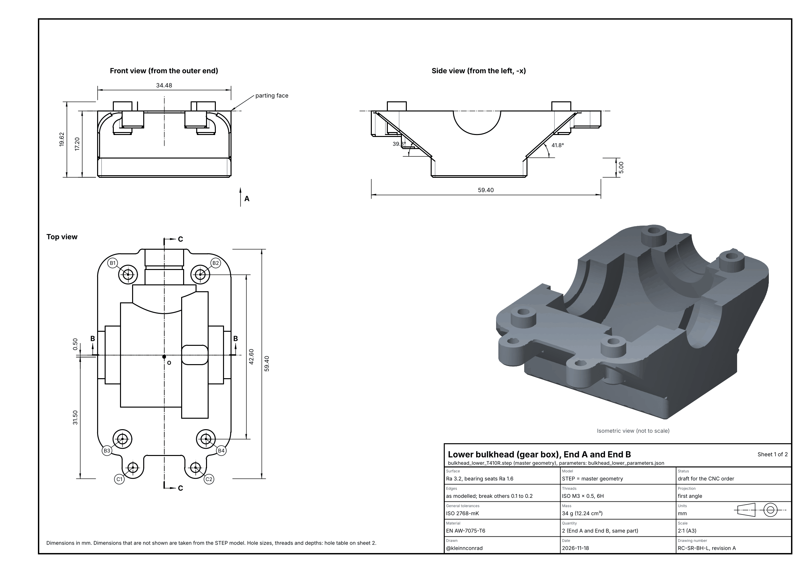
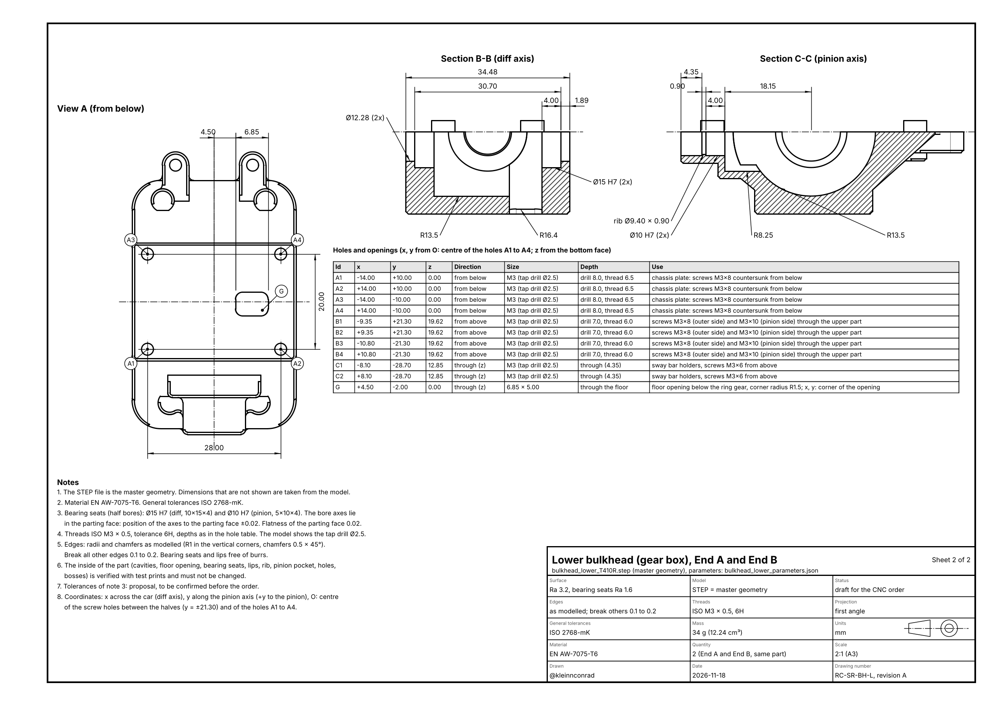
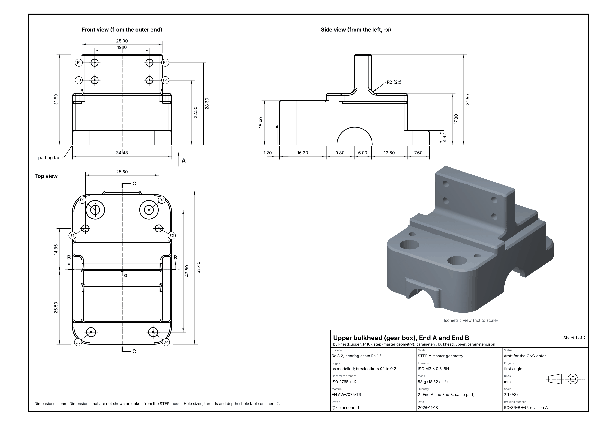
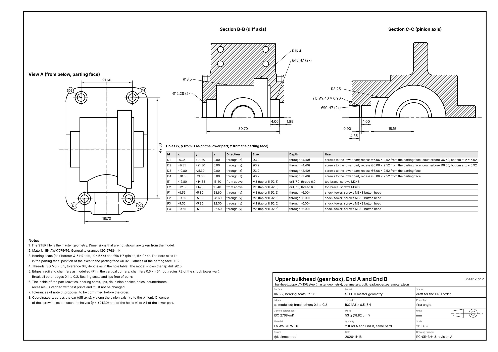

# Bulkheads: technical drawings

## Table of contents
* [Overview](#overview)
* [Lower bulkhead](#lower-bulkhead)
* [Upper bulkhead](#upper-bulkhead)
* [Content of the drawings](#content-of-the-drawings)
* [Tolerances (proposal)](#tolerances-proposal)
* [Files](#files)
* [Generating the drawings](#generating-the-drawings)

## Overview
* Technical drawings of the lower and the upper bulkhead (gear box) for a CNC version in EN AW-7075-T6, 2 pieces each (End A and End B use the same part).
* The ordered bulkheads are MJF 3D prints from nylon PA12 (see the [parts list](../../readme.md#parts-of-the-speedrun-chassis)). The fits, thread tolerances and surface values on the drawings refer to the CNC version in 7075.
* The drawings are projected from the STEP files of the parts (hidden line removal). The hole table is read from the STEP files, the dimensions refer to the parameter files.
* The STEP file is the master geometry. Dimensions that are not shown on the drawing are taken from the model.
* Format: A3 landscape, scale 2:1, first angle projection, 2 sheets per part. The PDF files are for printing and for the order, the PNG files show the sheets on this page.
* Design, interfaces, measurement basis and test prints of the parts: [CAD readme](../../readme.md#lower-bulkhead) (lower bulkhead) and [upper bulkhead](../../readme.md#upper-bulkhead-new-design).

## Lower bulkhead
**Sheet 1:** front view, top view, side view, isometric view



**Sheet 2:** view from below, sections through the diff axis and the pinion axis, holes and openings, notes



## Upper bulkhead
**Sheet 1:** front view, top view, side view, isometric view



**Sheet 2:** view from below (parting face), sections through the diff axis and the pinion axis, holes, notes



## Content of the drawings
| Sheet | Content |
|:---|:---|
| 1 | Front view (from the outer end), top view, side view (from the left), isometric view. Main dimensions, labels of the holes, section lines B-B and C-C, viewing direction A |
| 2 | View A (from below), section B-B through the diff axis (bearing seats, lips, cavities), section C-C through the pinion axis (bearing seats, rib, pinion pocket), hole table, notes |

* Coordinates: x across the car (diff axis), y along the pinion axis (+y toward the pinion), O is the centre of the screw holes between the two halves (y = ±21.30 mm). On the lower part, O is also the centre of the holes A1 to A4 in the bottom face. z is measured from the bottom face (lower part) or from the parting face (upper part).
* Hole table of the lower part: A1 to A4 (threads M3 from below, chassis plate), B1 to B4 (threads M3 in the bosses, screws through the upper part), C1 and C2 (threads M3 through the sway bar tabs), G (floor opening below the ring gear).
* Hole table of the upper part: D1 to D4 (clearance holes Ø3.2 mm for the screws to the lower part, with the recesses for the bosses and the counterbores on the pinion side), E1 and E2 (threads M3 for the top brace), F1 to F4 (threads M3 through the shock tower wall).
* Title block: material, quantity, scale, general tolerances, threads, edges, surface, mass, drawing number and revision.

## Tolerances (proposal)
The following values are on the drawings as a proposal (note 7 of sheet 2). They are confirmed before the order.

| Feature | Value | Reason |
|:---|:---|:---|
| General tolerances | ISO 2768-mK | Usual class for CNC milled parts |
| Bearing seats (half bores) | Ø15 H7 (diff bearings 10x15x4), Ø10 H7 (pinion bearings 5x10x4) | Split housing: the bearings are clamped between the two halves; a tighter fit would deform the bearings |
| Position of the bore axes | In the parting face, ±0.02 mm | The two half bores form a round bore |
| Flatness of the parting face | 0.02 mm | Contact of the two halves without a gap |
| Threads | ISO M3 x 0.5, 6H, depths as in the hole table | Standard thread tolerance |
| Surface | Ra 3.2 µm, bearing seats Ra 1.6 µm | Standard milling quality, finer at the bearings |
| Edges | Radii and chamfers as modelled, other edges broken 0.1 to 0.2 mm, bearing seats and lips free of burrs | See [edges of the outer shape](../../readme.md#design-of-the-lower-bulkhead) |

* The halves are located by the 4 bosses of the lower part (Ø4.86 mm) in the recesses of the upper part (Ø5.06 mm). This clearance allows an offset of the half bores of up to 0.1 mm. If the bearings do not run freely in the assembled bulkhead, the shop can bore the seats with both halves screwed together.

## Files
| File | Content |
|:---|:---|
| `bulkhead_lower_technical_drawing.pdf` | Technical drawing of the lower bulkhead, 2 sheets A3 |
| `bulkhead_lower_technical_drawing_sheet_1.png`, `..._sheet_2.png` | The sheets of the lower bulkhead as images (150 dpi) |
| `bulkhead_upper_technical_drawing.pdf` | Technical drawing of the upper bulkhead, 2 sheets A3 |
| `bulkhead_upper_technical_drawing_sheet_1.png`, `..._sheet_2.png` | The sheets of the upper bulkhead as images (150 dpi) |
| `bulkhead_lower_T410R.step`, `bulkhead_upper_T410R.step` | Master geometry of the parts (see [CAD readme](../../readme.md#lower-bulkhead)) |

## Generating the drawings
The drawings are generated from the STEP files and the parameter files of the parts. After a change of a bulkhead, the generators of the parts run first, then the script of the drawings (from the root directory of the repository; packages cadquery and matplotlib):

```bash
python scripts/cad/generate_bulkhead_technical_drawings.py
```

The option `--date` sets the date in the title block (default: today).
