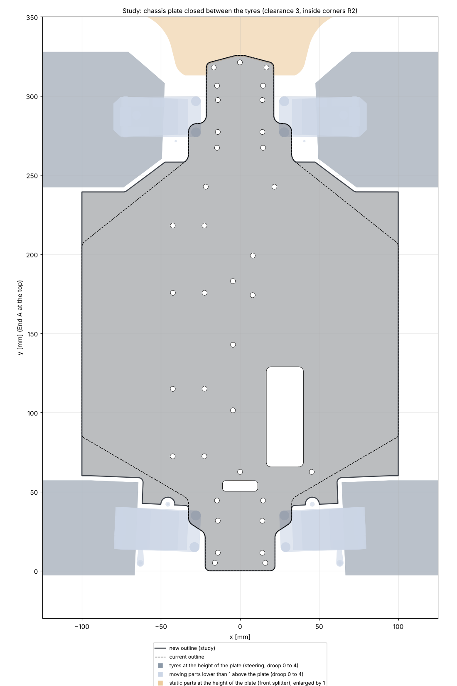
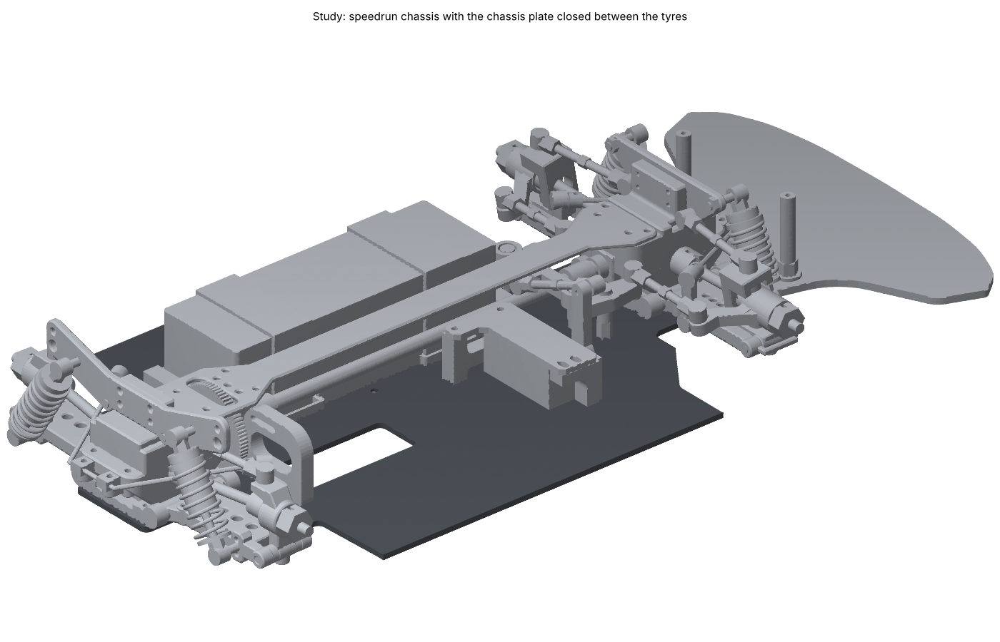

# Study: chassis plate closed between the tyres

## Table of contents
* [Task](#task)
* [Design](#design)
* [Result](#result)
* [Checks](#checks)
* [Notes and open points](#notes-and-open-points)
* [Files](#files)
* [Regenerating the files](#regenerating-the-files)

## Task
Owner (2026-11-21): the open space between the tyres is closed with the speedrun chassis plate, without touching the tyres or getting too close to them; no new material in front of the front tyres and behind the rear tyres, no spike beside the droop bosses of the front wishbones. The study is not part of the build: the speedrun chassis plate (wide, longer motor window) and the assembly are not changed.

## Design
The study keeps the speedrun chassis plate (holes, windows, countersinks, thickness 2.0 mm, aluminium 6082) and only adds material to its outline. The motor window (23.5 x 63.3 mm, longer window for the 3660 motor) and the slot of the spur gear stay open (owner), as all holes; checked in the STEP and the STL file.

* New material only between the rear axle and the front end of the diagonal edges of the current plate (y = 258.24 mm, where the current outline turns into the narrow front end) (owner); there the full width of the current plate (x = ±99.99 mm). In front of it and behind the rear axle the outline is the current one.
* Keep-out zones, each enlarged by the clearance:

| Zone | Model | Clearance |
|:---|:---|:---|
| Tyres | Cylinder Ø64 x 30 mm (width of setup sheet 4, as the tyre check of the front splitter), cut at the height of the plate up to 3.0 mm above its top face; front: turned about the kingpin axis over the free angles of the knuckle (45 degrees with the steering arm toward the outside, 35 degrees toward the middle); front and rear: static and with a droop of 2 and 4 mm; one zone per wheel, extended to the outside of the car (no plate beside the tyres) | 3.0 mm |
| Moving parts | Wishbones, C-hubs, knuckles, kingpins, guide sleeves, hub carriers, spacers, hinge pins, axles, hex hubs, bearings, ball studs on the wishbones; turned about the inner hinge pin from the static position to a droop of 4 mm at the wheel centre (5 positions): each piece that comes lower than 1.0 mm above the top face of the plate | 3.0 mm |
| Static parts | Parts that reach below the top face of the plate (front splitter): exact cross-section at the height of the plate | 1.0 mm |

* The outline is the full width minus the keep-out zones, united with the current outline (the study never removes material of the current plate). The new inside corners have a radius of 2.0 mm (end mill 4 mm).
* The droop of 4 mm and the tyre width of 30 mm are the assumptions of the tyre check of the front splitter.

## Result




| Value | Current plate | Study |
|:---|:---|:---|
| Area of the outline | 42275 mm² | 45828 mm² (+3553 mm², +8 %) |
| Mass (6082) | 217 g | 236 g (+19 g) |
| Full width (199.98 mm) | y = 85 to 207 mm | y = 60 to 240 mm |

* Between the front and the rear tyres the plate has the full width; the diagonal edges of the current plate are filled up to the tyre zones (front: steering fan of the tyre up to the corner of the current outline at y = 258.24 mm, rear: tyre with the toe angle).
* Beside the rear wishbones (in front of the rear axle) the plate follows the zones of the moving parts, with a round notch around each droop boss of the rear wishbones (3.0 mm clearance).

## Checks
Checks of the script (3D distances, the new plate with its holes and windows):

| Check | Result |
|:---|:---|
| Tyres, front (steering -35 to +45 degrees, droop 0 to 4 mm) | Smallest distance 3.82 mm (steering 35 degrees, droop 4 mm) |
| Tyres, rear (droop 0 to 4 mm) | Smallest distance 3.00 mm (droop 4 mm) |
| Moving parts (droop 0 to 4 mm) | As the current plate: the wishbones reach the plate at a droop of 4 mm (0.00 mm front right and rear left, 0.36 and 0.35 mm on the other side); the new material is at least 1.0 mm below them |
| Overlap with the parts of the assembly (static position) | None |

## Notes and open points
* The droop of 4 mm is an assumption (as the tyre check of the front splitter). The wishbones reach the current plate at this droop already (droop stop on the plate); the droop screws set the real droop.
* Roll: the full width (±100 mm) now reaches from y = 60 to 240 mm instead of 85 to 207 mm. At the ride height of 10 mm the edge of the plate touches the ground at a roll angle of approx. 5.7 degrees, as before (same width).
* The body (ZooRacing Hellcat, 190 mm wide) is not modelled: the plate is 199.98 mm wide, as the current plate.
* Tyres are cylinders (no rounded shoulders, no deformation): conservative.
* Not checked: the bump stops and the dampers at full compression (the tyres and the uprights move away from the plate in bump).
* The outline has 134 lines and arcs (DXF); the inside corners of the new material have a radius of 2.0 mm.

## Files
All files are stored in this directory and are generated by `generate_chassis_plate_closed_study.py`.

| File | Content |
|:---|:---|
| `chassis_plate_closed_study.step`, `.stl` | Plate of the study with the holes, windows and countersinks of the current plate (chassis plate coordinates) |
| `chassis_plate_closed_study.dxf` | Outline, windows and holes (layers as the DXF of the speedrun chassis plate) |
| `chassis_plate_closed_study_geometry.json` | Geometry data (format of the speedrun chassis plate): new outline, windows and holes of the current plate |
| `chassis_plate_closed_study_results.json` | Results of the checks, areas and masses |
| `chassis_plate_closed_study_top_view.png` | Top view with the new and the current outline and the keep-out zones |
| `chassis_plate_closed_study_assembly.png` | Assembly picture with the plate of the study |

## Regenerating the files
From the root directory of the repository, after `scripts/cad/generate_speedrun_assembly.py` (approx. 12 min):

```bash
python cad/studies/chassis_plate_closed/generate_chassis_plate_closed_study.py
```

The option `--pictures` renders only the pictures, the option `--outline` writes the geometry data and the DXF again from the STEP file. Requires cadquery, ezdxf and matplotlib.
