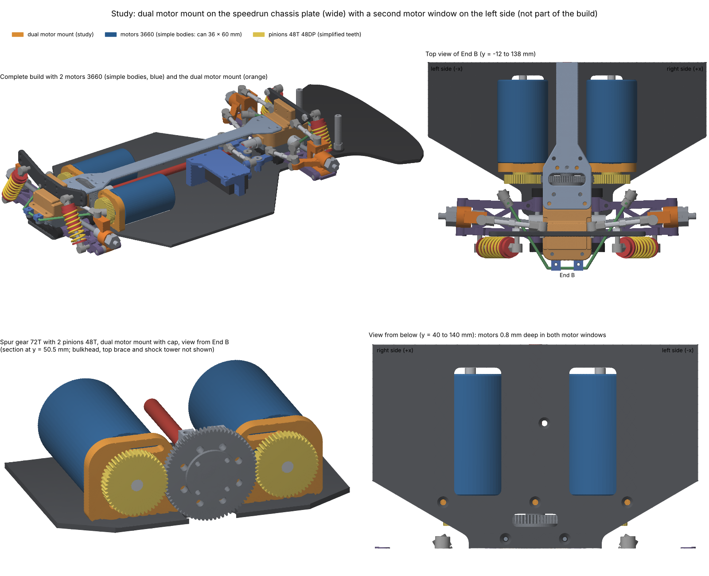
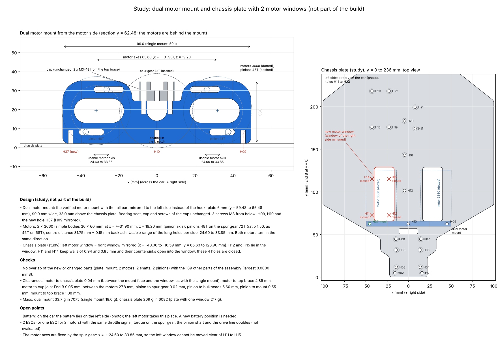
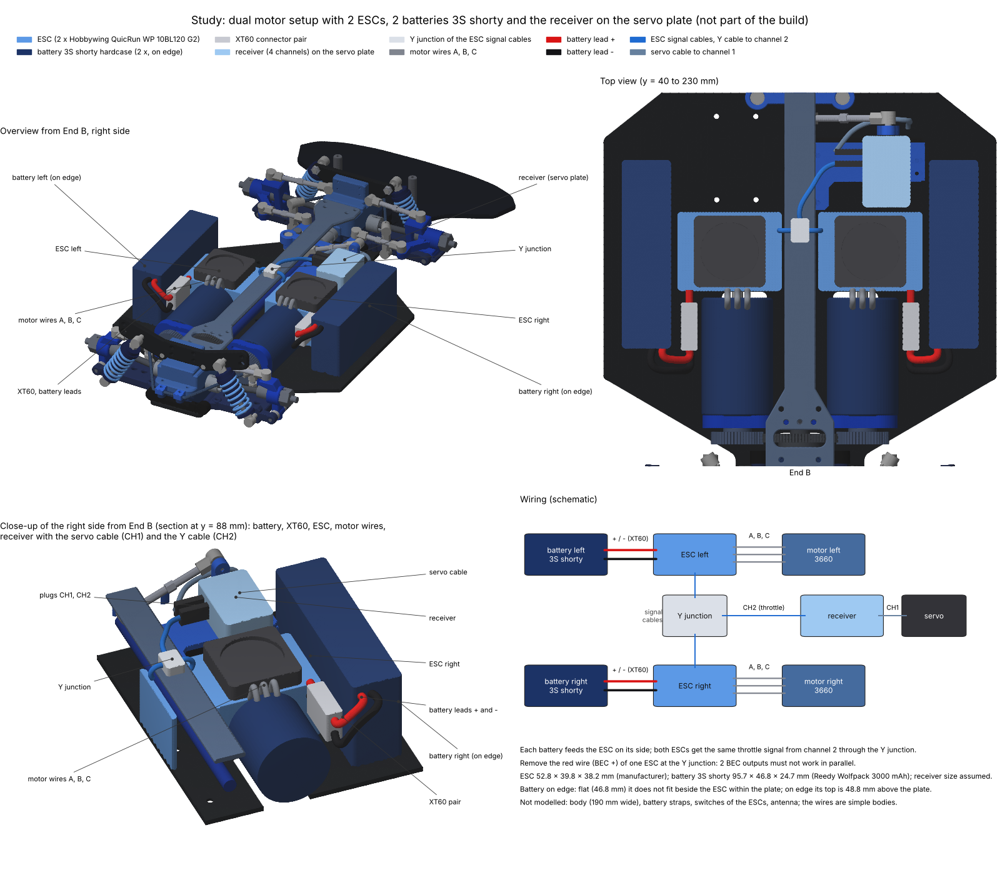
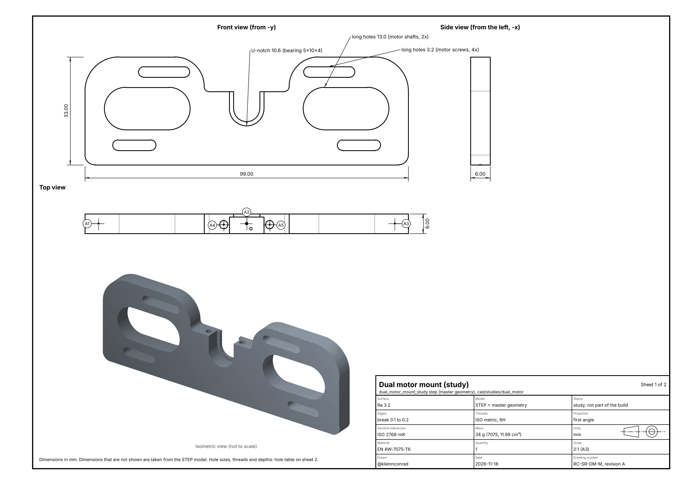
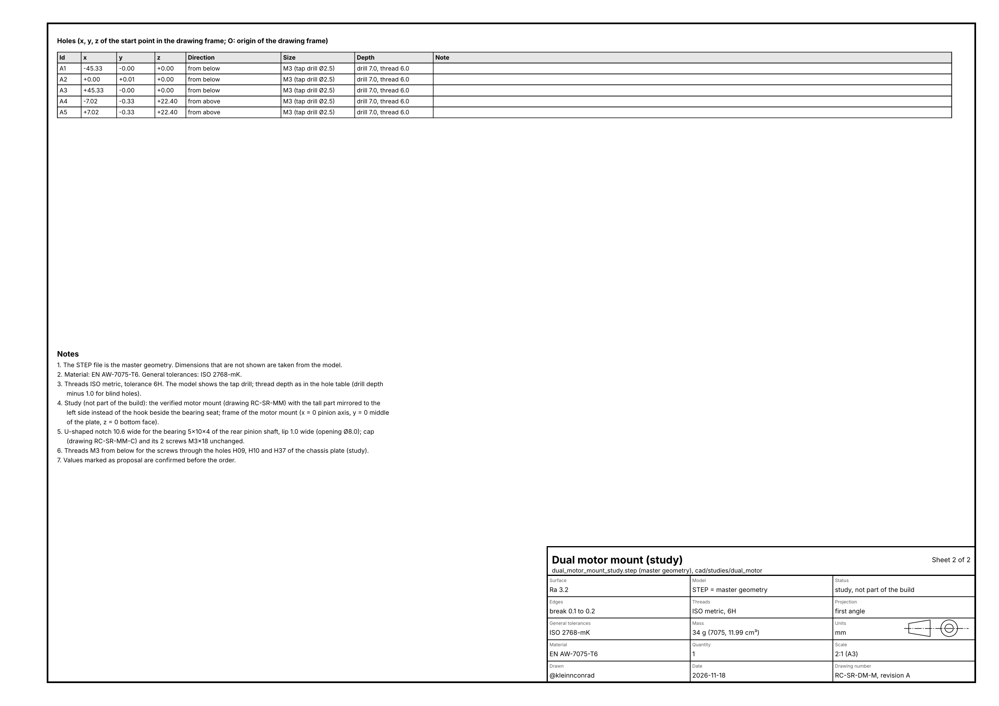
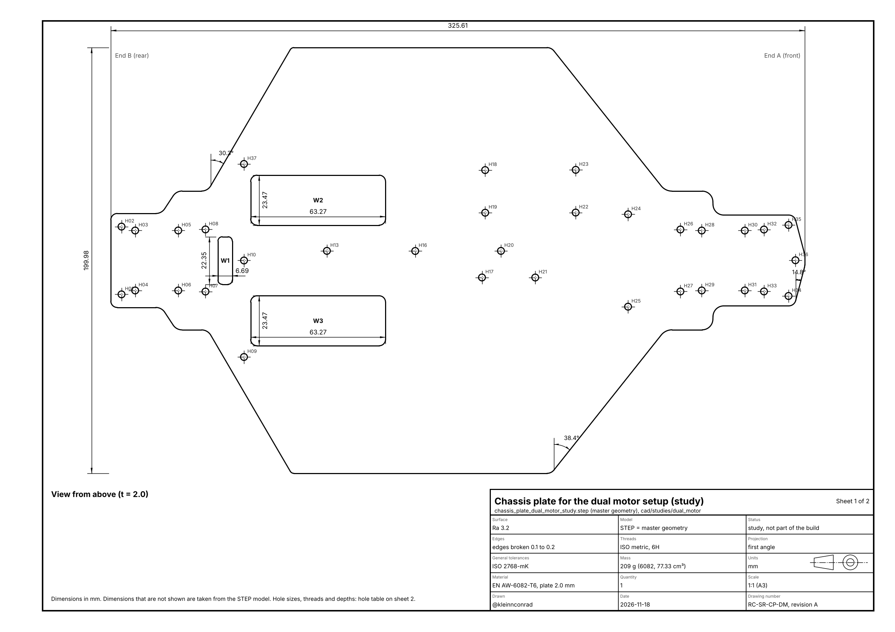
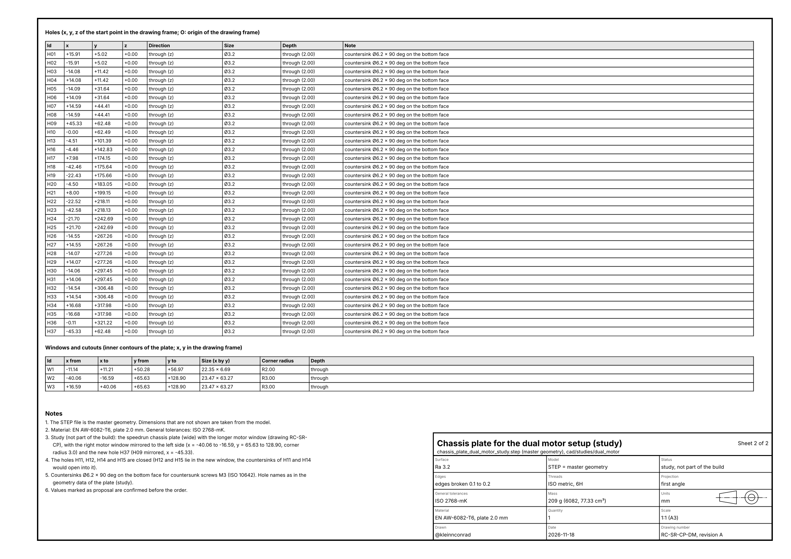

# Dual motor study

Study of a dual motor setup on the speedrun chassis plate (wide): a dual motor mount for 2 motors on the spur gear and a chassis plate with a second motor window on the left side. The study is not part of the build: the parts of the speedrun chassis, the further own parts and the assembly `cad/assembly/speedrun_chassis_T410R.step` are not changed.

## Table of contents
* [Design](#design)
* [Checks](#checks)
* [Electronics layout](#electronics-layout)
* [Open points](#open-points)
* [Technical drawings](#technical-drawings)
* [Files](#files)
* [Regenerating the files](#regenerating-the-files)

## Design




Coordinates as for the chassis plate (x across the car, + right side; y along the car, End B at y = 0; z = 0 bottom face of the chassis plate).

| Part | Model | Source |
|:---|:---|:---|
| Dual motor mount | The verified motor mount (see [centre driveshaft and drive line](../../readme.md#centre-driveshaft-and-drive-line)) with the tall part mirrored to the left side instead of the hook beside the bearing seat. Plate 6.0 mm, y = 59.48 to 65.48 mm, 99.0 mm wide (single mount 59.1 mm), 33.0 mm above the chassis plate. Long holes of the motor shaft and of the motor screws on both sides, as on the verified mount. Bearing seat, cap and the 2 screws M3x18 of the cap unchanged. | Verified motor mount, mirrored |
| Fixing of the mount | 3 screws M3 from below: H09, H10 and the new hole H37 at x = -45.33 mm, y = 62.48 mm (H09 mirrored) | Derived |
| Motors | 2 x 3660 (simple bodies: can 36 x 60 mm, shaft 5 mm), face on the mount, motor axes at x = ±31.90 mm, z = 19.20 mm (height of the pinion axis) | `spec_brushless_combo.yaml` |
| Pinions | 48T 48DP, 6.0 mm face width, centred on the spur gear 72T; ratio 1.50, the same as 45T on 68T (over 130 km/h, `spec_gearing.yaml`); centre distance 31.75 mm plus 0.15 mm backlash; teeth with the simplified profile of the spur gear | Spec, assumed (face width, hub) |
| Usable range of the motor axis | 24.60 to 33.85 mm per side (spur gear plus pinion 93 to 127 teeth), as the verified mount | Verified motor mount |
| Direction of rotation | Both pinions mesh with the same spur gear on opposite sides and both motors face End A: both motors turn in the same direction | Derived |
| Chassis plate (study) | Speedrun chassis plate (wide) with the longer motor window, plus the right motor window mirrored to the left side: x = -40.06 to -16.59 mm, y = 65.63 to 128.90 mm, corner radius 3.0 mm; new hole H37 | Mirrored |
| Closed holes | H12 and H15 lie in the new window. H11 and H14 keep walls of 0.94 mm and 0.85 mm, and their countersinks (6.2 mm on the bottom face) open into the window. These 4 holes are closed in the study plate. | Derived |

## Checks
Results of `generate_dual_motor_study.py`:

| Check | Result |
|:---|:---|
| Interference of the new and changed parts (chassis plate, dual motor mount, 2 motors, 2 motor shafts, 2 pinions) with the 184 other parts of the assembly | 0 mm³ |
| Motor to chassis plate | 0.04 mm (between the face of the mount and the start of the window, the same as with the single mount) |
| Motor to top brace | 4.85 mm |
| Motor to cup joint End B | 9.05 mm |
| Between the motors | 27.8 mm |
| Pinion to spur gear | 0.02 mm (simplified teeth with 0.15 mm backlash on the centre distance) |
| Pinion to bulkheads End B | 5.60 mm |
| Pinion to dual motor mount | 0.55 mm |
| Dual motor mount to top brace | 1.08 mm |
| Mass of the dual motor mount | 33.7 g in 7075 (single mount 18.1 g) |
| Mass of the chassis plate | 209 g in 6082 (plate with one motor window 217 g) |

## Electronics layout


One battery and one ESC per motor; both ESCs get the same throttle signal. Picture only: the parts are simple bodies, they are not in the assembly file.

| Part | Model | Source |
|:---|:---|:---|
| ESC (2 pieces) | Hobbywing QuicRun WP 10BL120 G2, 52.8 x 39.8 x 38.2 mm, with the fan on the top. Crosswise behind each motor (as on the car): x = ±9.5 to ±62.3 mm, y = 129.4 to 169.2 mm. Between the end of the motor and the servo mount there are 43 mm along the car, so the ESC does not fit lengthwise on the right side. | Manufacturer (size) |
| Battery (2 pieces) | 3S shorty hardcase, 95.7 x 46.8 x 24.7 mm (for example Reedy Wolfpack 3S 3000 mAh), on the outer side of each ESC: x = ±66.0 to ±90.7 mm, y = 100.0 to 195.7 mm. On edge, because flat (46.8 mm wide) the battery does not fit beside the ESC within the chassis plate; the top is 48.8 mm above the chassis plate. | Manufacturer (size) |
| Battery leads | Each battery feeds the ESC on its side: leads from the end of the battery (End B side) to an XT60 connector pair beside the motor, from there to the face of the ESC | Simple bodies |
| Motor wires | A, B, C from the face of the ESC over the gap of 3.9 mm to the top of the motor near its end | Simple bodies |
| Receiver | Konect RG4CHWP (4 channels), size 36 x 24 x 14 mm assumed, on the top plate of the servo mount; plugs of channel 1 and 2 on its inner face | Spec (model), assumed (size) |
| Signal cables | Signal cables of both ESCs joined in a Y junction on the top brace, Y cable to channel 2 (throttle); servo cable to channel 1 (steering) | Simple bodies |

* Interference check: the new parts do not overlap with the parts of the assembly and with each other (each wire touches only the parts at its ends).
* Clearances: ESC to servo mount 0.95 mm, ESC to motor shaft 0.92 mm, ESC to top brace 3.57 mm, battery to ESC 3.70 mm, battery to servo mount 4.70 mm, XT60 to motor 2.79 mm.
* BEC: both ESCs have a BEC output. At the Y junction the red wire (BEC +) of one ESC is removed, so that the 2 BEC outputs do not work in parallel.
* Not modelled: body (190 mm wide), battery straps, switches of the ESCs, antenna.

## Open points
* Battery: on the car the battery lies on the left side (photo of the owner, holes H11 to H23). The left motor takes this place. The [electronics layout](#electronics-layout) shows one battery 3S shorty on each outer side, on edge; a fit check with the body and the battery straps is open.
* Electronics layout: the gap of 3.9 mm between the motor and the ESC leaves little room for the motor wires and their connectors; height of the batteries on edge (48.8 mm) under the body.
* The motor axes are fixed by the spur gear (x = ±24.60 to 33.85 mm). The left motor window can therefore not be moved clear of the holes H11, H12, H14 and H15.
* Electronics: 2 ESCs (or one ESC for 2 motors) with the same throttle signal; synchronisation of 2 sensorless motors on one spur gear.
* Load: at full power of both motors, the torque on the spur gear, the rear pinion shaft and the drive line doubles (not evaluated).
* The motors, the pinions (face width, hub) and the gaps are simple bodies or assumptions.

## Technical drawings
Technical drawings of the 2 parts of the study for a later order (A3, first angle projection; the STEP file is the master geometry, dimensions that are not shown are taken from the model). The views are projected from the STEP files, the hole table is read from them. The cap of the mount is unchanged: drawing in [`cad/generic_parts/motor_mount`](../../generic_parts/motor_mount/readme.md).

**Dual motor mount (study)**, EN AW-7075-T6, scale 2:1. Sheet 1: views, main dimensions, callouts of the U-notch and the long holes, labels of the holes. Sheet 2: hole table (threads M3 from below for H09, H10 and H37, threads M3 from above for the screws of the cap) and notes.





**Chassis plate for the dual motor setup (study)**, EN AW-6082-T6, plate 2.0 mm, scale 1:1. Sheet 1: view from above with the 2 motor windows and the hole names (H11, H12, H14 and H15 closed, H37 new). Sheet 2: hole table with the countersinks and notes.





## Files
| File | Content |
|:---|:---|
| `dual_motor_mount_study.step`, `.stl` | Dual motor mount in the part coordinates of the motor mount (x = 0 pinion axis, y = 0 middle of the plate of the mount, z = 0 bottom face of the mount) |
| `chassis_plate_dual_motor_study.step`, `.stl` | Chassis plate (study) in the coordinates of the chassis plate |
| `chassis_plate_dual_motor_study_geometry.json` | Geometry data of the chassis plate (study): outline, cutouts, holes, thickness and countersink parameters |
| `dual_motor_study_assembly.step` | Assembly of the speedrun chassis with the chassis plate (study), the dual motor mount instead of the motor mount, the 2 motors, motor shafts and pinions (STEP AP214, one solid per part, 197 parts) |
| `dual_motor_study_assembly.png` | Complete build, top view of End B, spur gear with the 2 pinions, view from below |
| `dual_motor_study_drawing.png` | Dual motor mount from the motor side, chassis plate (study) with the closed holes and the new hole, check results |
| `dual_motor_study_electronics.png` | Electronics layout: overview, top view, close-up of the right side and the wiring diagram |
| `generate_dual_motor_study.py` | Script that generates the parts, the assembly and the first 2 pictures |
| `dual_motor_mount_study_technical_drawing.pdf`, `..._sheet_1.png`, `..._sheet_2.png` | Technical drawing of the dual motor mount (2 sheets A3) |
| `chassis_plate_dual_motor_study_technical_drawing.pdf`, `..._sheet_1.png`, `..._sheet_2.png` | Technical drawing of the chassis plate (study), 2 sheets A3 |
| `generate_dual_motor_electronics.py` | Script that generates the picture of the electronics layout from the assembly of the study |

## Regenerating the files
The script reads the parameters of the drive line, the geometry data of the speedrun chassis plate with the longer motor window and the assembly `cad/assembly/speedrun_chassis_T410R.step`. Run it after `generate_speedrun_assembly.py`, from the root directory of the repository:

```bash
python cad/studies/dual_motor/generate_dual_motor_study.py
python cad/studies/dual_motor/generate_dual_motor_electronics.py
python scripts/cad/generate_technical_drawings.py --part dual_motor_mount
python scripts/cad/generate_technical_drawings.py --part chassis_plate_dual_motor
```

* Options of `generate_dual_motor_study.py`: `--out <directory>` writes the files to another directory, `--no-picture` skips the pictures.
* `generate_dual_motor_electronics.py` reads `dual_motor_study_assembly.step` of this directory.
* Run time: approx. 1.5 min and 3 min. Requires the packages cadquery and matplotlib.
