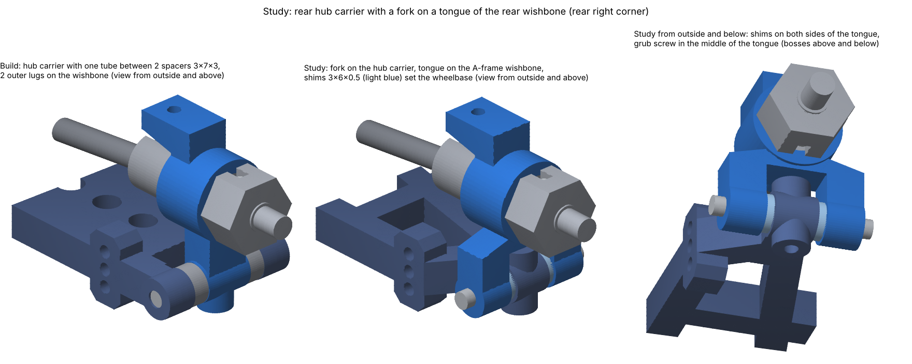
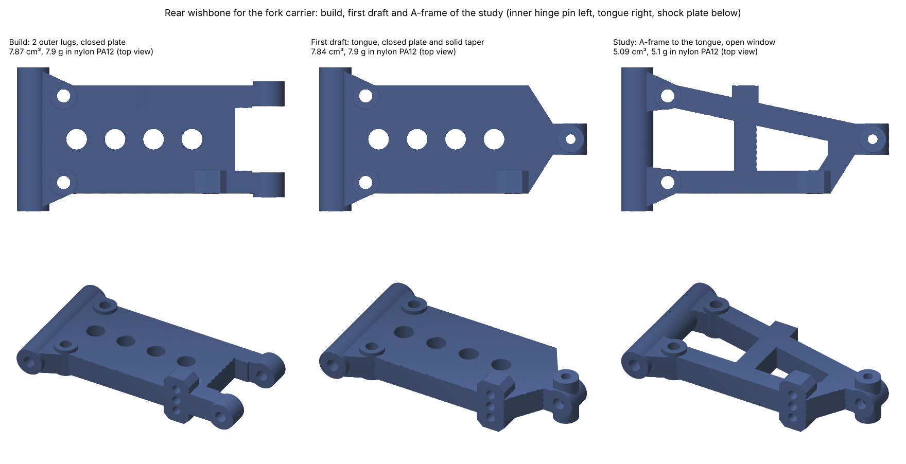

# Rear fork carrier study

Study of the design concept E of the owner for the rear corner (End B): the rear wishbone ends in one tube (tongue) on the outer hinge pin, the rear hub carrier has a fork with 2 lugs that straddle the tongue, and shims between the tongue and the lugs set the wheelbase. The grub screw that fixes the outer hinge pin sits in the middle, in the tongue of the wishbone (owner). Because all forces of the wheel now enter the wishbone at the tongue, the wishbone is a light A-frame instead of the closed plate of the build (owner: the wishbone need not be as massive). The study is not part of the build: the rear wishbone and the rear hub carrier of the build and the assembly `cad/assembly/speedrun_chassis_T410R.step` are not changed.

## Table of contents
* [Design](#design)
* [Rear wishbone as an A-frame](#rear-wishbone-as-an-a-frame)
* [Wheelbase adjustment](#wheelbase-adjustment)
* [Checks](#checks)
* [Open points](#open-points)
* [Files](#files)
* [Regenerating the files](#regenerating-the-files)

## Design



Frame of the outer hinge pin of the rear right arm: origin on the axis of the pin in the middle of the arm, x along the arm (outward), y along the pin (+y toward End A, the front of the car), z up. The hub carrier of the left side is the mirror image; the left wishbone is the same part turned upside down, as in the build.

| Feature | Build | Study |
|:---|:---|:---|
| Wishbone, outer end | 2 lugs Ø7.2 mm, 5.5 mm long, gap 15.6 mm (26.6 mm over the outer faces) | One tube (tongue) Ø7.2 mm, 7.0 mm long, bore Ø3.2 mm, at the end of 2 struts (see [rear wishbone as an A-frame](#rear-wishbone-as-an-a-frame)); the struts end 4.2 mm from the axis of the pin (0.6 mm clear of the lugs of the fork) |
| Fixing of the outer hinge pin | Grub screw M3x4 from below in the tube of the hub carrier (boss Ø6.0 mm); the pin turns in the lugs of the wishbone | Grub screw M3x4 from below in the middle of the tongue (owner). Bosses Ø6.0 mm above and below the tongue (5.7 mm from the axis of the pin, as the bosses of the build) with a through thread M3: on the left side the wishbone is turned upside down, and the screw goes in from below on both sides. The hub carrier turns on the pin |
| Hub carrier on the pin | One tube Ø7.2 mm, 9.2 mm long, bore Ø3.1 mm, between 2 spacers 3x7x3 | Fork: 2 lugs Ø7.2 mm, 6.0 mm long, bore Ø3.1 mm, inner faces 5.0 mm and outer faces 11.0 mm from the middle of the tongue (22.0 mm over the lugs), no grub screw. A bridge 1.5 mm above the upper boss of the tongue (7.2 mm above the axis of the pin) joins the lugs to the column under the bearing tube |
| Hub carrier, rest | – | Unchanged above the column: bearing tube 10 mm with 2 bearings 5x10x4 and the lip, web, top tab, camber stud bore 13.7 mm from the outer face of the bearing tube. In the middle position of the shims the axle has the position of the build |
| Spacers and shims | 2 spacers 3x7x3 | 6 shims 3x6x0.5, 3 on each side of the tongue in the middle position |
| Outer hinge pin | 3x26, fixed in the hub carrier | 3x26, fixed in the tongue: 2.0 mm beyond the outer faces of the lugs in the middle position, 0.5 mm at the end positions of the shims |
| Support of the hub carrier on the pin | 9.2 mm (length of the tube) | 22.0 mm (outer faces of the lugs) |
| Volume (mass in nylon PA12, 1.01 g/cm³) of the hub carrier | 1.94 cm³ (2.0 g) | 2.24 cm³ (2.3 g) |

* The hub carrier rests on the pin over 22.0 mm instead of 9.2 mm: forces that turn the hub carrier about a vertical axis (toe) are taken over a longer base.
* The mass of the hub carrier is given in PA12 for comparison only: the material of the hub carrier is open in the build.

## Rear wishbone as an A-frame


In the build, the wheel forces enter the wishbone at 2 lugs at the sides of the outer end; the closed plate between the rails (6.0 mm high, 4 lightening holes) ties both sides together. With the fork, the forces enter at one point in the middle (the tongue). The wishbone then works as a triangle: 2 struts from the tube on the inner hinge pin to the tongue take the forces along the car (braking, driving) as tension and compression, and the plate between them is not needed.

| Feature | A-frame of the study |
|:---|:---|
| Strut A (side with the shock plate, toward the outer end of the car) | Rail of the build (5.0 mm wide) up to the end of the shock plate (44.5 mm from the inner hinge pin), then 5.0 mm wide to the tongue |
| Strut B (side with the sway ball stud) | 5.0 mm wide, from the shoulder (9.0 mm from the inner hinge pin) straight to the tongue |
| Cross bar | 5.0 mm wide at the sway ball stud (24.9 mm from the inner hinge pin), from strut A to strut B; a pad 6.0 mm long carries the stud at the position of the build (outer face of the rail of the build) |
| Neck | 7.0 mm wide, from 44.0 mm to the tongue; both struts end in it |
| Unchanged from the build | Tube Ø7.2 mm on the inner hinge pin (33.0 mm, bore Ø3.2 mm), shoulders, droop bosses with the threads, shock plate with its 3 holes, hole of the sway ball stud, height 6.0 mm, length 54.3 mm |
| Window | Open between the struts, the cross bar and the tube on the inner hinge pin |

| Wishbone | Volume | Mass in nylon PA12 |
|:---|:---|:---|
| Build: 2 outer lugs, closed plate | 7.87 cm³ | 7.9 g |
| First draft of the study: tongue, closed plate of the build and a solid taper to the tongue | 7.84 cm³ | 7.9 g |
| Study: A-frame | 5.09 cm³ | 5.1 g (35 % less than the build) |

* The struts keep the height of the rails (6.0 mm): the droop screws, the shock ball stud and the sway ball stud need it for their threads, and the bending moment from the damper is largest at the shock plate (strut A, unchanged).
* The damper force acts on strut A at the side; strut A, the neck and the cross bar carry the torsion to the tongue and to strut B.
* Distance of the wishbone to the CVD drive shaft (static): 3.56 mm, the same as the build wishbone.

## Wheelbase adjustment
The pin is fixed in the tongue. Moving shims from one side of the tongue to the other moves the hub carrier and the axle along the outer hinge pin, which runs along the car (turned by the rear toe-in of 2.3 degrees). Each shim moves the axle by 0.5 mm. Both sides get the same shims.

| Shims in front of the tongue | Shims behind the tongue | Shift along the pin | Face of the rear hex hub (y) | Wheelbase |
|:---|:---|:---|:---|:---|
| 0 | 6 | -1.5 mm (toward End B) | 25.87 mm | 259.0 mm |
| 1 | 5 | -1.0 mm | 26.37 mm | 258.5 mm |
| 2 | 4 | -0.5 mm | 26.87 mm | 258.0 mm (T410R: 258 mm) |
| 3 | 3 | 0 (as the build) | 27.37 mm | 257.5 mm |
| 4 | 2 | +0.5 mm | 27.87 mm | 257.0 mm |
| 5 | 1 | +1.0 mm | 28.37 mm | 256.5 mm |
| 6 | 0 | +1.5 mm (toward End A) | 28.87 mm | 256.0 mm |

* Wheelbase: between the axle axes at the outer faces of the hex hubs, as in the [assembly drawing](../../assembly/readme.md) (front axle at y = 284.87 mm).
* The CVD drive shaft follows the axle: length 41.07 mm at -1.5 mm, 41.14 mm in the middle position, 41.27 mm at +1.5 mm; angle to the cross direction in the top view 4.1, 6.2 and 8.3 degrees.

## Checks
Results of `generate_rear_fork_carrier_study.py`:

| Check | Result |
|:---|:---|
| Interference of the study parts (2 wishbones, 2 hub carriers, shims, pins) with the other parts of the assembly and with each other, middle position of the shims | 0 mm³ |
| Hub carrier above the column against the hub carrier of the build | Identical (difference 0 mm³) |
| Distance of the wishbone to the CVD drive shaft (static) | 3.56 mm (build: 3.56 mm) |
| Swing of the hub carrier on the pin relative to the wishbone, -25 to +25 degrees in steps of 2.5 degrees (positive: top of the hub carrier toward the outside of the car) | Free over the whole range. Smallest distance 1.31 mm at 0 degrees, 1.07 mm at ±10 degrees, 0.92 mm at ±15 degrees, 0.77 mm at +25 degrees and 0.35 mm at -25 degrees (bridge to the upper boss and to the neck of the tongue) |
| End positions of the shims (-1.5 and +1.5 mm): hub carrier and axle group moved along the pin, against all other parts and the fixed pin (the CVD drive shaft and the camber link of this corner follow the hub carrier and are left out) | 0 mm³ in both positions |

## Open points
* **Strength of the A-frame:** the struts (5.0 x 6.0 mm), the neck and the tongue (7.0 mm long, wall 2.0 mm around the bore) take all forces of the wheel. In nylon PA12 (MJF) a test print and a load test on the car are needed. Radii at the joints of the struts, at the neck and at the pad are not modelled.
* **Grub screw in the tongue:** the thread M3 is cut into the printed tongue (as in the hub carrier of the build); the pin turns in the bores Ø3.1 mm of the lugs of the hub carrier.
* **Bridge of the fork:** 2.9 mm of material remain between the lower face of the bridge and the bearing seats.
* **Swing range:** the free range of ±25 degrees is to be compared with the suspension travel (not checked).
* **Shims:** shims 3x6x0.5 are to be bought.
* **Camber link:** the wheelbase adjustment moves the camber stud by up to 1.5 mm along the car; the angle of the rod ends is not checked.
* **Front wishbone:** the front corner keeps the C-hub between 2 lugs of the wishbone; the study covers the rear corner only.
* **Build:** if the owner chooses this design, the generators of the running gear and of the wishbones are changed, and the assembly, the camber links and the technical drawings of the wishbones are regenerated.

## Files
| File | Content |
|:---|:---|
| `generate_rear_fork_carrier_study.py` | Script of the study: parts, checks, pictures, STEP and STL files |
| `rear_wishbone_tongue_study.step`, `rear_wishbone_tongue_study.stl` | Rear wishbone of the study (A-frame) in arm coordinates (as the wishbones in `cad/parts/wishbone`); the same part on both sides |
| `rear_hub_carrier_fork_study.step`, `rear_hub_carrier_fork_study.stl` | Rear hub carrier of the study, right side, in chassis plate coordinates (as the files in `cad/running_gear/rear_corner`); the left one is its mirror image |
| `rear_fork_carrier_study_parts.step` | All study parts of both sides in chassis plate coordinates (wishbones, hub carriers, shims, pins) with the colours of the scheme |
| `rear_fork_carrier_study.png` | Rear right corner of the build and of the study |
| `rear_fork_carrier_study_section.png` | Sections at the axis of the outer hinge pin, build and study |
| `rear_fork_carrier_study_wishbones.png` | Rear wishbones: build, first draft and A-frame of the study, with volumes |

## Regenerating the files
The script reads the assembly STEP file and the parameter files of the running gear and of the wishbones (from the root directory of the repository; packages cadquery and matplotlib; approx. 5 min). It runs after `scripts/cad/generate_speedrun_assembly.py`:

```bash
python cad/studies/rear_fork_carrier/generate_rear_fork_carrier_study.py
```

The design values (length of the tongue, shims, length of the lugs, width of the struts, clearances) are defined at the top of the script.
