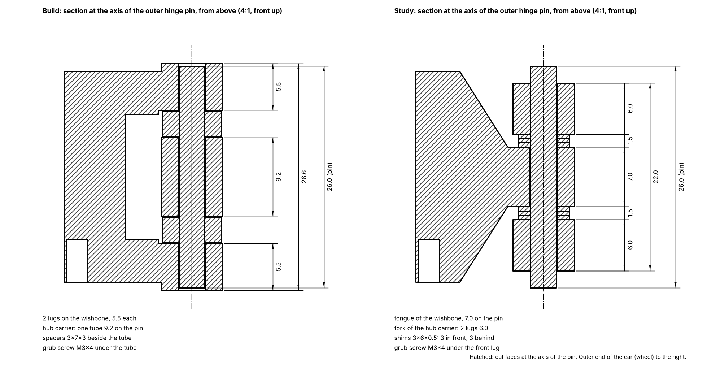

# Rear fork carrier study

Study of the design concept E of the owner for the rear corner (End B): the rear wishbone ends in one tube (tongue) on the outer hinge pin, the rear hub carrier has a fork with 2 lugs that straddle the tongue, and shims between the tongue and the lugs set the wheelbase. The study is not part of the build: the parts of the build and the assembly `cad/assembly/speedrun_chassis_T410R.step` are not changed.

## Table of contents
* [Design](#design)
* [Wheelbase adjustment](#wheelbase-adjustment)
* [Checks](#checks)
* [Open points](#open-points)
* [Files](#files)
* [Regenerating the files](#regenerating-the-files)

## Design




Frame of the outer hinge pin of the rear right arm: origin on the axis of the pin in the middle of the arm, x along the arm (outward), y along the pin (+y toward End A, the front of the car), z up. The left side is the mirror image.

| Feature | Build | Study |
|:---|:---|:---|
| Wishbone, outer end | 2 lugs Ø7.2 mm, 5.5 mm long, gap 15.6 mm (26.6 mm over the outer faces) | One tube (tongue) Ø7.2 mm, 7.0 mm long, bore Ø3.2 mm. From the end of the shock plate (44.5 mm from the inner hinge pin) a plate as high as the rails (6.0 mm) tapers from 24.7 mm to the tongue; the taper ends 4.2 mm from the axis of the pin (0.6 mm clear of the lugs of the fork) |
| Wishbone, rest | – | Unchanged: tube on the inner hinge pin, rails, web with the lightening holes, shock plate with its 3 holes, hole of the sway ball stud, droop bosses, length 54.3 mm |
| Hub carrier on the pin | One tube Ø7.2 mm, 9.2 mm long, bore Ø3.1 mm, between 2 spacers 3x7x3 | Fork: 2 lugs Ø7.2 mm, 6.0 mm long, bore Ø3.1 mm, inner faces 5.0 mm and outer faces 11.0 mm from the middle of the tongue (22.0 mm over the lugs). A bridge 1.0 mm above the tongue joins the lugs to the column under the bearing tube |
| Hub carrier, rest | – | Unchanged above the column: bearing tube 10 mm with 2 bearings 5x10x4 and the lip, web, top tab, camber stud bore 13.7 mm from the outer face of the bearing tube. In the middle position of the shims the axle has the position of the build |
| Fixing of the pin | Grub screw M3x4 from below in the tube of the hub carrier (boss Ø6.0 mm) | Grub screw M3x4 from below in the front lug (boss Ø6.0 mm, as long as the lug). The pin turns in the bore Ø3.2 mm of the tongue |
| Spacers and shims | 2 spacers 3x7x3 | 6 shims 3x6x0.5, 3 on each side of the tongue in the middle position |
| Outer hinge pin | 3x26 | 3x26, 2.0 mm beyond the outer faces of the lugs on both sides |
| Support of the hub carrier on the pin | 9.2 mm (length of the tube) | 22.0 mm (outer faces of the lugs) |
| Volume (mass in nylon PA12, 1.01 g/cm³) of the wishbone | 7.87 cm³ (7.9 g) | 7.74 cm³ (7.8 g) |
| Volume (mass in nylon PA12) of the hub carrier | 1.94 cm³ (2.0 g) | 2.34 cm³ (2.4 g) |

* The hub carrier rests on the pin over 22.0 mm instead of 9.2 mm: forces that turn the hub carrier about a vertical axis (toe) are taken over a longer base.
* The tongue takes all forces of the wishbone on the outer pin over 7.0 mm; in the build the 2 lugs take them over 11.0 mm.
* The mass of the hub carrier is given in PA12 for comparison only: the material of the hub carrier is open in the build.

## Wheelbase adjustment
Moving shims from one side of the tongue to the other moves the hub carrier, the pin and the axle along the outer hinge pin, which runs along the car (turned by the rear toe-in of 2.3 degrees). Each shim moves the axle by 0.5 mm. Both sides get the same shims.

| Shims in front of the tongue | Shims behind the tongue | Shift along the pin | Face of the rear hex hub (y) | Wheelbase |
|:---|:---|:---|:---|:---|
| 0 | 6 | -1.5 mm (toward End B) | 25.87 mm | 259.0 mm |
| 1 | 5 | -1.0 mm | 26.37 mm | 258.5 mm |
| 2 | 4 | -0.5 mm | 26.87 mm | 258.0 mm (T410R: 258 mm) |
| 3 | 3 | 0 (as the build) | 27.37 mm | 257.5 mm |
| 4 | 2 | +0.5 mm | 27.87 mm | 257.0 mm |
| 5 | 1 | +1.0 mm | 28.37 mm | 256.5 mm |
| 6 | 0 | +1.5 mm (toward End A) | 28.87 mm | 256.0 mm |

* Wheelbase: between the axle axes at the outer faces of the hex hubs, as in the [assembly drawing](../../assembly/readme.md) (front axle at y = 284.87 mm).
* The CVD drive shaft follows the axle: length 41.07 mm at -1.5 mm, 41.14 mm in the middle position, 41.27 mm at +1.5 mm; angle to the cross direction in the top view 4.1, 6.2 and 8.3 degrees.

## Checks
Results of `generate_rear_fork_carrier_study.py`:

| Check | Result |
|:---|:---|
| Interference of the study parts (2 wishbones, 2 hub carriers, shims, pins) with the other parts of the assembly and with each other, middle position of the shims | 0 mm³ |
| Hub carrier above the column against the hub carrier of the build | Identical (difference 0 mm³) |
| Swing of the hub carrier on the pin relative to the wishbone, steps of 2.5 degrees (positive: top of the hub carrier toward the outside of the car) | Free from -22.5 to +25.0 degrees. Distance 1.0 mm (bridge above the tongue) from -10 to +25 degrees, 0.67 mm at -15 degrees, 0.10 mm at -22.5 degrees; contact at -25 degrees (the bridge reaches the neck of the tongue) |
| End positions of the shims (-1.5 and +1.5 mm): hub carrier, pin and axle group moved along the pin, against all other parts (the CVD drive shaft and the camber link of this corner follow the hub carrier and are left out) | 0 mm³ in both positions |

## Open points
* **Strength of the tongue:** the tongue (7.0 mm long, wall 2.0 mm around the bore) takes all forces of the wishbone on the outer pin. In nylon PA12 (MJF) a test print and a load test on the car are needed. A longer tongue reduces the adjustment range or needs a longer pin and wider fork.
* **Taper of the wishbone:** the plate tapers from 24.7 mm to 7.0 mm over 5.6 mm. Radii at the neck of the tongue are not modelled.
* **Swing range:** the free range of -22.5 to +25.0 degrees is to be compared with the suspension travel (not checked).
* **Shims:** shims 3x6x0.5 are to be bought. The pin 3x26 stands 2.0 mm beyond the lugs on both sides as in the build; a pin 3x22 ends flush with the lugs.
* **Camber link:** the wheelbase adjustment moves the camber stud by up to 1.5 mm along the car; the angle of the rod ends is not checked.
* **Build:** if the owner chooses this design, the generators of the running gear and of the wishbones are changed, and the assembly, the camber links and the technical drawings of the wishbones are regenerated.

## Files
| File | Content |
|:---|:---|
| `generate_rear_fork_carrier_study.py` | Script of the study: parts, checks, pictures, STEP and STL files |
| `rear_wishbone_tongue_study.step`, `rear_wishbone_tongue_study.stl` | Rear wishbone of the study in arm coordinates (as the wishbones in `cad/parts/wishbone`) |
| `rear_hub_carrier_fork_study.step`, `rear_hub_carrier_fork_study.stl` | Rear hub carrier of the study, right side, in chassis plate coordinates (as `cad/running_gear/rear_corner`); the left one is its mirror image |
| `rear_fork_carrier_study_parts.step` | All study parts of both sides in chassis plate coordinates (wishbones, hub carriers, shims, pins) with the colours of the scheme |
| `rear_fork_carrier_study.png` | Rear right corner of the build and of the study |
| `rear_fork_carrier_study_section.png` | Sections at the axis of the outer hinge pin, build and study |

## Regenerating the files
The script reads the assembly STEP file and the parameter files of the running gear and of the wishbones (from the root directory of the repository; packages cadquery and matplotlib; approx. 5 min). It runs after `scripts/cad/generate_speedrun_assembly.py`:

```bash
python cad/studies/rear_fork_carrier/generate_rear_fork_carrier_study.py
```

The design values of the study (length of the tongue, shims, length of the lugs, clearances) are defined at the top of the script.
