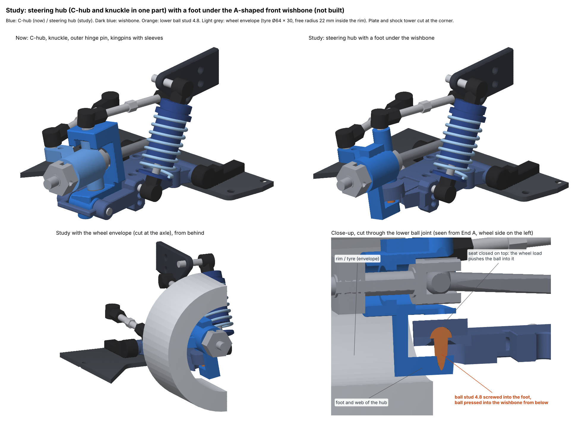
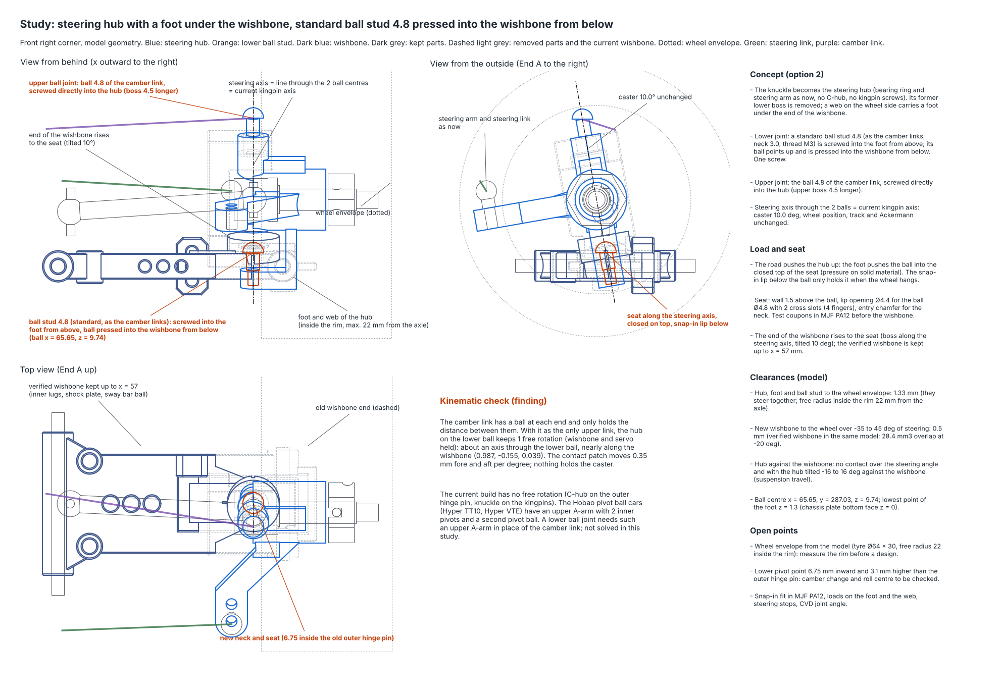

# Study: steering hub with a foot under the front wishbone

Owner (2026-11-23): the C-hub and the steering knuckle become one part (steering hub), mounted to the front wishbone with one screw, free to steer; the wishbone gets the matching shape. The owner chose option 2: a standard ball stud is screwed into a foot of the hub under the end of the wishbone, and its ball is pressed into the wishbone (nylon PA12, MJF) from below. The new parts must not touch the tyre. The study is not part of the build: the parts of the build and the assembly `cad/assembly/speedrun_chassis_T410R.step` are not changed.

**Kinematic finding:** with the camber link as the only upper link, the lower ball joint leaves the hub free to turn about an axis along the wishbone (the caster is not held, see [kinematic check](#kinematic-check)). The design works only with an upper A-arm in place of the camber link; this study does not solve it.

## Table of contents
* [Design](#design)
* [Why ball joints](#why-ball-joints)
* [Kinematic check](#kinematic-check)
* [Lower ball joint and seat](#lower-ball-joint-and-seat)
* [Wheel clearance](#wheel-clearance)
* [Checks](#checks)
* [Open points](#open-points)
* [Files](#files)
* [Regenerating the files](#regenerating-the-files)

## Design




| Feature | Build | Study |
|:---|:---|:---|
| Upright | C-hub on the outer hinge pin 3x26 (caster in the C-hub) and steering knuckle on 2 kingpins with brass sleeves and washers | One steering hub: the knuckle (bearing ring, bearings and steering arm as now) without its lower boss, with the upper boss 4.5 mm longer, a rib on top of the bearing ring, a web on the wheel side (2.5 x 6.0 mm) and a foot under the end of the wishbone (4.0 mm thick) |
| Steering axis | Kingpin axis of the C-hub: x = 65.65 mm at the height of the axle, caster 10 degrees | Line through the centres of the 2 balls, on the same axis: caster 10.0 degrees; wheel position, track and Ackermann unchanged |
| Upper joint | Ball stud 4.8x9 of the camber link through the top sleeve into the knuckle | Ball stud 4.8x9 of the camber link directly in the hub; the ball stays at the same place |
| Lower joint | Socket head screw M3x8 through the lower sleeve and washer into the knuckle | Standard ball stud 4.8 (as the camber links: neck 3.0 mm, ball centre 4.0 mm above the face, thread M3) screwed into the foot from above; the ball points up and is pressed into the wishbone from below. Ball centre x = 65.65, y = 287.03, z = 9.74 mm |
| Front wishbone | 2 outer lugs on the outer hinge pin | The verified wishbone up to x = 57 mm (inner lugs, shock plate, ball stud of the sway bar, droop bosses), then a neck that converges to the seat; the end rises to the seat (boss Ø12 mm along the steering axis, tilted 10 degrees). The arm stays horizontal, the pivot blocks are unchanged |
| Parts no longer needed | – | C-hubs (right and left), outer hinge pins 3x26 with grub screws, kingpin screws M3x8, guide sleeves and washers of the kingpins |

* Kingpin frame of the script: origin on the steering axis at the height of the axle, x toward the wheel along the axle, z along the steering axis. The left side is the mirror image.
* Edges: not treated (concept).

## Why ball joints
* A screw with a sleeve or a bearing is a pure pivot about the steering axis: the hub can steer but cannot tilt against the wishbone. With the camber link at the top the suspension locks: at 5 degrees of wishbone travel the camber link would have to be 2.7 mm shorter. A ball joint allows steering and the movement of the suspension, but it also allows a third rotation, which the camber link does not hold (see [kinematic check](#kinematic-check)).
* With 2 ball joints the caster follows from the positions of the 2 balls (lower ball ahead of the upper ball); lifting the whole wishbone at the front would not change it. Only the end of the wishbone is tilted by 10 degrees, so the seat lies along the steering axis: the hub steers about the axis of the ball stud, the ball only tilts with the suspension. This holds only if the upper ball is held fore and aft, which the camber link does not do.

## Kinematic check
* The hub on the lower ball can turn in 3 directions. With the wishbone and the servo held, the camber link and the steering link each block 1 direction: each link has a ball at both ends and only holds the distance between its 2 balls.
* 1 direction remains free: a rotation about an axis through the lower ball, nearly along the wishbone (axis x, y, z = 0.987, −0.155, 0.039). Per degree the contact patch of the tyre moves 0.35 mm fore and aft. Braking forces and bumps turn the hub about this axis until it touches the wishbone; the caster is not held.
* The current build has no free rotation: the C-hub turns only about the outer hinge pin, the knuckle only about the kingpins (2 rotations, 2 links).
* The Hobao cars with pivot ball suspension (Hyper TT10, Hyper VTE) have an upper A-arm with 2 inner pivots and a second pivot ball instead of a camber link. The upper A-arm holds the upper ball fore and aft and therefore the caster.
* Consequence: a lower ball joint (this study or the Hobao principle with the ball in the hub) needs an upper A-arm in place of the camber link, with 2 pivots on the front shock tower. The check is computed by `free_rotation` in the script.

## Lower ball joint and seat
* **Load:** the road pushes the hub up, the spring pushes the wishbone down. With the foot under the end of the wishbone, the foot pushes the ball up into the closed top of the seat (pressure on solid material, wall 1.5 mm above the ball). The snap-in lip below the ball only holds the ball when the wheel hangs.
* **Standard part:** ball studs with a flange or a hex between the ball and the thread cannot pass through a seat from below. With the foot, the flange sits on the foot and only the ball enters the wishbone, so the standard ball stud of the camber links fits.
* **Assembly:** screw the ball stud into the foot (threadlocker), then press the end of the wishbone onto the ball (the ball enters the seat from below).
* **Snap-in fit in MJF PA12:** opening Ø4.4 mm for the ball Ø4.8 mm (0.4 mm smaller), 2 cross slots 0.7 mm wide, so 4 fingers bend instead of a closed ring that stretches; entry chamfer for the tilt of the neck. The print tolerance (approx. ±0.3 mm) is of the same order as the allowance: print test pieces with several openings (for example Ø4.2, 4.4 and 4.6 mm) before the wishbone and choose by test; grease the seat.

## Wheel clearance
* The solid tyre model of the other checks (cylinder Ø64 x 30 mm) contains the parts of the corner that sit inside the rim (C-hub, knuckle, wishbone end, hex hub). The study therefore uses a wheel envelope: a ring from 22.0 mm to 32.0 mm from the axle, x = 67.5 to 97.5 mm (wheel centre x = 82.5 mm). 22.0 mm is the radius that the outer end of the verified wishbone (down to z = 0) uses inside the wheel today.
* Hub, foot, web and ball stud steer together with the wheel: their clearance does not change with the steering angle.
* The wishbone does not steer: the wheel envelope is turned about the steering axis over the free angles of the knuckle (−35 to +45 degrees). The verified wishbone overlaps this envelope by up to 28.4 mm³ (at −20 degrees) although it fits on the car, so the envelope is conservative.

## Checks
Results of `generate_steering_hub_study.py` (`steering_hub_study_results.json`):

| Check | Result |
|:---|:---|
| Caster (line through the 2 balls) | 10.0 degrees |
| Hub, foot and ball stud to the wheel envelope | 1.33 mm |
| New wishbone to the wheel envelope, steering −35 to +45 degrees | 0.5 mm, no overlap (verified wishbone: up to 28.4 mm³ overlap) |
| Hub against the wishbone over the steering angle | No overlap |
| Hub tilted −16 to +16 degrees against the wishbone about the ball (suspension travel), at −35, 0 and +45 degrees of steering | No overlap |
| Ball stud in the seat | No overlap |
| Wishbone and hub to the CVD drive shaft | 3.73 mm and 2.07 mm |
| Wishbone to the chassis plate | 0.60 mm (verified part of the wishbone) |
| Lowest point of the foot | z = 1.3 mm (bottom face of the chassis plate z = 0, ride height 10 mm) |
| Free rotation of the hub about the lower ball (wishbone and servo held) | 1 direction: axis (0.987, −0.155, 0.039), contact patch 0.35 mm fore and aft per degree (current build: none). The design does not hold the caster |

## Open points
* **Upper link:** the camber link does not hold the caster with a lower ball joint (see [kinematic check](#kinematic-check)). An upper A-arm with 2 pivots on the front shock tower and a second ball joint is needed; not designed.
* **Rim:** the wheel envelope is taken from the model. Measure the rim (inner diameter at the inner edge, depth from the inner edge to the hex) before a design.
* **Kinematics:** the lower pivot point lies 6.75 mm further inward and 3.1 mm higher than the outer hinge pin (z = 9.74 instead of 6.6 mm): camber change, roll centre and bump steer to be checked and adjusted with the camber link.
* **Snap-in fit:** test pieces in MJF PA12 before the wishbone; behaviour over time (play, wear).
* **Strength:** the web and the foot carry all wheel loads into the ball joint; material of the hub (PA12 or aluminium) and the thread M3 for the ball stud in the foot (in PA12 a threaded insert) to be decided.
* **Steering stops:** the C-hub no longer limits the steering angle; steering stops and the angle of the CVD joint to be defined.
* **Shape:** the rib on the bearing ring, the web and the neck of the wishbone are first shapes; edges not treated.
* **Build:** if the owner chooses this design, the running gear generator (front corner), the wishbone generator (front wishbone) and the technical drawings are changed, and the assembly is regenerated.

## Files
| File | Content |
|:---|:---|
| `generate_steering_hub_study.py` | Script of the study: parts, checks, sketch, render, STEP and STL files |
| `steering_hub_study_hub_end_a_right.step`, `.stl` | Steering hub of the study, front right, chassis plate coordinates (left: mirror image) |
| `front_wishbone_steering_hub_study_right.step`, `.stl` | Front wishbone of the study, right, chassis plate coordinates (left: mirror image) |
| `steering_hub_study_results.json` | Results of the checks |
| `steering_hub_study_sketch.png` | Front right corner in 3 views with the notes |
| `steering_hub_study_render.png` | Build and study, study with the wheel envelope, cut through the lower ball joint |

## Regenerating the files
The script reads the assembly STEP file and the parameter files of the running gear (from the root directory of the repository; packages cadquery and matplotlib; approx. 1.5 min). It runs after `scripts/cad/generate_speedrun_assembly.py`:

```bash
python cad/studies/steering_hub/generate_steering_hub_study.py
```

The design values (ball stud, gaps, seat, web, foot, wheel envelope, steering and tilt ranges) are defined at the top of the script.
